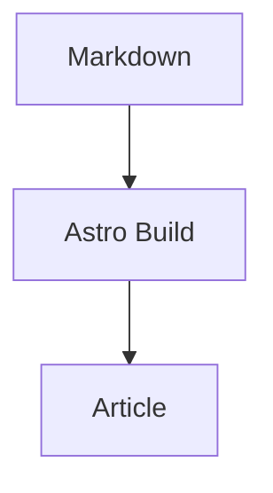

# Wayne’s Desk

个人网站，以全屏 Platinum9 桌面作为入口。首页默认打开 Blog 应用 **Wayne’s Notes**。Astro 在构建时从仓库内的 Markdown 生成博客首页、专题和独立文章页。

## 本地开发

使用 [.node-version](.node-version) 和 [package.json](package.json) 中的 Node.js 与 pnpm 版本。

```sh
pnpm install --frozen-lockfile
pnpm dev --host 127.0.0.1
```

本地验证与 CI 使用同一组命令。

```sh
pnpm format:check
pnpm lint
pnpm check
pnpm build
pnpm test
```

Prettier 统一 Markdown、Astro 和代码格式。`pnpm format` 整理全仓格式，用 `pnpm exec prettier --write <文件>` 整理本次改动。ESLint 检查 JavaScript、TypeScript 和 Astro 代码，`pnpm check` 运行 Astro 的类型检查。 [Prettier 配置](.prettierrc.json) · [ESLint 配置](eslint.config.mjs)

用 `pnpm preview --host 127.0.0.1` 打开构建产物。可以从首页或专题打开文档，也可以直接访问文章地址。

`pnpm test` 使用临时 Markdown 构建站点，验证文章直链、专题链接和草稿过滤。

首页与专题每页最多显示 10 篇文章。窗口底栏的字号与明暗设置保存在当前浏览器。

## Agent 使用

从 Desk 仓库根启动 Bot 或 Agent。根目录指引涵盖工作范围与验证，内容工作流说明笔记更新、按日期发时讯和准备 PR。 [Agent 入口](AGENTS.md) · [内容工作流](docs/content-workflow.md)

## 写作

Markdown 普通段落在源文件中写成一行，编辑器开启软折行，页面随窗口宽度自然换行。修改旧文时，按段落语义整理已有的中文段内折行。空行用于分段，标题、列表、代码围栏和有语义的换行按 Markdown 写法保留。

在 `content/topics/<slug>.md` 创建专题。Frontmatter 需要 `title`、`description` 和非负整数 `order`。专题默认是英文，可以通过 `lang` 标明语言。

在 `content/posts/<slug>/index.md` 添加文章，图片可与 Markdown 放在同一目录并使用相对路径引用。目录名为稳定 URL 的一部分，使用小写字母、数字与连字符。每篇文章的 `topics` 至少列出一个已建专题的文件名，省略 `.md`。下面的文章引用 `content/topics/research-notes.md`。

```yaml
---
title: 文章标题
description: 一句说明
kind: article
lang: zh-CN
publishedAt: '2026-11-18'
topics:
  - research-notes
---
```

`kind` 支持 `article` 和 `note`，`lang` 支持 `zh-CN` 和 `en`。给有实质变化的内容加 `updatedAt`。可选的 `sources` 列表记录 `label`，并可附 `url` 和 `revision`。没有 URL 的来源以文本显示。带 `draft: true` 的条目从文章页和所有索引中排除。推送到公开仓库的草稿源文件仍可读。

用 `mermaid` 代码围栏写图。图随阅读页的明暗和字号切换，宽图可在图框内横向滚动。

````markdown

````

## 桌面与阅读页

[桌面组件](src/platinum/) 提供 Platinum9 风格的窗口、菜单、图标和字体，并适配 Astro 的静态渲染与启动窗口尺寸。[Desk](src/components/Desk.tsx) 注册桌面应用和图标，[SiteLayout](src/layouts/SiteLayout.astro) 提供 Blog 窗口内的页面，[DocumentLayout](src/layouts/DocumentLayout.astro) 提供独立阅读页。导航和控件使用英文。窗口控件与英文栏目标题使用 Chicago Kare，文章标题和正文使用 Inter 和站内加载的 Noto Sans SC。

## 许可

项目代码、测试和自有界面素材采用 MIT。`content/` 内文章与配图的著作权归各自作者，授权由条目另行说明。 [MIT 许可全文](LICENSE)

Chicago Kare 使用 MIT。Inter 和 Noto Sans SC 使用 SIL Open Font License 1.1。许可声明随站点一同构建。 [Chicago Kare](public/licenses/ChicagoKare-MIT.txt) · [Inter](public/licenses/Inter-OFL.txt) · [Noto Sans SC](public/licenses/NotoSansSC-OFL.txt)

Mermaid 使用 MIT。 [Mermaid 许可](public/licenses/Mermaid-MIT.txt)
