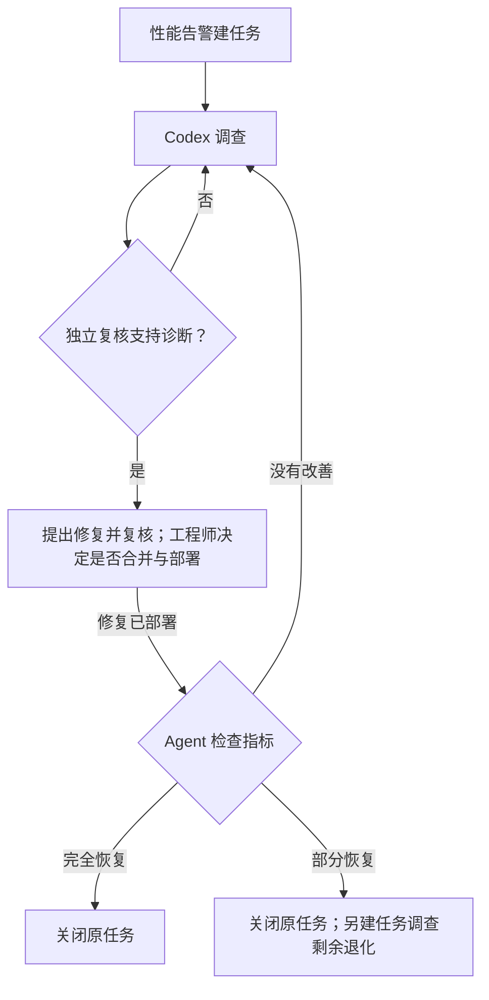
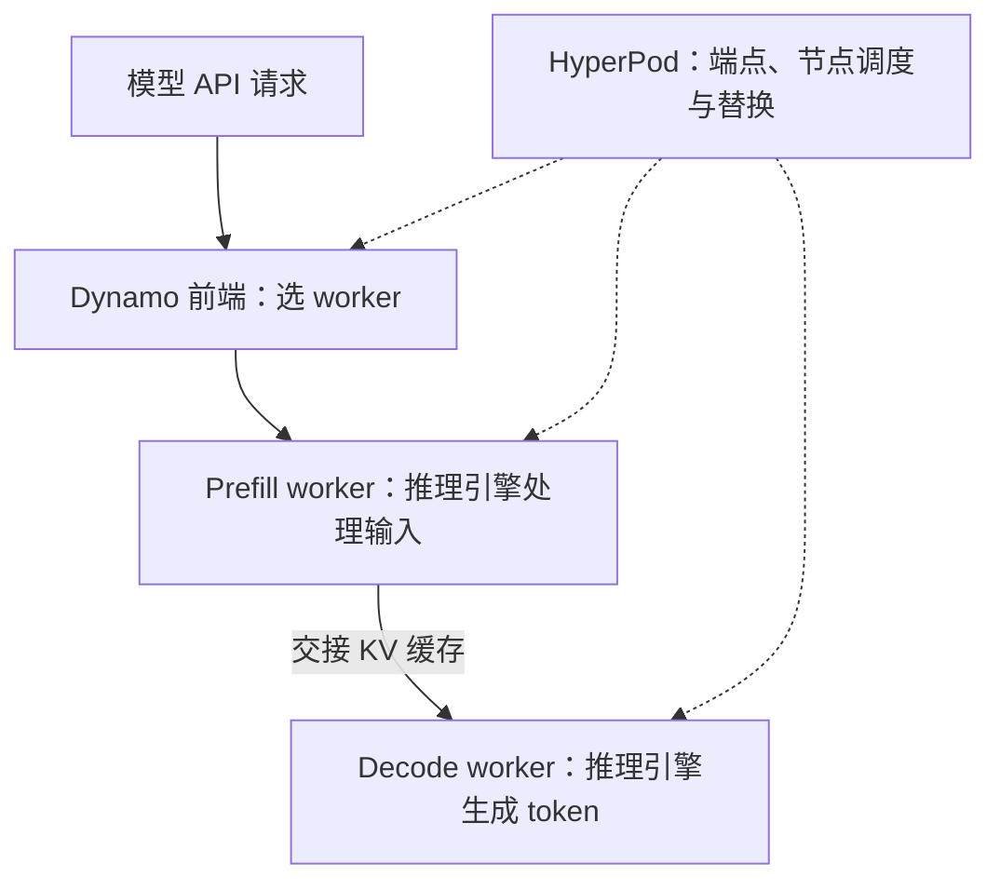

本期日期为 2026 年 11 月 20 日（北京时间）。Gemini Mac、GPT-Live-1.1 开发者公告和 Anthropic 首日收盘属于当天动态；Performance Factory 与 HyperPod 托管 Dynamo 作为近期工程专题。Gemini 4 Neon 只作前情，不算当天新模型。

## 重点拆解｜Performance Factory：从「找出嫌疑」到「验证恢复」

如果 ChatGPT 的首 token 延迟突然上升，告警能告诉你什么时候越过阈值，却不一定告诉你问题什么时候开始，或者为什么变慢。是同一类请求真的比以前更慢，还是流量中原本就慢的请求变多了？两种情况可能拉高同一个指标，却应该查不同的系统。OpenAI 在北京时间 11 月 19 日 16:00 发布的[工程文章](https://openai.com/index/how-openai-performance-factory-keeps-chatgpt-fast/)里，拆解了内部如何把这个问题交给 Codex 驱动的性能回归流程。

### 任务可以等，Agent 不必一直在线

系统把任务状态、证据和进展保存在 Agent 会话之外。调度器周期检查哪些任务能推进，再启动对应的 Codex 回合。遇到待评审、等待 CI 或等待部署，任务挂起并订阅需要的事件，等条件满足再恢复。Agent 以服务身份运行，权限和操作来源可以单独管理。这个设计的重点是：**任务的生命周期长于一次模型会话，等待也不消耗一个常驻执行回合。**

### 独立复核查的是因果，结案查的是指标

调查会话先找出何时开始变慢、哪些请求受到影响，再把变更时间线和日志、追踪、代码关联。另一 Codex 会话专门寻找反例：未接触可疑变更的请求是否也退化？回滚后指标是否恢复？诊断通过后才进入修复提案阶段；修复方案也有复核，以免把性能问题换成另一个故障。最终是否合并和部署仍由工程师决定。

**怎么读数字：** OpenAI 报告三个多月追踪了 **1,700 多次调查**、定位了 **600 多个案例**的根因，但未把后者称为成功修复次数。另一次人工复核覆盖了 100 条根因建议，其中 70% 被评为准确；这是独立的质量检查，不能拿它当所有调查的准确率。原文还把调查能力和交接质量分开评估：前者用历史事故回放且遮掉答案，后者用已保存任务检查报告是否足以让工程师继续接手。真正值得关注的是整体恢复时间、错误归因和工程师投入，而不是多开了多少任务或 PR。

## 11 月 20 日动态

### Gemini for Mac：后台能做事，授权仍由用户决定

北京时间 01:00，[Google 发布 Mac 版 Gemini 的 Computer Use 公告](https://blog.google/innovation-and-ai/products/gemini-app/computer-use-mac/)。一个典型场景是从本地 PDF 提取表格数据，再在网页里填写报价草稿。过去让 Agent 操作你的桌面，常意味着把前台窗口和鼠标交出去；这次 Google 把 Agent 放在独立后台窗口里，用户可以继续用主屏幕和光标。功能先向美国英语用户逐步推出，面向年满 18 岁、符合条件的个人 Google AI Plus、Pro、Ultra 账号，要求 Apple Silicon 和 macOS 15 或更新版本。

**后台执行不等于安全边界。** 这里至少有三层：独立窗口减少和前台的人机冲突；按应用授权决定 Agent 可以操作哪里；关键动作审批、实时预览和暂停决定用户何时介入。允许访问一个邮件应用，并不等于允许它发送任何邮件。独立窗口也不等于独立虚拟机，公告没有说明更底层的隔离实现，不能从 UI 表现推断进程、文件系统或网络已经隔离。评估实用性时，除了跑通顺利流程，还要看登录弹窗、文件选择、权限撤回和重复提交等中断场景能否安全处理。

**Neon 是另一条产品线。** [Gemini 4 Neon](https://blog.google/innovation-and-ai/models-and-research/gemini-models/introducing-gemini-4-neon/)在北京时间 11 月 19 日 05:00 发布，[模型卡](https://deepmind.google/models/model-cards/gemini-4-neon/)提供四档推理预算。预算是延迟、成本和任务成功率的可调权衡，不是 Mac 版 Computer Use 的权限档位，也没有证据表明后台功能由 Neon 驱动。[Google 的评测方法](https://storage.googleapis.com/deepmind-media/gemini/gemini_4_neon_model_evaluation.pdf)提供了一个有用的对照：同一个 Neon，在 mini-SWE 与 Antigravity CLI 1.5.9 上的 SWE-sweep 子任务加权奖励分别为 12.8% 与 39.0%。由于工具、执行方式等并未只改变一个变量，不能把差异全部归给模型，或归给某个单独功能。

### GPT-Live-1.1：让语音会话和后台任务各按自己的节奏运行

北京时间 12:12，[OpenAI 开发者公告](https://community.openai.com/t/gpt-live-1-1-has-arrived-in-the-api/1418537)确认模型 `gpt-live-1.1` 已可接入 API；它此前已用于 ChatGPT Plus 和 Pro 的语音。官方称这一版改善了多语言发音和口音一致性，以及字母、数字等细节的识别。对客服或语音表单来说，念错一个订单号比声音不够自然更影响业务，所以这类提升要用字段是否准确来测，而不是只让人评价听感。

**语音和后台工作分开。** 语音模型可以边说边听，也可以委派较复杂的工作给后端模型；这允许语音交互继续，但不保证后端动作立刻完成。比如用户口述订单号后要求查物流，系统要区分「听清号码」「正在查询」「查到结果」三个阶段。网络重试、工具超时或用户改口时，尤其要防止把旧工具结果当成新问题的答案。

**待机和断线也不同。** [会话文档](https://developers.openai.com/api/docs/guides/live-conversations#configure-standby)说明，两代 GPT-Live 都可设置 5 至 60 秒的空闲阈值；进入待机后 WebRTC 和会话 ID 保留，检测到讲话再恢复推理。麦克风轨道需要保持活动，待机不是关闭麦克风。官方还提示，恢复后第一句短话可能响应更慢。公告列出的活跃费率为每分钟 0.05 美元，待机为 0.02 美元，后台模型和工具另计。例如 10 分钟通话有 5 分钟实际处于待机，语音会话部分约为 0.35 美元，而不是全活跃的 0.50 美元；能否省到这笔钱取决于真实待机时长，不能把所有静默直接算作待机。实际评估应一起记录误唤醒、漏唤醒、首句恢复时延和字段准确率。

### Anthropic 上市：首日涨幅和公司融资是两回事

[Nasdaq](https://www.nasdaq.com/newsroom/anthropic-marks-ipo-at-nasdaq)确认 Anthropic（ANT）于美东 11 月 19 日开始交易；对应北京时间 20 日 05:00 的首日收盘，[Reuters 报道](https://www.reuters.com/legal/transactional/view-anthropic-set-soar-debut-will-ai-peers-follow-2026-11-19/)为 **97.17 美元**，较[发行价](https://www.anthropic.com/news/anthropic-prices-initial-public-offering) **83 美元**高约 **17.1%**。这是相对发行价，不是相对首笔成交价，也不是公司融资额增加了 17.1%。首日收盘是二级市场给出的价格；IPO 的资金流向由发行时出售的股份和价格决定。

**发行规模不等于公司收到的现金。** 定价公告列出约 9.8 亿股，其中约 9.56 亿股由 Anthropic 发行，约 2,365 万股由原股东出售。按每股 83 美元，不含超额配售，整笔发行的总额约 **813.4 亿美元**；其中公司发行股份对应的毛额约 **793.8 亿美元**，其余约 **19.6 亿美元**对应原股东出售。公司并不获得原股东出售的款项；[最终招股书](https://www.sec.gov/Archives/edgar/data/2130357/000162828026074944/anthropicpbc-424b4.htm)列出的基础发行公司所得约为 788.4 亿美元，已扣承销费用，但未扣其他发行开支。上述数字是基础发行口径，并非包含超额配售和同期私募的全部融资。

**产业意义在上市后的可观测性。** 过去容易用融资规模、估值或发布热度替代经营信息。上市后，定期报告能更连续地反映收入增长、利润与现金流之间是否同步。例如招股书披露，Anthropic 在 2026 年前九个月实现约 332 亿美元收入，同时仍录得约 13 亿美元 GAAP 营业亏损。收入规模不能代替盈利能力；多年期算力采购和租赁承诺也不等于当季已经支付的现金。首日价格能描述市场反应，但不能单独证明模型能力、收入质量或推理成本改善。

## 近期背景｜AWS 托管 Dynamo：托管了集群运维，没替你决定推理拓扑

[AWS 上线公告](https://aws.amazon.com/blogs/machine-learning/managed-nvidia-dynamo-on-amazon-sagemaker-hyperpod-inference/)标注 11 月 17 日，[技术回顾](https://aws.amazon.com/blogs/machine-learning/amazon-sagemaker-inference-2026-launches-in-review-part-2/)标注 11 月 19 日。后者是年度回顾，不是再次上线。跨节点分片和 Prefill/Decode 分离是两个不同维度：前者把一个模型副本的权重和计算铺到多机，解决单机放不下的问题；后者把不同请求阶段放进独立 GPU 池，两池各自有模型权重，跨池传的是 KV 状态。部署时需要把三个工作分开：引擎计算 token，Dynamo 编排请求和 worker，HyperPod 管节点、网络和端点。Dynamo 不是替代 SGLang、vLLM 或 TensorRT-LLM 的模型引擎。

### 走一遍请求，才看得清三层的边界

Prefill 消化输入并生成 KV 缓存，Decode 使用这些状态持续生成 token。聚合部署让同一 worker 做两段；分离部署通过独立 worker 池调节两段的容量，但必须传输 KV 状态。请求有相同前缀时，Dynamo 的 KV-aware 路由可以优先选有重叠缓存的 worker；这与 Kubernetes 把 worker 放到哪组节点不是同一个问题。

**托管的是部署机制，仍有配置取舍。** 在 EKS 编排的 HyperPod 上，正常入口是给 `InferenceEndpointConfig` 增加 `dynamoSpec`，由推理控制器生成 Dynamo 的部署图并衔接负载均衡、TLS 和伸缩。若直接管理 `DynamoGraphDeployment`，AWS 仍负责插件安装升级，但端点和扩缩容等要自行配置。两种路径都要选择模型、引擎、聚合或分离、worker 规模及并行度。[部署文档](https://docs.aws.amazon.com/sagemaker/latest/dg/sagemaker-hyperpod-model-deployment-dynamo.html)还有一条容易漏掉的限制：**实例支持 EFA，不等于具体推理引擎的跨池 KV 传输会走 EFA。** 例如文档中的 SGLang 路径用 TCP；不应把硬件能力直接写成应用层已经使用的传输路径。

**分离为何不一定更快。** 长输入时，独立 Prefill 池能减轻输入计算对 Decode 的干扰，但跨池拷贝会新增时间和带宽开销。若提示词很短、流量低，或 Prefill 和 Decode 池比例不匹配，新增排队和传输可能抵消收益。[AWS 基准](https://aws.amazon.com/blogs/machine-learning/managed-nvidia-dynamo-on-amazon-sagemaker-hyperpod-inference/)报告，在 16 张 H200 上用 TensorRT-LLM 服务 Qwen3-235B-A22B-FP8，输入 4,000、输出 200 token。在 P90 首 token 延迟低于 1 秒、P50 每用户生成速度至少为 50 token/s 的合格点中，分离与聚合的最高吞吐分别为每 GPU 207 和 101 输出 token/s，约 **2.05 倍**。两者对应的并发是 80 和 32，不是同并发的单请求提速，也不能外推到所有模型。另一组跨节点测试使用不同模型和引擎，回答的是分片跨机的额外开销，不能把两组结果相乘。评估自己的服务时，应同时看首 token 延迟、逐 token 延迟、符合目标的单位 GPU 吞吐，以及节点替换后重新接流量所需的时间。
