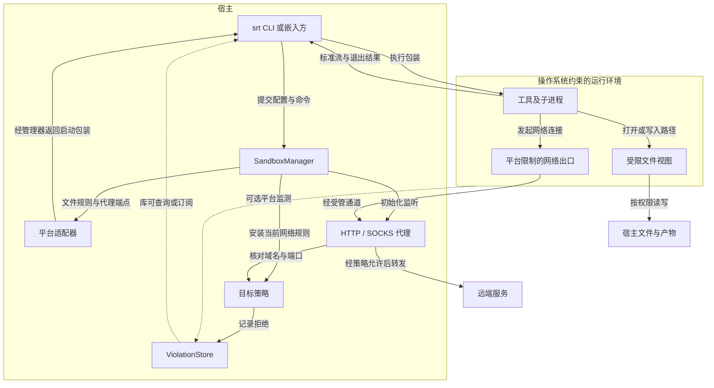
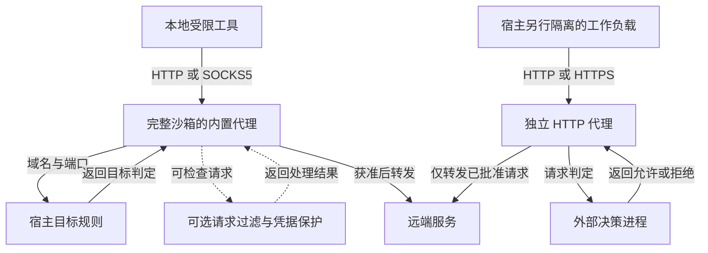
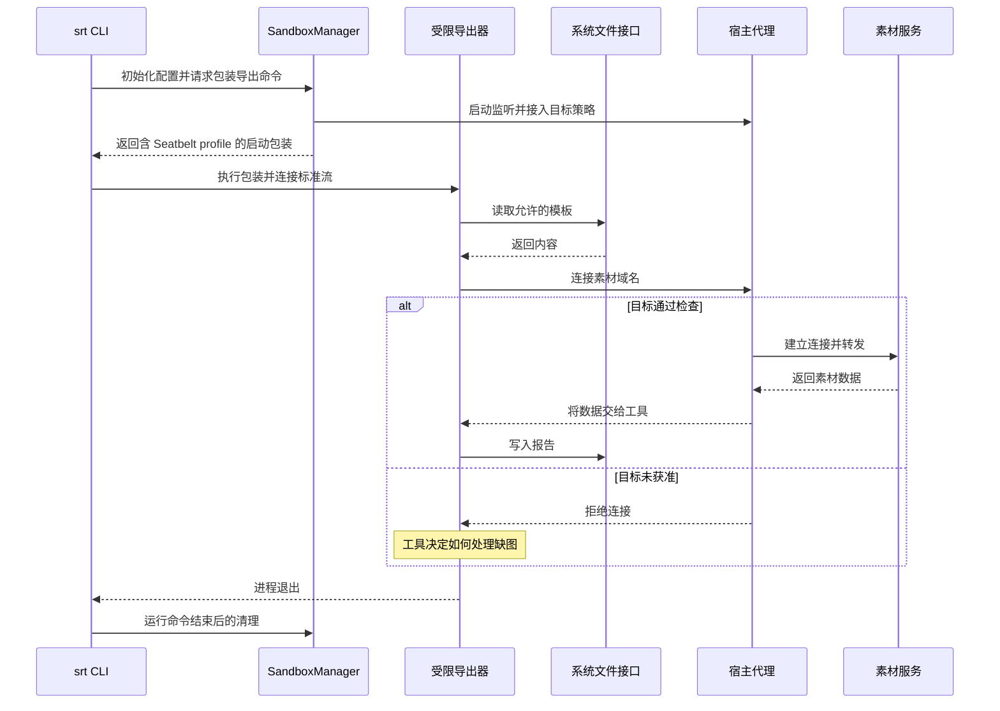

一个桌面 Agent 要运行本地文档导出器。导出器需要读模板、写报告、向公司的素材服务取图，还会启动一个排版子进程。产品知道用户同意了哪项任务，操作系统却只看到以当前用户身份运行的程序。如何让这项授权覆盖整棵进程树，同时让原来的排版工具照常工作？

Anthropic 为 Claude Code 开发的 Sandbox Runtime（`srt`）解决的就是这个问题。调用方交给它一条命令和文件、网络访问规则，拿回命令的标准输出、错误输出和执行结果。工具继续使用原有的文件和网络接口，允许写入的产物留在宿主指定的位置。本地 MCP 服务、构建工具和第三方 CLI 都是这种调用关系。授权范围由集成产品决定，`srt` 负责把它落实到进程启动和资源访问上。[上游定位与设计目标](https://github.com/anthropics/sandbox-runtime/blob/98a4016d27609ed34dd1fb43d23ed6efb6eeeb77/README.md#overview) · [CLI 的命令生命周期](https://github.com/anthropics/sandbox-runtime/blob/98a4016d27609ed34dd1fb43d23ed6efb6eeeb77/src/cli.ts)

## 一份策略如何变成两个执行边界

上游明确把文件与网络并列为两个隔离面。原生沙箱最擅长处理“这个进程能否打开这条路径”，而远端服务通常以域名和端口表达。项目让平台适配器为进程树建立文件视图、限制直接联网，再让留在宿主的代理判断该去哪个远端。这样，子进程和孙进程都受系统边界约束，域名规则也有一个能独立更新的执行位置。[上游的双重隔离设计](https://github.com/anthropics/sandbox-runtime/blob/98a4016d27609ed34dd1fb43d23ed6efb6eeeb77/README.md#dual-isolation-model) · [平台与代理的协调代码](https://github.com/anthropics/sandbox-runtime/blob/98a4016d27609ed34dd1fb43d23ed6efb6eeeb77/src/sandbox/sandbox-manager.ts)

沿图可以辨认两种所有权。`SandboxManager` 准备代理、平台参数和命令包装；进程归启动它的调用方管理。CLI 实现了启动、连接标准流、处理退出等动作。作为库使用时，同一个管理器可以服务多条命令，嵌入方拿到包装后自行启动、等待，每条命令结束后调用清理接口。整个会话结束时再用 `reset()` 停掉共享监听和桥接、释放平台资源。图中的 `ViolationStore` 是宿主内存里的近期事件，文件内容、命令输出和远端响应都不会通过它转交。[库入口与类型](https://github.com/anthropics/sandbox-runtime/blob/98a4016d27609ed34dd1fb43d23ed6efb6eeeb77/src/index.ts) · [库集成示例](https://github.com/anthropics/sandbox-runtime/blob/98a4016d27609ed34dd1fb43d23ed6efb6eeeb77/README.md#as-a-library) · [事件存储](https://github.com/anthropics/sandbox-runtime/blob/98a4016d27609ed34dd1fb43d23ed6efb6eeeb77/src/sandbox/sandbox-violation-store.ts)

### 启动时，平台具体接管了什么

CLI 先解析和校验设置文件。未指定文件且默认文件不存在时可以采用内置配置；显式要求的文件缺失，或读到的文件无效、为空时，CLI 会在创建工具进程前报错。否则，一次配置写入中断就可能让下一次执行悄悄丢掉原有规则。对于读取权限，Linux 和 macOS 的常规起点较宽，可以禁止读取一片目录，再开放其中的项目子目录；对于写入权限，应先给出允许写入的区域，再保护其中不能被修改的文件。仅配置报告输出目录，并不能表达模板之外的文件都不可读。[配置加载器](https://github.com/anthropics/sandbox-runtime/blob/98a4016d27609ed34dd1fb43d23ed6efb6eeeb77/src/utils/config-loader.ts) · [CLI 的失败分支](https://github.com/anthropics/sandbox-runtime/blob/98a4016d27609ed34dd1fb43d23ed6efb6eeeb77/src/cli.ts) · [读写规则与优先级](https://github.com/anthropics/sandbox-runtime/blob/98a4016d27609ed34dd1fb43d23ed6efb6eeeb77/README.md#filesystem-isolation)

| 平台 | 文件和进程的约束 | 开启网络限制时，工具如何到达宿主代理 |
| --- | --- | --- |
| Linux | bubblewrap 用挂载构造进程树可见、可写的文件视图 | 隔离的网络命名空间经桥接和挂入的 Unix socket 访问代理 |
| macOS | sandbox-exec 安装按命令生成的 Seatbelt profile，子进程继承约束 | profile 允许工具连接代理使用的本地端口 |
| Windows（此版本标为 alpha） | srt-win 以专用本地账户和受限令牌运行命令，通过 Windows 访问控制项管理路径 | Windows Filtering Platform 按账户限制出站流量，为代理留下本地端口范围 |

三平台共享的是配置词汇，路径规则的落地对象和生存期各不相同。例如 Linux 挂载跟随进程环境，Windows 的文件访问授权按会话管理。这也是为什么“配置解析成功”和“当前运行的工具已经得到新权限”是两次不同的判断。[Linux 适配](https://github.com/anthropics/sandbox-runtime/blob/98a4016d27609ed34dd1fb43d23ed6efb6eeeb77/src/sandbox/linux-sandbox-utils.ts) · [macOS 适配](https://github.com/anthropics/sandbox-runtime/blob/98a4016d27609ed34dd1fb43d23ed6efb6eeeb77/src/sandbox/macos-sandbox-utils.ts) · [Windows 支持范围](https://github.com/anthropics/sandbox-runtime/blob/98a4016d27609ed34dd1fb43d23ed6efb6eeeb77/README.md#windows-alpha)

### 连接到来时，代理掌握了什么

完整沙箱的内置代理从一个监听端口区分 HTTP 与 SOCKS5，两种协议共用目标策略。策略先匹配明确禁止的域名和端口，再匹配允许项。严格允许列表会拒绝剩余目标；在允许扩展的配置中，才继续查询本次命令的附加允许项或调用宿主的询问回调。应用因而可以对批处理采用固定规则，对有交互的本地工具另行决定未知目标。允许域名后，代理直连目标时还可以按解析出的地址检查限制。是否有权取某个具体素材，仍由远端服务判断。[协议分流](https://github.com/anthropics/sandbox-runtime/blob/98a4016d27609ed34dd1fb43d23ed6efb6eeeb77/src/sandbox/mux-proxy.ts) · [规则判定顺序](https://github.com/anthropics/sandbox-runtime/blob/98a4016d27609ed34dd1fb43d23ed6efb6eeeb77/src/sandbox/sandbox-manager.ts) · [目标地址检查](https://github.com/anthropics/sandbox-runtime/blob/98a4016d27609ed34dd1fb43d23ed6efb6eeeb77/src/sandbox/resolved-address-guard.ts)

宿主还能选用更细的请求过滤和凭据保护。普通 HTTPS 隧道只能让代理按连接目标判断；在显式启用 TLS 终止的适用连接上，代理才看得到具体 HTTP 请求，能够按请求决策。配置了凭据掩码时，支持的来源在工具侧呈现占位值，宿主代理只向获准的目标提供对应凭据。这样做把处理真实凭据和明文请求的责任留给宿主，也让产品承担信任配置和协议兼容的成本。[请求过滤接口](https://github.com/anthropics/sandbox-runtime/blob/98a4016d27609ed34dd1fb43d23ed6efb6eeeb77/src/sandbox/request-filter.ts) · [TLS 终止的边界](https://github.com/anthropics/sandbox-runtime/blob/98a4016d27609ed34dd1fb43d23ed6efb6eeeb77/README.md#tls-termination) · [凭据配置类型](https://github.com/anthropics/sandbox-runtime/blob/98a4016d27609ed34dd1fb43d23ed6efb6eeeb77/src/sandbox/sandbox-config.ts)

两种入口的网络路径可以并排看。虚线表示完整沙箱中按配置启用的请求级处理，图中的“可检查请求”包括普通 HTTP 以及启用 TLS 终止并适用该规则的 HTTPS。

独立入口 `srt proxy` 面向另一种部署。已有 VM 或容器负责运行工具时，宿主可以只复用 HTTP 代理。该模式接管宿主交付的监听端点，请外部决策进程逐请求给出结论，获准才转发。这里没有管理器替宿主启动子进程，也没有文件策略可依赖。两种入口共享 HTTP 转发能力，授权来源与运行环境的提供方各有分工。[独立代理的接口与生命周期](https://github.com/anthropics/sandbox-runtime/blob/98a4016d27609ed34dd1fb43d23ed6efb6eeeb77/src/sandbox/proxy-only.ts)

## 一次导出，三种不同的结果

以下选用 macOS、内置代理和严格允许列表。模板和报告走操作系统文件接口，素材走代理；工具可以自行决定取图失败后是中止还是继续生成报告。

这里有三个结果可分别验收。文件接口决定报告能否写入，代理知道某次连接为何被拒，调用方看到的是导出器如何处理这两件事后给出的退出状态。后者可能是成功，即使报告里少了一张图。代理可把拒绝写入 `SandboxViolationStore`，嵌入方还可以选择开启平台监测；macOS 消费系统沙箱日志，Linux 通过专门的观察器报告部分操作。存储只保留最近 100 条事件供查询或订阅，持久审计和报告完整性要由集成产品另行负责。[CLI 的退出处理](https://github.com/anthropics/sandbox-runtime/blob/98a4016d27609ed34dd1fb43d23ed6efb6eeeb77/src/cli.ts) · [Linux 观察器](https://github.com/anthropics/sandbox-runtime/blob/98a4016d27609ed34dd1fb43d23ed6efb6eeeb77/src/sandbox/linux-violation-monitor.ts) · [事件保留与订阅](https://github.com/anthropics/sandbox-runtime/blob/98a4016d27609ed34dd1fb43d23ed6efb6eeeb77/src/sandbox/sandbox-violation-store.ts)

## 运行中修改策略会发生什么

设想一次批量导出尚未结束，管理员撤回了素材服务的网络授权，又收紧了产物目录。内置代理每次判断新连接都会读取管理器的当前规则，下一次连接便会遇到新的名单。已经建好的连接不能用这个更新追溯撤销。文件访问依赖已安装的 profile、挂载或 Windows 会话授权，运行中的工具仍处在原先的文件环境。要让收紧的路径规则覆盖它，集成方需要结束旧工作负载并以新规则启动；Windows 文件授权变更还要重置并重新初始化会话。[上游对动态配置的说明](https://github.com/anthropics/sandbox-runtime/blob/98a4016d27609ed34dd1fb43d23ed6efb6eeeb77/README.md#L187-L251) · [配置替换与会话清理](https://github.com/anthropics/sandbox-runtime/blob/98a4016d27609ed34dd1fb43d23ed6efb6eeeb77/src/sandbox/sandbox-manager.ts)

这也是把设计迁移到其他产品时，最值得保留的一条判断。若要集成许多会自行开文件、发请求、启动辅助进程的本地工具，应把授权放在它们共享的启动入口，再给每类权限定义生效和撤回的时点。用临时目录和自有素材服务验收时，可以分别检查子进程能否读模板、输出目录之外的测试文件是否保持原状、规则更新后的新连接是否到达服务，以及报告是否包含预期图片。若产品还需要跨机器恢复整段执行，调度、快照和恢复状态属于另一层运行环境职责。[Sandbox Runtime 的隔离模型](https://github.com/anthropics/sandbox-runtime/blob/98a4016d27609ed34dd1fb43d23ed6efb6eeeb77/README.md#how-it-works) · [Agent Substrate 的工作区生命周期](/github/substrate-agent-workspaces/)
