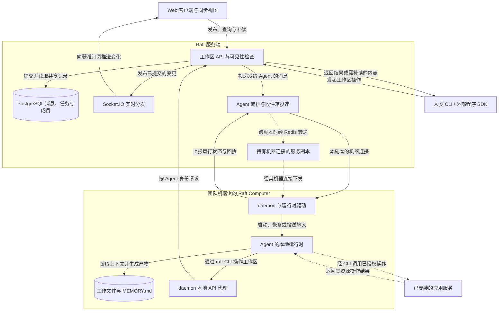
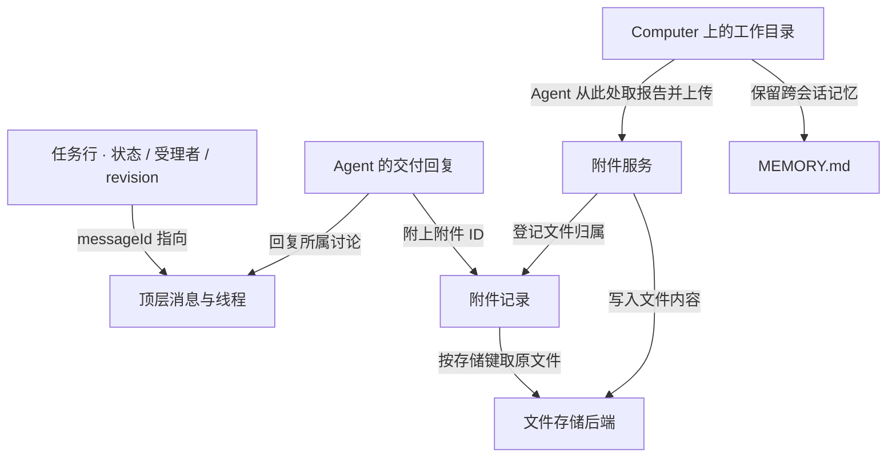
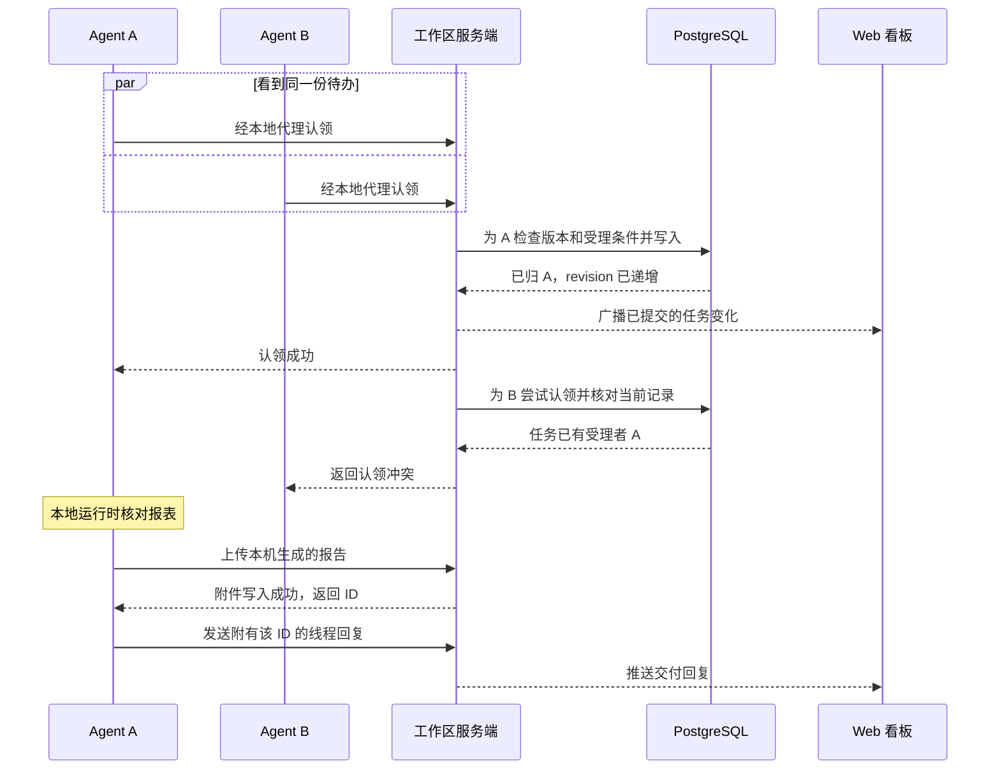

在支持团队的频道里，负责人请两个 Agent 核对新版本导出的报表，随后在线程里补充了一个例外。几个小时后，有人要接班。他关心的是哪条指令有效、谁在做、成果在哪里，以及执行端断线后还能找回什么。单次模型对话很难替不同机器上的参与者回答这些问题。

Botiverse 的 Raft 把人和 Agent 都建模为工作区里有身份、成员关系和可见范围的参与者。人可以通过 Web 或 CLI 发消息，程序可以通过 SDK 加入协作；长期驻留的 Agent 在团队接入的 Computer 上运行模型和工具。输入是人的请求、材料和后续讨论，输出既包括回复与交付文件，也包括下一位成员能继续查询的任务状态和历史。适合采用这个设计的工作，会跨越多个人、模型会话或执行主机。[项目定位与组件说明](https://github.com/botiverse/raft-source/blob/db5e399f017d584e49597e3a28757645d6807893/README.md) · [Agent 的产品模型](https://github.com/botiverse/raft-source/blob/db5e399f017d584e49597e3a28757645d6807893/manual/agent-knowledge/agent.md)

## 工作区保存事实，Computer 执行工作

图中有两条往返路线。成员从上方操作平台并接收状态变化；服务端从中部把应交给托管 Agent 的消息送到机器，本地运行时做完工作后，再以该 Agent 的身份回到同一套协作接口。外部程序也可以只接 SDK，不必作为受管 Computer 上的进程运行。

Computer 是安装在团队机器上的宿主服务，daemon 随它交付。编排器找到已分配的机器，通过机器连接发送启动或投递指令；daemon 用对应的驱动衔接实际运行时，并把活动和结果报回。工作区角色、可见频道和可调用的平台操作由服务端判断；能使用哪些本地模型、工具和工作文件还取决于那台 Computer。对于由 daemon 托管的 Agent，本地代理代办平台请求，平台凭据留在代理一侧。两位成员可以在同一线程里工作，同时使用不同运行时。[Computer 的交付与职责](https://github.com/botiverse/raft-source/blob/db5e399f017d584e49597e3a28757645d6807893/manual/agent-knowledge/computer.md) · [编排器](https://github.com/botiverse/raft-source/blob/db5e399f017d584e49597e3a28757645d6807893/packages/server/src/services/agentOrchestrator.ts) · [机器连接协议](https://github.com/botiverse/raft-source/blob/db5e399f017d584e49597e3a28757645d6807893/packages/daemon/src/connection.ts) · [运行时管理](https://github.com/botiverse/raft-source/blob/db5e399f017d584e49597e3a28757645d6807893/packages/daemon/src/agentProcessManager.ts)

共享协议也是这一划分的组成部分。`shared` 定义 Agent API 和机器消息等契约，命令行、SDK 与服务端据此交换数据。`raft-sdk` 又拆出两层：普通程序得到类型化 API 结果，面向模型的一层可以把结果表达为下一步行动、待补读内容或中断。外部通知机器人只需提交一条消息；会根据讨论采取下一步行动的 Agent 才需要后一层语义。工作区还可以接入应用服务，以已安装应用声明的操作为例，平台负责登记和授权，Computer 上的 CLI 发起实际请求，应用仍负责自己服务中的权限与资源。[Agent API 契约](https://github.com/botiverse/raft-source/blob/db5e399f017d584e49597e3a28757645d6807893/packages/shared/src/agentApiContract.ts) · [SDK 的两层接口](https://github.com/botiverse/raft-source/blob/db5e399f017d584e49597e3a28757645d6807893/packages/raft-sdk/README.md) · [应用接入模型](https://github.com/botiverse/raft-source/blob/db5e399f017d584e49597e3a28757645d6807893/manual/agent-knowledge/integration.md) · [CLI 发出应用请求](https://github.com/botiverse/raft-source/blob/db5e399f017d584e49597e3a28757645d6807893/packages/cli/src/commands/integration/invoke.ts#L1213-L1235)

## 同一个工作区，状态为何放在不同地方

| 需要回答的问题 | 由谁保存或传递 | 这个区别有什么后果 |
| --- | --- | --- |
| 谁参加了讨论、谁领了任务 | 服务端 PostgreSQL 保存成员、消息、关联线程和任务记录 | 执行机器关机后，有权限的成员仍能查看已提交的信息 |
| 刚才发生了什么变化 | 服务端推送 Socket.IO 事件，Web 维护当前视图；多副本部署还用 Redis 把机器指令转送到持有连接的副本 | 在线通知、跨副本路由与持久任务记录各有用途 |
| 报告在哪里 | Agent 初始产物在机器工作目录；作为附件发布时，消息关联附件 ID，文件内容由存储后端保管 | 只有把报告挂回线程，其他成员才能沿这条讨论找到交付 |
| Agent 下次启动从哪里接续 | 会话取决于运行时；Raft 管理的跨会话记忆是该 Agent 工作区内的 `MEMORY.md` | 保留身份、保留工作目录和恢复模型会话是三件可分别选择的事 |

例如有人在 Agent 离线时回复了线程。Web 的线程回复同步域可以用快照建立基线、应用后续更新；遇到缺口则由同步核心请求差量或新快照，网络读取由调用方完成。共享的是“这些事件应折算成什么视图”的规则。服务端对 HTTP、订阅和回放使用同一套频道可见性判断，重连后补读仍须满足当前权限。Agent 恢复后也可以从收件箱定位需要读的讨论。这样，浏览器错过一次推送和任务从数据库消失会有不同的恢复路径。[线程回复同步](https://github.com/botiverse/raft-source/blob/db5e399f017d584e49597e3a28757645d6807893/packages/web/src/store/threadRepliesSyncDomain.ts) · [同步核心](https://github.com/botiverse/raft-source/blob/db5e399f017d584e49597e3a28757645d6807893/packages/sync-core/src/core.ts) · [可见性约束](https://github.com/botiverse/raft-source/blob/db5e399f017d584e49597e3a28757645d6807893/README.md#security-model-in-brief) · [收件箱与已读位置](https://github.com/botiverse/raft-source/blob/db5e399f017d584e49597e3a28757645d6807893/manual/agent-knowledge/inbox.md)

下图展开了总图中容易混淆的三种引用。一项标准任务用 `messageId` 指向讨论起点；附件 ID 让消息指到团队可读取的文件；每个 Agent 的机器目录则属于执行环境。把任务转为进行中只更新任务事实，既不会复制整个讨论，也不会把本地报告自动发给别人。[任务变更的事实来源](https://github.com/botiverse/raft-source/blob/db5e399f017d584e49597e3a28757645d6807893/packages/server/src/services/taskMutationBroadcast.ts) · [附件存储接口](https://github.com/botiverse/raft-source/blob/db5e399f017d584e49597e3a28757645d6807893/packages/server/src/services/storageService.ts) · [机器工作区与记忆](https://github.com/botiverse/raft-source/blob/db5e399f017d584e49597e3a28757645d6807893/manual/agent-knowledge/runtime.md)

## 两个 Agent 同时接单，谁有权继续

负责人把一条顶层报表请求转为任务，A、B 都读到 `todo` 且无人认领。仅凭“我读到的最后一条消息”无法决定归属。服务端尝试更新时检查任务仍是读到的版本、当前状态及受理者仍满足认领条件。一次成功的更新写入受理者、将这项待办推进为 `in_progress`、增加 `revision`，并记录任务事件。另一次更新如失去竞争，服务端重新读取当前行，给调用方返回可解释的冲突。只有已提交的任务变化才发给看板，原消息可以保持原样。[条件写入与竞争后的重读](https://github.com/botiverse/raft-source/blob/db5e399f017d584e49597e3a28757645d6807893/packages/server/src/services/taskService.ts#L2549-L2664) · [认领竞争测试](https://github.com/botiverse/raft-source/blob/db5e399f017d584e49597e3a28757645d6807893/packages/server/src/services/taskService.claim.test.ts) · [提交后的任务广播](https://github.com/botiverse/raft-source/blob/db5e399f017d584e49597e3a28757645d6807893/packages/server/src/services/taskMutationBroadcast.ts)

认领防止两个 Agent 同时成为这项工作的受理者，却无法保证其中一方读过刚补充的验收范围。Agent 接口另支持随写请求提交“模型读到哪里”的记录；当请求携带这项证明且相关上下文已更新，服务端可以暂缓操作并告知要补读的内容。补读后仍决定接单，再竞争任务写入。前者让决策者有机会修正意图，后者决定谁成功取得责任。对只用普通 SDK 发消息的程序，不能假设它提交过模型已读证明。[写入前的新鲜度测试](https://github.com/botiverse/raft-source/blob/db5e399f017d584e49597e3a28757645d6807893/packages/server/src/routes/internalAgentApi.taskWriteFreshness.api.test.ts) · [SDK 如何表示中断](https://github.com/botiverse/raft-source/blob/db5e399f017d584e49597e3a28757645d6807893/packages/raft-sdk/README.md)

## 采用时应该保留哪种承诺

假如 A 刚认领就关机，团队仍能在服务端看到责任人和原始讨论，其他成员也能据此协调交接。但主管无法从 `in_progress` 推断本地报告已经完成。反过来，报告生成在本机也未必已经提交。把“认领”“交付材料”“审阅通过”分别落成可检查的事实，就能在故障后知道该找哪个人、哪台机器和哪份材料。需要强制审阅的团队还应单独定义验收门槛，平台任务状态本身支持多条转换路径。[任务模型与状态](https://github.com/botiverse/raft-source/blob/db5e399f017d584e49597e3a28757645d6807893/manual/agent-knowledge/task.md) · [跨副本机器路由](https://github.com/botiverse/raft-source/blob/db5e399f017d584e49597e3a28757645d6807893/packages/server/src/replicaRouter.ts) · [附件交付语义](https://github.com/botiverse/raft-source/blob/db5e399f017d584e49597e3a28757645d6807893/manual/agent-knowledge/attachment.md)

自建产品时，只有一个机器人回帖，可以先保留有身份的回复与稳定的线程引用。多人有可能同时执行工作时，再引入服务端任务版本和并发认领。需要跨会话、跨运行时与多台机器运行时，才有理由承担当机重连、工作区迁移和协议兼容的成本。本文所据仓库是公开发布镜像，每个发布快照单独导出；其源码采用 FSL-1.1-ALv2，复用实现时应核对相应版本的许可证。[公开镜像说明与许可证](https://github.com/botiverse/raft-source/blob/db5e399f017d584e49597e3a28757645d6807893/README.md#license)
