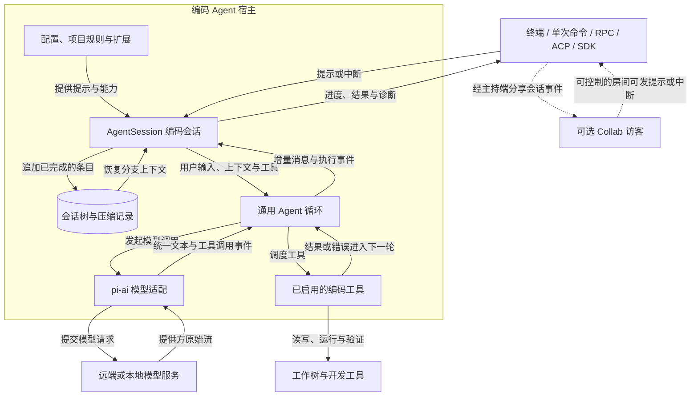
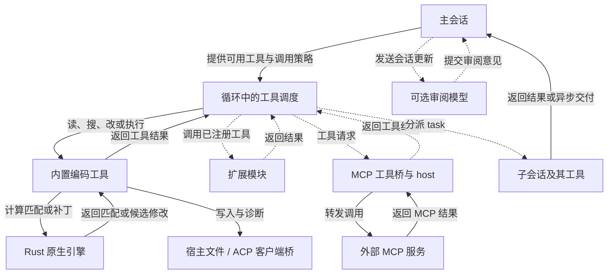
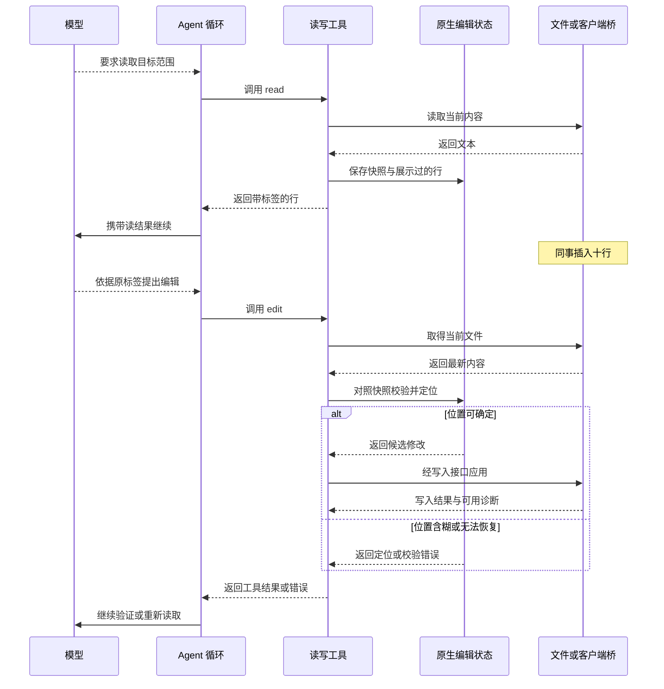

开发者希望 Agent 修好一个金额舍入错误。输入是一句需求和一棵真实的工作树，交付物是修改后的文件、能说明结果的测试，以及稍后还可继续的会话。中间有不少模型本身做不了的事：取得当前文件，判断自己读到的行是否已经变化，运行工具，再把结果交还给下一轮推理。

Oh My Pi（`omp`）是基于 Pi 扩展的编码 Agent。它既是人可以直接使用的终端程序，也提供单次输出、RPC、编辑器 ACP 和嵌入式 SDK。上游明确选择了终端优先、常用编码能力内置、高级行为可配置三个方向。这解释了为何仓库同时包含模型协议适配、通用 Agent 循环、编码会话、原生工具引擎和交互界面。下面跟随这几层，看看换一个模型、换一个编辑器或恢复会话，分别会改变什么。[项目的设计理念](https://github.com/can1357/oh-my-pi/blob/1263bcd83293946b445e0561fc49a464366f0ead/README.md#philosophy) · [启动流程与子系统地图](https://github.com/can1357/oh-my-pi/blob/1263bcd83293946b445e0561fc49a464366f0ead/packages/coding-agent/DEVELOPMENT.md)

## 一套会话服务多种入口

总图把一次使用中要经过的三道边界画在一起。入口传递用户意图，模型决定下一步要请求什么，宿主实际执行被允许的工具。每次执行都能产生两种不同的输出：界面可以立刻显示进度，后续模型调用则消费已经形成的消息和工具结果。

`createAgentSession` 负责把配置、模型与工作目录装配起来。终端界面订阅会话事件，把增量文本、工具进度和差异画出来；一次性命令消费结果后退出；RPC 让其他程序通过标准流收发命令和事件；ACP 向编辑器暴露会话并可使用客户端提供的文件能力；SDK 调用方直接持有会话对象。启用协作分享时，远端访客可以在终端或浏览器重现同一会话，工具仍在主持人的宿主执行。由此推断，新增入口的主要成本是协议、交互与文件归属，Agent 的多轮控制逻辑可以复用。[SDK 装配](https://github.com/can1357/oh-my-pi/blob/1263bcd83293946b445e0561fc49a464366f0ead/packages/coding-agent/src/sdk.ts) · [RPC 协议](https://github.com/can1357/oh-my-pi/blob/1263bcd83293946b445e0561fc49a464366f0ead/docs/rpc.md) · [ACP 客户端桥](https://github.com/can1357/oh-my-pi/blob/1263bcd83293946b445e0561fc49a464366f0ead/packages/coding-agent/src/modes/acp/acp-client-bridge.ts) · [协作会话边界](https://github.com/can1357/oh-my-pi/blob/1263bcd83293946b445e0561fc49a464366f0ead/docs/collab.md)

### 模型为什么能换，工具为什么仍能继续工作

模型目录提供可选模型及其标识，`pi-ai` 把选中的提供方协议转换成统一的流。不同服务拆分文本片段、工具名和工具参数的方式不同；适配器对外给出一致的开始、增量、结束或错误事件，以及最终的助手消息。`packages/agent` 消费这个接口：若模型请求工具，循环找到已注册工具并派发，将结果与原调用配对，再送进下一次模型调用。用户中途发来的纠正可以在相应的轮次边界进入。这样上游既能保留流式预览，又有确定的调用结果用于下一轮；编辑器不必了解每个提供方传来的原始字段。[模型目录](https://github.com/can1357/oh-my-pi/tree/1263bcd83293946b445e0561fc49a464366f0ead/packages/catalog) · [流协议及事件传播](https://github.com/can1357/oh-my-pi/blob/1263bcd83293946b445e0561fc49a464366f0ead/docs/provider-streaming-internals.md) · [循环与工具调度](https://github.com/can1357/oh-my-pi/blob/1263bcd83293946b445e0561fc49a464366f0ead/packages/agent/src/agent-loop.ts)

### 同一个工具接口如何容纳本地操作与扩展

编码会话将内置工具、已启用的扩展工具和 MCP 工具放入同一批可调用能力，调度时按工具策略处理审批与并发。内置读写、搜索、Shell 与语言服务处理本机工作树；需要额外能力时，扩展可以注册工具、命令与事件钩子，MCP host 可以维护外部服务连接。二者的生命周期不同：扩展模块在宿主内加载并绑定到会话，会话持有 MCP host 所管单元的租约，没有持有者后由 host 按策略回收本地服务进程或远程连接。打开项目时还可能加载项目提供的配置和扩展，因此嵌入者需要明确哪些项目代码能在自己的宿主执行。[工具审批](https://github.com/can1357/oh-my-pi/blob/1263bcd83293946b445e0561fc49a464366f0ead/docs/approval-mode.md) · [扩展绑定流程](https://github.com/can1357/oh-my-pi/blob/1263bcd83293946b445e0561fc49a464366f0ead/docs/extension-loading.md) · [MCP 连接所有权](https://github.com/can1357/oh-my-pi/blob/1263bcd83293946b445e0561fc49a464366f0ead/docs/mcp-runtime-lifecycle.md) · [项目输入与信任](https://github.com/can1357/oh-my-pi/blob/1263bcd83293946b445e0561fc49a464366f0ead/README.md#project-inputs-and-trust)

Rust 层针对搜索、语法匹配、补丁等热点提供原生实现，通过 N-API 接到 TypeScript 工具；上游给出的理由是减少频繁启动小进程的成本，并降低对宿主已安装命令的依赖。工作需要并行时，`task` 创建有独立上下文的子会话，按配置限制并发，指定时可以用隔离工作区，或要求结果符合给定结构。另一个可选组件 Advisor 观察主会话进展，用自己的上下文提供意见。一个用于委派可交回的工作，一个用于在工作进行时追加判断；两者都不能代替结果验证。[原生层设计](https://github.com/can1357/oh-my-pi/blob/1263bcd83293946b445e0561fc49a464366f0ead/docs/natives-architecture.md) · [任务执行与隔离选项](https://github.com/can1357/oh-my-pi/blob/1263bcd83293946b445e0561fc49a464366f0ead/docs/tools/task.md) · [Advisor 的职责](https://github.com/can1357/oh-my-pi/blob/1263bcd83293946b445e0561fc49a464366f0ead/docs/advisor-watchdog.md)

## 从“请修改”到真的改对了哪一步

继续看舍入错误。选用 `hashline` 编辑模式时，读工具返回路径、内容标签与可引用的行，并在这次对话的 `EditStore` 保存快照和已完整展示的行。此时同事在文件顶部插入十行，模型仍按照旧读数提出修改。直接写原行号容易落到另一个函数；无条件拒绝任何外部修改，又会让无关的插入也迫使模型重做阅读。原生引擎用保留的快照和当前内容定位，在符合恢复规则且位置可确定时继续。模型、项目配置也可以选择不同于 `hashline` 的编辑协议。[编辑模式与恢复规则](https://github.com/can1357/oh-my-pi/blob/1263bcd83293946b445e0561fc49a464366f0ead/docs/tools/edit.md) · [对话级快照存储](https://github.com/can1357/oh-my-pi/blob/1263bcd83293946b445e0561fc49a464366f0ead/packages/coding-agent/src/edit/store.ts)

运行过程中看到的差异是只读预览，执行时还会重读并校验。宿主写入可能经过编辑器桥，也可能经本地写入流程触发格式化和诊断，落盘文本可能与预览不同。多文件调用会先准备各段，再按序写入；后面的系统写入失败时，前面的文件可能已经修改。由此可得一个具体的验收顺序：先重看实际差异，确认目标函数和其他文件的最终内容，再运行能区分舍入前后行为的测试。快照能验证编辑依据，行为正确性仍要由这些测试证明。[原生编辑会话](https://github.com/can1357/oh-my-pi/blob/1263bcd83293946b445e0561fc49a464366f0ead/crates/edit/src/session.rs) · [写回及部分失败语义](https://github.com/can1357/oh-my-pi/blob/1263bcd83293946b445e0561fc49a464366f0ead/docs/tools/edit.md#output-and-side-effects) · [已展示行测试](https://github.com/can1357/oh-my-pi/blob/1263bcd83293946b445e0561fc49a464366f0ead/packages/coding-agent/test/read-edit-seen-lines.test.ts)

## 恢复会话时究竟恢复了什么

| 状态 | 谁保存、如何读取 | 对下一次工作的影响 |
| --- | --- | --- |
| 对话走到了哪里 | 文件型会话以 JSONL 记录普通追加条目和父节点，由活动叶节点选定分支 | 可以回到较早讨论分叉，再为选中的路线组装上下文 |
| 下一轮模型能看到什么 | 上下文构建器沿活动路径读取记录，使用适用的压缩条目和其后保留的消息 | 长会话可以继续，压缩后的模型输入与完整历史并不相同 |
| 模型基于哪一份文件提出编辑 | 本次对话的 EditStore 持有近期快照、已展示范围等信息 | 重开进程后应以当前文件重新建立编辑依据 |
| 跨会话有哪些项目经验 | 默认关闭的记忆子系统可按配置启用，例如从持久会话生成项目摘要 | 经验供后续启动参考，当前工作树、测试和用户要求仍需重新核对 |

切换会话叶节点可以重新讨论一种方案，但单靠它不会将文件恢复到先前的字节；要保留两份独立实现，仍需隔离工作树或显式版本管理。对自建编码工具而言，这给出了一个比“加上记忆”更具体的选择：先确定哪份记录能恢复对话、哪条路径会产生真实写入，再决定是否承担长期摘要、分支和并行工作的成本。如果两个入口都要改同一份代码，首先要在二者之间共享编辑校验和工具结果契约。[会话树与历史](https://github.com/can1357/oh-my-pi/blob/1263bcd83293946b445e0561fc49a464366f0ead/docs/session.md) · [压缩与上下文重建](https://github.com/can1357/oh-my-pi/blob/1263bcd83293946b445e0561fc49a464366f0ead/docs/compaction.md) · [可选记忆后端](https://github.com/can1357/oh-my-pi/blob/1263bcd83293946b445e0561fc49a464366f0ead/docs/memory.md)
