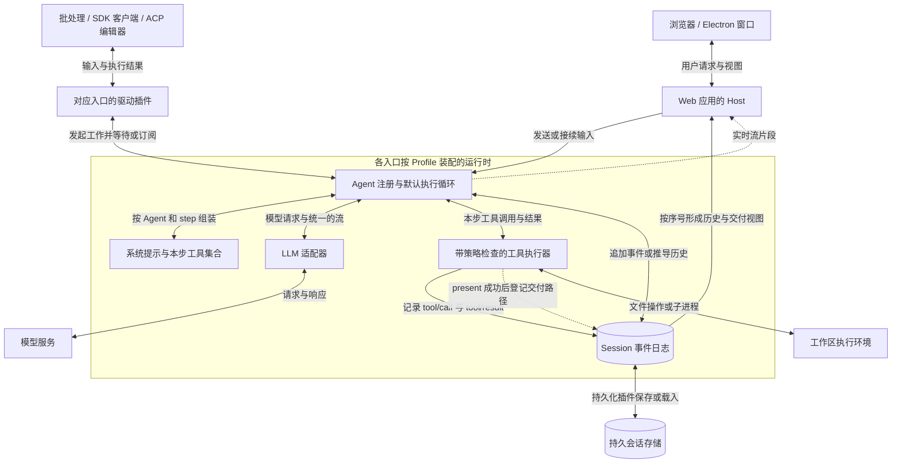
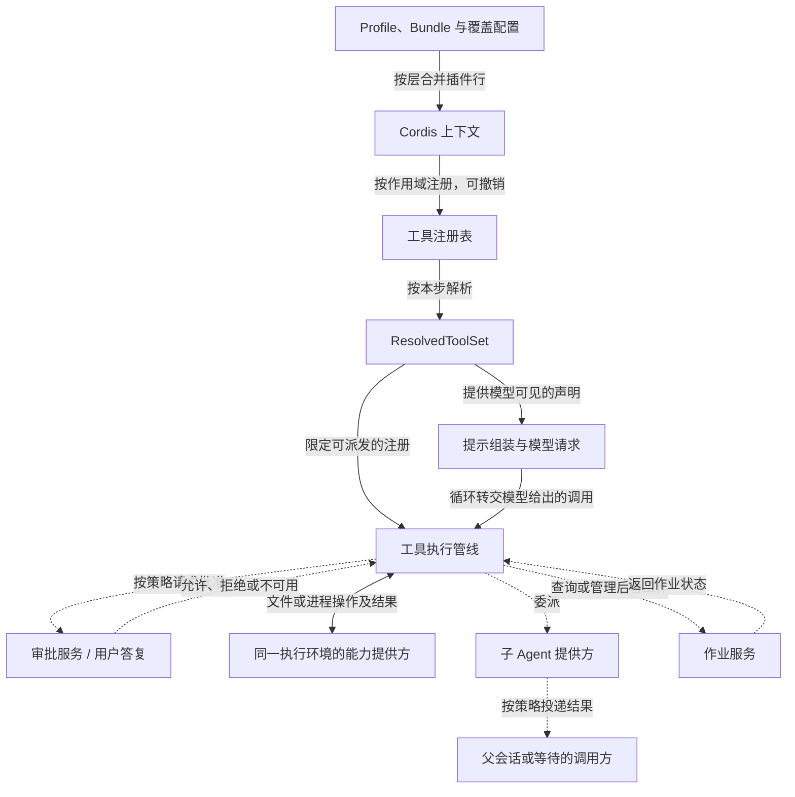
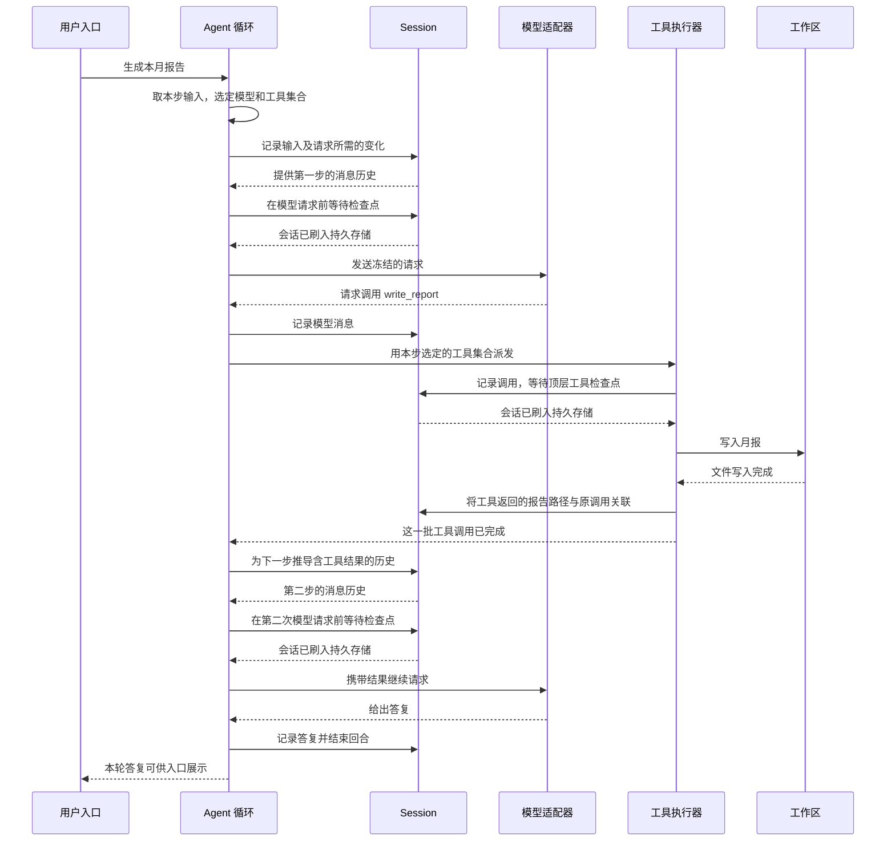

DeepSeek Harness（`dsh`）是运行 Agent 的开源框架。模型提出要调用什么工具，Harness 负责决定当前会话可用的工具、在工作区执行调用、把结果送回模型，再把进展交给用户。这样，一次请求可以经历多轮判断和操作，留下后来可查的执行历史。使用者可以在浏览器或桌面应用里交互，开发者也可以从批处理、SDK 或编辑器发起工作。适合采用它的产品通常要复用一套工具和会话语义，同时允许不同入口选择不同的模型、执行环境和交互方式。[项目定位](https://github.com/deepseek-ai/deepseek-harness/blob/fcc0ad462172522aaf5c93a7b2e01f6b9f0b0159/README.md#L5-L13) · [应用入口](https://github.com/deepseek-ai/deepseek-harness/blob/fcc0ad462172522aaf5c93a7b2e01f6b9f0b0159/docs/architecture.md#L41-L53)

## 从用户发起请求，到结果回到入口

一个用户在网页里发起任务时，浏览器把请求交给宿主进程（Host）。Host 决定执行顺序、运行工具、保存会话，网页订阅进展、拼出界面。换成命令行批处理，入口会直接创建或接续一个 Agent，等它完成，输出结果并退出。用 TypeScript SDK 集成时，客户端启动专用子进程，通过标准输入输出上的 JSON-RPC 发送请求、接收通知。Python SDK 也启动相应的运行时，编辑器通过 ACP 接入。Electron 桌面版携带自己的运行时，让本地窗口连接 Desktop Host 内启动的 Web 应用。各入口可以独立启动，有自己的进程、配置和会话。[网页和 Host 各自拥有什么](https://github.com/deepseek-ai/deepseek-harness/blob/fcc0ad462172522aaf5c93a7b2e01f6b9f0b0159/docs/subsystems/web-client.md#L9-L20) · [批处理驱动器](https://github.com/deepseek-ai/deepseek-harness/blob/fcc0ad462172522aaf5c93a7b2e01f6b9f0b0159/packages/bundle/headless/src/index.ts#L1-L8) · [SDK 客户端与子进程](https://github.com/deepseek-ai/deepseek-harness/blob/fcc0ad462172522aaf5c93a7b2e01f6b9f0b0159/packages/sdk/client/README.md#L10-L14) · [Python、ACP 与桌面入口](https://github.com/deepseek-ai/deepseek-harness/blob/fcc0ad462172522aaf5c93a7b2e01f6b9f0b0159/docs/architecture.md#application-launch)

这也解释了怎样处理“网页刚打开时，该显示哪个模型”这样的简单问题。仓库的设计记录提到，早期列表和详情各自从内存、磁盘或缓存取数据，打开一次页面可能重复载入同一份会话记录，标题和模型可能来自不同的进度，界面还会一度显示猜测的默认值。现在 Host 可以按同一事件序号（`asOfSeq`）得出一组状态，各功能分别定义如何从事件算出自己的值；浏览器取回这个视图，再接上后续更新。这里统一的是一次读取看到的进度，标题和模型仍有各自的业务规则。[旧实现出现过的读数不一致](https://github.com/deepseek-ai/deepseek-harness/blob/fcc0ad462172522aaf5c93a7b2e01f6b9f0b0159/.agents/notes/implemented/architecture/2026-08-25-session-observations-and-projection-owned-client-state.md#L7-L17) · [同一事件序号上的视图](https://github.com/deepseek-ai/deepseek-harness/blob/fcc0ad462172522aaf5c93a7b2e01f6b9f0b0159/.agents/notes/implemented/architecture/2026-08-25-session-observations-and-projection-owned-client-state.md#L59-L69)

## 为什么连驱动 Agent 的循环也做成插件

同一个运行时怎样适配这些入口？`dsh` 启动时先选 **Profile**，由它指定这一入口采用的 **Bundle**，即成组分发的插件配置。Cordis 按配置装配插件，插件在共享上下文里提供服务、声明依赖或订阅事件。项目的架构说明明确给出的目标，是让扩展可以挂在现有实现旁边，让默认实现可以替换，插件卸载时也能撤销它做的注册。因此，连 Agent 的默认执行循环、模型适配器和会话存储也走这套机制。Web 与 headless 选用共同的基础 Bundle，再分别装入浏览器应用和一次性驱动器。精简版 SDK 则自己列出所需组件，集成者可以核对它具体提供哪些能力。[作者对可替换性与卸载的说明](https://github.com/deepseek-ai/deepseek-harness/blob/fcc0ad462172522aaf5c93a7b2e01f6b9f0b0159/docs/architecture.md#L7-L25) · [Cordis 的服务与注册生命周期](https://github.com/deepseek-ai/deepseek-harness/blob/fcc0ad462172522aaf5c93a7b2e01f6b9f0b0159/docs/cordis-primer.md#L7-L18)

下图把启动时才发生的装配和工作进行中的派发放在一起。实线说明插件怎样进入宿主、怎样为这一步生成请求；虚线是可以选装、替换或按策略触发的参与者。图中一次工具注册同时关系到“模型看到的工具说明”和“谁真的有资格执行它”。

其中，`ctx.agents` 是活动 Agent 的注册与操作接口，`ctx.agentLoop` 是默认驱动器；`ctx.systemPrompt` 汇总提示片段和工具声明，`ctx.tools` 持有注册与执行管线。分开后，一个插件可以只调整模型看到的环境说明，另一个插件可以在实际调用前要求用户批准。批准只针对所询问的那次动作；拒绝或无法得到答复时，依赖这次批准的动作不会继续。Agent 生命周期事件适合介入正在进行的工作，文件或工具能力上的事件适合挂接特定策略，需要重启后仍能解释的事实则追加到 Session。[核心服务与三种事件](https://github.com/deepseek-ai/deepseek-harness/blob/fcc0ad462172522aaf5c93a7b2e01f6b9f0b0159/docs/architecture.md#core-packages) · [提示与工具声明](https://github.com/deepseek-ai/deepseek-harness/blob/fcc0ad462172522aaf5c93a7b2e01f6b9f0b0159/docs/subsystems/system-prompt.md) · [审批结果的范围](https://github.com/deepseek-ai/deepseek-harness/blob/fcc0ad462172522aaf5c93a7b2e01f6b9f0b0159/docs/subsystems/approval.md) · [工具执行管线](https://github.com/deepseek-ai/deepseek-harness/blob/fcc0ad462172522aaf5c93a7b2e01f6b9f0b0159/docs/tool-execution-pipeline.md)

配置可以按插件行的稳定标识覆盖。上游有一个很小的测试：第一个 Bundle 插入 `a`，第二个把它配成 `v: 2`，用户层又把它配成 `v: 3`。启动时只有一个 `a`，它拿到的是 3。覆盖一行时会替换整份配置；维护基础 Bundle 的人新增了一个字段，用户层若已替换整行，就得检查自己是否仍想沿用这个字段。这样做让人可以从最终配置解释插件怎么来的，代价是局部定制也要跟随配置契约演进。[配置覆盖的测试](https://github.com/deepseek-ai/deepseek-harness/blob/fcc0ad462172522aaf5c93a7b2e01f6b9f0b0159/packages/boot/app-boot/tests/profile.spec.ts#L301-L317) · [配置层顺序](https://github.com/deepseek-ai/deepseek-harness/blob/fcc0ad462172522aaf5c93a7b2e01f6b9f0b0159/docs/architecture.md#profiles-and-bundles)

以研究团队的月报产品为例。分析员在网页上可以补充统计口径，夜间作业则由批处理入口发起。团队只需实现一次生成报告的工具，向注册表声明名称、参数与执行函数，执行时通过上下文访问文件服务。若把工作区迁到远端，文件读写和运行子进程必须指向同一个环境，否则模型刚写好的报告就可能在另一个服务中找不到。项目因此把能力的接口、提供实现的插件、消费能力的工具分开。给网页增加一个“查看报告”按钮只涉及展示；要让所有文件工具都读远端工作区，修改点在能力提供方。这两种需求在组件图上落在不同位置。[能力接口与提供方](https://github.com/deepseek-ai/deepseek-harness/blob/fcc0ad462172522aaf5c93a7b2e01f6b9f0b0159/docs/architecture.md#capability-seams) · [交付工具的依赖声明](https://github.com/deepseek-ai/deepseek-harness/blob/fcc0ad462172522aaf5c93a7b2e01f6b9f0b0159/packages/deliverables/tool-present/src/index.ts#L25-L38)

同样的结构也能表达耗时工作。后台作业服务按作业标识和所有者暴露状态；委派给子 Agent 时，提供方可以启动本地子会话或调用外部执行者，按发起方式把结果送回父会话或等待结果的调用方。启用 Agent Teams 才额外引入根会话的共享任务板。给任务改状态不会自动给成员投递消息，需要其采取行动时仍走普通子 Agent 通信。这样读图就能区分三件事：后台活动是否仍在运行、子任务是否已交回、团队决定由谁负责。[后台作业模型](https://github.com/deepseek-ai/deepseek-harness/blob/fcc0ad462172522aaf5c93a7b2e01f6b9f0b0159/docs/subsystems/jobs.md) · [子 Agent 的归属与结果投递](https://github.com/deepseek-ai/deepseek-harness/blob/fcc0ad462172522aaf5c93a7b2e01f6b9f0b0159/docs/subsystems/subagent.md) · [团队任务与消息边界](https://github.com/deepseek-ai/deepseek-harness/blob/fcc0ad462172522aaf5c93a7b2e01f6b9f0b0159/docs/subsystems/agent-team.md)

## 一句话为什么会触发两次模型请求

`Session` 代表一次可以重开的会话。用户发起一轮工作称为 **turn**；在一轮之内，Agent 可以分若干 **step** 调用模型，并处理模型要求执行的工具。用户只说了一句话，模型却需要先请求生成月报，在工具返回文件路径后再决定如何答复。这个例子最少能看到两份不同的模型输入。下面从入口已把指令交给 Agent 画起，假设产品注册了 `write_report` 工具，并采用基础配置的持久化和检查点策略。[回合与步骤](https://github.com/deepseek-ai/deepseek-harness/blob/fcc0ad462172522aaf5c93a7b2e01f6b9f0b0159/docs/architecture.md#turn-flow) · [循环决定继续还是结束](https://github.com/deepseek-ai/deepseek-harness/blob/fcc0ad462172522aaf5c93a7b2e01f6b9f0b0159/packages/core/agent-loop/src/agent.ts#L574-L597)

第一步开始时，`preStep` 从收件箱领取本步的输入，选定模型、解析该 Agent 能用的工具，再组装提示。请求准备好以后，循环用 `session.deriveMessages()` 从事件推导模型可见的消息，连同请求配置和工具声明一起冻结。第二次请求多出来的内容有明确来源：第一步的模型消息里有带 `callId` 的工具请求，日志里随后有引用该调用的工具结果。循环读这份历史，所以即使换成无界面的入口，仍然知道刚才生成的是哪个文件。[解析本步输入和工具](https://github.com/deepseek-ai/deepseek-harness/blob/fcc0ad462172522aaf5c93a7b2e01f6b9f0b0159/packages/core/agent-loop/src/agent.ts#L283-L312) · [从日志形成冻结请求](https://github.com/deepseek-ai/deepseek-harness/blob/fcc0ad462172522aaf5c93a7b2e01f6b9f0b0159/packages/core/agent-loop/src/agent.ts#L709-L742) · [工具结果引用原调用](https://github.com/deepseek-ai/deepseek-harness/blob/fcc0ad462172522aaf5c93a7b2e01f6b9f0b0159/packages/core/tools/src/batch.ts#L243-L265)

把两次请求放在一起看，差别会更清楚。下表只摘出与月报有关的消息，调用编号 `r7` 是示意值。

| 请求 | 模型收到的月报相关信息 |
| --- | --- |
| 第一步，工具尚未执行 | 用户要求“生成本月报告”。工具声明说明 `write_report` 接受哪些参数。此时还没有报告路径。 |
| 第二步，工具已经返回 | 历史保留原指令，又加入助手发起的 `write_report` 调用 `r7`，以及工具为 `r7` 返回的 `monthly-report.xlsx`。模型这时可以据此介绍成品。 |

为什么要从日志推导模型输入，而不让每个入口自己拼聊天记录？项目早期只记录了部分消息，遗漏模型选择、系统提示和工具声明，插件还可以临时改写某次请求。同一段对话换一组插件重新打开，开发者很难说清当时到底发了什么，原本可复用的请求前缀也可能变化，影响模型服务的缓存。开发者于是规定，进入模型请求的输入要能从记录中找回。对执行循环发出的请求，给定同一版本的代码，文本输入可以从日志重建；带图片的请求还需要日志引用的不可变附件。这项设计换来的是可核对的请求边界，代价是改变模型输入的插件也要留下相应记录。[请求重建的设计决策](https://github.com/deepseek-ai/deepseek-harness/blob/fcc0ad462172522aaf5c93a7b2e01f6b9f0b0159/.agents/notes/implemented/architecture/2026-07-05-reconstructable-requests.md#L7-L17)

这个顺序也规定了用户何时能改变模型的判断。假设第一份请求正在准备发送，分析员这时补了一句“排除退款”。`steer` 把补充放进下一步的收件箱；`followup` 则给后续回合排队。已经选定输入的请求继续使用原口径。如果产品要求已经开始的导出立刻中断，还需明确取消当前操作，并决定如何处置已写的文件。上游测试在请求钩子中注入了一条迟到的上下文，分别检查前后两次适配器请求，只有后一次读到了它。[输入队列](https://github.com/deepseek-ai/deepseek-harness/blob/fcc0ad462172522aaf5c93a7b2e01f6b9f0b0159/packages/core/agent-loop/src/agent.ts#L170-L189) · [迟到上下文的对照测试](https://github.com/deepseek-ai/deepseek-harness/blob/fcc0ad462172522aaf5c93a7b2e01f6b9f0b0159/packages/core/agent-loop/tests/request-reconstruction.spec.ts#L739-L765)

## 模型记得工具名，为什么执行时仍会被拒绝

假设管理员在模型思考期间升级了 `write_report`。旧版按输入文件生成预览，新版还会覆盖正式报告。如果执行器只在收到回复时按名字查找最新函数，模型按旧说明生成的参数就可能落到新实现。为此，注册表按 Agent 的作用域解析出本步的 `ResolvedToolSet`，记录当时获准的工具定义和注册。循环用它向模型声明工具，也把同一个集合交给执行器。派发时还要核对当前注册与限制。[工具集合的解析](https://github.com/deepseek-ai/deepseek-harness/blob/fcc0ad462172522aaf5c93a7b2e01f6b9f0b0159/packages/core/tools/src/index.ts#L251-L296) · [派发时沿用本步集合](https://github.com/deepseek-ai/deepseek-harness/blob/fcc0ad462172522aaf5c93a7b2e01f6b9f0b0159/packages/core/agent-loop/src/agent.ts#L586-L593)

源码测试把这个条件卡得很细：移除工具后，甚至用**同一个工具对象、同一个名称**再注册，带旧集合的调用仍然得到 `UNKNOWN_TOOL`；重新解析后调用才成功，两次尝试总共只进入一次工具实现。所以产品排查“工具明明在配置里，为什么不能用”时要看三个时点：启动时是否装载、该 Agent 在组装请求时是否获准、实际派发时注册是否仍然有效。这项约束保护即将派发的调用；已经生成的文件有自己的生命周期。[同名重新注册的测试](https://github.com/deepseek-ai/deepseek-harness/blob/fcc0ad462172522aaf5c93a7b2e01f6b9f0b0159/packages/core/tools/tests/activation.spec.ts#L115-L124) · [执行前收紧限制的测试](https://github.com/deepseek-ai/deepseek-harness/blob/fcc0ad462172522aaf5c93a7b2e01f6b9f0b0159/packages/core/tools/tests/activation.spec.ts#L79-L90)

## 刷新网页、重启宿主和重新执行工具，各需要什么记录

逐字显示答案时，Web 关心“刚又到了哪些字符”。继续下一步时，Agent 关心“一次模型尝试最后形成了什么消息”。`agent/assistant-stream` 把流式片段交给现场订阅者，正常结束时，循环把组装的 `assistant/message` 和对应流记录追加到 Session。用户主动取消时，如果已有可保留的部分输出，循环仍可记下一条标有 `interrupted` 的消息。失败的尝试也可留下 `assistant/attempt` 供排查，这类记录不会作为成功答复进入模型历史。宿主进程若在收束前突然退出，网页曾显示的片段可能还没有对应的完整日志记录。重建一份请求能解释当时发给适配器的输入；用这些输入再次调用模型，输出仍可能不同。[主动取消时的处理](https://github.com/deepseek-ai/deepseek-harness/blob/fcc0ad462172522aaf5c93a7b2e01f6b9f0b0159/packages/core/agent-loop/src/agent.ts#L499-L525) · [流与会话的两种读法](https://github.com/deepseek-ai/deepseek-harness/blob/fcc0ad462172522aaf5c93a7b2e01f6b9f0b0159/docs/architecture.md#session-log) · [请求重建测试核对哪些字段](https://github.com/deepseek-ai/deepseek-harness/blob/fcc0ad462172522aaf5c93a7b2e01f6b9f0b0159/packages/core/agent-loop/tests/request-reconstruction.spec.ts#L850-L896)

Session 自身先收到内存中的追加事件。要跨进程恢复，需要挂接持久化提供方。长会话还可挂接压缩策略，以已记录的上下文变化缩短后续模型输入；面向 Web 的历史投影、模型看到的上下文和系统的遥测各服务于不同读者。基础 Bundle 配置了 JSONL 存储，也配置了检查点插件：它在循环的模型请求发给适配器之前，以及带 Agent 的顶层工具进入实际工具体之前，等待 Session 的 `flush` 完成。如果保存失败，后面的模型调用或工具体就不会被放行。检查点缩小了不确定的范围；写报告与写会话日志仍是两个独立动作。[基础配置中的存储](https://github.com/deepseek-ai/deepseek-harness/blob/fcc0ad462172522aaf5c93a7b2e01f6b9f0b0159/packages/bundle/base/cordis.patch.yml#L138-L140) · [检查点放在哪几个边界](https://github.com/deepseek-ai/deepseek-harness/blob/fcc0ad462172522aaf5c93a7b2e01f6b9f0b0159/packages/session/session-checkpoint-policy/src/index.ts#L52-L82) · [压缩事件的语义](https://github.com/deepseek-ai/deepseek-harness/blob/fcc0ad462172522aaf5c93a7b2e01f6b9f0b0159/docs/subsystems/compaction.md) · [遥测通道所有权](https://github.com/deepseek-ai/deepseek-harness/blob/fcc0ad462172522aaf5c93a7b2e01f6b9f0b0159/docs/subsystems/otel.md)

设写报告时宿主突然退出。与其笼统地说“支持会话恢复”，可以直接问：重开时最后一条可靠记录是什么？

| 已保存的记录 | 恢复时能判断什么 | 月报产品可以怎样接续 |
| --- | --- | --- |
| 模型消息提出工具请求，还没有该请求的 `tool/call` | 在上述检查点配置的顶层调用路径上，没有已记录的执行开始；恢复代码把缺失的结果标成 `TOOL_NOT_STARTED` | 确认用户仍需要这份报告，再安排这项工作 |
| 已有 `tool/call`，缺少对应 `tool/result` | 工具可能刚要开始，也可能已经写完。恢复代码能识别调用身份，补入 `TOOL_OUTCOME_UNKNOWN` | 用业务任务标识查输出或回执；若动作会对外发布，保留待确认状态 |
| 已有成功的 `tool/result` 及返回路径 | 后续请求可以读到这次工具报告的结果 | 使用现有结果继续，并按业务要求核对文件版本和内容 |

恢复测试把日志预置在第二行所述的位置。调用记录的序号是 3，重开后追加的结果是 4，`sourceEventSeqs` 指回 3，回合以 `interrupted` 收尾。修复的是会话中悬而未决的调用；查明外部世界发生了什么，仍要靠文件或业务服务提供的证据。分支也有类似边界：从历史中的某一点 fork，子会话继承截至该序号的事件，并补齐开放的尾部；父会话此后写入的文件仍存在于原来的工作区。做两套候选方案若还要求文件相互隔离，需要另外提供独立工作区。[恢复代码的两类结果](https://github.com/deepseek-ai/deepseek-harness/blob/fcc0ad462172522aaf5c93a7b2e01f6b9f0b0159/packages/core/session/src/repair.ts#L14-L40) · [中断调用的持久化恢复测试](https://github.com/deepseek-ai/deepseek-harness/blob/fcc0ad462172522aaf5c93a7b2e01f6b9f0b0159/packages/core/agent-loop/tests/resume.spec.ts#L539-L575) · [分支如何选取事件前缀](https://github.com/deepseek-ai/deepseek-harness/blob/fcc0ad462172522aaf5c93a7b2e01f6b9f0b0159/packages/core/session/src/fork.ts#L10-L29)

## 会话、工作区和最终交付分别保存什么

原生的 `present` 工具解决最后一段交付。它要求当前回合已经打开，借助文件服务核对目标是普通文件，将候选路径与本次工具执行关联。等工具管线给出成功结果，监听器才追加 `deliverables/presented`。同样是文件已经存在，如果后置检查阻止交付，网页就不应把它列为本轮成品。上游还用一个二进制文件验证：声明交付会记录路径和描述，过程中没有读取、拷贝文件内容。[交付工具实现](https://github.com/deepseek-ai/deepseek-harness/blob/fcc0ad462172522aaf5c93a7b2e01f6b9f0b0159/packages/deliverables/tool-present/src/index.ts#L75-L109) · [成功和后置拒绝两个用例](https://github.com/deepseek-ai/deepseek-harness/blob/fcc0ad462172522aaf5c93a7b2e01f6b9f0b0159/packages/deliverables/tool-present/tests/present.spec.ts#L79-L138)

因此“改过哪些文件”“这一轮交付了哪个文件”“客户当时收到哪个版本”要从不同地方取证。`workspace-changes` 用 Git 工作树和部分文件工具的前后采集计算差异，在无仓库目录里，单由 shell 改写的文件可能不在差异清单内。`present` 可以声明一个本轮没改过的已有文件。若下个月用同名文件覆盖它，再沿旧路径打开会看到新内容。需要审计的产品可以在用户确认交付时保存不可变制品，把版本或内容标识关联到会话和业务任务，而不是根据一条路径推断收件人当时看到了什么。[变更采集的范围](https://github.com/deepseek-ai/deepseek-harness/blob/fcc0ad462172522aaf5c93a7b2e01f6b9f0b0159/packages/deliverables/workspace-changes/README.md) · [交付记录的契约](https://github.com/deepseek-ai/deepseek-harness/blob/fcc0ad462172522aaf5c93a7b2e01f6b9f0b0159/docs/subsystems/deliverables.md)

## 给自己的产品选取哪一层

如果只有一个夜间作业，明确的输入、固定的生成函数和可核对的输出已经足够。加入网页协作后，可以先借鉴 Session 的设计，把用户指令、模型请求工具的决定和对应结果关联起来，让两个入口都能解释同一份进度。再出现“不同团队用不同工具”“工具会在运行中升级”“断线后还需接手”等需求时，按会话和步骤选择工具、从日志重建上下文、在外部操作前设置检查点才各有明确收益。采用整套 Harness 还要维护插件组合、持久化配置和工具自己的外部副作用。所读版本处于开发预览期，固定配置和关键交互的回归测试都是集成成本。[版本状态](https://github.com/deepseek-ai/deepseek-harness/blob/fcc0ad462172522aaf5c93a7b2e01f6b9f0b0159/README.md#developer-preview)

最后给这个产品换一项需求。原来的工具只把月报写入工作区，现在还要把报告寄给客户。如果发件服务已接单，宿主却在记录结果前退出，重开页面能看到哪次工具调用结果未知。要决定是否重发，接手的人还得拿业务操作标识查发件服务的回执。如果发件端无从按标识查回记录，也没有约定去重，产品就应保留“发送结果待确认”。到这里，Session 管会话进度、文件服务管报告、发件服务确认邮件的分工，已经足以推导出一个原案例没有演示过的决定。
