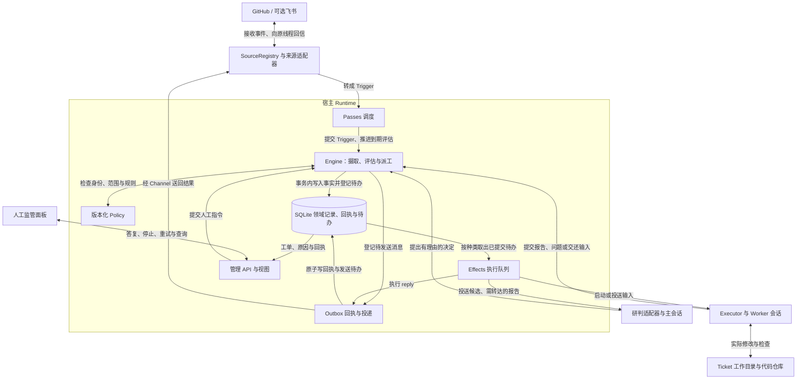
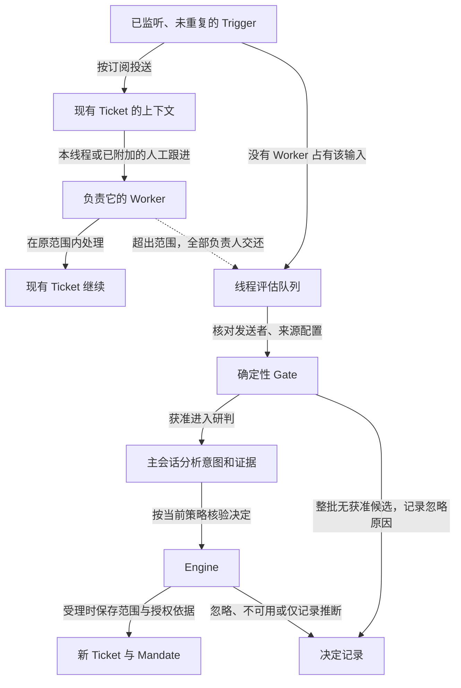
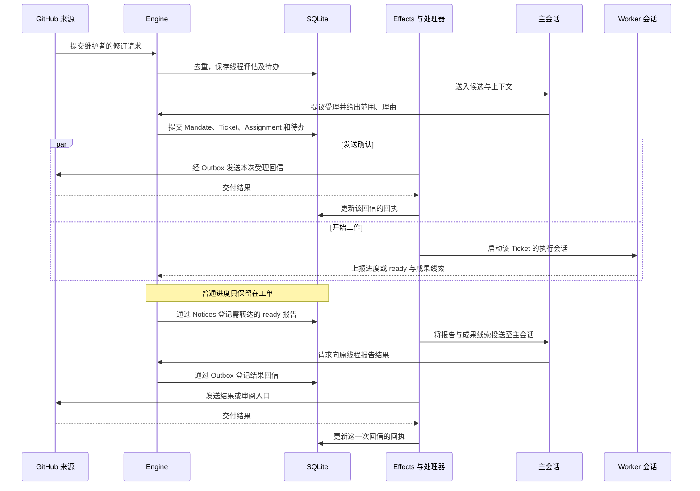

维护者在一个 GitHub Issue 里请 Agent 修订安装文档。同事补充了适用版本，CI 机器人发来状态，另一位成员在飞书里引用了原讨论。团队想得到的是一份可审阅的修订和一条回到原线程的结果，而不是让每个渠道各启动一个 Agent，再请人辨认哪份工作算数。

`dsh-superagent` 是为**单个 GitHub 仓库**编写的 DeepSeek Harness Bundle，可以加接飞书。Harness 提供会话、模型与工具运行时，这个 Bundle 实现来源监听、工作受理、仓库执行、回复和监管面板。作者把团队成员的注意力视作稀缺资源：有明确请求或成文规则才开工，需要人决定或已有可用结果时才出声。本文依据公开研究原型，作者说明其实现与内部版本和研究文章中的设想有差异。[项目定位](https://github.com/deepseek-ai/dsh-superagent-prototype/blob/6337fc823ce20251c8de8085948165c81aaa701e/README.md) · [团队的设计出发点](https://github.com/deepseek-ai/dsh-superagent-prototype/blob/6337fc823ce20251c8de8085948165c81aaa701e/docs/000-philosophy.md) · [DeepSeek Harness 的组件与边界](/github/deepseek-ai-deepseek-harness/)

## 从来源到交付，谁能改变哪类事实

`Runtime` 准备宿主、打开存储并装配各组件。`Engine` 是领域记录的唯一写入方。来源、主会话、执行会话和管理面板都要经它改变任务状态。下图中最值得追的一条线是穿过 SQLite 的分界：一次决定在事务中登记，调用模型、启动 Worker、对外回复等需要等待的工作，则交给提交后的执行器处理。

这里存在三份不同的工作记录：SQLite 中的工单与域事件，Harness 持有的主会话和 Worker 会话，以及仓库目录和托管平台上的真实产物。主会话具备路由工作所需的工具，每个 Ticket 的 Worker 会话和目录延续该项工作的现场；二者运行在不同角色的提示和工具约束下。目录分开能减少不同任务的文件干扰，执行命令的实际权限仍取决于宿主账户。面板通过管理 API 查看状态和历史，也可以提交人工操作；模型对外部工作的描述不能直接改写这些事实。[装配与启动顺序](https://github.com/deepseek-ai/dsh-superagent-prototype/blob/6337fc823ce20251c8de8085948165c81aaa701e/src/app/runtime.ts) · [Engine 所有权与端口](https://github.com/deepseek-ai/dsh-superagent-prototype/blob/6337fc823ce20251c8de8085948165c81aaa701e/docs/007-architecture.md#engine) · [执行会话与目录](https://github.com/deepseek-ai/dsh-superagent-prototype/blob/6337fc823ce20251c8de8085948165c81aaa701e/docs/003-execution.md#the-executor) · [管理面板](https://github.com/deepseek-ai/dsh-superagent-prototype/blob/6337fc823ce20251c8de8085948165c81aaa701e/docs/005-panel.md)

## 同一条消息为何可能开工、补充上下文，或只留下记录

一个 **Trigger** 是来源给出稳定标识的一次事件，**Thread** 定义讨论发生在哪里，**Ticket** 才是一份带工作范围的任务。来源负责认识平台上的讨论串、回复地址与监听范围；Engine 判断这条输入是否已经处理、送入哪些订阅，是否还需要在该 Trigger 的主讨论线程排队评估。同一线程一次只有一个 Eval；一次评估可以面向一批 Trigger，不必让快速补发的三句话各自启动工作。[领域概念与约束](https://github.com/deepseek-ai/dsh-superagent-prototype/blob/6337fc823ce20251c8de8085948165c81aaa701e/docs/001-domain.md) · [去重、关联与订阅投送](https://github.com/deepseek-ai/dsh-superagent-prototype/blob/6337fc823ce20251c8de8085948165c81aaa701e/src/core/intake.ts)

同事在文档 Issue 里补一句“只改 Linux 安装说明”，现有 Ticket 可以直接收到这个输入。另一个线程仅因为被订阅或引用而提供背景，并没有给执行者新增权限。若负责人发现请求应归另一项工作，可以交回；直到没有 Ticket 继续占有该条跟进，它才回到新的 Eval。对全新工作，确定性 Gate 决定谁能发起以及授权强度，模型解释意图并给出证据，Engine 再按现行 Policy 检查结果。明确请求与按团队规则推断的机会走不同路径：推断行为可以先只记录“本会受理”，自动模式与匹配规则都满足后才实际开始。[受理、跟进归属与交回](https://github.com/deepseek-ai/dsh-superagent-prototype/blob/6337fc823ce20251c8de8085948165c81aaa701e/docs/002-authorization.md) · [把研判转换为决定](https://github.com/deepseek-ai/dsh-superagent-prototype/blob/6337fc823ce20251c8de8085948165c81aaa701e/src/policy.ts)

受理后保存的 **Mandate** 包含强度、范围与所用策略版本。以后恢复工作时可以重新检查发送者、来源范围或已启用规则。团队可以用提示规定回复口吻、哪些变更先给草稿、交付时应附哪种证据；保存新提示会改变模型的工作方式，Gate、Mandate 和工具检查仍由程序执行。这使“学会团队习惯”和“得到团队授予的权限”可以独立演进。[授权重验](https://github.com/deepseek-ai/dsh-superagent-prototype/blob/6337fc823ce20251c8de8085948165c81aaa701e/docs/002-authorization.md#revalidation-before-resume) · [团队提示的作用范围](https://github.com/deepseek-ai/dsh-superagent-prototype/blob/6337fc823ce20251c8de8085948165c81aaa701e/docs/004-prompts.md)

## 一次文档修订，为什么需要三种确认

这里取一个尚无 Ticket 的新 Issue。假定来源已开启、请求者有权限、主会话判断受理，一次写入提交后可以同时推进确认回信和 Worker 启动。图中合并了 Source 与其 GitHub 线程，省略了周期调度和模型服务。

第一次确认是工作被受理，第二次是 Worker 报告产物已可审阅，第三次是该结果是否送到原线程。普通进度留在 Ticket；具体问题会尽快转给主会话，等待审阅、阻塞或输入投递失败也可在面板上分别呈现。若交付的是 PR，“已可审阅”和“已合并”仍由不同证据支持。面板优先排列等待人采取行动的记录，健康状态不用靠反复发消息提醒。[报告与通知的分流](https://github.com/deepseek-ai/dsh-superagent-prototype/blob/6337fc823ce20251c8de8085948165c81aaa701e/src/app/notices.ts) · [工单阶段的优先顺序](https://github.com/deepseek-ai/dsh-superagent-prototype/blob/6337fc823ce20251c8de8085948165c81aaa701e/src/core/stage.ts) · [执行与收尾条件](https://github.com/deepseek-ai/dsh-superagent-prototype/blob/6337fc823ce20251c8de8085948165c81aaa701e/docs/003-execution.md)

## 重启之后，要从哪里接手

| 中断发生的位置 | 系统保留下来的证据 | 恢复后的判断 |
| --- | --- | --- |
| 受理事务提交后，Worker 尚未开始 | SQLite 中已有工单、Assignment 和待执行工作 | 调度器处理已提交的启动待办；看板可以显示“已排队” |
| Worker 正执行时宿主退出 | Ticket、会话、执行目录和原 Assignment 都有身份 | 原运行记录结束，新的 Assignment 带恢复说明进入同一现场；未被原会话实际取入历史的输入可再次投送，先核对目录、Git 历史和远端状态再决定下一步 |
| 结果回信已登记，来源暂时停用 | Outbox 保留唯一消息 ID、待发送回执和对应工作 | 等来源恢复；若目标已消失或不再监听，就以明确原因结束回执 |

`Effects` 将候选投递、启动、输入转交和外发回复都建成有类型的持久待办，不同类型独立设置并发和重试。暂时没有执行名额可以延后，不必记成工作失败。Outbox 在同一事务中登记回执和发送待办；重复的本地消息 ID 不会新建第二份。远端已经收到、本地却还没记下成功仍是两个系统间的窗口。需要保证外部动作不重复的产品，还需目标服务的幂等键或按业务标识查询回执的能力。[Effects 的待办与重试](https://github.com/deepseek-ai/dsh-superagent-prototype/blob/6337fc823ce20251c8de8085948165c81aaa701e/src/app/effects.ts) · [Outbox 的登记与结算](https://github.com/deepseek-ai/dsh-superagent-prototype/blob/6337fc823ce20251c8de8085948165c81aaa701e/src/app/outbox.ts) · [恢复现有执行现场](https://github.com/deepseek-ai/dsh-superagent-prototype/blob/6337fc823ce20251c8de8085948165c81aaa701e/docs/003-execution.md#restart)

对于只允许人手动启动单项作业的产品，稳定的线程引用、作业记录和一次结果回执就能解决大部分交接问题。多个渠道开始送入相互关联的请求后，才值得增加订阅、受理依据和独立执行身份。可以用一个可控仓库检验这项投入：重复送达同一请求应只得到一个工单；引用线程提供背景后，原任务范围应保持；执行完成时关闭回信来源，面板应仍能分别回答“谁可以审阅什么”和“谁已经收到通知”。[领域行为测试](https://github.com/deepseek-ai/dsh-superagent-prototype/blob/6337fc823ce20251c8de8085948165c81aaa701e/tests/core-engine.spec.ts) · [跟进分配测试](https://github.com/deepseek-ai/dsh-superagent-prototype/blob/6337fc823ce20251c8de8085948165c81aaa701e/tests/followups.spec.ts) · [回执投递测试](https://github.com/deepseek-ai/dsh-superagent-prototype/blob/6337fc823ce20251c8de8085948165c81aaa701e/tests/outbox.spec.ts)
