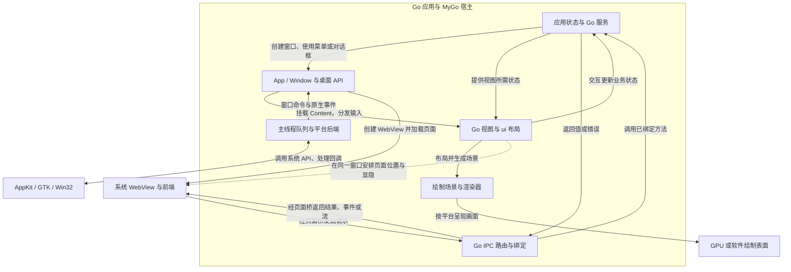
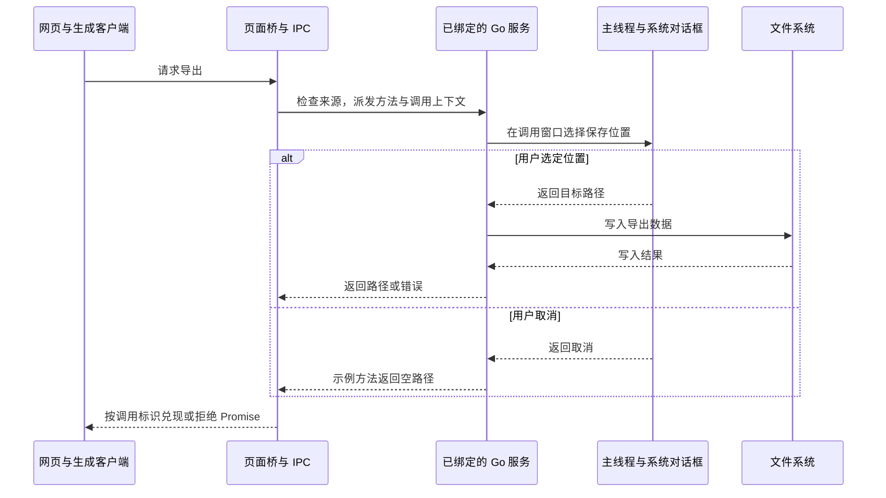
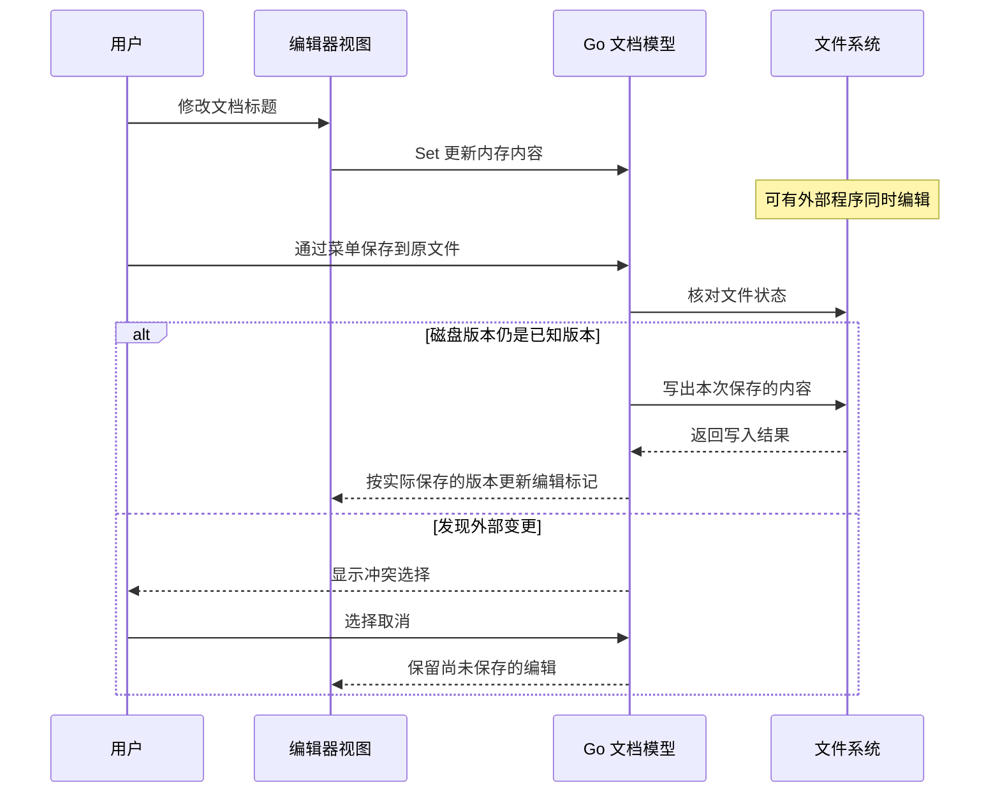
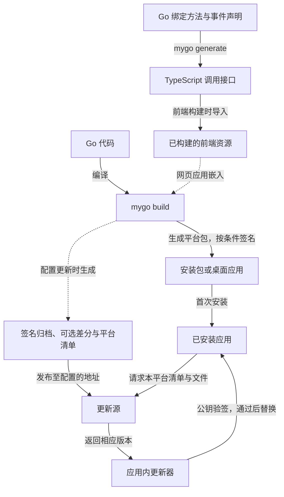

MyGo 是一个用 Go 构建桌面应用的框架。窗口可以显示系统 WebView 上的网页，也可以展示由 Go 描述、由 MyGo 绘制的界面，两类视图还可以组合。对想做本地 Markdown 编辑器的团队，这意味着已有的网页编辑控件可以沿用，而打开文件、处理系统菜单、记住未保存改动等桌面行为可以交给 Go 宿主。若应用本身很小，也可以全程使用 Go。上游的 `examples/documents` 就用 Go 界面展示编辑、保存和外部文件变更。[项目说明](https://github.com/egoist/mygo/blob/f7d98564ed6929b3f86594d48a4039613c6d7a4f/README.md) · [文档编辑器示例](https://github.com/egoist/mygo/blob/f7d98564ed6929b3f86594d48a4039613c6d7a4f/examples/documents/main.go)

## 一套桌面宿主，两条显示路径

开发者交给 MyGo 的是 Go 业务代码和窗口定义，选择网页时再提供前端资源。用户拿到的是有系统窗口、菜单、文件对话框和自身生命周期的桌面应用。作者把低运行开销、无 cgo 和 Go 风格的 API 列为设计目标。两条显示路径回应两种不同成本：已有前端最贵的是重写复杂控件，小型 Go 工具最不愿付出的则是为了显示一个按钮再启动网页环境。[设计目标与约束](https://github.com/egoist/mygo/blob/f7d98564ed6929b3f86594d48a4039613c6d7a4f/docs/architecture.md#goals-and-constraints)

`package mygo` 负责窗口注册、生命周期、IPC 路由和菜单语义。`internal/platform` 定义窗口、后端和事件回调契约，每个平台把这些操作译成自己的原生调用，并把输入、关闭等系统事件送回公共层。macOS、Linux 运行时通过 purego 连接本机库，Windows 使用系统调用与 COM。这样同一套代码可以交叉编译，运行时仍使用目标机器提供的窗口设施。窗口监听器同步运行在主线程，才能及时决定是否允许关闭；后台 goroutine 请求窗口操作时，公共层可以将工作排入主线程并唤醒事件循环。[分层与平台契约](https://github.com/egoist/mygo/blob/f7d98564ed6929b3f86594d48a4039613c6d7a4f/docs/architecture.md#layers) · [主线程队列](https://github.com/egoist/mygo/blob/f7d98564ed6929b3f86594d48a4039613c6d7a4f/loop.go) · [线程模型](https://github.com/egoist/mygo/blob/f7d98564ed6929b3f86594d48a4039613c6d7a4f/docs/architecture.md#threading-model)

**Go 原生界面**从应用状态构建一帧的控件，执行布局，生成绘制场景，再送往 Metal、Direct3D 或 OpenGL 等渲染路径，也有软件绘制退路。输入、失效请求或动画需要新画面时才安排帧，稳定窗口无需靠定时轮询持续重画。控件外观、文本编辑和布局由框架承担，因此平台差异更多集中在呈现、文字、输入法和无障碍接口。原生 UI 另有 WebAssembly 浏览器后端，以 Canvas 呈现；支持桌面窗口的能力仍取决于具体宿主。[原生界面渲染](https://github.com/egoist/mygo/blob/f7d98564ed6929b3f86594d48a4039613c6d7a4f/docs/ui/rendering.md) · [视图与浏览器后端](https://github.com/egoist/mygo/blob/f7d98564ed6929b3f86594d48a4039613c6d7a4f/docs/ui/browsers.md) · [稳定窗口的调度目标](https://github.com/egoist/mygo/blob/f7d98564ed6929b3f86594d48a4039613c6d7a4f/docs/architecture.md#goals-and-constraints)

**网页界面**把 HTML、CSS 和脚本交给系统已有的 WKWebView、WebKitGTK 或 WebView2。应用显式绑定 Go 服务，CLI 根据这些方法生成 TypeScript 客户端。构建时的类型约束解决“前端应该怎样调用”，运行时的来源检查解决“当前页面能不能调用”。受信任的顶层页面通过桥发送带调用标识的消息，Go 把结果交还对应页面。普通方法提供一次结果，`Channel[T]` 可在一次调用期间传回多项数据，类型化事件则可以由 Go 主动发出。混合界面可由原生窗口创建并保留一个 WebView，Go 视图负责安排网页的位置与可见性，还能把菜单或对话框绘在其上。[服务绑定与权限范围](https://github.com/egoist/mygo/blob/f7d98564ed6929b3f86594d48a4039613c6d7a4f/docs/bindings.md) · [IPC 通信契约](https://github.com/egoist/mygo/blob/f7d98564ed6929b3f86594d48a4039613c6d7a4f/docs/architecture.md#ipc) · [嵌入的 WebView](https://github.com/egoist/mygo/blob/f7d98564ed6929b3f86594d48a4039613c6d7a4f/docs/ui/web-view.md)

## 界面响应、阻塞工作与结果如何各就各位

以已有网页编辑器的“导出”为例。页面希望等用户选完文件后拿到一个路径，但系统对话框需要 UI 线程，业务方法还可能要写磁盘。MyGo 将每次绑定调用放在独立 goroutine；业务方法可以等待，宿主仍能处理窗口事件。携带调用上下文的方法还可以知道请求来自哪个窗口，把对话框挂到正确的父窗口。[上游导出示例与调用上下文](https://github.com/egoist/mygo/blob/f7d98564ed6929b3f86594d48a4039613c6d7a4f/docs/bindings.md#the-context-and-the-calling-window) · [页面调用的实现](https://github.com/egoist/mygo/blob/f7d98564ed6929b3f86594d48a4039613c6d7a4f/ipc.go)

框架处理线程调度，并不会替业务方法串行化共享数据。两个页面可以同时调用同一服务；页面导航或窗口关闭时，调用上下文会被取消，长任务需要显式遵守这个信号。插件也复用这些接口：向网页开放能力的插件可以带一半 Go 服务和一半 JS 客户端，原生渲染或更新窗口等插件则可以只用 Go。这样应用可以按功能装入能力，保留明确的页面调用范围。[绑定方法的并发约定](https://github.com/egoist/mygo/blob/f7d98564ed6929b3f86594d48a4039613c6d7a4f/docs/bindings.md#bind-a-service) · [扩展方式与插件类型](https://github.com/egoist/mygo/blob/f7d98564ed6929b3f86594d48a4039613c6d7a4f/docs/plugins.md)

应用还可把文档生命周期交给 `NewDocuments`。它为每种格式提供读写函数和创建窗口的方式，框架负责打开、另存为、恢复副本和关闭确认。Web 编辑器可以绑定相应业务服务，原生示例则直接用 Go 视图调用文档模型。[文档模型契约](https://github.com/egoist/mygo/blob/f7d98564ed6929b3f86594d48a4039613c6d7a4f/docs/documents.md) · [原生文档示例](https://github.com/egoist/mygo/blob/f7d98564ed6929b3f86594d48a4039613c6d7a4f/examples/documents/main.go)

## 当编辑器和另一个程序都修改了文件

上游示例的文本框在用户修改时通过 `doc.Set` 更新文档。假设用户正在改标题，另一个程序又改了磁盘上的同一个 Markdown 文件。此时“内存有改动”与“磁盘上的副本被别人改过”是两个独立事实。MyGo 会观察文件变化，保存到原路径时也会核对磁盘状态，交互式保存遇到冲突会让用户选择覆盖、恢复磁盘版本或取消。[文件观察](https://github.com/egoist/mygo/blob/f7d98564ed6929b3f86594d48a4039613c6d7a4f/document_watch.go) · [写入与文件标记](https://github.com/egoist/mygo/blob/f7d98564ed6929b3f86594d48a4039613c6d7a4f/document_file.go) · [交互式冲突处理](https://github.com/egoist/mygo/blob/f7d98564ed6929b3f86594d48a4039613c6d7a4f/document_flow.go)

文档没有本地改动时，框架可以重新加载外部版本；有本地改动时，自动保存应该停下，让用户决定。另一个容易忽略的情况是磁盘写入过程本身也需要时间。若保存已经取走一份内容快照，用户又敲了一个字，那么即使前一次写入成功，新输入仍应显示为未保存。仓库为这两种情形都有测试。这里的文件标记依据修改时间与大小，适合发现常规外部修改；要支持多人同时协作及无损合并，还需要更强的版本协议。[保存期间继续输入与冲突测试](https://github.com/egoist/mygo/blob/f7d98564ed6929b3f86594d48a4039613c6d7a4f/document_test.go) · [文件标记的比较](https://github.com/egoist/mygo/blob/f7d98564ed6929b3f86594d48a4039613c6d7a4f/document_file.go)

## 一次保存之外，还要负责什么

用户打开尚未命名的新文档，普通自动保存没有目标路径；磁盘冲突也可能阻止写回。框架为这类未保存状态维护恢复副本。副本通常在停笔约一秒后才写入，此前进程异常退出，最后几次输入可能还没有留下副本。应用可以分别处理“继续上次编辑”和“覆盖原文件”。对产品验收，两条路径应有不同的观察点：恢复时看草稿能否重新打开，正式保存时看目标文件的内容和编辑标记。平台级 UI 操作还要遵守窗口线程规则，不能因为 Go 方法可以后台运行，就把所有底层窗口操作移到任意 goroutine。[恢复副本](https://github.com/egoist/mygo/blob/f7d98564ed6929b3f86594d48a4039613c6d7a4f/document_recovery.go) · [文档与恢复测试](https://github.com/egoist/mygo/blob/f7d98564ed6929b3f86594d48a4039613c6d7a4f/document_recovery_test.go) · [UI 线程模型](https://github.com/egoist/mygo/blob/f7d98564ed6929b3f86594d48a4039613c6d7a4f/docs/architecture.md)

## 应用如何从源码变成可交付的程序

开发时，网页窗口的相对路径可以指向前端开发服务器；构建时 CLI 将已构建的前端资源嵌入可执行文件，应用协议从包内提供同一批页面。全 Go 界面可以跳过这条资源管线。桌面用户最终需要的是符合平台约定的应用或安装包，因此 CLI 除了编译还负责生成资源、装包，并在相应条件下签名。若启用自动更新，发布环节签署更新档案，已安装应用使用内置公钥校验下载内容，再执行替换。生成目标二进制和完成目标平台的签名、公证或安装器步骤有不同的环境要求。[前端资源在开发与发布中的来源](https://github.com/egoist/mygo/blob/f7d98564ed6929b3f86594d48a4039613c6d7a4f/docs/frontend.md#how-pages-load) · [分发流程与平台要求](https://github.com/egoist/mygo/blob/f7d98564ed6929b3f86594d48a4039613c6d7a4f/docs/distribution.md) · [自动更新契约](https://github.com/egoist/mygo/blob/f7d98564ed6929b3f86594d48a4039613c6d7a4f/docs/updates.md)

系统代码签名面向操作系统与分发渠道；更新归档的签名则由已安装的 MyGo 应用检查。适用的差分能减少下载量，更新器会校验差分和重建结果，差分路径失败后改取完整归档。把两种校验都归结为“发布时签过名”，会漏掉安装完成以后由谁决定接受新版本。[平台签名与公证](https://github.com/egoist/mygo/blob/f7d98564ed6929b3f86594d48a4039613c6d7a4f/docs/distribution.md#signing-and-notarization) · [差分更新与回退](https://github.com/egoist/mygo/blob/f7d98564ed6929b3f86594d48a4039613c6d7a4f/docs/updates.md#delta-updates)

选择 WebView 的团队能沿用已有编辑器和 Web 生态，代价是维护 Go 与 TypeScript 的契约，并在不同系统浏览器内核上测试；选择 Go 视图可以复用一个类型系统，却需要用框架提供的组件实现交互。无论哪条路径，都应先在目标平台测一次中文输入法、长文档滚动、窗口关闭和文件选择，再决定复杂控件应由谁绘制。只需发布一个普通网页且没有本地文件生命周期时，整套桌面宿主的成本就很难收回。

把这个设计用在自己的图纸编辑器，可以先实现三个可以观察的状态：磁盘上的已知版本、内存中的编辑版本，以及当前一轮保存所采用的版本。验收时在写盘过程中继续编辑，再用第二个程序改变文件后按保存，最后等未命名草稿的恢复副本写好后模拟异常退出，再打开应用。三次操作分别检验是否误清了编辑标记、是否覆盖了别人改动，以及能否找回用户的工作。
