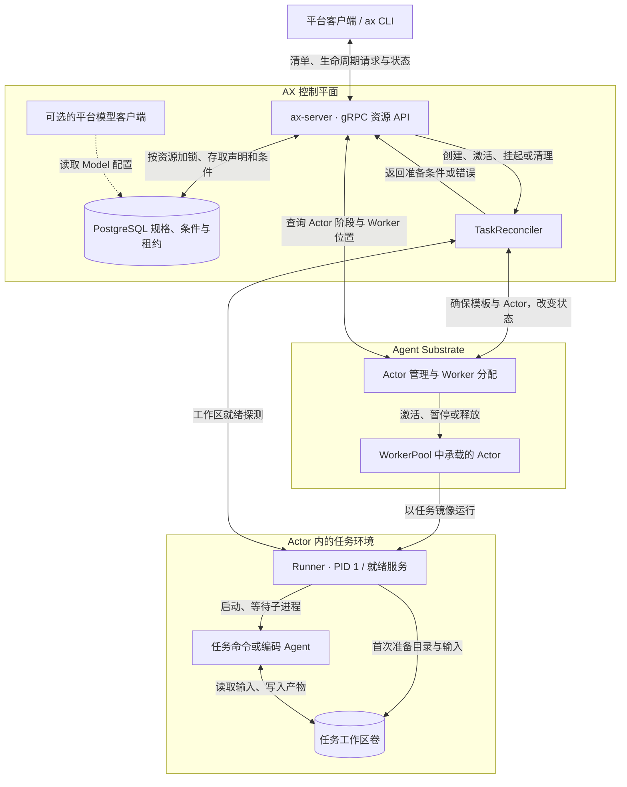
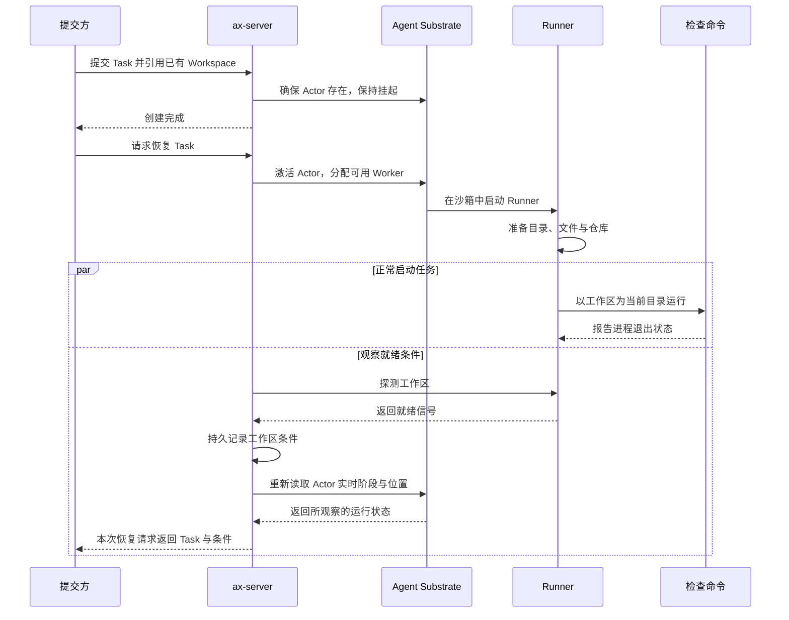
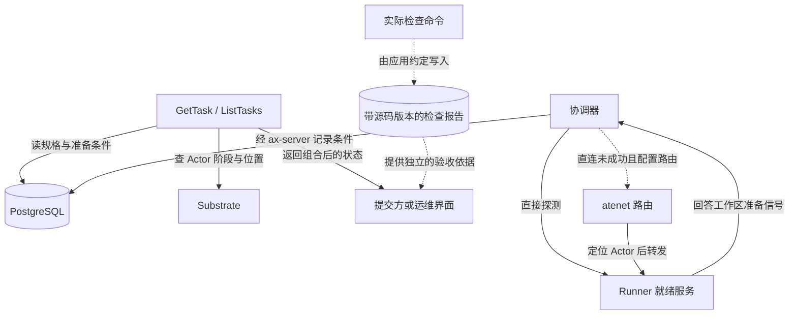

假设一个团队要在许多仓库上运行相同的兼容性检查。每个任务都要拿到正确的源码、配置和运行工具，拥有独立的执行环境，还要让操作者知道卡在环境准备还是业务检查。Google AX 为这件事提供声明式控制平面。调用方提交任务和工作区描述，AX 负责协调准备与启动，底层的 Agent Substrate 分配 Worker 并运行隔离的 Actor。任务里面可以是编码 Agent，也可以是一个普通命令。[项目定位与最小示例](https://github.com/google/ax/blob/241bc4d0c682a6898da5f718a9ec84fe7c9197f9/README.md) · [Agent Substrate 项目参考](../../github/substrate-agent-workspaces/)

## 任务、工作区和模型配置有不同的拥有者

**Task** 声明单次执行的镜像、资源、命令和参数，可引用同一 atespace（资源所属空间）中的 **Workspace**。Workspace 描述 Git 仓库、要写入的文件及可供工具使用的其他配置；它让多个任务共享同一种准备方式。**Model** 是可由 AX 组件使用的模型配置，包含提供方、模型和凭据引用。普通任务可以没有 Workspace 或 Model，上游的最小示例只运行一条读取环境变量的命令。具体 Agent 如何解释任务目标和调用模型，取决于所选 Runner 与命令。[资源与条件定义](https://github.com/google/ax/blob/241bc4d0c682a6898da5f718a9ec84fe7c9197f9/docs/concepts.md) · [最小 Task](https://github.com/google/ax/blob/241bc4d0c682a6898da5f718a9ec84fe7c9197f9/examples/simple.yaml) · [Runner 配置契约](https://github.com/google/ax/blob/241bc4d0c682a6898da5f718a9ec84fe7c9197f9/docs/manifests.md)

上游的出发点是大批量、有状态、需要暂停的短生命周期任务。把每一项都存为 Kubernetes CRD 会把频繁写入和保留成本转给集群的 etcd。AX 选择把自己的资源和细粒度租约放在 PostgreSQL，在 API 请求路径上直接协调 Substrate。规模是作者的设计目标；判断实际吞吐量还需要部署负载数据。Task 的外形借鉴 Kubernetes，保存与调度它的组件则在下图中各有位置。[作者对存储与协调方式的解释](https://github.com/google/ax/blob/241bc4d0c682a6898da5f718a9ec84fe7c9197f9/DESIGN.md#architecture)

新建 Task 会先检查显式引用的 Workspace 是否已经存在；Task 定义创建后不可改，Workspace、Model 是可以更新的独立资源。生产入口用同一个 PostgreSQL 后端提供存储和租约，锁粒度包含资源种类、所属空间和名字。因此两次修改同一任务的生命周期要相互等待，不相关任务则不必共用一把全局锁。Actor 的运行阶段和 Worker 位置属于 Substrate。获取或列出 Task 时，服务端结合自身记录与底层运行态构造响应。好处是不用长期维护两份容易过期的位置记录；代价是读取状态也依赖底层服务，底层不可达时可能得到 `Unknown`。这对运维界面很重要：暂时查不到底层状态时，直接显示任务已失败会误导操作者。[存储与状态分工](https://github.com/google/ax/blob/241bc4d0c682a6898da5f718a9ec84fe7c9197f9/DESIGN.md) · [底层不可达时的状态测试](https://github.com/google/ax/blob/241bc4d0c682a6898da5f718a9ec84fe7c9197f9/internal/server/actor_status_test.go)

## “工作区”在这里有两种含义

这个版本的每个 Task 至多绑定一份 Workspace，一份 Workspace 可以声明多个 Git 仓库。清单里的 Workspace 是可复用的准备配方，Actor 内的目录则保存单个任务实际取得的文件。将同一份声明绑给十个 Task，可以让它们取得同种输入；各任务中命令修改的文件仍属于各自的执行现场。协调器通过容器环境交给 Runner 任务与工作区声明。默认 Runner 读取声明、在持久工作区留下首次初始化标记，以该目录作为子进程的工作目录。任务程序也可以通过仅限沙箱内部的元数据接口查询自己的配置。MCP、技能或自由格式的 `spec.config` 最终如何被具体 Agent 使用，取决于该镜像的 Runner 与命令。[Runner 的输入输出契约](https://github.com/google/ax/blob/241bc4d0c682a6898da5f718a9ec84fe7c9197f9/docs/runner.md#how-a-runner-is-launched) · [初始化与卷上标记](https://github.com/google/ax/blob/241bc4d0c682a6898da5f718a9ec84fe7c9197f9/internal/workspace/setup.go) · [任务内元数据](https://github.com/google/ax/blob/241bc4d0c682a6898da5f718a9ec84fe7c9197f9/internal/metadata/server.go)

为什么要让 Runner 担任容器的第一个进程？平台需要一个稳定对象回答“环境准备好了吗”，而仓库里的检查命令可能很快退出、长期运行，甚至根本没有配置。把元数据、探测、子进程管理封装在 Runner，控制平面才能用同一协议管理不同工作负载。自定义镜像可以复用 Go 的 `runner` 包，或自行实现契约；替换镜像时仍要保留固定入口、准备信号和工作目录约定。托管平台自身可以按需读取 Model 资源；这条支路并不把一个模型或一套提示强加给每个 Task。[公共 Runner 实现](https://github.com/google/ax/blob/241bc4d0c682a6898da5f718a9ec84fe7c9197f9/runner/runner.go) · [平台模型配置读取](https://github.com/google/ax/blob/241bc4d0c682a6898da5f718a9ec84fe7c9197f9/internal/model/client.go) · [Runner 自定义项](https://github.com/google/ax/blob/241bc4d0c682a6898da5f718a9ec84fe7c9197f9/docs/runner.md)

## 一项兼容性检查何时可以开始

假设新建 Task 引用了一个需要克隆的 Git 仓库，Runner 使用默认实现。正常创建完成时，服务端已确保 Actor 存在并处于挂起状态。调用方再请求恢复，Substrate 从可用 Worker 池中分配执行位置；未准备足够的 Worker 时，这一步可以失败而原任务仍然挂起。一份 Task 的镜像先运行 Runner。Runner 开启元数据服务，尝试准备工作目录，然后按配置把检查程序作为子进程启动。AX 控制平面会探测 Runner 的工作区就绪信号，把结果映射为 Task 的条件。下面画出准备正常完成的路径，子进程执行与控制平面的探测可以并行发生。[协调器的恢复与探测](https://github.com/google/ax/blob/241bc4d0c682a6898da5f718a9ec84fe7c9197f9/internal/controller/reconciler.go) · [默认 Runner](https://github.com/google/ax/blob/241bc4d0c682a6898da5f718a9ec84fe7c9197f9/runner/runner.go)

`WorkspaceReady` 表达一次性的准备信号，后续挂起时可以保留；`Ready` 还要求任务处于运行状态。**两者都不能证明兼容性检查通过。** 默认 Runner 在子进程结束后继续提供元数据服务，控制平面在此版本不读取该命令的退出码作为业务完成结果。若产品要展示“测试已通过”，检查命令需要把结果、版本和报告交给产品认可的结果存储。[Runner 契约](https://github.com/google/ax/blob/241bc4d0c682a6898da5f718a9ec84fe7c9197f9/docs/runner.md) · [子进程退出后继续服务的测试](https://github.com/google/ax/blob/241bc4d0c682a6898da5f718a9ec84fe7c9197f9/runner/runner_test.go)

所读实现还有一个值得纳入验收的细节。初始化例程遇到 Git 克隆失败时会省略标记文件以便重试，却可能返回空错误；默认 Runner 仅检查返回的错误，可能因此发出就绪信号。即使初始化返回错误，默认 Runner 记录失败后仍会走到尝试启动配置命令的路径。对必须使用指定版本源码的任务，应在执行检查前独立确认实际检出的提交，并把这个提交记入报告。看到准备标记或健康响应，很难据此证明所有输入都已到位。[工作区初始化分支](https://github.com/google/ax/blob/241bc4d0c682a6898da5f718a9ec84fe7c9197f9/internal/workspace/setup.go) · [Runner 对就绪信号的处理](https://github.com/google/ax/blob/241bc4d0c682a6898da5f718a9ec84fe7c9197f9/runner/runner.go)

## 挂起与删除改变的资源不同

暂停计算时，AX 要求 Substrate 为 Actor 建立检查点并挂起它。查询该任务应看到当前不可接活，而此前已经记录的 `WorkspaceReady` 可以继续成立。再恢复时由底层负责执行现场，让每次临时停用都无需重新构建同一个 Agent 的工作区。删除则是另一条路径：服务端先清理底层 Actor 及为该任务生成的模板，再删除 AX 的存储记录。这个顺序保留了重试清理所需的身份；否则数据库里已经查不到任务，底层资源却可能仍然存在。[挂起、恢复与条件的职责](https://github.com/google/ax/blob/241bc4d0c682a6898da5f718a9ec84fe7c9197f9/internal/controller/reconciler.go) · [服务端读写及删除顺序](https://github.com/google/ax/blob/241bc4d0c682a6898da5f718a9ec84fe7c9197f9/internal/server/server.go#L368-L445)

访问运行环境同样不靠查询表里的旧地址。客户端可以经 Substrate 的 atenet 路由按空间和任务身份到达当前 Worker，任务无需单独建立 Kubernetes Service。固定版本的协调器探测就绪时先尝试 Worker 地址，在配置了路由地址且直连未成功时还会尝试路由。Runner 的探测与受支持的访客接口服务于平台，供子进程自查的元数据接口仅绑定回环地址。路由、任务信息和命令自己的结果接口具有不同的读者。[按 Actor 身份寻址](https://github.com/google/ax/blob/241bc4d0c682a6898da5f718a9ec84fe7c9197f9/docs/networking.md) · [实际探测顺序](https://github.com/google/ax/blob/241bc4d0c682a6898da5f718a9ec84fe7c9197f9/internal/controller/reconciler.go#L298-L343) · [访客与元数据服务](https://github.com/google/ax/blob/241bc4d0c682a6898da5f718a9ec84fe7c9197f9/docs/sandbox.md)

下图把读状态和验收结果放在同一处。上方两个数据源回答“任务目前在哪里、能否接活”，下方分支才回答“跑出了什么”。就绪探测也可以独立于查询过程发生。

## 在自己的平台里复用这层设计

如果只在一个受信任的 CI 节点运行固定检查，作业脚本和现有流水线已经能记录退出码与产物。需要为不同 Agent 配置不同镜像、共享工作区声明、隔离并管理大量独立任务，而且已有 Kubernetes 与 Substrate 基础设施时，AX 的资源和 Runner 契约更有价值。团队可以先沿用默认 Runner，仅替换包含项目工具链的镜像；需要自定义准备及状态语义时，再实现相同宿主接口。所读仓库仍处于快速开发期，适合固定控制平面和 Runner 版本共同验收。[Runner 的扩展层次](https://github.com/google/ax/blob/241bc4d0c682a6898da5f718a9ec84fe7c9197f9/docs/runner.md) · [版本状态](https://github.com/google/ax/blob/241bc4d0c682a6898da5f718a9ec84fe7c9197f9/README.md)

用一个可控仓库做三次检查：一次正常检出并成功退出，一次拿不到仓库，一次检出成功但测试失败。界面应分别给出工作区条件、实际输入版本和业务报告。再在任务挂起后重新查询，确认它能保留历史准备信息，同时清楚显示当前不能接活。这样把原本模糊的“任务跑起来了”拆成可以独立验证的产品承诺。
