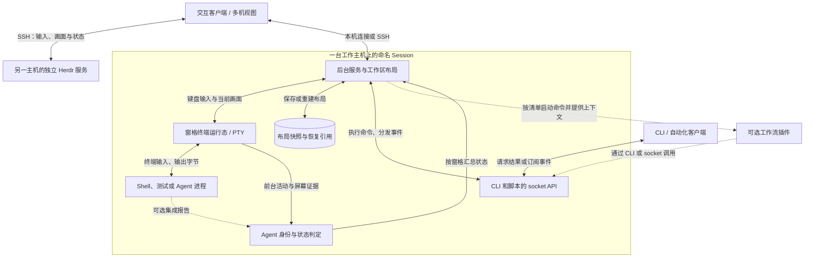
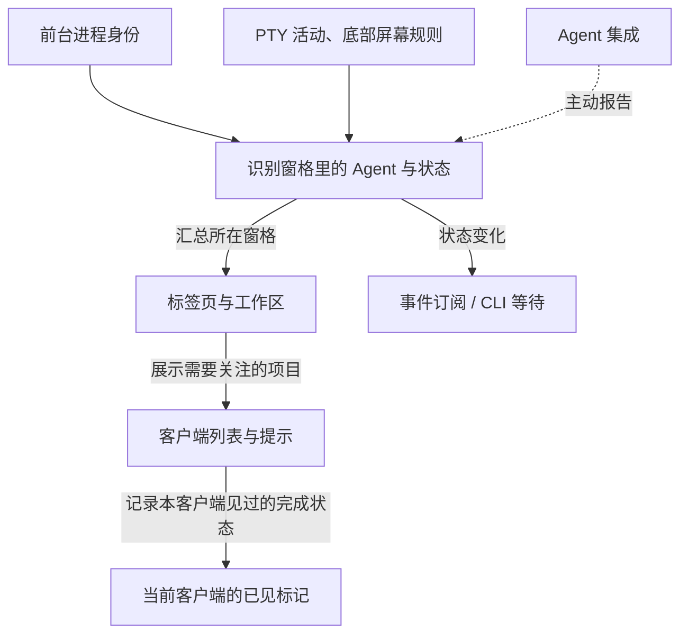
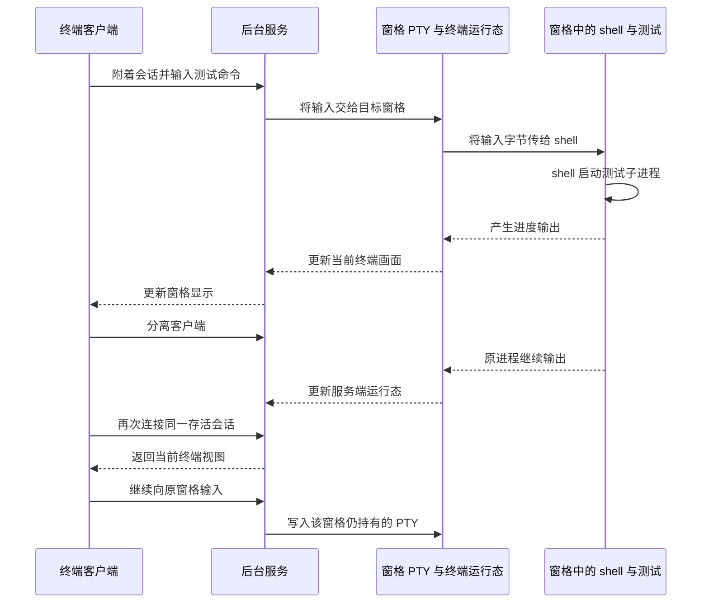

一个开发者在远端机器上开着三个终端：一个编码 Agent 正在改代码，一个在跑集成测试，另一个等待人工确认。笔记本合盖后，最希望保留的是远端任务继续执行的能力；第二天重新连接时，还希望立即认出哪个终端需要自己处理。Herdr 将这两个问题放在一起解决。它用后台服务持有真实终端，用工作区、标签页和窗格组织它们，并用 Agent 状态把注意力引到合适的位置。[仓库介绍](https://github.com/herdrdev/herdr/blob/e8d7d9705a7a2c89cef4dd42079379f05685af87/README.md) · [工作区与窗格概念](https://github.com/herdrdev/herdr/blob/e8d7d9705a7a2c89cef4dd42079379f05685af87/docs/versions/0.9.5/website/src/content/docs/concepts.mdx)

## 真正持有进程的是谁

**Workspace** 可以代表一个仓库或一次调查；**Tab** 保存一组布局；**Pane** 是能够接收输入并显示真实进程输出的终端。显示这些窗格的客户端可以离开，后台 Herdr 服务仍持有伪终端（PTY）与终端运行态。PTY 为 shell、测试程序等子进程提供正常的终端接口，意味着现有工具可以照常运行。命名 Session 进一步隔开不同组的服务和运行状态，多机视图则可以连接各台主机上独立的服务。[服务与连接方式](https://github.com/herdrdev/herdr/blob/e8d7d9705a7a2c89cef4dd42079379f05685af87/docs/versions/0.9.5/website/src/content/docs/persistence-remote.mdx) · [PTY 实现](https://github.com/herdrdev/herdr/blob/e8d7d9705a7a2c89cef4dd42079379f05685af87/src/pty/mod.rs)

输入仍是发给现有程序的按键、鼠标操作或命令，输出则有两层：终端程序产生自己的文本或画面，Herdr 另外提供按项目和机器汇总的 Agent 状态。模型服务、对话记录与代码仓库继续由各编码工具使用和维护。这个边界使一个未适配的 CLI 也能照常在窗格里运行，只是 Herdr 不一定知道何时该提醒人。[运行现有 Agent 的产品定位](https://github.com/herdrdev/herdr/blob/e8d7d9705a7a2c89cef4dd42079379f05685af87/README.md) · [支持方式与状态](https://github.com/herdrdev/herdr/blob/e8d7d9705a7a2c89cef4dd42079379f05685af87/docs/versions/0.9.5/website/src/content/docs/agents.mdx)

输入抵达后台服务后，目标窗格决定写入哪一个 PTY；子进程的输出又改变该终端的缓冲和可见画面。附着客户端得到的是能按自身界面显示的视图与更新，不必拥有负责读 PTY 的进程。没有人看屏幕时这套运行态仍在。服务器的 `TerminalRuntime`、无界面运行循环与客户端画面输出分属三个模块，这也解释了断开显示不会自动终止工作。[服务端终端对象](https://github.com/herdrdev/herdr/blob/e8d7d9705a7a2c89cef4dd42079379f05685af87/src/terminal/runtime.rs) · [无界面服务](https://github.com/herdrdev/herdr/blob/e8d7d9705a7a2c89cef4dd42079379f05685af87/src/server/headless.rs) · [客户端画面输出](https://github.com/herdrdev/herdr/blob/e8d7d9705a7a2c89cef4dd42079379f05685af87/src/client/frame_output.rs)

多机模式把本机和保存的 SSH 连接放在同一客户端，每台机器仍有自己的会话、后台服务和进程。连接其中一台失败时，其他机器保持可用；移除一个保存的连接也不会顺便关闭远端进程。对命名 Session，可以把它理解为一组服务、控制接口和持久状态的命名空间；对 Workspace，可以把它理解为这个空间中的项目分组。这里没有一个集中调度器负责跨机器迁移任务。[连接与独立重连](https://github.com/herdrdev/herdr/blob/e8d7d9705a7a2c89cef4dd42079379f05685af87/docs/versions/0.9.5/website/src/content/docs/connecting-machines.mdx) · [命名会话与远程连接](https://github.com/herdrdev/herdr/blob/e8d7d9705a7a2c89cef4dd42079379f05685af87/docs/versions/0.9.5/website/src/content/docs/persistence-remote.mdx)

## 终端输出如何变成“需要我处理”的提示

只有在窗格里看到一个等待符号，无法区分 Agent 正在计算、等待人回答，还是仅仅展示历史记录。Herdr 先识别前台程序，再综合活动、画面规则和可用集成信号；例如对依赖屏幕规则的 Agent，只有匹配当前底部画面中的已知确认或提问控件，才把它判成 `blocked`。某个版本更换了提示外观时，就可能暂时退回已知 Agent 的默认 `idle`。这些判断服务于“应该看哪里”，代码改动是否正确还要看测试或审阅。[屏幕检测与证据字段](https://github.com/herdrdev/herdr/blob/e8d7d9705a7a2c89cef4dd42079379f05685af87/src/detect/mod.rs) · [状态判定的局限](https://github.com/herdrdev/herdr/blob/e8d7d9705a7a2c89cef4dd42079379f05685af87/docs/versions/0.9.5/website/src/content/docs/agents.mdx#blocked-state)

`done` 还有一层面向人的含义：工作已结束，且这个客户端还没有看过。一个窗口显示完成后，另一个客户端仍可能保留提醒；CLI/API 使用服务端的已见状态。脚本和 Agent 可以用同一个控制面查询窗格、发输入或等待事件。工作流插件也使用这些接口：宿主读取清单、启动声明的命令并提供上下文，插件自己选择实现语言、依赖和持久状态。上游将这一边界解释为保持核心聚焦于终端和稳定的控制接口，让团队按需增加流程。[每个客户端的状态语义](https://github.com/herdrdev/herdr/blob/e8d7d9705a7a2c89cef4dd42079379f05685af87/docs/versions/0.9.5/website/src/content/docs/concepts.mdx#agent) · [控制与订阅接口](https://github.com/herdrdev/herdr/blob/e8d7d9705a7a2c89cef4dd42079379f05685af87/docs/versions/0.9.5/website/src/content/docs/socket-api.mdx) · [插件设计与状态归属](https://github.com/herdrdev/herdr/blob/e8d7d9705a7a2c89cef4dd42079379f05685af87/docs/versions/0.9.5/website/src/content/docs/plugins.mdx)

## 同一次长测试，关闭客户端和重启服务结果不同

先在窗格中启动一个持续输出的测试程序，然后只让客户端分离。此时既没有把测试存盘，也没有把进程迁到别处；测试一直在原主机运行。稍后客户端重新握手，重新获得终端视图，就可以看到分离期间产生的输出。所读版本有专门的集成测试覆盖这个过程。[分离后原进程仍存活](https://github.com/herdrdev/herdr/blob/e8d7d9705a7a2c89cef4dd42079379f05685af87/tests/detach_reattach.rs#L431) · [重连能查看断开期间的输出](https://github.com/herdrdev/herdr/blob/e8d7d9705a7a2c89cef4dd42079379f05685af87/tests/detach_reattach.rs#L744) · [无客户端时的服务测试](https://github.com/herdrdev/herdr/blob/e8d7d9705a7a2c89cef4dd42079379f05685af87/tests/server_headless.rs)

若操作的是停止后台服务或重启整台机器，就要换一套恢复预期。磁盘上的布局能说明“原来有哪些窗格”，无法凭这些信息恢复任意 shell 进程的内存。Herdr 为此将几种状态分开处理。[恢复边界](https://github.com/herdrdev/herdr/blob/e8d7d9705a7a2c89cef4dd42079379f05685af87/docs/versions/0.9.5/website/src/content/docs/session-state.mdx) · [快照的数据结构](https://github.com/herdrdev/herdr/blob/e8d7d9705a7a2c89cef4dd42079379f05685af87/src/persist/snapshot.rs)

| 想保留的东西 | 服务重启后的来源 | 使用时要核对什么 |
| --- | --- | --- |
| 项目、标签页、目录与布局 | 已保存的会话快照 | 是否重新打开了预期项目和目录 |
| 最近的终端画面 | 可选的窗格历史，需与保存的布局相符 | 输出可能包含私密信息，因此该版本默认关闭此功能 |
| 某个 Agent 的原生对话 | 受支持的集成提供会话引用，或 Agent 提供恢复命令 | 这是让支持的 Agent 重新启动并接续对话，之前的任意后台命令需分别核对 |

恢复后的窗格找不到原目录时会保留错误和目录信息，修好后可以再试。对支持的 Agent，会话引用说明应请哪个程序重新打开哪次对话，真正的对话历史由该 Agent 管理。受支持平台升级时还可以尝试将仍存活的终端交接给新服务；能成功交接的前提是旧服务和进程仍在。这与机器掉电后的快照恢复是不同的生命周期。[恢复与更新交接](https://github.com/herdrdev/herdr/blob/e8d7d9705a7a2c89cef4dd42079379f05685af87/docs/versions/0.9.5/website/src/content/docs/session-state.mdx) · [运行中终端交接实现](https://github.com/herdrdev/herdr/blob/e8d7d9705a7a2c89cef4dd42079379f05685af87/src/handoff_runtime.rs)

因此，能重放一行“正在测试”只证明曾经显示过这行文本。能恢复 Agent 的对话，也不能说明对话里提及的测试仍在执行。对于重要的长作业，产品应为作业本身保存身份与最终结果，使人重连后有独立的核对入口。[会话恢复实现](https://github.com/herdrdev/herdr/blob/e8d7d9705a7a2c89cef4dd42079379f05685af87/src/persist/restore.rs) · [原生 Agent 恢复](https://github.com/herdrdev/herdr/blob/e8d7d9705a7a2c89cef4dd42079379f05685af87/src/agent_resume.rs)

## 什么时候需要给终端再加这一层

如果日常只需要保留一两个远程 shell，已有终端复用器就能解决大部分需求。若团队频繁切换多个仓库、多个编码 Agent 或多台机器，工作台既要让进程继续运行，又要指出哪一处在等待人，Herdr 的价值才更明显。相应的运营成本包括让工作主机和后台服务持续可用、维护支持的 Agent 集成，以及决定哪些屏幕历史可以落盘。

验收一个自己的运维工作台时，可以先让测试程序连续写出编号，分离客户端后再次附着，核对编号仍由原进程继续生成。然后在可丢弃的测试会话中重启后台服务，分别检查布局、画面回放、Agent 对话和正在运行的进程。用这两次情形检验同一个“恢复会话”按钮，可以说清它对用户许下了哪几项承诺。
