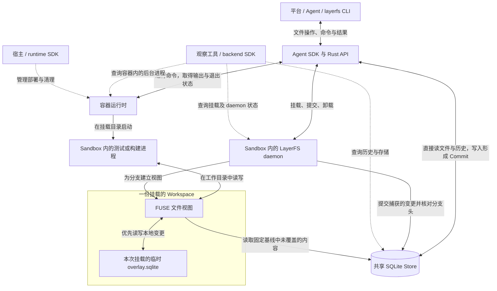
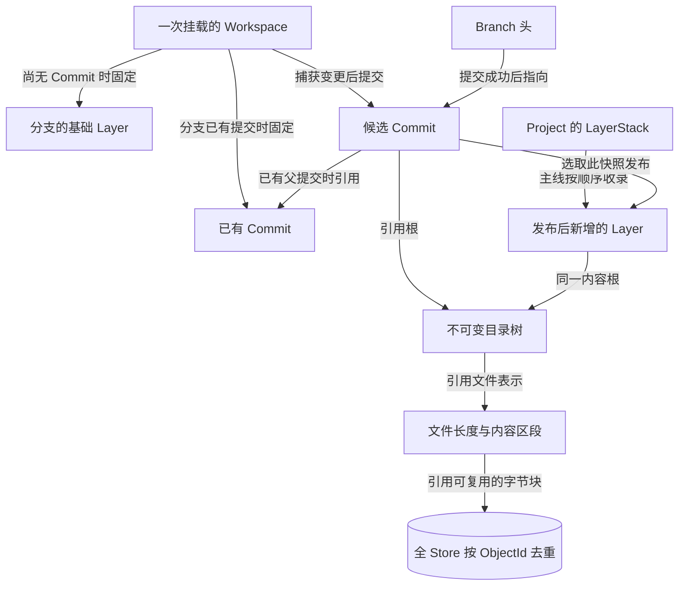
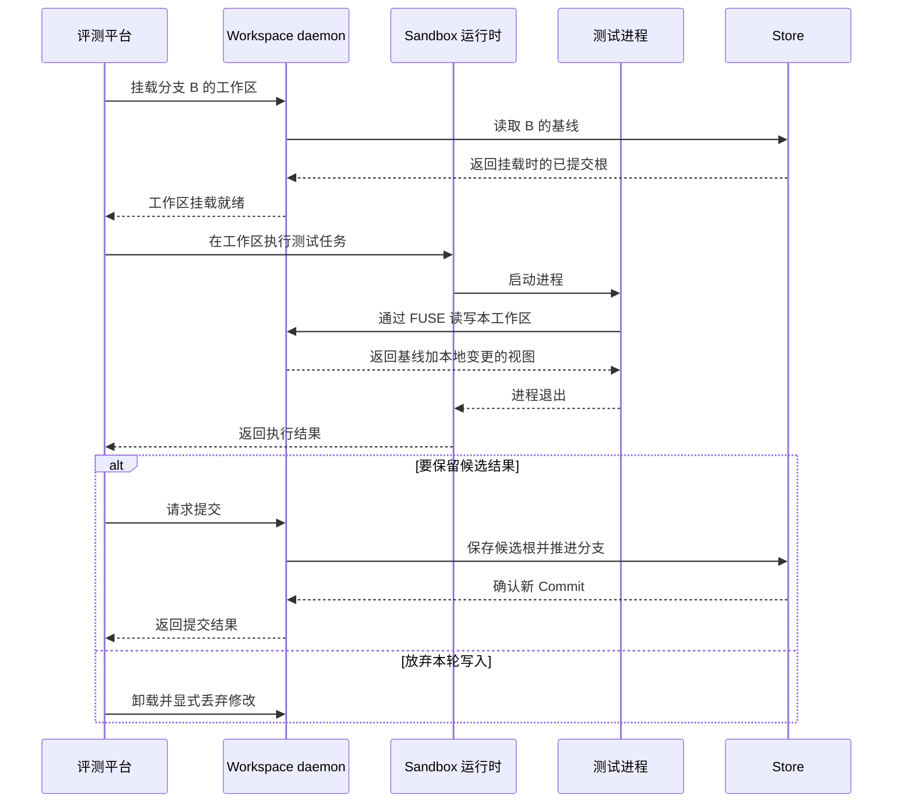

设想一个自动修复平台要同时尝试两种补丁。两个 Agent 都要读源码、运行已经装好的测试工具，还要改动同一份配置。如果共用一个目录，第一轮测试读到的文件可能来自第二个 Agent。逐份复制整个目录能隔开两次试验，但依赖和构建产物越大，准备每个任务的成本就越高。

LayerFS 为这类任务提供带历史的文件系统。平台先把需要的目录保存在 Store 中，再给每次试验挂载一个可写的 Workspace。两个工作区可以从同一棵文件树开始，分别修改、提交和卸载。只要初始快照已包含依赖，新任务就能直接读它们。以后要复查某个结果，可以从相应的 Commit 派生一个分支，再挂载这个分支。这里保存的是文件系统的状态，远端服务里的测试数据仍由那些服务管理。[项目说明与使用边界](https://github.com/Ephemeral-AI-Lab/layerfs/blob/35d36575c1eb4d23d4b54534a7030d855db890e7/README.md) · [工作区生命周期](https://github.com/Ephemeral-AI-Lab/layerfs/blob/35d36575c1eb4d23d4b54534a7030d855db890e7/docs/general/concepts.md)

## 一个挂载点背后有哪些状态

**Commit** 表示一份不可变的分支快照。**Branch** 给一系列 Commit 提供一个可推进的头。**Workspace** 固定一个起点，把已提交的文件树和本次写入叠成进程看到的目录。**Layer** 是项目主线上的一个发布版本，某个试验分支新增了 Commit 后，项目主线可以继续停留在原来的 Layer。这样，评测系统能分别记录“哪份候选补丁通过了测试”和“最后选中了哪份补丁”。[数据模型](https://github.com/Ephemeral-AI-Lab/layerfs/blob/35d36575c1eb4d23d4b54534a7030d855db890e7/docs/general/concepts.md) · [发布入口](https://github.com/Ephemeral-AI-Lab/layerfs/blob/35d36575c1eb4d23d4b54534a7030d855db890e7/engine/crates/layerfs-api/src/branch/publish.rs)

上游把设计来源概括为联合文件系统、写时复制快照、按内容寻址的存储和可丢弃的执行环境。它们在这里围绕一个约束组合起来：不同 Agent 要能立即看到完整目录，获取这份视图不应要求每人复制整个目录。系统因此把承载文件内容的 Store、暂存未提交修改的 Workspace、运行测试的 Sandbox 拆成三个不同的对象。[上游对设计来源的说明](https://github.com/Ephemeral-AI-Lab/layerfs/blob/35d36575c1eb4d23d4b54534a7030d855db890e7/README.md#prior-art)

上图画的是 Linux 下的调用关系。平台请求运行测试程序时，Sandbox 运行时在挂载目录中启动进程、收集输出并返回退出状态。测试进程通过普通文件接口访问挂载点，由 daemon 处理目录内的读写；只需通过 SDK 读文件、改文件或查历史时，可以直接使用 Store。产生更改的 SDK 文件写入可以单独形成一次 Commit，也可用 `fs.apply` 把多项修改一次发布。一个 Sandbox 可以有多个挂载。测试进程由容器运行时管理，只将选中的 Workspace 用作当前目录；容器内其他位置（例如临时目录）不受这份挂载的分支隔离。执行命令后，调用方决定何时提交工作区。macOS 和 Windows 的 Store 调用经由运行在 Linux 环境中的 worker。集成平台还可用 `@layerfs/backend` 读取历史和工作区状态，用 `@layerfs/runtime` 初始化或清理运行环境。[SDK 分工与平台边界](https://github.com/Ephemeral-AI-Lab/layerfs/blob/35d36575c1eb4d23d4b54534a7030d855db890e7/api/README.md) · [命令执行的实现](https://github.com/Ephemeral-AI-Lab/layerfs/blob/35d36575c1eb4d23d4b54534a7030d855db890e7/engine/crates/layerfs-api/src/sandbox/exec.rs) · [调用的执行位置](https://github.com/Ephemeral-AI-Lab/layerfs/blob/35d36575c1eb4d23d4b54534a7030d855db890e7/api/docs/agent.md)

在 Linux，SDK 经 Node 原生绑定调用 Rust，实现 Store 操作的进程可以直接打开 SQLite 文件，系统无需常驻数据库服务。非 Linux 上的 Store 调用进入配套的 Linux worker。直接访问省去了文件工具启动容器的往返。命令路径的写入层有每个挂载独立的临时数据库，与存放历史和对象的共享 SQLite 文件用途不同；卸载可丢掉前者，但不会删除已经发布的历史。[每挂载独立的写入层](https://github.com/Ephemeral-AI-Lab/layerfs/blob/35d36575c1eb4d23d4b54534a7030d855db890e7/core/docs/architecture/19-daemon-overlay.md) · [SDK 与运行时的分工](https://github.com/Ephemeral-AI-Lab/layerfs/blob/35d36575c1eb4d23d4b54534a7030d855db890e7/api/README.md)

## 复用的究竟是目录、名字还是字节

一次分支试验逐层经过下列引用。Project 对应命名的 LayerStack，`main` 的 Layer 描述选中了哪棵树，Branch 的头描述该条候选线最新的 Commit。最下面是一套全 Store 共享的不可变对象；同一根树可以被不同名字、不同提交与发布记录同时引用。两份并发试验的“共同起点”只需共享这些引用。

同一内容重复插入时，Store 按 `ObjectId` 去重；文件以按内容分块和组织区段的结构表示；局部修改时，未改变的块仍可被旧树和新树同时引用。因此，创建 Branch 或发布 Layer 不需要复制整份文件内容，而大量从未出现过的构建产物依然会增长存储。内容身份也使读者可以核对刚读出的字节与被引用的对象相符。这里的收益取决于工作集的相似度，不能只由某一次去重比推算。[不可变对象与分块模型](https://github.com/Ephemeral-AI-Lab/layerfs/blob/35d36575c1eb4d23d4b54534a7030d855db890e7/docs/general/concepts.md#content-model) · [全局 SQLite 对象空间](https://github.com/Ephemeral-AI-Lab/layerfs/blob/35d36575c1eb4d23d4b54534a7030d855db890e7/core/docs/architecture/84-global-sqlite-store.md)

## 两个候选补丁怎样从同一基线分开

平台在同一基线派生 A、B 两个 Branch。下图跟踪 B 的一次试验。A 的写入进入自己的 Workspace；即使两个 Agent 修改相同路径，B 的测试进程也只读到 B 的候选内容。为了复查实验，平台把测试的退出状态和日志单独保存，关联 B 的提交标识。重跑时先用 `branch.fork` 从该 Commit 派生新分支，再用 `workspace.mount` 挂载新分支。[提交驱动](https://github.com/Ephemeral-AI-Lab/layerfs/blob/35d36575c1eb4d23d4b54534a7030d855db890e7/engine/crates/layerfs-store-service/src/store/commit.rs) · [分支与合并 API](https://github.com/Ephemeral-AI-Lab/layerfs/blob/35d36575c1eb4d23d4b54534a7030d855db890e7/engine/crates/layerfs-api/src/branch/merge.rs)

**退出状态和快照解决不同的问题。** 命令返回成功只说明测试进程如何结束。显式提交后，其他消费者才有这次 Workspace 修改对应的 Commit；也可以在测试失败后提交失败现场供人复查。普通卸载遇到未提交状态会拒绝，调用方可以明确选择丢弃。若两个 Workspace 共用同一 Branch，提交期间分支头可能已经推进，普通提交会尝试把修改与新头合并，遇到冲突时不推进共享分支头；带冲突的合并结果留在 Workspace，本地历史绑定移动到已观察的新头，调用方可继续处理。给两轮试验各自分支，可以把“选哪个结果”的决定留到评测之后。[卸载契约](https://github.com/Ephemeral-AI-Lab/layerfs/blob/35d36575c1eb4d23d4b54534a7030d855db890e7/api/agent/src/workspace/unmount.js) · [提交与分支头变化](https://github.com/Ephemeral-AI-Lab/layerfs/blob/35d36575c1eb4d23d4b54534a7030d855db890e7/engine/crates/layerfs-store-service/src/store/commit.rs) · [并发提交测试](https://github.com/Ephemeral-AI-Lab/layerfs/blob/35d36575c1eb4d23d4b54534a7030d855db890e7/engine/crates/layerfs-api/tests/lane_merge.rs)

## 哪个版本可以成为共享结果

独立分支的 `branch.merge` 会尝试生成一个新的合并分支。若两侧存在无法合并的修改，则返回冲突，两条输入分支保留原样。对自动生成、允许覆盖的文件，可以按项目规则指定最后写入者胜出；对同时改动的业务配置，评测平台应让负责人审查差异并重跑测试。[分支合并的返回约定](https://github.com/Ephemeral-AI-Lab/layerfs/blob/35d36575c1eb4d23d4b54534a7030d855db890e7/engine/crates/layerfs-api/src/branch/merge.rs) · [合并与冲突规则](https://github.com/Ephemeral-AI-Lab/layerfs/blob/35d36575c1eb4d23d4b54534a7030d855db890e7/.agents/skills/layerfs-js-sdk/references/methods/branch.md)

发布另有一层选择。`branch.publish` 把指定 Commit 的视图加为主线的新 Layer。旧分支直接发布，可能让 `main` 当前视图跳过分支派生后其他人发布的修改，发布结果会列出被跳过的层。若必须保留这些修改，应先把最新主线合入候选分支，在合并结果上重新测试，再发布并核对返回值。如果产品承诺保留所有并发发布，所有发布者应经同一条发布队列，串行完成读取最新主线、合并、复测和发布。这样能避免测试期间发生另一次主线推进。`overwrote` 是发布之后的反馈。这个区分同样适用于设计素材审核系统：一份候选作品能独立预览，并不意味着它天然包含审稿期间主线上的修订。[发布实现](https://github.com/Ephemeral-AI-Lab/layerfs/blob/35d36575c1eb4d23d4b54534a7030d855db890e7/engine/crates/layerfs-api/src/branch/publish.rs) · [发布结果与主线更新](https://github.com/Ephemeral-AI-Lab/layerfs/blob/35d36575c1eb4d23d4b54534a7030d855db890e7/.agents/skills/layerfs-js-sdk/references/methods/branch.md)

## 给自动修复平台选存储方式

如果评测对象只有 Git 跟踪的源码，每次只需少量工作副本，Git worktree 已能提供独立目录。若每轮还依赖大量相同的未跟踪文件、需要频繁并发试验，并希望事后挂载某次工具操作留下的完整现场，LayerFS 的快照范围和共享对象值得评估。选择前还要核对测试程序用到的文件类型，例如该版本的 FUSE 视图不支持 FIFO、套接字节点或设备节点。[适用场景与文件系统限制](https://github.com/Ephemeral-AI-Lab/layerfs/blob/35d36575c1eb4d23d4b54534a7030d855db890e7/README.md)

**逻辑提交和抗断电是两项承诺。** 此版本的 SQLite Store 采用 Disposable 配置，使用 WAL 并设置 `synchronous=OFF`。正常卸载后可从提交派生新分支并重新挂载，无法由此推断机器突然断电也能找回最后一次提交。若某一份修复产物不能重新生成，应由具备所需持久性保证的制品库保存。[SQLite 配置实现](https://github.com/Ephemeral-AI-Lab/layerfs/blob/35d36575c1eb4d23d4b54534a7030d855db890e7/engine/crates/layerfs-persistence/src/backend/sqlite/profile.rs) · [Store 的运行边界](https://github.com/Ephemeral-AI-Lab/layerfs/blob/35d36575c1eb4d23d4b54534a7030d855db890e7/core/docs/architecture/84-global-sqlite-store.md)

上线前可用一套真实依赖做一次小试验。让 A、B 从同一基线修改同名文件，分别提交并卸载，从两个提交分别派生新分支并挂载，核对文件内容与平台单独保存的测试回执。然后在主线加入一项必须保留的修订，再走一遍合并、验证和发布。记录首个测试进程就绪所用时间、重复挂载的耗时和 Store 的实际增量。这几项观察可以同时回答任务是否真正隔离、候选能否复现，以及共享初始文件给自己的工作负载节省了多少成本。
