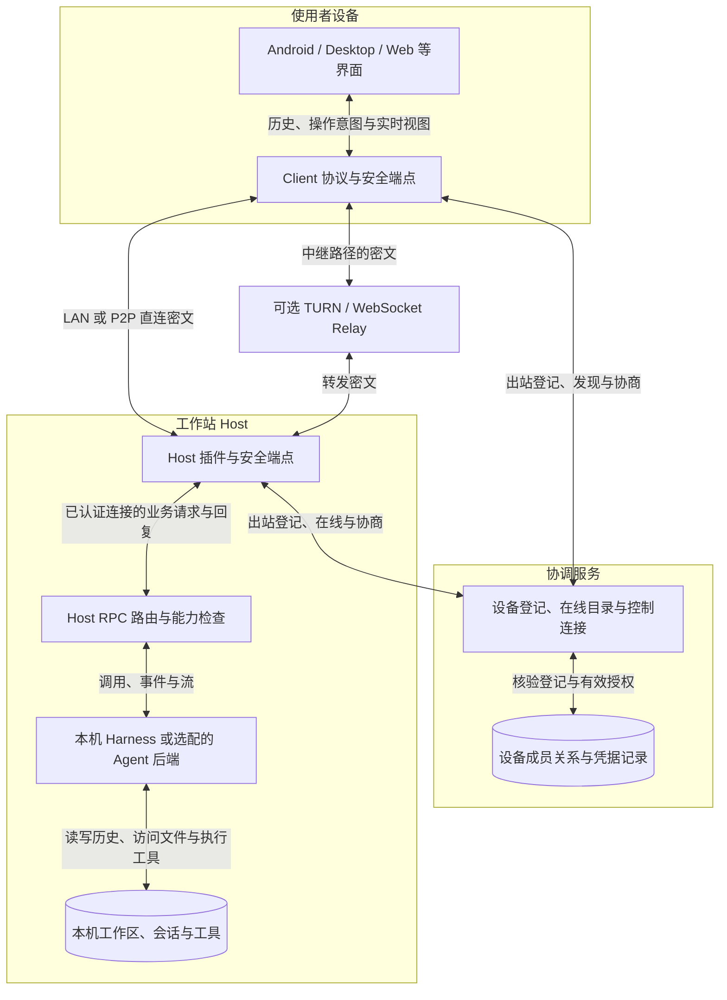
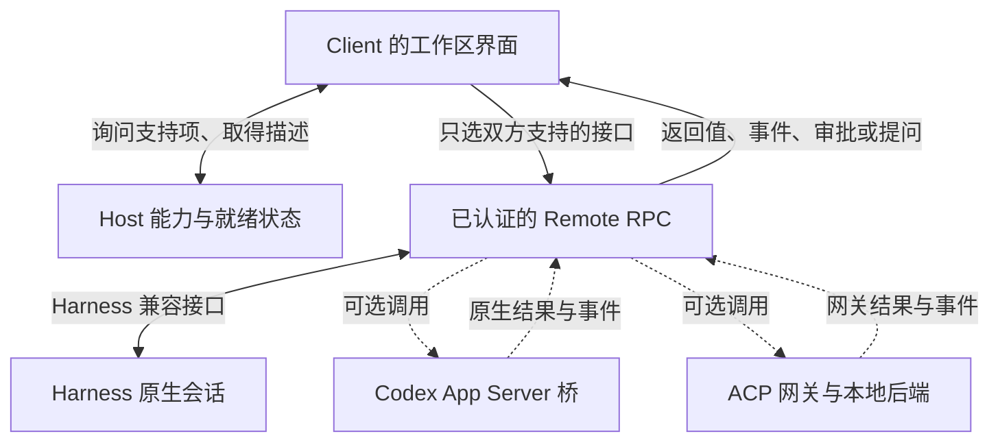
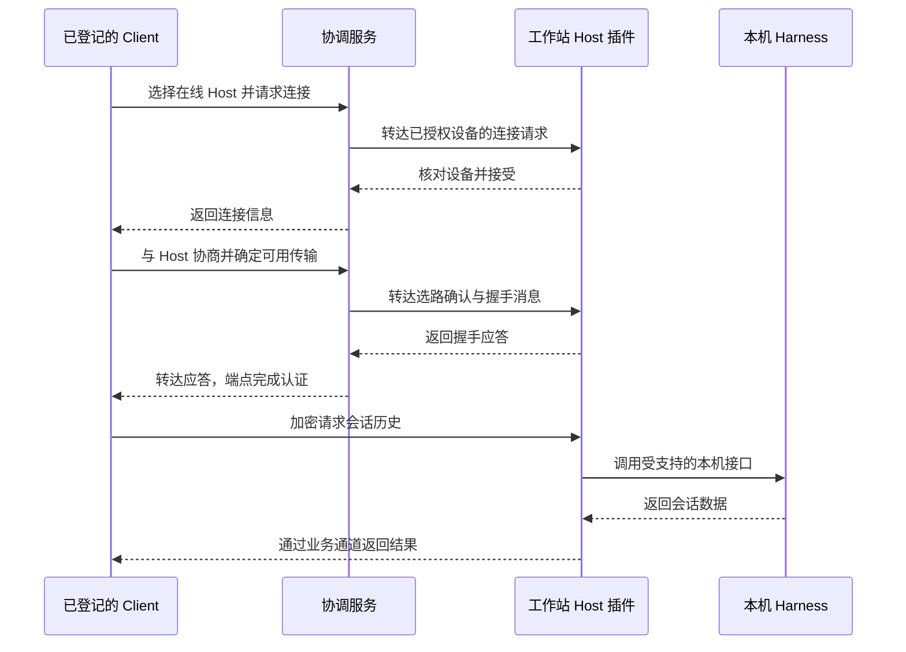

工作站上的 Agent 已经生成了报告，使用者离开桌面后想在手机上看看进度。文件、工具和会话历史都在工作站，为了一次查看就把整套目录、模型设置和运行环境同步到手机，既费时又容易产生两个版本。DSH Remote 选择让 **Host** 继续拥有运行环境，另一台设备充当 **Client**，通过远程接口读取历史、发送操作和查看结果。DeepSeek Harness 提供运行能力，本仓库主要提供远程接入所需的插件、客户端、协议及通信层。[项目定位与客户端范围](https://github.com/liguobao/ds-harness-remote/blob/fac5e6005b6b747889ef01193a64601bb14f53ad/README.zh.md) · [DeepSeek Harness 项目参考](../../github/deepseek-ai-deepseek-harness/)

## 哪些信息需要交给服务端

Host 主动连接协调服务，Client 也向该服务登记设备并寻找在线的 Host。协调服务需要知道账号成员关系、设备在线状态和连接情况，才能帮助两台设备找到对方。会话消息与文件内容则通过以 Noise IK 握手建立的端到端加密业务通道传递，网络条件允许时可直连，也可中继。Host 不需要为这个工作流开放公网入站端口。这个仓库的 `apps/server` 提供单账号自部署所需的子集，评估托管站点功能时还要区分哪些由外部服务提供。[网络职责](https://github.com/liguobao/ds-harness-remote/blob/fac5e6005b6b747889ef01193a64601bb14f53ad/docs/network.md) · [自部署服务说明](https://github.com/liguobao/ds-harness-remote/blob/fac5e6005b6b747889ef01193a64601bb14f53ad/apps/server/README.md)

仓库本身也沿这条边界分工。Host 插件、Android 客户端、实验性 VS Code 客户端、浏览器扩展入口，以及协议、加密、选路和客户端公共包都在本仓库。浏览器扩展负责发现设备并打开 Remote Web；完整多账号站点、Web 会话界面和管理端由独立服务项目提供。仓内的单账号 Server 可以独立部署，提供登记、在线目录和控制连接，数据通道仅支持 WebSocket 密文中继。后文的 WebRTC/TURN 属于支持它们的部署。这样读下面的架构图，才能分辨一个功能属于协议、客户端还是某种部署。[仓库功能边界](https://github.com/liguobao/ds-harness-remote/blob/fac5e6005b6b747889ef01193a64601bb14f53ad/docs/README.md) · [最小服务实现范围](https://github.com/liguobao/ds-harness-remote/blob/fac5e6005b6b747889ef01193a64601bb14f53ad/apps/server/README.md) · [协议与实现边界](https://github.com/liguobao/ds-harness-remote/blob/fac5e6005b6b747889ef01193a64601bb14f53ad/docs/protocol.md)

图中将协调与中继按职责画开，二者可以由同一服务承担。连接需要同账号下的有效设备授权，双方还要核对对端身份；对已认识的设备，固定在本地的公钥用于发现身份变化。中继可观察哪些设备何时通信、近似流量等元数据。读取本次对话则需要业务端点解密，所以终端设备自身和 Host 的本地授权仍在信任范围内。[身份与可见元数据](https://github.com/liguobao/ds-harness-remote/blob/fac5e6005b6b747889ef01193a64601bb14f53ad/docs/end-to-end-encryption.md) · [设备身份存储](https://github.com/liguobao/ds-harness-remote/blob/fac5e6005b6b747889ef01193a64601bb14f53ad/packages/plugin/src/identity-store.ts)

客户端所列“工作站在线”只说明控制连接存在。采用完整网络能力的部署时，双方先确定共同可用的传输：局域网或互联网直连可减少中转，直连不可用时可以使用 TURN，WebRTC 不可用时还可走 WebSocket Relay。选好路径后，双方经控制通道交换握手消息并确认对端；随后业务密文走选定路径。账号成员关系由服务端判断，设备端另行保存对端身份，Host 再决定这条连接能使用哪些能力。把三个判断拆开，才能解释为什么“设备可见、网络已通、当前后端能打开终端”可能得到三个不同的答案。[连接顺序与传输职责](https://github.com/liguobao/ds-harness-remote/blob/fac5e6005b6b747889ef01193a64601bb14f53ad/docs/network.md) · [设备身份与信任](https://github.com/liguobao/ds-harness-remote/blob/fac5e6005b6b747889ef01193a64601bb14f53ad/docs/end-to-end-encryption.md)

## 同一台手机怎样面对不同的 Agent 后端

同一条加密连接可以承载不同业务协议。Host 先描述自身支持的能力和已就绪的工作区类型，Client 再选择相应接口。对 Harness，固定版本保留不同代的接口适配，当前兼容性说明以官方 Typert / Session V3 为主要方向，旧 ApiProxy 实现仍存在。对可选 Codex 工作区，适配的是 Codex 的 App Server；ACP 工作区经专门的网关连接已配置的本地后端。这种分派让客户端可以共用设备选择和传输逻辑，又无需假定每种后端都有相同的历史、终端、文件预览和交互权限。[能力与版本矩阵](https://github.com/liguobao/ds-harness-remote/blob/fac5e6005b6b747889ef01193a64601bb14f53ad/docs/compatibility.zh.md) · [Host 分派实现](https://github.com/liguobao/ds-harness-remote/blob/fac5e6005b6b747889ef01193a64601bb14f53ad/packages/plugin/src/rpc-router.ts) · [客户端公共接口](https://github.com/liguobao/ds-harness-remote/blob/fac5e6005b6b747889ef01193a64601bb14f53ad/packages/client-core/src/index.ts)

同一个会话界面显示的历史，在三条路径上分别归原后端管理。Harness 提供原生会话；Codex 的 Thread、历史和待审批状态归 Codex App Server，Remote 只把它们映射到界面。实验性 ACP 网关按后端能力取回记录，例如 OpenCode 用会话列表确定目录，再用独立临时进程加载会话并回放历史，记录始终留在对应后端。工作站恢复在线后，只有选对原后端才能取回同一份工作。[Codex 会话与审批归属](https://github.com/liguobao/ds-harness-remote/blob/fac5e6005b6b747889ef01193a64601bb14f53ad/docs/codex-remote.md#L10-L26) · [ACP 后端历史的来源](https://github.com/liguobao/ds-harness-remote/blob/fac5e6005b6b747889ef01193a64601bb14f53ad/docs/acp-remote.md#L24-L30)

对业务侧，输入可能是一条提示、一次审批答复或对文件的查询；输出既可能是一次调用结果，也可能是之后不断到达的事件。流、传输中的数据与取消操作归属于具体连接，从而允许两台设备同时观察同一 Host。Android 可在本地保留草稿和阅读位置，展开某条对话时仍从 Host 读取正文；已显示的界面、远端执行和传输中的请求因此有各自的生命周期。[协议中的调用与流](https://github.com/liguobao/ds-harness-remote/blob/fac5e6005b6b747889ef01193a64601bb14f53ad/docs/protocol.md) · [Android 历史与实时事件的展示](https://github.com/liguobao/ds-harness-remote/blob/fac5e6005b6b747889ef01193a64601bb14f53ad/apps/android/src/state/event-reducer.ts) · [各端支持范围](https://github.com/liguobao/ds-harness-remote/blob/fac5e6005b6b747889ef01193a64601bb14f53ad/README.md#supported-clients)

## 手机点开历史记录时发生什么

以两台已经登记的设备为例。当前请求只读取已有会话。协调阶段先确定双方可以连接，双方确定数据路径，经控制连接完成身份握手。Host 收到已解密的调用，再把受支持的请求映射到本机 Harness 接口。在这个设计里，承载字节的网络路径和有权解释工作区操作的组件是分开的：换用中继，并不会给中继读取历史或调用工作区工具的权限。[远程协议](https://github.com/liguobao/ds-harness-remote/blob/fac5e6005b6b747889ef01193a64601bb14f53ad/docs/protocol.md) · [Host RPC 路由](https://github.com/liguobao/ds-harness-remote/blob/fac5e6005b6b747889ef01193a64601bb14f53ad/packages/plugin/src/rpc-router.ts) · [会话历史桥接](https://github.com/liguobao/ds-harness-remote/blob/fac5e6005b6b747889ef01193a64601bb14f53ad/packages/plugin/src/harness-api-history.ts)

还有一个容易被稳定 Wi-Fi 掩盖的约束：返回历史要适合单条安全消息的尺寸。在仓内的 ApiProxy 历史读取路径上，Host 会根据编码后的实际大小缩减每页消息数；即使只留一条仍太大，就返回可识别的错误。这比无限重试同一请求更能说明故障在哪里。Android 另有事件归并逻辑，让历史窗口与后续实时事件落到同一套会话显示规则。[历史分页与响应上限](https://github.com/liguobao/ds-harness-remote/blob/fac5e6005b6b747889ef01193a64601bb14f53ad/packages/plugin/src/harness-api-history.ts) · [客户端事件归并](https://github.com/liguobao/ds-harness-remote/blob/fac5e6005b6b747889ef01193a64601bb14f53ad/apps/android/src/state/event-reducer.ts)

Host 必须在工作时可达。如果只是手机换了网络，已建立的传输失效后，客户端需要建立新的传输和加密通道，再读取当前会话状态，按需重新订阅实时更新。重新连上只证明通信恢复；一次在断线前提交的操作是否已由 Host 接收，应根据 Host 的会话事实来核对。若工作站本身关机，中继掌握的在线信息无法用来重建工作区。[传输协商与重连](https://github.com/liguobao/ds-harness-remote/blob/fac5e6005b6b747889ef01193a64601bb14f53ad/docs/network.md) · [自适应传输实现](https://github.com/liguobao/ds-harness-remote/blob/fac5e6005b6b747889ef01193a64601bb14f53ad/packages/webrtc/src/adaptive-transport.ts)

## 给另一个产品选远程访问方式

如果需求只是让同事阅读一份已经定稿的报告，一个有版本的只读制品更简单，也可以在生成机器离线后访问。如果用户要在另一台设备上继续和同一会话交互，且源代码、模型接入、工具执行和审批状态需要留在原主机，远程能力桥才有优势。代价是多设备身份管理、连接可用性、网络延迟，以及不同客户端对各后端功能的适配。该项目对不同平台与实验后端分别说明支持范围，不能从“客户端已连接”推断所有本机能力都已开放。[客户端与兼容性说明](https://github.com/liguobao/ds-harness-remote/blob/fac5e6005b6b747889ef01193a64601bb14f53ad/docs/compatibility.zh.md) · [远程能力分派](https://github.com/liguobao/ds-harness-remote/blob/fac5e6005b6b747889ef01193a64601bb14f53ad/packages/plugin/src/rpc-router.ts)

在自有设备上验收这个方案，可以创建带唯一标题的测试会话，先让两台已配对设备读取同一份历史，再让其中一台短暂断网并重连，核对 Host 新增的条目是否仍能读到。随后把 Host 下线，检查客户端能否把“当前无法联系原主机”与“该会话不存在”区分开。最后撤销测试设备的成员授权，检查它无法再取得新的业务连接。这些结果分别检验状态归属、网络恢复和设备生命周期，不需要复制真实项目数据。
