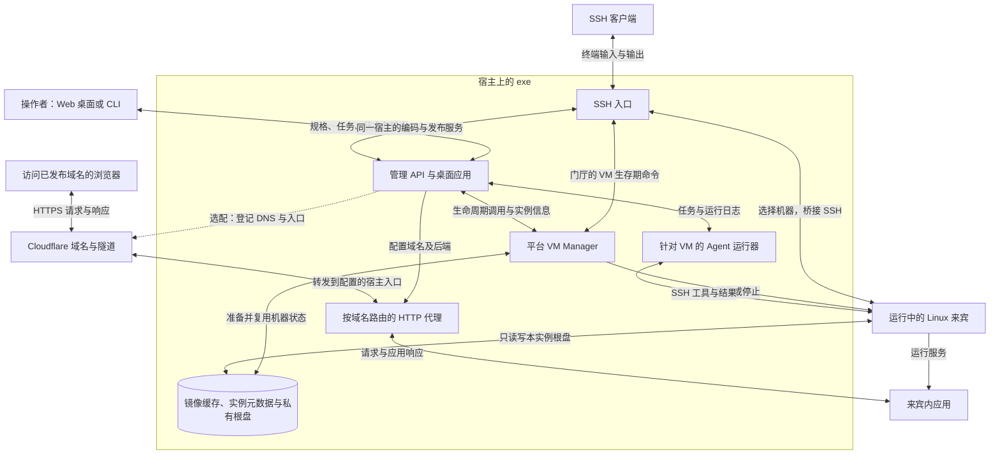
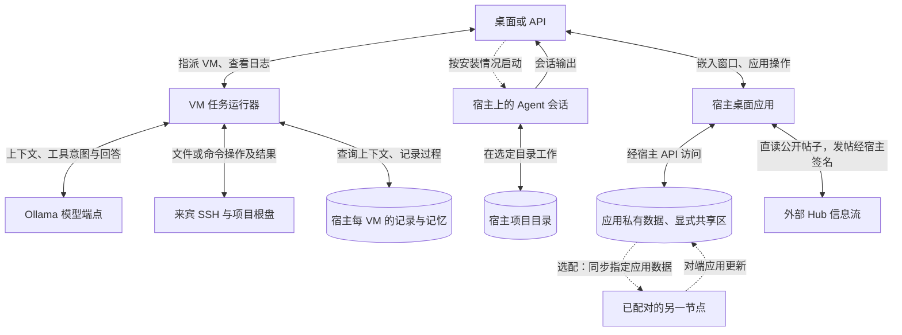
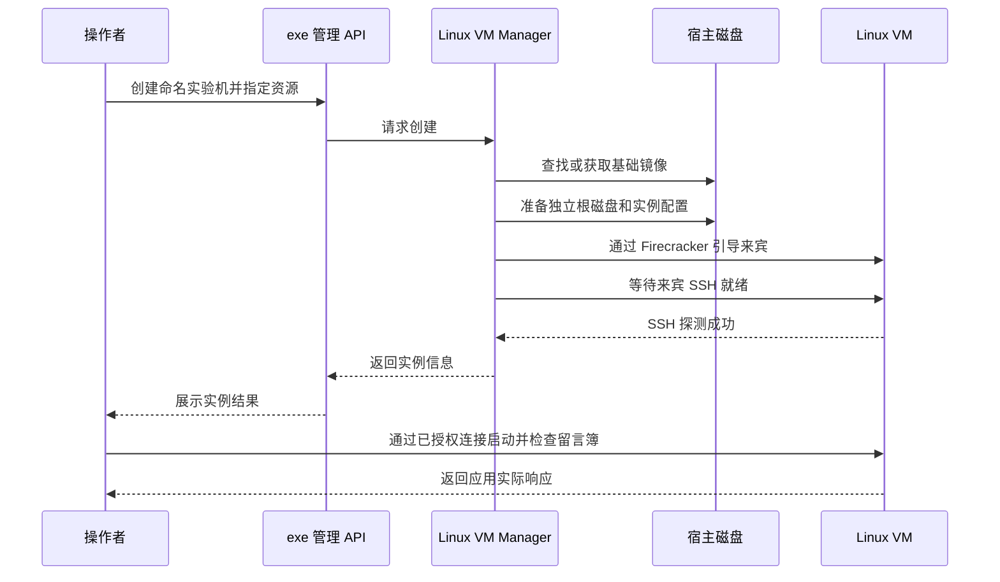

`exe` 是用 Go 编写的个人虚拟机管理平台。它让同一台宿主机通过 Web 桌面、CLI 和 API 创建与管理持久 Linux 虚拟机，也可以通过 SSH 操作来宾系统，并将指定应用发布给浏览器访问。上游用留言簿演示这条路径：在新 VM 里安装和运行应用，先在私有环境确认可用，之后才为这个服务选择公开入口。在这个例子里，执行编码任务和保留应用数据的是所选的来宾系统；同一桌面也能打开宿主自己的开发工具。[仓库与留言簿案例](https://github.com/livid/exe/blob/c4f684f546c5a863bf8b9b020544d753494b9535/README.md) · [桌面与 API](https://github.com/livid/exe/blob/c4f684f546c5a863bf8b9b020544d753494b9535/internal/server/site/docs/desktop.md)

## 软件装在宿主，项目运行在哪里

操作者输入的是机器规格、项目工作目录、给 Agent 的任务或待发布的端口，得到的可能是一台可反复启动的 VM、一段操作记录，或一个让别人访问服务的域名。三者有不同的所有者。运行在宿主上的单个 Go 程序 `exe serve` 对外提供管理接口，内嵌浏览器桌面，同时可以使用宿主自身的应用和终端。平台层 `vmm.Manager` 将同一套创建、启动、停止和查询操作落在不同的虚拟化后端。SSH 门厅给脚本和终端用户另一种交互方式：选择门厅时执行管理命令，选择 VM 时才桥接到来宾的 SSH 服务。[守护进程与桌面](https://github.com/livid/exe/blob/c4f684f546c5a863bf8b9b020544d753494b9535/internal/server/site/docs/desktop.md#L1-L24) · [SSH 两种目的地](https://github.com/livid/exe/blob/c4f684f546c5a863bf8b9b020544d753494b9535/internal/server/site/docs/ssh.md#L1-L27) · [虚拟机管理契约](https://github.com/livid/exe/blob/c4f684f546c5a863bf8b9b020544d753494b9535/internal/vmm/vmm.go)

从接口向下看，macOS 后端使用 Virtualization.framework 和系统 NAT；Linux 使用 KVM 上的 Firecracker，管理器从云镜像准备根文件系统并分配每台 VM 的网络；Windows 使用 QEMU/WHPX，来宾网络由守护进程内的网络栈承载。共享契约让桌面只需问“机器是否启动、有何地址”，也让管理器可以在缺少虚拟化能力时明确拒绝 VM 操作，继续提供宿主桌面。镜像格式、网络设备和运行进程的监督责任仍由各后端承担。[三个平台的磁盘与网络](https://github.com/livid/exe/blob/c4f684f546c5a863bf8b9b020544d753494b9535/internal/server/site/docs/vms.md#L3-L35) · [后端不可用时的行为](https://github.com/livid/exe/blob/c4f684f546c5a863bf8b9b020544d753494b9535/internal/vmm/unavailable_test.go)

## 模型决定下一步，哪台机器实际执行

给某台 VM 提交编码任务时，宿主侧运行器根据配置向本地或云端的 Ollama 模型提供输入，按模型返回的工具请求访问所选来宾，将工具结果带回下一轮；界面能逐步收到日志，之后还能从守护进程重新读取本次运行记录。项目将会话记录和可留给下一次运行的 VM 记忆保存在宿主的每实例目录，应用代码、依赖及业务数据在来宾根盘。模型服务、宿主日志和来宾文件各自保存不同信息。[Agent 循环的接口](https://github.com/livid/exe/blob/c4f684f546c5a863bf8b9b020544d753494b9535/internal/agent/agent.go#L1-L50) · [操作日志与 VM 记忆](https://github.com/livid/exe/blob/c4f684f546c5a863bf8b9b020544d753494b9535/internal/server/server.go#L590-L659)

宿主桌面还可以直接打开已安装的编码 Agent。例如 Projects 将议题正文和讨论传给桌面，由守护进程在选定的**宿主项目目录**启动会话。这种场景中的文件和权限属于宿主。桌面应用也可独立工作，安装内容、每个应用的私有数据以及供应用和工具交换文件的共享区分开管理。可选的节点间同步限于相应的应用数据，Hub 的公开信息流优先由应用直读，发帖由守护进程签名；因此一台机器没有虚拟化支持也能承担部分桌面工作。[宿主 Agent 工作目录](https://github.com/livid/exe/blob/c4f684f546c5a863bf8b9b020544d753494b9535/docs/projects-issue-agents.md#L1-L36) · [桌面应用数据边界](https://github.com/livid/exe/blob/c4f684f546c5a863bf8b9b020544d753494b9535/internal/server/apps.go#L1-L11) · [节点同步范围](https://github.com/livid/exe/blob/c4f684f546c5a863bf8b9b020544d753494b9535/internal/server/peers.go#L1-L9) · [Hub 读取、转发与签名](https://github.com/livid/exe/blob/c4f684f546c5a863bf8b9b020544d753494b9535/internal/server/hub.go#L1-L6) · [Hub 与桌面](https://github.com/livid/exe/blob/c4f684f546c5a863bf8b9b020544d753494b9535/internal/server/site/docs/desktop.md#L5-L16)

## 从复用镜像到启动一台新的实验机

以下跟踪 Linux 后端的成功路径。基础镜像可缓存在宿主机上，每台 VM 拥有自己的工作磁盘。后端按规格准备文件系统、注入启动和网络所需信息、记录实例数据，再启动虚拟机。启动以后，留言簿软件是否已经安装、服务是否开始监听，仍需在来宾系统中单独确认。[Linux 创建与启动代码](https://github.com/livid/exe/blob/c4f684f546c5a863bf8b9b020544d753494b9535/internal/vmm/manager_linux.go) · [虚拟机 API](https://github.com/livid/exe/blob/c4f684f546c5a863bf8b9b020544d753494b9535/internal/server/server.go)

区分这几步，对重新启动尤其重要。后台服务正常关闭会使 VM 关机，磁盘仍可保留。随后启动同一台 VM 是从已有磁盘引导，原来的内存、打开的连接和临时运行的应用进程需要分别处理。如果留言簿应在重启后自动恢复，应让来宾系统负责拉起服务并从持久数据读取记录。仅凭控制台显示“运行中”无法证明昨天的留言可以查询。[VM 与守护进程的关系](https://github.com/livid/exe/blob/c4f684f546c5a863bf8b9b020544d753494b9535/internal/server/site/docs/vms.md) · [Linux 后端测试](https://github.com/livid/exe/blob/c4f684f546c5a863bf8b9b020544d753494b9535/internal/vmm/manager_linux_test.go)

## 什么情况下一个域名已经可以用了

发布也有两段。当用户选择域名和 VM 端口时，守护进程先持久化本机的域名到后端地址映射，随后在已配置 Cloudflare 的情况下更新 DNS 和隧道入口。首次发布可能已经获得一个 URL，却附带 DNS 或入口未就绪的警告。访客请求走另一条路径：到达隧道后交给宿主代理，代理用 Host 头查询持久化路由，再访问来宾监听的端口，将应用响应送回浏览器。代理也能指向内嵌站点或宿主上的服务和目录，公开内容的去向取决于当前路由。应用自己的访客鉴权仍由应用承担。[发布顺序与部分成功](https://github.com/livid/exe/blob/c4f684f546c5a863bf8b9b020544d753494b9535/internal/server/server.go#L739-L805) · [持久化代理路由](https://github.com/livid/exe/blob/c4f684f546c5a863bf8b9b020544d753494b9535/internal/proxy/proxy.go#L1-L34) · [宿主目标类型](https://github.com/livid/exe/blob/c4f684f546c5a863bf8b9b020544d753494b9535/internal/server/routes.go#L42-L81)

## 把机器状态、应用健康和发布状态分开验收

| 用户实际在问什么 | 应该观察什么 |
| --- | --- |
| 实验机能否再次启动 | 查询同一实例，在来宾中核对预先写入磁盘的测试文件 |
| 留言簿能否继续服务 | 向来宾中的应用发出测试请求，读取重启前已确认保存的留言 |
| 同事通过域名看到的是哪一个应用 | 从授权的外部测试入口访问，核对应用版本和测试留言，再核对该域名的代理路由 |

同样的界面还可能只具备部分能力。在不具备相应虚拟化条件的机器上，项目可以让桌面及部分宿主功能继续运行，而 VM 操作报告不可用。若做成面向团队的开发环境产品，最好直接展示缺失的宿主能力，避免把“网页打开了”误判成“可以创建实验机”。[无可用虚拟化后端时的行为](https://github.com/livid/exe/blob/c4f684f546c5a863bf8b9b020544d753494b9535/internal/server/site/docs/getting-started.md#running-without-vms-a-nas-a-container) · [不可用后端测试](https://github.com/livid/exe/blob/c4f684f546c5a863bf8b9b020544d753494b9535/internal/vmm/unavailable_test.go)

只有一个静态演示网页时，静态托管或现有 Web 服务的成本更低。需要安装系统级依赖、隔离多个长期实验、离开后继续保留每个项目的 Linux 磁盘时，这种个人虚拟机平台才值得评估。代价是宿主需持续可用，操作者要预算虚拟内存、镜像空间、备份和发布通道，并分别验证各目标平台。把它迁移到自己的产品，优先借鉴的是这三层状态各有可核验的结果：实例可以启动，应用确实就绪，发布路由指向预期的版本。
