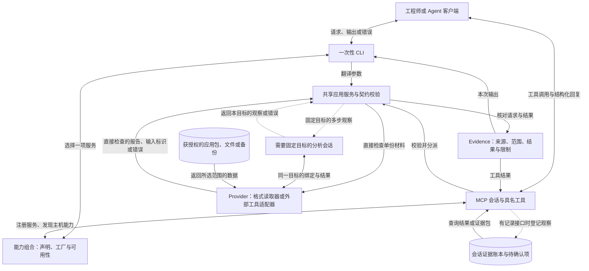
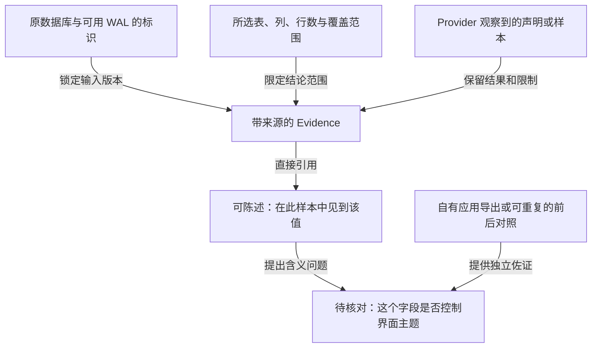
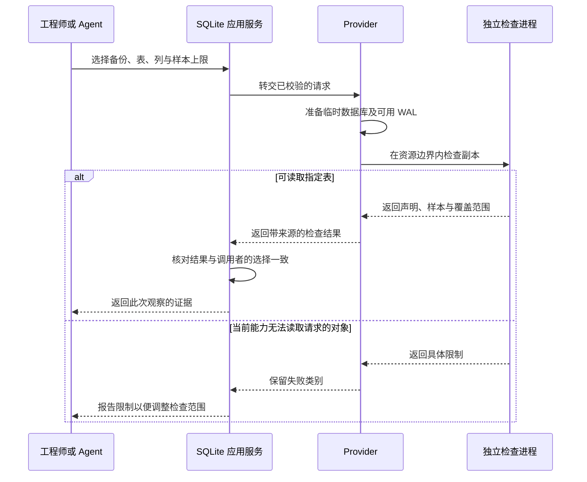

REA（Reverse Engineer Anything）把多种软件产物的检查能力接在统一的命令行和 MCP 接口后面。它可以让工程师或 Agent 检查自有发行包、应用资源、程序文件和保留下来的数据，并取得带来源的结构化结果。它解决的实际问题是，工具的输出往往只能在原界面里看懂，交给下一个人时很难分辨哪些事实已观察到、用的是哪份输入，以及哪部分仍需补充材料。[项目定位](https://github.com/morluto/rea/blob/8c857ce56c68ca46d202db0c9571277974c9e167/README.md#how-rea-works) · [组件架构](https://github.com/morluto/rea/blob/8c857ce56c68ca46d202db0c9571277974c9e167/docs/architecture.mermaid)

适合采用这套设计的情形，是一个团队要持续为自有的历史发行包、应用数据或缺少文档的格式做兼容性核对。输入是选定的产物、问题和允许观察的范围；输出是 **Evidence**，即带有对象标识、来源、观察方法、结构化结果和限制的一项记录。比较两个版本时，可以引用各自的记录；如果还缺能验证业务含义的材料，则把问题留在调查里。数据库只是这些材料中的一种。下文用旧版笔记应用的偏好备份说明这个过程。[证据返回契约](https://github.com/morluto/rea/blob/8c857ce56c68ca46d202db0c9571277974c9e167/docs/mcp-contracts.md#tool-results) · [调查记录的职责](https://github.com/morluto/rea/blob/8c857ce56c68ca46d202db0c9571277974c9e167/src/application/investigation/InvestigationRecords.ts)

## 一项能力怎样被找到、执行，再被复查

项目的组合层区分两种事实。“代码声明某个 Provider 可以提供某种观察”能够随软件版本固定；“这台主机现在能否做观察”还要结合配置、依赖和运行时探测。只列出支持的格式时，无需启动全部解析器。一次性 CLI 只装配所需的服务，长期 MCP 进程则组合一组服务，登记具名的工具契约，在退出时释放自己持有的资源。两个入口共享应用逻辑和 Provider 工厂，参数转换与生命周期分别由各自负责。[组合层的设计记录](https://github.com/morluto/rea/blob/8c857ce56c68ca46d202db0c9571277974c9e167/docs/capability-composition.md#source-declarations-and-runtime-bindings) · [资源所有权与清理重试](https://github.com/morluto/rea/blob/8c857ce56c68ca46d202db0c9571277974c9e167/src/application/CapabilityScope.ts#L1-L40)

**一次文件观察和长期调查有不同的状态。** 例如备份文件可在没有活动目标的情况下单独检查。需要跨步骤维持同一目标的任务，才使用目标会话：为该目标固定主要 Provider，将对应的输入、快照和记录归在一起。重置或切换目标需等待正在进行的工作，避免迟到的结果被写进下一个目标的记录。调查层分别保存证据和未解决的问题；MCP 返回服务产生的 Evidence；注册了记录接口时，同一项观察还会追加到当前会话。若 SQLite 观察已经完成、释放资源却失败，带记录接口的 MCP 宿主还能先保留已完成的 Evidence，并在错误中给出可查的编号。调用者于是能分别追查观察结果和运行故障。CLI 的一次调用则可把其输出显式保存以供下一次复查。[目标切换与生命周期](https://github.com/morluto/rea/blob/8c857ce56c68ca46d202db0c9571277974c9e167/docs/capability-composition.md#resource-lifetime) · [SQLite 的 MCP 记录接口](https://github.com/morluto/rea/blob/8c857ce56c68ca46d202db0c9571277974c9e167/src/server/registerSqliteTools.ts#L10-L28) · [会话记录接口的建立](https://github.com/morluto/rea/blob/8c857ce56c68ca46d202db0c9571277974c9e167/src/server/createServer.ts#L839-L853) · [清理失败时保留观察](https://github.com/morluto/rea/blob/8c857ce56c68ca46d202db0c9571277974c9e167/docs/sqlite-databases.md#L180-L185) · [Evidence 的保留和转移](https://github.com/morluto/rea/blob/8c857ce56c68ca46d202db0c9571277974c9e167/docs/mcp-contracts.md#tool-results)

## 看见一个字段，为何仍然不能确认用途

Evidence 记录的是某种方法在具体输入上得到的观察。输出里的 `normalized_result` 提供可跨工具读取的表示；如果 Provider 已有一个含义不同的原始报告，可以另存为 `raw_result`。原始报告不存在时，空值保留了这一事实。用证据编号回看或比较原记录时，省去了在模型上下文里重复粘贴完整材料的成本，依据也仍可追溯。[Evidence 的结果、身份与来源引用](https://github.com/morluto/rea/blob/8c857ce56c68ca46d202db0c9571277974c9e167/docs/mcp-contracts.md#tool-results)

对一份大型备份，默认的目录清单能先回答“有哪些对象”，无需将每张表的所有列、声明和数据都塞进模型上下文。调用者显式指定表或更大范围时，才请求相应的细节。能力发现与执行也分开：环境不满足 SQLite 检查的运行时要求时，可以先报告该能力不可用，其他能力仍可按各自条件评估。[不同查询范围与运行条件](https://github.com/morluto/rea/blob/8c857ce56c68ca46d202db0c9571277974c9e167/docs/sqlite-databases.md) · [SQLite 能力声明](https://github.com/morluto/rea/blob/8c857ce56c68ca46d202db0c9571277974c9e167/src/application/sqlite/SqliteDatabaseCapability.ts)

## 一份设置样本如何成为有边界的证据

以下跟踪第二步，假设调用者已从清单中找到 `settings`，希望只观察选定列。在打开输入前，团队应先用应用支持的备份流程获得一致快照。如果数据库使用预写日志（WAL），近期已提交的数据可能还在配套日志文件里。数据库和可用的 WAL 分别记录原文件的摘要与大小。工具读取临时副本，源文件因此不会收到 SQLite 工作进程生成的锁或辅助文件；复制时没观察到变化，仍无法证明对正在写入的一对文件取得了原子快照。[快照来源与复制](https://github.com/morluto/rea/blob/8c857ce56c68ca46d202db0c9571277974c9e167/src/sqlite/SqliteDatabaseSnapshot.ts) · [一致性前提](https://github.com/morluto/rea/blob/8c857ce56c68ca46d202db0c9571277974c9e167/docs/sqlite-databases.md)

例如“在样本中读到一条主题设置”可以作为本次观察。若请求了有限行数，顺序未指定，剩余记录也未穷尽，据此宣称“所有用户都选择该主题”就超出了证据。某些表可以列出声明但无法读取行；能力不足、输入格式异常和检查超过资源限制也应分别处理。把这些区别保留在错误与结果契约中，Agent 才有机会选择下一步，而非把失败统一解释为空数据库。[结果范围与不支持的对象](https://github.com/morluto/rea/blob/8c857ce56c68ca46d202db0c9571277974c9e167/docs/sqlite-databases.md) · [检查进程的返回契约](https://github.com/morluto/rea/blob/8c857ce56c68ca46d202db0c9571277974c9e167/src/sqlite/SqliteDatabaseWorkerExecution.ts) · [应用服务测试](https://github.com/morluto/rea/blob/8c857ce56c68ca46d202db0c9571277974c9e167/src/application/sqlite/SqliteDatabaseService.test.ts)

## 对迁移工具真正有价值的部分

只需要人工查看一个已知库时，常用 SQLite 客户端就可以完成工作。如果产品要从多种历史版本或不同类型的产物中自动收集证据，再把结果交给工程师或 Agent 复核，那么共享契约、输入来源、输出范围和明确的限制值得复用。代价是维护各个 Provider 的运行依赖、验证样本与测试数据，以及保管待分析文件和返回的内容。只有与样本相关的列需要进入产品记录。

可以从两份自有测试备份开始验收：只改变应用的一项偏好，保留应用中可观察的前后结果。分别记录两个备份的输入标识、实际检查的表和列、返回行数与截断情况；再用应用自身的导出或读取逻辑复核差异。如果后续换用 MCP、某个可选 Provider 不可用，或者只读取部分行，系统仍应能明确回答“这项结论来自哪里、观察到了多少、还有什么未知”。
