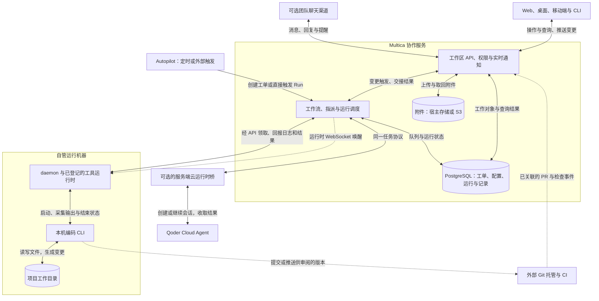
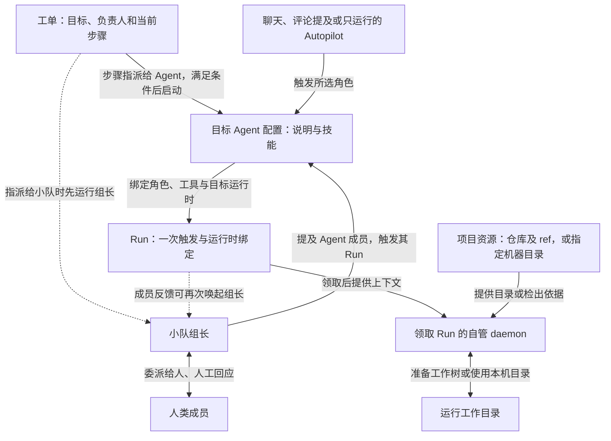
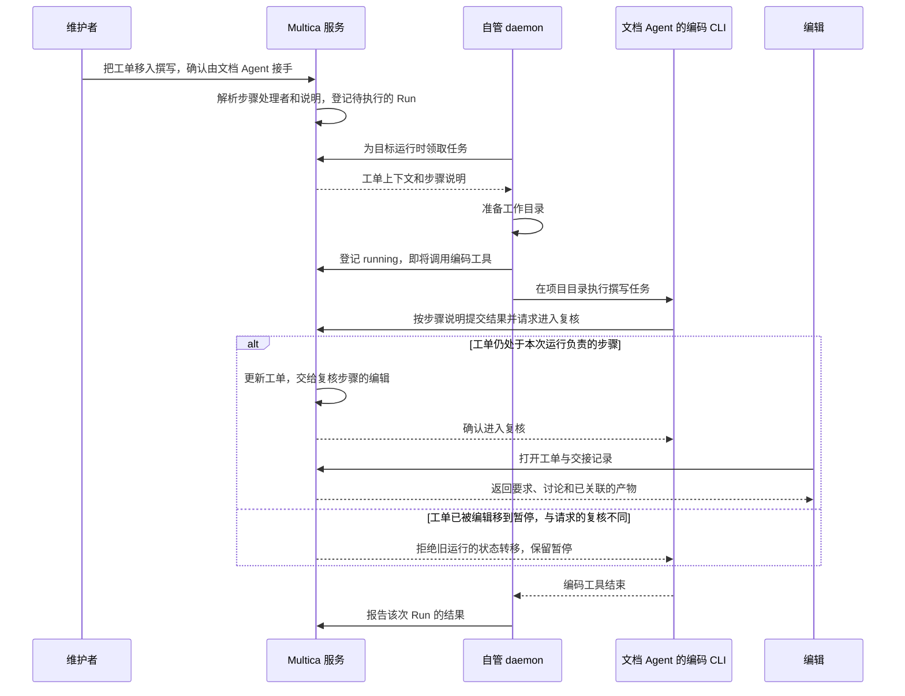

Multica 是一个可自托管的团队工作区。人和编码 Agent 可以在同一张看板上承接工单，查看目标、讨论、产物和处理历史。它解决的是已有编码工具却难以交接的问题。工程师在自己的终端生成一份改动，编辑第二天接手时，仍需要知道对应哪项需求、改到了哪个版本、谁来核对。Multica 把这些信息放回工单，并给每次执行留下独立记录。[项目介绍](https://github.com/multica-ai/multica/blob/2c86a9c3b0543a040f6fffe91e4c31a18b235104/README.md) · [工单和运行的关系](https://github.com/multica-ai/multica/blob/2c86a9c3b0543a040f6fffe91e4c31a18b235104/apps/docs/content/docs/tasks.mdx)

作者在愿景中指出，增加能执行任务的 Agent 也会增加需要人盯着的窗口；把成果、决策和下一位负责人保留在共享历史里，才让换人之后还能继续。这个版本把工作区、工单、Agent、独立的运行和可连接的执行机器做成产品对象。人在既有渠道发出的需求、项目仓库或目录、角色配置都是输入；团队能拿到带上下文的执行记录、工单中的讨论、待验收的改动及其版本线索。[作者的动机与愿景范围](https://github.com/multica-ai/multica/blob/2c86a9c3b0543a040f6fffe91e4c31a18b235104/VISION.zh.md#L40-L92) · [已实现的协作与执行边界](https://github.com/multica-ai/multica/blob/2c86a9c3b0543a040f6fffe91e4c31a18b235104/apps/docs/content/docs/how-multica-works.mdx#L8-L31)

以修改产品手册为例。维护者把新版接口和验收条件写在工单里，要求文档 Agent 补齐示例；进入编辑复核后，由一位编辑核对示例和术语。一次生成失败可以重试，编辑发现遗漏也可以退回。同一项需求经历多次运行，原始要求和退回原因仍保留在同一处。[项目工作流](https://github.com/multica-ai/multica/blob/2c86a9c3b0543a040f6fffe91e4c31a18b235104/apps/docs/content/docs/workflows.mdx)

## 哪些状态属于看板，哪些属于执行机器

**Issue** 保存长期目标、责任人和业务步骤。**Agent** 保存团队可指派的角色、所用工具和运行时等配置。**Run** 是其中一次有起止、有结果的执行；可以先指定责任人，等依赖到位再启动。评论里的提及、聊天和定时任务也可以触发运行。团队既能只请另一位 Agent 回答一次问题，也能把整张工单正式交给它。[指派规则](https://github.com/multica-ai/multica/blob/2c86a9c3b0543a040f6fffe91e4c31a18b235104/apps/docs/content/docs/assigning-issues.mdx) · [运行的触发来源](https://github.com/multica-ai/multica/blob/2c86a9c3b0543a040f6fffe91e4c31a18b235104/apps/docs/content/docs/tasks.mdx)

在自管运行时上，daemon 领取任务、准备工作目录并调用机器上的编码 CLI。协作服务器保存工单、执行上下文、结果与讨论，并把变化送回客户端。工作目录留在运行机器上，日志和回复仍可能含有源码片段；配置的自定义环境变量也会经服务器送往运行时。采用时要把本机文件、与团队共享的记录和模型服务收到的内容分别核对。该版还支持由服务端桥接的 Qoder Cloud Agent，其运行地点及凭据配置另有约定。[运行时与数据边界](https://github.com/multica-ai/multica/blob/2c86a9c3b0543a040f6fffe91e4c31a18b235104/apps/docs/content/docs/daemon-runtimes.mdx) · [任务服务](https://github.com/multica-ai/multica/blob/2c86a9c3b0543a040f6fffe91e4c31a18b235104/server/internal/service/task.go)

在自托管部署里，Web 前端与 Go API/实时服务可以分开部署；数据库保存协作对象，附件可保存到服务端卷或对象存储。两条 WebSocket 有不同的听众。用户端收到工单、评论和收件箱事件，重连后重新查询服务端的持久状态；运行时则由另一条连接唤醒，仍须经 API 领取任务，定期轮询可以补上丢失的通知。多实例部署可通过 Redis 转发实时事件，业务事实归 PostgreSQL。外部聊天渠道把讨论带回工作区。接入代码托管后，工作区还能把带工单标识的合并请求、对应提交的 CI 状态挂在工单上。对于已配置的自托管 Git 集成，该工单关联的合并请求全部合并后，集成可把它移入工作区约定的目标列。这里有三份可分别核验的材料：机器上的文件、仓库中的版本、Multica 中对这次变更的讨论和决定。[两条实时连接与主存储](https://github.com/multica-ai/multica/blob/2c86a9c3b0543a040f6fffe91e4c31a18b235104/apps/docs/content/docs/developers/architecture.mdx#L92-L126) · [自托管的数据组件](https://github.com/multica-ai/multica/blob/2c86a9c3b0543a040f6fffe91e4c31a18b235104/SELF_HOSTING.md#L184-L196) · [团队入口与收件箱](https://github.com/multica-ai/multica/blob/2c86a9c3b0543a040f6fffe91e4c31a18b235104/README.zh.md#L82-L108) · [外部版本与工单联动](https://github.com/multica-ai/multica/blob/2c86a9c3b0543a040f6fffe91e4c31a18b235104/apps/docs/content/docs/vcs-integration.mdx#L8-L24)

## 为什么不同入口可以共用运行队列

Agent 保存这个角色的职责、模型与运行时绑定；技能是可由多个角色复用的工作方法。要让一个团队接手，可以把工作交给 Squad。此时先启动组长 Agent，由组长从角色表挑选成员、在工单里发起后续协作。成员可以是人或 Agent。组长提及 Agent 成员会触发其自己的 Run；分给人时由成员接手，无需为人创建运行。成员回报或阶段完成后，组长可再次评估是否继续委派、请人决策或送审。Autopilot 则描述反复执行的工作：需要人在看板上追踪时创建工单，只需背景结果时可以直接触发一次运行。把分工、触发和执行分别建模，才能解释同一个人为什么可以在同一项目里先请 Agent 回答问题、稍后再把整个任务指派给它。[Squad 组长与成员](https://github.com/multica-ai/multica/blob/2c86a9c3b0543a040f6fffe91e4c31a18b235104/apps/docs/content/docs/squads.mdx#L8-L44) · [技能和角色说明](https://github.com/multica-ai/multica/blob/2c86a9c3b0543a040f6fffe91e4c31a18b235104/apps/docs/content/docs/skills.mdx#L8-L18) · [自动任务的两种模式](https://github.com/multica-ai/multica/blob/2c86a9c3b0543a040f6fffe91e4c31a18b235104/apps/docs/content/docs/autopilots.mdx#L8-L35)

项目资源解决的是“同一个角色换到另一台机器，究竟该修改哪一份文件”。仓库资源给出可获取的代码与默认 ref，daemon 可准备工作树；本地目录只在与资源绑定的机器上生效，直接修改该目录时通常串行，适用的 Git 目录也可选用独立工作树并行。另一台机器上的同名路径没有相同身份。执行记录中的进展和退出状态要与实际产物版本对应，复核者才能重现它看过的修改。[项目资源的选取与并发](https://github.com/multica-ai/multica/blob/2c86a9c3b0543a040f6fffe91e4c31a18b235104/apps/docs/content/docs/project-resources.mdx#L8-L42)

## 一张文档工单怎样交给编辑

设项目工作流在“撰写”步骤指派文档 Agent，在“复核”步骤指派编辑，另有“暂停”列供团队等待接口定稿。下图跟踪一次正常交付，以及接口临时变更时旧运行可能遇到的分支。[步骤交接实现](https://github.com/multica-ai/multica/blob/2c86a9c3b0543a040f6fffe91e4c31a18b235104/server/internal/handler/issue_workflow_entry.go) · [daemon 准备目录和启动工具的顺序](https://github.com/multica-ai/multica/blob/2c86a9c3b0543a040f6fffe91e4c31a18b235104/server/internal/daemon/daemon.go#L8388-L8424) · [运行领取和完成](https://github.com/multica-ai/multica/blob/2c86a9c3b0543a040f6fffe91e4c31a18b235104/server/internal/service/task.go)

“进入复核”需要一次明确的工单更新。工作流把普通状态变化解析为接手人和步骤说明，Agent 也受指派权限约束。若工单已离开旧运行负责的步骤，旧运行请求的目标又与工单现状不同，服务可以拒绝这次变更；若已在请求的目标列，则无需重复交接。这个检查保护看板上记录的交接。编辑仍须打开实际改动验证示例，任何已经写入工作目录的文件也要单独处理。换负责人通常不会终止旧运行；在工作流交接的确认界面，可以选择同时停止上一步仍在运行的任务。[交接与过期步骤校验](https://github.com/multica-ai/multica/blob/2c86a9c3b0543a040f6fffe91e4c31a18b235104/server/internal/handler/issue_workflow_entry.go) · [交接操作的约定](https://github.com/multica-ai/multica/blob/2c86a9c3b0543a040f6fffe91e4c31a18b235104/apps/docs/content/docs/workflows.mdx)

面板上的 `queued`、`dispatched` 和 `running` 则用来定位执行停在哪里。比如任务已经入队后机器失联，队列会给该运行时留出重连时间；运行绑定到原运行时。若触发前已知机器离线，某些即时操作会直接报告无法开始。正常结束写入 `completed`，验收是否通过仍由项目流程决定。直接用进程退出状态驱动“完成”列，会抹去重做、人工复核和只回答了一条评论的区别。[运行状态和失败条件](https://github.com/multica-ai/multica/blob/2c86a9c3b0543a040f6fffe91e4c31a18b235104/apps/docs/content/docs/tasks.mdx) · [运行触发判定](https://github.com/multica-ai/multica/blob/2c86a9c3b0543a040f6fffe91e4c31a18b235104/server/internal/service/issue_trigger.go)

## 什么时候值得引入这样的工作区

团队已有多种编码 CLI，又希望责任变更、机器执行和人工验收可以分别追溯，Multica 的三个对象可以直接对应产品需求。若只为一个维护者偶尔更新手册，现有工单加一个有输出链接的 CI 作业通常已够用。采用完整工作区还要维护数据库、运行机器、Agent 配置与可见范围，并约定工单里记录哪版产物。上游将该版称为 source-available；许可证在 Apache 2.0 文本之外规定了第三方托管、对外商业产品嵌入和品牌保留等条件，选择内部自用或将代码并入对外产品时应分别核对。[自托管组件](https://github.com/multica-ai/multica/blob/2c86a9c3b0543a040f6fffe91e4c31a18b235104/SELF_HOSTING.md) · [该版许可证](https://github.com/multica-ai/multica/blob/2c86a9c3b0543a040f6fffe91e4c31a18b235104/LICENSE)

借用到翻译管理系统时，可以给每条待翻译文案一个稳定编号，每次机器翻译另记运行编号、源文版本和结果链接，术语审核另设责任人。用同一条文案做两个验收实验。先只指定翻译角色，确认看板能显示负责人且没有产生运行记录。再启动翻译，在第一次执行返回前由编辑把工单转入“暂停”并保留旧运行，随后让旧运行申请“复核”。预期申请被拒绝，工单仍在“暂停”，但仍能查到这次执行及对应译稿。若系统无法从已验收的文案找到当时核对的译稿版本，还需要补充产物关联，单看运行日志无法回答这个问题。
