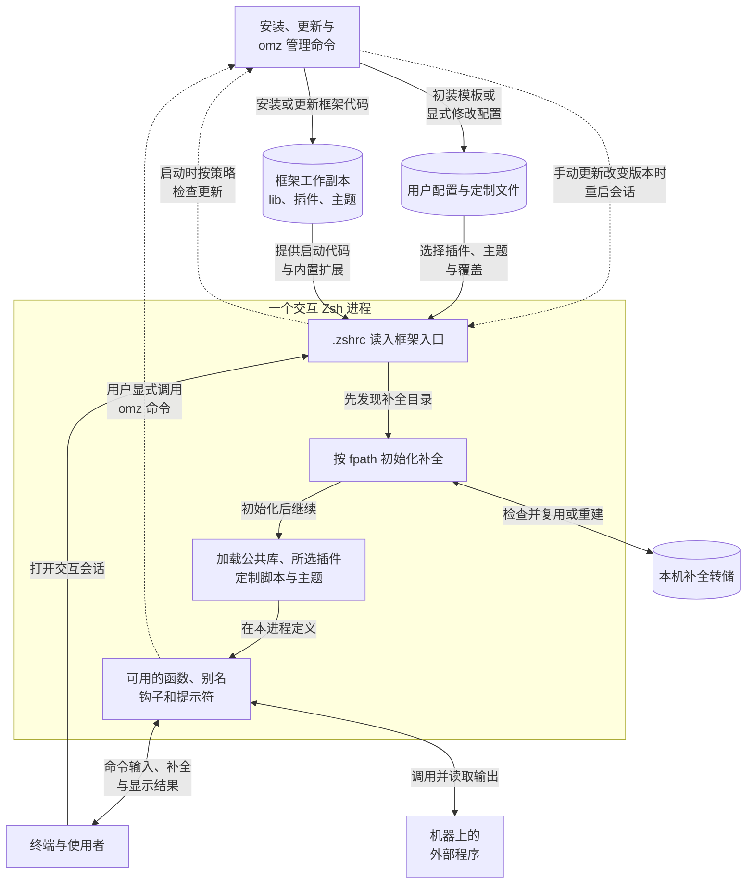
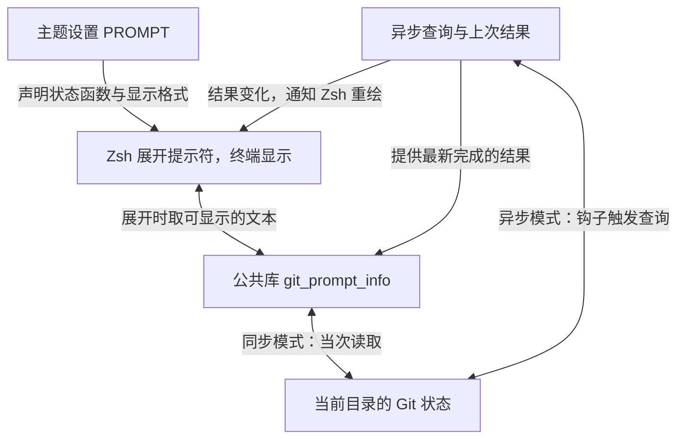
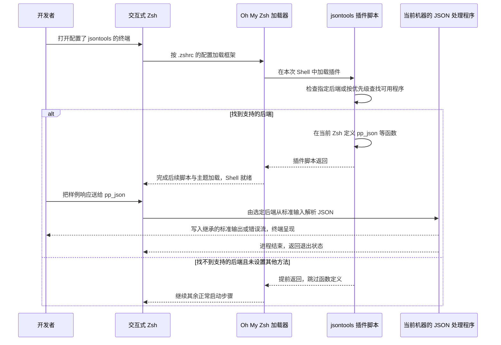

Oh My Zsh 是管理交互式 Zsh 配置的框架。开发者选择插件和主题，框架在启动时将公共函数、补全、别名和提示符装入当前 Shell。一份不断扩大的个人配置因此有了可共享的组成部分。终端模拟器依然负责窗口、字体和渲染，Zsh 负责解释命令，外部程序负责真正的运算。[项目定位与主题范围](https://github.com/ohmyzsh/ohmyzsh/blob/6010fb6260f359e71d99ba25f05f9215809b3ed2/README.md) · [配置模板](https://github.com/ohmyzsh/ohmyzsh/blob/6010fb6260f359e71d99ba25f05f9215809b3ed2/templates/zshrc.zsh-template)

它接收的主要输入有三份：用户的 `.zshrc` 选择哪些能力生效，框架目录给出当前版本的实现，`ZSH_CUSTOM` 提供个人或团队维护的替换与扩展。一次启动的主要输出则是一份已经配置好的**当前 Shell 进程**：按 Tab 有补全，输入命令有函数、选项和别名，等待输入时有提示符。另一个已打开的终端有自己的进程和已加载的定义。这个模型适合多人共用工作方法，同时保留自己的主题和工作习惯。[配置模板](https://github.com/ohmyzsh/ohmyzsh/blob/6010fb6260f359e71d99ba25f05f9215809b3ed2/templates/zshrc.zsh-template) · [作者给出的覆盖约定](https://github.com/ohmyzsh/ohmyzsh/blob/6010fb6260f359e71d99ba25f05f9215809b3ed2/README.md#custom-plugins-and-themes)

## 哪些留在磁盘上，哪些只活在当前 Shell

安装工具准备框架的 Git 工作副本和启动配置；可以沿用现有配置，采用模板时已有配置可备份。后续打开 Zsh 时，`.zshrc` 在当前进程中读入 `oh-my-zsh.sh`。源文件被执行后，Zsh 自己持有函数、别名和钩子。底层命令只有在该机可用时才能被相应的插件调用。[安装与已有配置处理](https://github.com/ohmyzsh/ohmyzsh/blob/6010fb6260f359e71d99ba25f05f9215809b3ed2/tools/install.sh#L354-L403) · [启动入口](https://github.com/ohmyzsh/ohmyzsh/blob/6010fb6260f359e71d99ba25f05f9215809b3ed2/oh-my-zsh.sh#L50-L98)

手动 `omz update` 通过更新工具改变框架代码；当修订发生变化时，该命令会重启当前 Zsh，使新版本生效。自动检查另读用户的模式、上次检查时间和当前终端条件，可以提示、提醒或关闭。也就是说，配置选择、框架版本、已打开的会话并非同一个更新对象。要复现同事的结果，除了插件列表，也要知道哪一版实现被哪个 Shell 装入。[更新模式](https://github.com/ohmyzsh/ohmyzsh/blob/6010fb6260f359e71d99ba25f05f9215809b3ed2/tools/check_for_upgrade.sh#L6-L52) · [手动更新与当前会话](https://github.com/ohmyzsh/ohmyzsh/blob/6010fb6260f359e71d99ba25f05f9215809b3ed2/lib/cli.zsh#L911-L954)

## 发现补全为何先于执行插件

启动入口先找出配置里启用的插件，把包含插件脚本或同名补全文件的目录加入 Zsh 的函数查找路径 `fpath`，然后运行 `compinit`。同一插件先试定制目录，选中的目录逐个前插，所以列表后面的插件目录在最终查找路径中更靠前；脚本却按列表从前往后执行。这个次序让只有补全定义的插件也能被发现。框架把版本和 `fpath` 记录进补全转储，元数据变化时让补全重建。转储能复用补全信息，每次打开 Shell 时，已启用插件的初始化代码仍会执行。[插件发现、补全与缓存](https://github.com/ohmyzsh/ohmyzsh/blob/6010fb6260f359e71d99ba25f05f9215809b3ed2/oh-my-zsh.sh#L81-L98) · [转储校验与初始化](https://github.com/ohmyzsh/ohmyzsh/blob/6010fb6260f359e71d99ba25f05f9215809b3ed2/oh-my-zsh.sh#L208-L265)

随后框架依次加载公共库、按用户列表顺序加载插件脚本，再加载定制目录顶层的 `.zsh` 文件，最后加载主题。对于公共库或插件的同一相对路径，如果同时存在定制和内置版本，加载器优先使用定制文件。补全目录的选择与单个脚本的选择各自独立。一个定制插件只有同名补全文件时，插件脚本仍可回退到内置版本。覆盖脚本的团队还要在上游修复对应文件时复查自己的版本。脚本共享当前 Shell 环境，后加载的定义可能改写前者。默认主题直接设置 `PROMPT` 并引用 Git 状态函数，主题和插件都依赖已加载的环境。[脚本和主题装载顺序](https://github.com/ohmyzsh/ohmyzsh/blob/6010fb6260f359e71d99ba25f05f9215809b3ed2/oh-my-zsh.sh#L267-L344) · [默认主题实现](https://github.com/ohmyzsh/ohmyzsh/blob/6010fb6260f359e71d99ba25f05f9215809b3ed2/themes/robbyrussell.zsh-theme)

提示符尤其能显出“装入一次”和“反复使用”的差别。默认主题把 `git_prompt_info` 的结果嵌入 `PROMPT`，Git 公共库提供函数实现；启用 Git 插件是一项独立选择。匹配版本和配置时，框架可以在显示提示符前发起异步状态查询，待结果到达再让 Zsh 行编辑器重绘。响应慢的仓库因此不必阻塞每次首屏。代价是先看到的状态可能要等更新完成才刷新；同步模式则在取到结果后显示。[默认主题](https://github.com/ohmyzsh/ohmyzsh/blob/6010fb6260f359e71d99ba25f05f9215809b3ed2/themes/robbyrussell.zsh-theme) · [Git 状态的同步与异步分支](https://github.com/ohmyzsh/ohmyzsh/blob/6010fb6260f359e71d99ba25f05f9215809b3ed2/lib/git.zsh#L171-L232) · [异步回调与重绘](https://github.com/ohmyzsh/ohmyzsh/blob/6010fb6260f359e71d99ba25f05f9215809b3ed2/lib/async_prompt.zsh#L105-L139)

## 一个函数怎样在三种开发机上工作

负责接口联调的同事可以启用 `jsontools`，用相同的 `pp_json` 函数查看响应，又保留各自的主题。这个例子把扩展装载和外部程序的实际运行分得很清楚。[插件功能](https://github.com/ohmyzsh/ohmyzsh/blob/6010fb6260f359e71d99ba25f05f9215809b3ed2/plugins/jsontools/README.md) · [后端选择](https://github.com/ohmyzsh/ohmyzsh/blob/6010fb6260f359e71d99ba25f05f9215809b3ed2/plugins/jsontools/jsontools.plugin.zsh#L1-L31)

在未指定后端的情况下，`jsontools` 按 Node、Python 3、Ruby 的顺序选择首个可用程序；选择发生在加载阶段。调用 `pp_json` 时，包装函数才启动解析器。只把插件名写进配置的机器，仍可能缺少可用后端。输出格式也取决于后端。这一版的 Node 和 Python 3 分支输出 JSON，Ruby 分支把解析后的对象转为 YAML。若下游还要读取 JSON，就应明确选用 Node 或 Python 3；若要把格式化结果提交给 Git 并逐字节比较，还要固定后端版本和样例。上游所引测试只覆盖 Node 分支。[各后端的实现](https://github.com/ohmyzsh/ohmyzsh/blob/6010fb6260f359e71d99ba25f05f9215809b3ed2/plugins/jsontools/jsontools.plugin.zsh) · [插件样例测试](https://github.com/ohmyzsh/ohmyzsh/blob/6010fb6260f359e71d99ba25f05f9215809b3ed2/plugins/jsontools/tests/jsontools.test.zsh)

## 怎样决定团队配置的边界

若大家只需要一个别名，一行团队维护的 Zsh 配置就足够。需要协商插件启用顺序、补全、可选后端和个人覆盖时，Oh My Zsh 给出了这些约定。采用成本集中在新 Shell 的启动时间、插件共用名称可能产生的冲突，以及每台机器的外部依赖。配置模板因此只默认启用 Git 插件；交付给 CI 的数据转换可以直接调用固定版本的解析器，使非交互作业的运行条件更容易重现。[插件选择与模板](https://github.com/ohmyzsh/ohmyzsh/blob/6010fb6260f359e71d99ba25f05f9215809b3ed2/templates/zshrc.zsh-template) · [Git 插件的别名定义](https://github.com/ohmyzsh/ohmyzsh/blob/6010fb6260f359e71d99ba25f05f9215809b3ed2/plugins/git/git.plugin.zsh)

同样的设计可以用在有扩展机制的数据清洗控制台。让扩展在启动时声明可用命令，把真正的处理留在用户调用时，并在配置里写清同名扩展的优先级。验收可以用两份只含测试数据的配置：在第一份的工具路径里提供 Node 或 Python 3，打开新的交互会话，用 `whence -w pp_json` 检查函数，再对含嵌套对象的样例做格式化并按 JSON 重新解析。若改用 Ruby，则按 YAML 解回数据并比较结构。第二份只移除支持的后端，保持其他启动依赖和插件不变，确认新会话仍可用、该函数未定义。对固定版本做隔离验证时，在内置与定制目录分别放置带不同标记的同名测试脚本。新会话只出现定制标记，移除该定制脚本后再开会话，只出现内置标记。这样能分别验证扩展发现、依赖可用性和同路径脚本的覆盖顺序。
