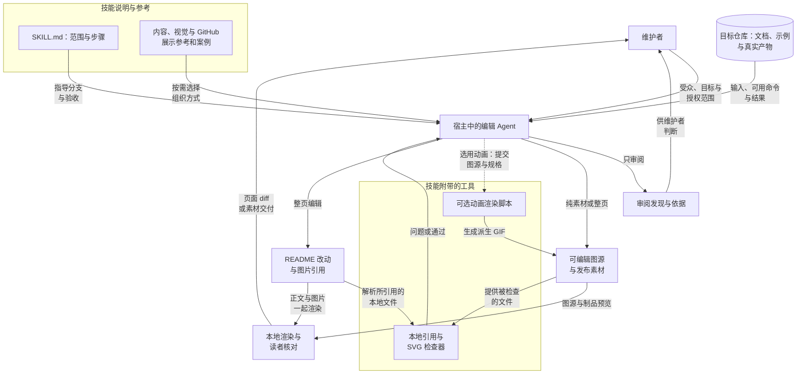
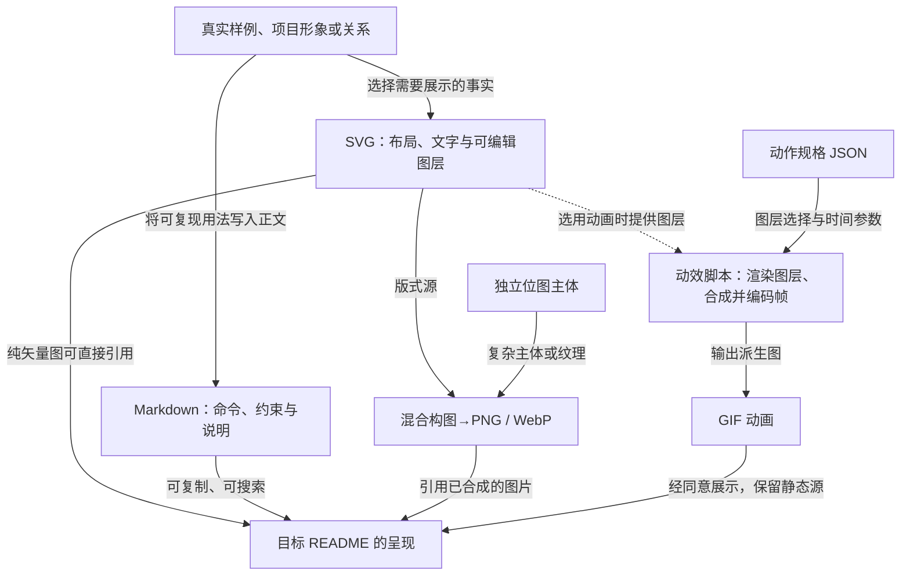
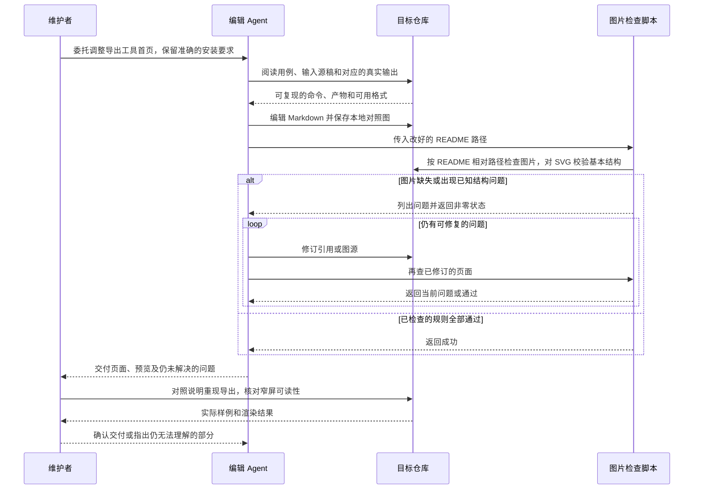

Beautify GitHub README 是供编辑型 Agent 使用的一套技能，面向希望陌生访客快速看懂项目的维护者。仓库交付一份工作说明、按需查阅的内容与视觉指南、真实案例，以及检查图片引用、生成动画的两个 Python 脚本。维护者提供原仓库和编辑范围，Agent 阅读材料后产出可提交的 Markdown、图片或审阅意见。整页的取材、叙事和修改由 Agent 与维护者完成。[项目与案例](https://github.com/oil-oil/beautify-github-readme/blob/d6562a5f5c484d069f8560b39c215c9cda4b5a55/README.zh-CN.md) · [技能定义](https://github.com/oil-oil/beautify-github-readme/blob/d6562a5f5c484d069f8560b39c215c9cda4b5a55/skills/beautify-github-readme/SKILL.md)

比如一个把图标源稿导出成多种尺寸的工具，旧首页把依赖列表放在最前面。新读者可能装完才发现工具能否交付自己需要的格式。可以先展示一张来自真实样例的“源稿与导出结果”对照图，紧跟一条能重现结果的命令，把可选依赖移到对应格式的说明旁。这样既给读者一个采用理由，也留下检验这个理由的方法。上游也用真实图标集解释图标项目的成果，用游戏角色和桌面布局介绍 Wolfcha，不同仓库选择了不同的证据。[首页案例](https://github.com/oil-oil/beautify-github-readme/blob/d6562a5f5c484d069f8560b39c215c9cda4b5a55/README.md) · [内容顺序与素材分工](https://github.com/oil-oil/beautify-github-readme/blob/d6562a5f5c484d069f8560b39c215c9cda4b5a55/skills/beautify-github-readme/references/content-architecture.md)

## 两个仓库，三类责任

技能仓库保存规则、参考资料、案例和小工具；**目标仓库**保存产品的真实内容及其首页；Agent 宿主负责阅读、编辑和调用本机工具。工作从维护者指定范围开始。先找什么问题由项目解决、什么输出能作证，再决定首屏给谁看、需要图还是文字。整页委托的交付是 README 改动、对应图源与可视预览；纯素材委托的交付是文件和预览，是否嵌入由维护者决定；若只要求审阅，拿到的是问题与依据。上游把前两种列为制作模式，另处理只审阅的请求。[工作方式与范围](https://github.com/oil-oil/beautify-github-readme/blob/d6562a5f5c484d069f8560b39c215c9cda4b5a55/skills/beautify-github-readme/SKILL.md#L7-L36) · [本地交付物](https://github.com/oil-oil/beautify-github-readme/blob/d6562a5f5c484d069f8560b39c215c9cda4b5a55/README.zh-CN.md#L120-L156)

安装命令、兼容范围和经常变更的参数保留在 Markdown，便于复制、检索和翻译；图适合展示对照、结构或操作结果。还有一种独立交付：维护者验收后，若希望把自己维护的公开项目加入技能的案例集，可以另外准备展示 PR，先核对展示文案和差异再决定是否提交。它与目标仓库的首页交付是两次决定。[可选案例收录](https://github.com/oil-oil/beautify-github-readme/blob/d6562a5f5c484d069f8560b39c215c9cda4b5a55/skills/beautify-github-readme/SKILL.md#L146-L159) · [模式和交付边界](https://github.com/oil-oil/beautify-github-readme/blob/d6562a5f5c484d069f8560b39c215c9cda4b5a55/skills/beautify-github-readme/SKILL.md) · [页面内容规范](https://github.com/oil-oil/beautify-github-readme/blob/d6562a5f5c484d069f8560b39c215c9cda4b5a55/skills/beautify-github-readme/references/content-architecture.md)

**发布格式与可编辑源可以不同。** 关系图或排版优先使用静态 SVG；需要人物或复杂产品图像时，可以保留矢量排版和独立位图素材，向 README 提供合成后的 PNG 或 WebP。只有动态变化能帮助理解且维护者选择动画时，才投入制作成本。动画脚本读取 SVG 和 JSON 动作规格，渲染帧并编码为 GIF，保留静态版本仍可传达主要信息。上游自己的首屏就同时留有 SVG、动作规格和 GIF，后续维护者可以据此调整。[混合素材制作](https://github.com/oil-oil/beautify-github-readme/blob/d6562a5f5c484d069f8560b39c215c9cda4b5a55/skills/beautify-github-readme/references/hybrid-svg-production.md) · [动画渲染器](https://github.com/oil-oil/beautify-github-readme/blob/d6562a5f5c484d069f8560b39c215c9cda4b5a55/skills/beautify-github-readme/scripts/render_motion_gif.py) · [首页动作规格](https://github.com/oil-oil/beautify-github-readme/blob/d6562a5f5c484d069f8560b39c215c9cda4b5a55/assets/readme/hero-motion.json)

## 为什么一张首图要留好几种文件

首屏要展示应用的真实产物，而读者又应能复制命令、搜索依赖名、在窄屏上辨认细节。仓库据此把 Markdown 作为内容层，把可确定重现的 SVG 作为排版与图形层。适合用代码、图标、结构关系说明的项目，可以直接展示 SVG；人物、产品实物或复杂纹理若靠几何形状表达会丢失信息，就把位图主体和版式源分开，导出组合图片。这让下一次只改项目名或一条连线时仍有可编辑的起点。[首页如何选择真实素材](https://github.com/oil-oil/beautify-github-readme/blob/d6562a5f5c484d069f8560b39c215c9cda4b5a55/skills/beautify-github-readme/references/project-native-hero.md) · [混合图源与交付物](https://github.com/oil-oil/beautify-github-readme/blob/d6562a5f5c484d069f8560b39c215c9cda4b5a55/skills/beautify-github-readme/references/hybrid-svg-production.md)

动画脚本接收的是可识别的 SVG 图层和声明动作的 JSON。它先校验规格，选择可用的 SVG 渲染器，合成每帧，最后由 FFmpeg 生成调色板并编码 GIF。输出超过配置的文件体积预算时，脚本给出警告，仍需编辑者决定是否减重或改用静态图。首页中的静态 SVG、动作规格和 GIF 说明了三类文件各自的维护责任。把整个页面栅格化会同时丢掉可复制命令和逐项维护的便利。图的任务是承担文字不容易给出的证据。[动作规格的校验与图层](https://github.com/oil-oil/beautify-github-readme/blob/d6562a5f5c484d069f8560b39c215c9cda4b5a55/skills/beautify-github-readme/scripts/render_motion_gif.py#L47-L107) · [生成后的文件体积警告](https://github.com/oil-oil/beautify-github-readme/blob/d6562a5f5c484d069f8560b39c215c9cda4b5a55/skills/beautify-github-readme/scripts/render_motion_gif.py#L584-L595) · [调色板与 GIF 编码](https://github.com/oil-oil/beautify-github-readme/blob/d6562a5f5c484d069f8560b39c215c9cda4b5a55/skills/beautify-github-readme/scripts/render_motion_gif.py#L484-L540)

## 改版以后，怎样知道读者看得到、也看得懂

`audit_readme.py` 读取指定 Markdown，提取常见 Markdown 和 HTML 图片引用，跳过远端 URL 等非本地目标。对匹配到的本地引用，它检查文件是否存在；对 HTML `img`（包括远端图片）则检查 `alt` 是否非空，对本地 SVG 还检查能否解析、是否有 `viewBox`、标题以及部分不兼容元素。没有嵌入页面的纯素材不在扫描范围内，需要单独渲染查看。规则无法判断文字描述是否准确、图片是否真的记录了该项目的输出，也没有执行 README 中的安装命令。[检查器实现](https://github.com/oil-oil/beautify-github-readme/blob/d6562a5f5c484d069f8560b39c215c9cda4b5a55/skills/beautify-github-readme/scripts/audit_readme.py) · [实际渲染与窄屏预览要求](https://github.com/oil-oil/beautify-github-readme/blob/d6562a5f5c484d069f8560b39c215c9cda4b5a55/skills/beautify-github-readme/references/github-readme-canvas.md)

用固定版本的脚本和临时 README 可以看到这条边界。引用不存在的 `flow.svg` 时，脚本列出缺图并返回 1；加上带标题和 `viewBox` 的有效 SVG 后返回 0。把图片的非空替代文字从“输入到输出”改成无关的“订单金额”，脚本仍然返回 0。因而验收应留一道读者测试：请未接触项目的人仅凭首页指出输入、产物和支持格式，再用提供的样例输出一份文件。程序能发现断链，读者的操作能发现论证缺口。[退出状态与规则范围](https://github.com/oil-oil/beautify-github-readme/blob/d6562a5f5c484d069f8560b39c215c9cda4b5a55/skills/beautify-github-readme/scripts/audit_readme.py)

如果只是修一个拼写或一处断链，直接修改并复查即可。更值得借鉴这套方法的，是承担采用决策的页面，例如内部组件目录或数据集说明。先找真实的组件效果或可重现的数据样例，再决定是否需要图。随后把文件存在性等规则交给构建检查，把“这张图证明了什么、命令是否仍能跑通”留给内容负责人。以后项目变更时，就能找到要复核的证据和要重新生成的素材。
