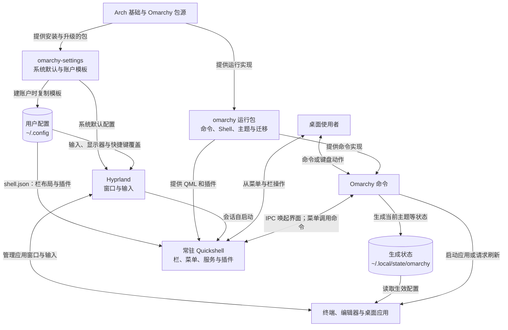
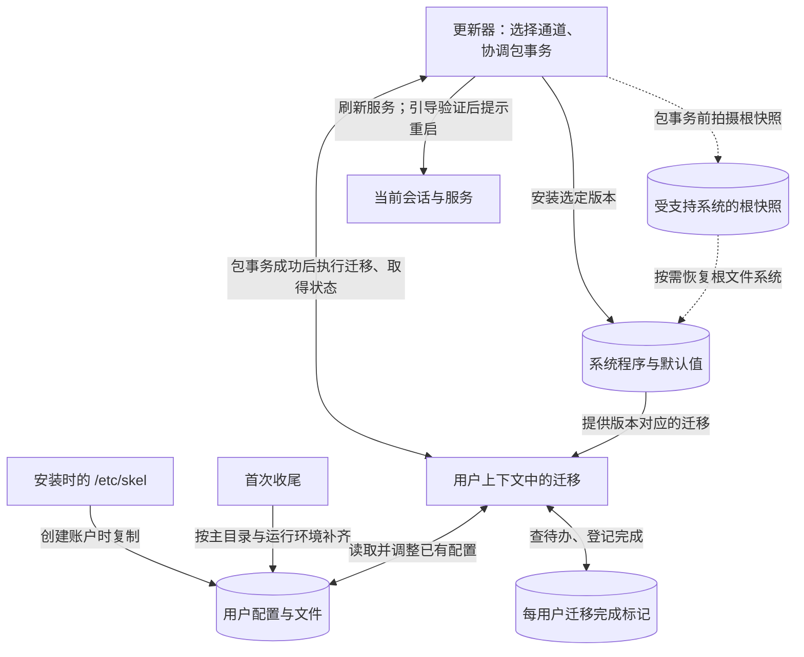
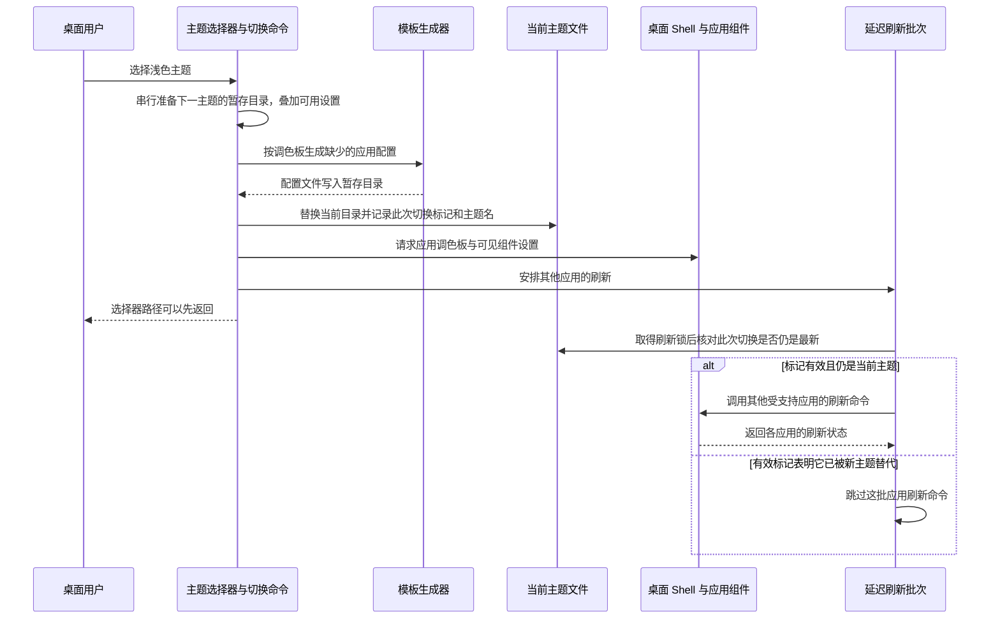

Omarchy 是基于 Arch Linux 的桌面发行版。它组合 Hyprland 平铺窗口管理器、用 Quickshell 构建的桌面 Shell、终端、编辑器与常用应用，并为它们提供一套键盘操作、菜单、默认配置和升级方式。它适合愿意沿用这套工作习惯，又希望保留配置文件控制权的人。项目替用户维护的工作包括选哪些组件、如何让它们配合，以及软件升级时如何迁移既有安装。[项目定位](https://github.com/omacom/omarchy/blob/087f73d899b456ce5275ebf27294d379585fbdb1/manual/01-welcome-to-omarchy.md) · [配置文件归属](https://github.com/omacom/omarchy/blob/087f73d899b456ce5275ebf27294d379585fbdb1/manual/31-dotfiles.md) · [更新方式](https://github.com/omacom/omarchy/blob/087f73d899b456ce5275ebf27294d379585fbdb1/manual/30-updates.md)

作者把发行方式称为 _omakase_：为愿意接受一套现成工作方式的人，同时选择应用和它们之间的操作约定。一个可用的发行版因此要处理三段不同的工作：让新用户第一次登录就有可用桌面，日常从一个入口驱动多个独立程序，更新后让既有账户跟上新版本。输入既有 Arch 与 Omarchy 的软件包，也有硬件、个人配置和当前会话；输出既有已安装的系统和配置文件，也有用户此刻能看到、能操作的桌面。[项目对桌面体验的定位](https://github.com/omacom/omarchy/blob/087f73d899b456ce5275ebf27294d379585fbdb1/manual/01-welcome-to-omarchy.md#L1-L11) · [仓库与安装系统的对应关系](https://github.com/omacom/omarchy/blob/087f73d899b456ce5275ebf27294d379585fbdb1/docs/file-layout.md#L6-L47)

## 从软件包到有人登录的桌面

这里的桌面 Shell 指同一登录会话里长时间运行的 **Quickshell 实例**。Hyprland 负责窗口、输入和布局，按自启动配置拉起 Shell；栏、菜单、浮层和服务以插件形式在 Shell 内加载。调用方可通过 IPC 找到正在运行的实例，只打开所需面板；窗口内的编辑器和终端继续以自己的进程运行。CLI 将命令映射为随包提供的具体程序，菜单可以调用相同的日常动作。壁纸、窗口边框和编辑器同时变色，意味着不同组件分别读到了正确状态。[桌面 Shell 与插件生命周期](https://github.com/omacom/omarchy/blob/087f73d899b456ce5275ebf27294d379585fbdb1/docs/omarchy-shell.md#L1-L52) · [CLI 如何找到具体实现](https://github.com/omacom/omarchy/blob/087f73d899b456ce5275ebf27294d379585fbdb1/docs/cli-router.md#L1-L30) · [菜单与命令](https://github.com/omacom/omarchy/blob/087f73d899b456ce5275ebf27294d379585fbdb1/docs/menu.md)

默认设置和用户意图有不同的维护周期。手册把 `/usr/share/omarchy` 里的文件交给发行版维护，把个人调整放进 `~/.config`。以窗口管理为例，入口加载发行版配置后，再读取个人的显示器、输入、按键和外观模块。这样一次上游按键调整可以服务尚未定制的人，自定义行为也有固定的入口。升级还涉及包和配置迁移；通过 Limine 引导的受支持安装可用系统快照恢复根文件系统，`/home` 里的新文档和配置保留原状。因此旧程序能否读迁移后的个人配置需要另外核对。[用户配置入口](https://github.com/omacom/omarchy/blob/087f73d899b456ce5275ebf27294d379585fbdb1/config/hypr/hyprland.lua) · [发行版升级](https://github.com/omacom/omarchy/blob/087f73d899b456ce5275ebf27294d379585fbdb1/manual/30-updates.md) · [系统快照的恢复范围](https://github.com/omacom/omarchy/blob/087f73d899b456ce5275ebf27294d379585fbdb1/manual/47-system-snapshots.md)

## 为什么软件包升级后，还需要按用户迁移

这份源码构建两个主要包，PKGBUILD 在独立仓库维护。`omarchy-settings` 提供创建用户、安装引导环境前就要存在的配置，`omarchy` 依赖它，提供运行、收尾与迁移。新账户从 `/etc/skel` 取得一份初始配置，再由每用户收尾阶段处理依赖真实主目录或设备状态的设置。再次更新包不会重新创建用户，也不会把骨架目录的所有文件无条件复制一遍。必须改变旧配置时，上游用明确的迁移脚本，在各个账户下分别记录完成情况；显式重置为默认值是另一项操作。[账户的三种配置路径](https://github.com/omacom/omarchy/blob/087f73d899b456ce5275ebf27294d379585fbdb1/docs/file-layout.md#L8-L47) · [每用户迁移设计](https://github.com/omacom/omarchy/blob/087f73d899b456ce5275ebf27294d379585fbdb1/docs/update-process.md#L9-L56)

例如两位用户共用一台机器，系统软件只能有一份，两人的快捷键配置和迁移记录却各有一份。上游明确把迁移放在包事务以后，因为有些改动需要当前用户的主目录、桌面会话或交互。按顺序运行、对已应用的机器级更改允许重复检查，可以避免第二个用户再次破坏第一个用户的修复。发行通道控制更新节奏。固定版本中，快照创建失败可继续更新；软件包更新失败则止于该步骤。受支持安装若已留下快照，可以从引导菜单回到升级前的根文件系统。恢复后个人文件仍是当下的版本，旧应用能否解释新配置要另行核对。[更新顺序与迁移标记](https://github.com/omacom/omarchy/blob/087f73d899b456ce5275ebf27294d379585fbdb1/docs/update-process.md#L9-L59) · [更新失败时的分支](https://github.com/omacom/omarchy/blob/087f73d899b456ce5275ebf27294d379585fbdb1/bin/omarchy-update#L108-L129) · [更新器负责服务与重启检查](https://github.com/omacom/omarchy/blob/087f73d899b456ce5275ebf27294d379585fbdb1/bin/omarchy-update#L124-L174) · [通道选择](https://github.com/omacom/omarchy/blob/087f73d899b456ce5275ebf27294d379585fbdb1/manual/30-updates.md#L9-L22) · [根快照范围](https://github.com/omacom/omarchy/blob/087f73d899b456ce5275ebf27294d379585fbdb1/manual/47-system-snapshots.md#L3-L19)

## 为什么一次主题切换会有多个完成时刻

以正常启动的桌面、从选择器切换到已有主题为例。主题提供 `colors.toml`，其中的背景、前景和强调色可以转换为多个应用各自需要的文件格式。模板生成器保留主题已提供的目标文件，对其余文件先匹配用户模板，再使用发行版模板。[主题切换入口](https://github.com/omacom/omarchy/blob/087f73d899b456ce5275ebf27294d379585fbdb1/bin/omarchy-theme-set) · [模板生成器](https://github.com/omacom/omarchy/blob/087f73d899b456ce5275ebf27294d379585fbdb1/bin/omarchy-theme-set-templates)

第一把锁保护多个主题切换对同一暂存区的写入；脚本先删除旧主题目录再把暂存目录移动过去，读取者不能据此假定路径始终存在。第二把锁约束延迟刷新的批次，切换标记用于识别已经过期的应用刷新。如果这次标记未能写入，脚本仍会尝试刷新，此时无法靠标记跳过过期批次。用户的主题钩子在该锁外调用，需要自行处理可能过期的通知。交互终端直接执行命令时会等待这批应用刷新；选择器可以先返回，单个刷新失败会留下记录，屏幕上可能短时间同时出现新旧配色。这解释了为什么“用户已选中浅色”与“编辑器已显示浅色”要分别观察。[准备、替换与记录当前主题](https://github.com/omacom/omarchy/blob/087f73d899b456ce5275ebf27294d379585fbdb1/bin/omarchy-theme-set#L408-L524) · [延迟批次及失败报告](https://github.com/omacom/omarchy/blob/087f73d899b456ce5275ebf27294d379585fbdb1/bin/omarchy-theme-set#L555-L632)

## 采用整套桌面，还是只借用配置分层

需要平铺窗口、统一菜单和成套开发应用，且能接受发行版约定的团队，可以把 Omarchy 当作工作站基线。若现有桌面已经满足需求，只想让两款内部工具颜色一致，一份共享调色板和两个适配器就足够。整套发行版带来硬件、软件包与配置迁移的维护范围，而新增一种应用能否同步主题，取决于它能否读取生成的配置以及是否有可靠的刷新方式。[软件与使用范围](https://github.com/omacom/omarchy/blob/087f73d899b456ce5275ebf27294d379585fbdb1/README.md) · [扩展到其他应用](https://github.com/omacom/omarchy/blob/087f73d899b456ce5275ebf27294d379585fbdb1/manual/43-making-your-own-theme.md)

把这套机制迁移到内部终端和日志查看器时，可以先用一个强调色字段、两份模板做验证。给日志查看器提供一份同名用户模板，另给终端放一份主题自带的完整目标文件。生成后应分别看到用户模板中的颜色与原封不动的终端文件，上游也用临时目录验证了这两个优先级。再连续选择 A、B 两种主题，让 A 的后台刷新等待到 B 已成为当前主题后才开始；检查界面最终使用 B，以及失败的应用是否能被单独识别。前一个实验检验配置归属，后一个检验配置与运行中界面能否最终一致。[模板优先级测试](https://github.com/omacom/omarchy/blob/087f73d899b456ce5275ebf27294d379585fbdb1/test/shell.d/theme-templates-test.sh) · [刷新批次的代次校验](https://github.com/omacom/omarchy/blob/087f73d899b456ce5275ebf27294d379585fbdb1/bin/omarchy-theme-set#L555-L610)
