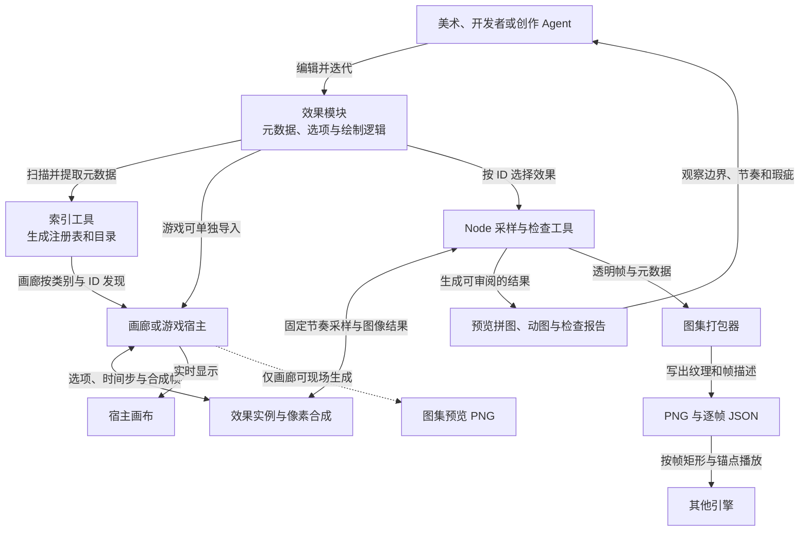
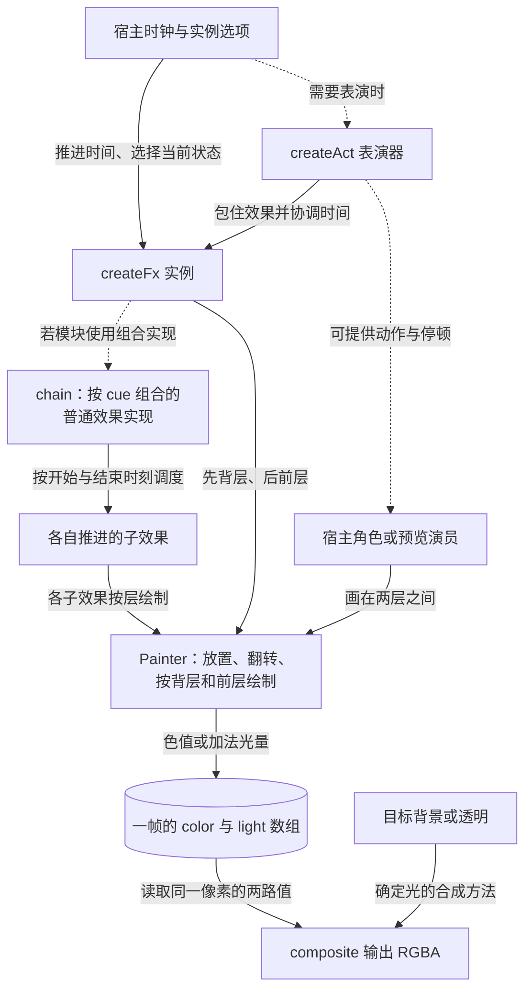
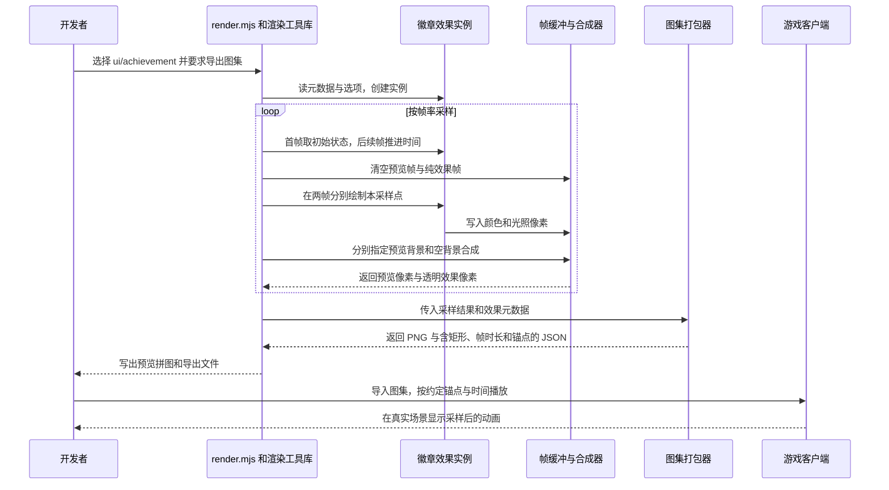

PixelFX 是一套用 JavaScript 定义的像素动效库。每个效果都有自己的尺寸、原点、时长和绘制逻辑，可以在网页中按需要的色板创建实例、绘制时调整位置或朝向，也可以逐帧导出透明 PNG 图集和描述帧位置的 JSON。仓库还提供可交互的画廊、效果创作指南和辅助 Agent 反复渲染、观察、修改的技能。它适合既要保留可编辑动效，又要兼顾不同渲染环境的游戏和界面团队。[项目与画廊说明](https://github.com/patch-gg/pixelfx/blob/5294518ce7c72e48b6100a744596e0acf57f2826/README.md) · [效果创作约定](https://github.com/patch-gg/pixelfx/blob/5294518ce7c72e48b6100a744596e0acf57f2826/docs/AUTHORING.md)

作者把每个效果写成一小份可修改的程序，再以渲染结果判断它值不值得保留。这样一朵火焰可以更换色阶，一次反馈也可以只换朝向，而无需手工重画整张图集。输入是某份效果定义、参数、时间步和宿主画布；输出可以是本帧 RGBA 像素，也可以是完全脱离 JavaScript 的制品。以成就徽章为例，游戏决定什么练习算完成、是否已经发奖，库只负责奖章出现、亮光扫过和文字滑出的表现。[作者的创作方法与产品入口](https://github.com/patch-gg/pixelfx/blob/5294518ce7c72e48b6100a744596e0acf57f2826/README.md#L7-L25) · [徽章的输入参数与元数据](https://github.com/patch-gg/pixelfx/blob/5294518ce7c72e48b6100a744596e0acf57f2826/src/fx/ui/achievement.js#L4-L22)

## 从效果文件，到人实际看到的像素

项目在构建时扫描按类别组织的效果文件，生成 JavaScript 注册表和人可读的目录，静态画廊用该注册表列出效果、调整选项并演示播放。游戏可以只导入需要的模块，运行时无需为浏览目录或导出视频付出同样成本。创作工具则给同一模块渲染拼图或动图，检查元数据、画布越界、循环接缝与尾帧等问题。程序可以指出有像素出了边界，作者仍要看它的视觉重心和播放节奏；下一轮修改落在效果文件。[目录和注册表的生成](https://github.com/patch-gg/pixelfx/blob/5294518ce7c72e48b6100a744596e0acf57f2826/tools/index.mjs#L1-L55) · [画廊如何使用实例](https://github.com/patch-gg/pixelfx/blob/5294518ce7c72e48b6100a744596e0acf57f2826/gallery/app.js#L2-L98) · [检查器的职责](https://github.com/patch-gg/pixelfx/blob/5294518ce7c72e48b6100a744596e0acf57f2826/tools/check.mjs#L1-L26) · [作者工作方法](https://github.com/patch-gg/pixelfx/blob/5294518ce7c72e48b6100a744596e0acf57f2826/docs/AUTHORING.md#the-method)

## 颜色与光照是一种分层，角色前后是另一种

作者用局部坐标画图，把原点放在效果需要对齐的位置。宿主改变实例的位置或朝向时，由 Painter 统一映射。效果可以按给定时间直接绘制，也可以在实例里保存粒子等状态，逐步更新。需要与角色相互遮挡时，宿主可分两次画出效果的前后层，在中间绘制自己的角色；上游还可以给有表演要求的效果编排姿势和停顿。`createAct` 把可选的角色动作时间线与效果推进放在一起；`chain` 则按开始与截止时刻驱动多项子效果，对外仍暴露普通效果接口，原有播放器和图集工具即可复用。前后层控制遮挡次序，颜色和光照缓冲控制每个像素如何合成，两组划分各有用途。[实例与分层接口](https://github.com/patch-gg/pixelfx/blob/5294518ce7c72e48b6100a744596e0acf57f2826/src/core/fx.js) · [绘制器](https://github.com/patch-gg/pixelfx/blob/5294518ce7c72e48b6100a744596e0acf57f2826/src/core/painter.js) · [子效果组合契约](https://github.com/patch-gg/pixelfx/blob/5294518ce7c72e48b6100a744596e0acf57f2826/src/core/chain.js#L1-L42) · [动作编排](https://github.com/patch-gg/pixelfx/blob/5294518ce7c72e48b6100a744596e0acf57f2826/src/core/act.js)

徽章是有状态的例子。创建实例时，会合并默认配置，把选定的色板与文字字形保存在徽章实例中，使用种子生成部分闪光和粒子。下门课程可以按新主题直接创建下一枚徽章；已经开始播放的这枚如果也要改文字或色板，宿主需要重建实例，若要延续进度还需用自己记录的时间步重新推进。当宿主推进 `dt`，核心会把这一次推进拆成时长不超过约 1/120 秒的小步交给模拟逻辑。要重复得到相同的像素，应固定效果版本、选项、种子和每次推进的节奏；仅记录“都跑了一秒”无法保证不同宿主逐像素一致。[时间推进](https://github.com/patch-gg/pixelfx/blob/5294518ce7c72e48b6100a744596e0acf57f2826/src/core/fx.js) · [奖章的粒子与时间线](https://github.com/patch-gg/pixelfx/blob/5294518ce7c72e48b6100a744596e0acf57f2826/src/fx/ui/achievement.js)

## 给只认图集的客户端交付一次徽章动画

离线工具为预览和透明效果分别绘制，图集中取的是效果本身；预览背景和用于演示的替身演员不会作为额外层被打包进去。组合效果仍可直接导出；若模块含动作编排，普通图集的 JSON 可另带编排时序，但 PNG 仍取纯效果帧。要把完整表演连同角色画面一起烘焙，可使用独立的表演渲染路径。徽章只有自身的像素和时间线，无需演员。光照则发生了实质变化：现场绘制可以把光值加到已有背景，图集要把透明处的亮光折算成带 alpha 的颜色。如果目标引擎只对整张图做普通透明叠加，在明亮背景上可能与原始合成效果不同。因此美术验收要使用真正的游戏背景。[采样和图集生成](https://github.com/patch-gg/pixelfx/blob/5294518ce7c72e48b6100a744596e0acf57f2826/tools/lib/fxlib.mjs) · [完整表演的采样与显示](https://github.com/patch-gg/pixelfx/blob/5294518ce7c72e48b6100a744596e0acf57f2826/tools/lib/fxlib.mjs#L85-L115) · [颜色与光照合成](https://github.com/patch-gg/pixelfx/blob/5294518ce7c72e48b6100a744596e0acf57f2826/src/core/fx.js)

由该提交的徽章元数据和采样公式可推出默认导出的 JSON 记录帧尺寸 220 × 72、锚点 (110, 36)、30 FPS、单次播放和 73 帧。2.4 秒乘 30 得到 72 个采样间隔，非循环效果还包括起始帧，单帧时长在导出文件中取整为 33 毫秒。接入时应读取帧矩形和时长，并确认引擎如何解释 `meta.pixelfx.pivot`；只把 PNG 当普通图片加载，不会自动产生正确的播放节奏和对齐。[导出入口](https://github.com/patch-gg/pixelfx/blob/5294518ce7c72e48b6100a744596e0acf57f2826/tools/render.mjs) · [帧数、时长和锚点写入](https://github.com/patch-gg/pixelfx/blob/5294518ce7c72e48b6100a744596e0acf57f2826/tools/lib/fxlib.mjs)

## 哪一端值得承担动效成本

每次发奖时需要按用户主题选择文字、光照或色板时，实时模式省去预制每种组合的工作，但要在目标设备上测绘制预算。播放内容固定、客户端已有图集播放器时，离线模式省去 JavaScript 模拟，代价是存储每一帧及其变体。只需显示“已完成”的低频设置页，一张静态徽章和可读文字就能完成反馈。如果复用整个仓库，还要区别代码和素材的权利范围，画廊的 Patch Pixel 字体有单独的声明。[创作与集成约定](https://github.com/patch-gg/pixelfx/blob/5294518ce7c72e48b6100a744596e0acf57f2826/docs/AUTHORING.md) · [素材声明](https://github.com/patch-gg/pixelfx/blob/5294518ce7c72e48b6100a744596e0acf57f2826/NOTICE.md)

把徽章迁移到另一个界面框架时，先固定主题和种子导出，再在目标引擎把锚点钉在同一像素标记上。逐帧检查奖章出现时是否漂移、尾帧是否残留，再在一深一浅两种背景上对照实时输出的光晕。若只有亮底上有明显偏差，就可以决定采用宿主的独立光照层，或接受图集表现；若两种背景都发生位置偏移，则先修正帧矩形、缩放和锚点。
