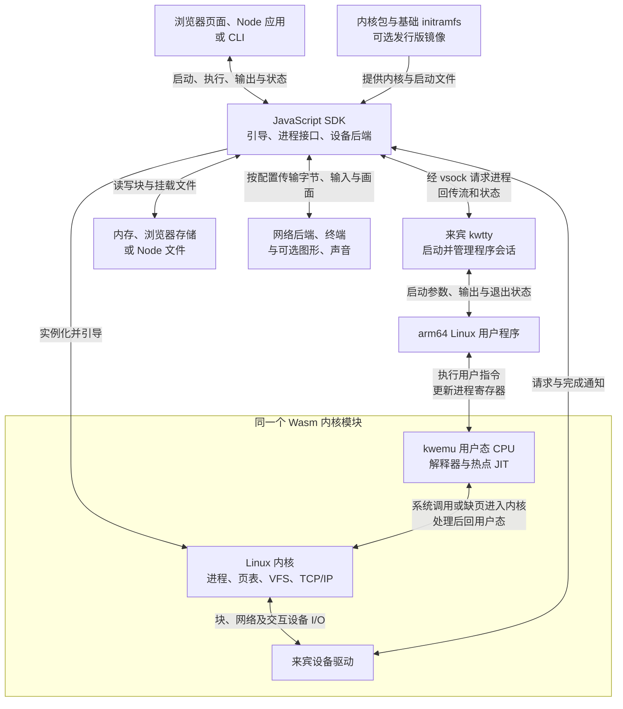
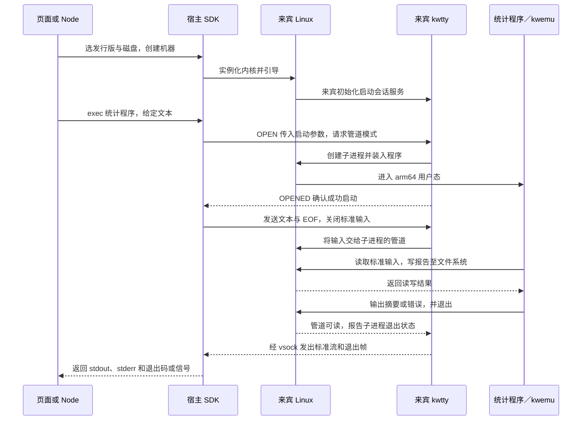
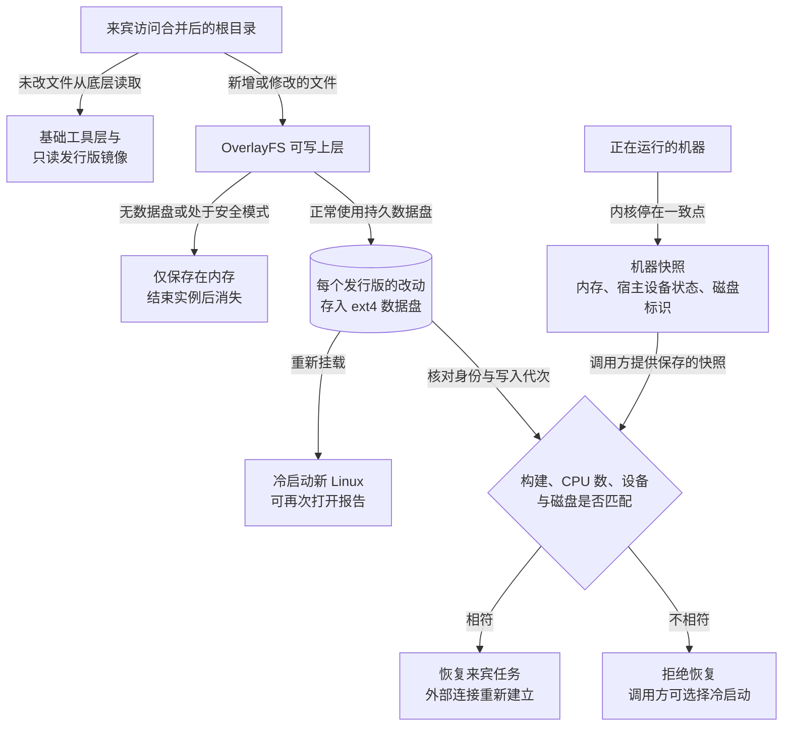

假设你维护一个 Linux 命令行工具，用户拖进一段文本，它统计行数、写出报告，并把摘要送到标准输出。想把它嵌进教学网站，同时在 Node 测试中运行同一个二进制，通常要在后端维持一台机器，或为浏览器移植工具及其依赖。unkernel 给了另一条路：在用户设备上实例化一份编译成 WebAssembly 的 Linux 内核，让现有的 arm64 Linux 用户程序在其中运行。程序、发行版镜像和宿主提供的输入是起点，输出可以是进程状态、字节流、磁盘文件，也可以是终端、图像或声音。示例中的统计工具是假设的自有程序，下面按项目实际的进程和存储接口跟踪它。[作者对项目与用途的说明](https://github.com/pithings/unkernel/blob/bc6e5ba6a06f6fd729a240d8774ec84c8e8dca66/README.md#L15-L28) · [程序执行契约](https://github.com/pithings/unkernel/blob/bc6e5ba6a06f6fd729a240d8774ec84c8e8dca66/docs/1.sdk/2.programs.md#L5-L29)

它适合希望读者在网页里直接使用真实 Linux 工具的交互教材，也适合要在浏览器和 Node 上复用某个 arm64 软件包的应用。需要确认两件事：目标程序和库须能在它支持的用户态指令集上运行，宿主引擎须提供内核所需的 WebAssembly 特性。特别重的计算、依赖特定硬件的程序，还要在目标设备上验证。用户所见的 Linux 文件系统、进程和设备属于来宾机器；宿主能力由 SDK 显式接入。[用户空间与指令集](https://github.com/pithings/unkernel/blob/bc6e5ba6a06f6fd729a240d8774ec84c8e8dca66/include/kw_emu.h#L3-L24) · [平台和运行时限制](https://github.com/pithings/unkernel/blob/bc6e5ba6a06f6fd729a240d8774ec84c8e8dca66/README.md#L173-L182) · [CPU 密集代码的边界](https://github.com/pithings/unkernel/blob/bc6e5ba6a06f6fd729a240d8774ec84c8e8dca66/README.md#L283-L305)

## 哪一层真正运行 Linux

作者保留 Linux 处理系统调用、调度、页表和文件系统的代码，把需要模拟的部分缩到 **arm64 用户态 CPU**。两边链接进同一个内核模块。kwemu 执行用户程序，沿 Linux 自己维护的页表翻译虚拟地址。程序发起系统调用或碰到缺页时，它把控制权交给已经编译为 Wasm 的内核；返回时用户寄存器仍有明确归属。这样 `fork`、写时复制和信号可以沿用 Linux 的语义，现有发行版软件也不用逐个重编译成 Wasm。代价由用户态执行承担：代码块先解码，热点可编译为 Wasm，冷路径和部分指令仍需解释。任务切换使用 JSPI，即宿主 WebAssembly 引擎暂停和恢复调用栈的接口。[作者比较设计路径及解释、JIT 的分工](https://github.com/pithings/unkernel/blob/bc6e5ba6a06f6fd729a240d8774ec84c8e8dca66/README.md#L220-L258) · [CPU、内核与页表的契约](https://github.com/pithings/unkernel/blob/bc6e5ba6a06f6fd729a240d8774ec84c8e8dca66/include/kw_emu.h#L3-L35) · [内核包组成](https://github.com/pithings/unkernel/blob/bc6e5ba6a06f6fd729a240d8774ec84c8e8dca66/kernel/README.md#L23-L32)

SDK 的工作是给这份内核一台可用的机器。发行包自带基础启动文件系统，单独提供发行版镜像后，来宾启动器把它作为只读底层挂上；不选发行版也可进入基础系统。块设备可以由浏览器持久存储或 Node 文件提供。来宾继续使用 Linux TCP/IP 栈，虚拟网卡交付以太网帧，宿主的 JavaScript 网络栈再桥接到实际后端；SDK 默认不接网络，Node 可用宿主套接字，浏览器可用显式选择的 Wisp 代理。宿主文件系统可通过 9p 挂进来宾，图形、输入、声音也经设备驱动映射至宿主。可选 Worker 让内核离开页面或 Node 的主线程；浏览器多 CPU 模式另需支持共享内存的隔离页面，各 CPU 在自己的 Worker 中使用同一份来宾内存。[启动镜像与下载边界](https://github.com/pithings/unkernel/blob/bc6e5ba6a06f6fd729a240d8774ec84c8e8dca66/README.md#L324-L346) · [设备驱动](https://github.com/pithings/unkernel/blob/bc6e5ba6a06f6fd729a240d8774ec84c8e8dca66/README.md#L259-L265) · [来宾网卡与宿主网络栈](https://github.com/pithings/unkernel/blob/bc6e5ba6a06f6fd729a240d8774ec84c8e8dca66/js/core/net.ts#L3-L13) · [网络后端与默认值](https://github.com/pithings/unkernel/blob/bc6e5ba6a06f6fd729a240d8774ec84c8e8dca66/docs/1.sdk/3.network.md#L14-L21) · [文件共享](https://github.com/pithings/unkernel/blob/bc6e5ba6a06f6fd729a240d8774ec84c8e8dca66/README.md#L433-L459) · [Worker 与多 CPU](https://github.com/pithings/unkernel/blob/bc6e5ba6a06f6fd729a240d8774ec84c8e8dca66/README.md#L621-L633)

## 一个进程怎样把结果交回页面

假设发行版镜像内已放入这个自有 arm64 统计工具。页面希望从标准输入送入文章，收到一行统计结果，并让工具把同一结果写为来宾目录下的报告。SDK 的 `exec` 走管道，`spawn` 还可使用伪终端提供交互式 Shell；两者都由来宾内的 `kwtty` 接收启动请求。主机与来宾通过 vsock 交换字节，无需给来宾配置互联网。图中的程序会在写入或处理失败时返回非零状态。[宿主进程接口与帧](https://github.com/pithings/unkernel/blob/bc6e5ba6a06f6fd729a240d8774ec84c8e8dca66/js/core/tty.ts#L3-L45) · [创建管道和子进程](https://github.com/pithings/unkernel/blob/bc6e5ba6a06f6fd729a240d8774ec84c8e8dca66/guest/src/kwtty.c#L1809-L1834) · [来宾启动实际程序](https://github.com/pithings/unkernel/blob/bc6e5ba6a06f6fd729a240d8774ec84c8e8dca66/guest/src/kwtty.c#L585-L596)

这里有三种彼此独立的结果。机器启动成功，只说明 Linux 能运行；SDK 收齐标准输出，只说明进程送出了这些字节；业务是否成功要结合退出状态和预期报告判断。项目约定非零退出也会正常返回结果对象，而连接在收到退出帧之前结束表示会话丢失。交互程序还要持续读输出，否则来宾可能在管道或终端处等待。由此可推，在页面里显示“完成”之前，至少要区分“进程失败”“连接丢了”和“报告已生成”。[确认启动后才写入输入](https://github.com/pithings/unkernel/blob/bc6e5ba6a06f6fd729a240d8774ec84c8e8dca66/js/core/tty.ts#L1108-L1129) · [来宾确认启动](https://github.com/pithings/unkernel/blob/bc6e5ba6a06f6fd729a240d8774ec84c8e8dca66/guest/src/kwtty.c#L1845-L1877) · [普通退出与非零退出](https://github.com/pithings/unkernel/blob/bc6e5ba6a06f6fd729a240d8774ec84c8e8dca66/docs/1.sdk/2.programs.md#L9-L32) · [EOF 与退出帧](https://github.com/pithings/unkernel/blob/bc6e5ba6a06f6fd729a240d8774ec84c8e8dca66/js/core/tty.ts#L35-L45)

## 保存文件和继续运行是两种恢复

根文件系统用 OverlayFS 把两份底层（项目附带的基础工具和只读发行版镜像）与可写上层合起来。通用 SDK 没有挂持久数据盘时，改动留在内存；挂入带 `kwdata` 标记的盘之后，正常挂载后，每个发行版的改动进入盘上自己的目录；安全模式可以临时使用内存上层，保留原有数据。浏览器演示页使用持久数据盘，Node 可把数据盘存为宿主文件。这样第二天冷启动，来宾可以重新打开报告；当时运行到哪里、终端里哪个进程正在等待，则需要另外保存。若报告写到显式挂载的宿主目录，它有该宿主文件系统自己的生命周期。[根目录的两种上层](https://github.com/pithings/unkernel/blob/bc6e5ba6a06f6fd729a240d8774ec84c8e8dca66/README.md#L324-L346) · [来宾启动器的叠加层](https://github.com/pithings/unkernel/blob/bc6e5ba6a06f6fd729a240d8774ec84c8e8dca66/guest/base/initramfs/init#L9-L35) · [浏览器与 Node 的数据盘](https://github.com/pithings/unkernel/blob/bc6e5ba6a06f6fd729a240d8774ec84c8e8dca66/docs/1.sdk/4.disks.md#L9-L31) · [宿主挂载在恢复时的归属](https://github.com/pithings/unkernel/blob/bc6e5ba6a06f6fd729a240d8774ec84c8e8dca66/js/core/instance.ts#L55-L74)

进程收到文件写入成功与宿主刷盘完成也有先后。内核把块请求描述放入内存，后端可同步完成，或在 Promise 结束后写回状态、触发中断。要承诺关闭页面以后仍能读到这份报告，持久盘的刷新同样属于保存流程。[块设备完成通知与刷新](https://github.com/pithings/unkernel/blob/bc6e5ba6a06f6fd729a240d8774ec84c8e8dca66/js/core/block.ts#L3-L15) · [持久盘的刷新序号](https://github.com/pithings/unkernel/blob/bc6e5ba6a06f6fd729a240d8774ec84c8e8dca66/js/core/block.ts#L35-L45)

机器快照要求内核把任务停在状态都已进入内存的位置。快照记录内核内存、时钟、设备状态和每块盘的身份与写入代次，盘内容本身由调用方保留。若机器在拍照后继续写盘，旧快照与新盘不再构成同一运行时刻。恢复时因此要求相同内核构建、相同 CPU 数及相容设备，发现磁盘变化就拒绝。对于“保存后关闭”的应用，带 `commit` 回调的快照让机器在一致点等待，调用方存储成功后才停止；提交失败或超时则继续原来的机器。普通 TCP 和 vsock 连接要重建，可分离的终端会话是特例，来宾保留了它，宿主可以在期限内重新挂接。[快照包含的对象](https://github.com/pithings/unkernel/blob/bc6e5ba6a06f6fd729a240d8774ec84c8e8dca66/js/core/snapshot.ts#L3-L17) · [磁盘与设备校验](https://github.com/pithings/unkernel/blob/bc6e5ba6a06f6fd729a240d8774ec84c8e8dca66/js/core/instance.ts#L55-L74) · [保存失败仍继续运行](https://github.com/pithings/unkernel/blob/bc6e5ba6a06f6fd729a240d8774ec84c8e8dca66/js/core/snapshot.ts#L90-L106)

如果把这套架构用于交互教材，一个值得先定下来的产品约定是“继续上次练习”要恢复什么。只要让学生第二天打开报告，保留数据盘并重新启动工具通常已足够；若要保留尚在运行的调试会话，则还要保存机器、固定兼容构建并安排重新连接。可以给两种承诺各做一次验收：第一次只保留盘，确认文件存在、进程已重新开始；第二次保存机器，再刻意换上一份已修改的盘，确认系统拒绝把两个时刻拼成一次恢复。[快照保存、停机和重新挂接的契约](https://github.com/pithings/unkernel/blob/bc6e5ba6a06f6fd729a240d8774ec84c8e8dca66/js/core/instance.ts#L834-L850)
