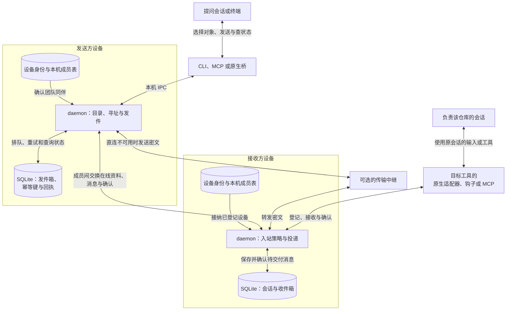
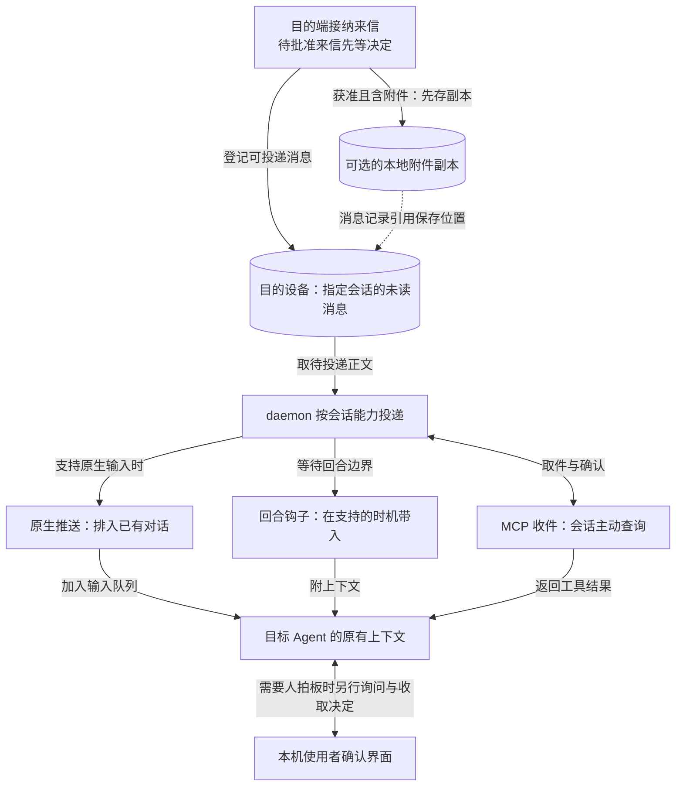
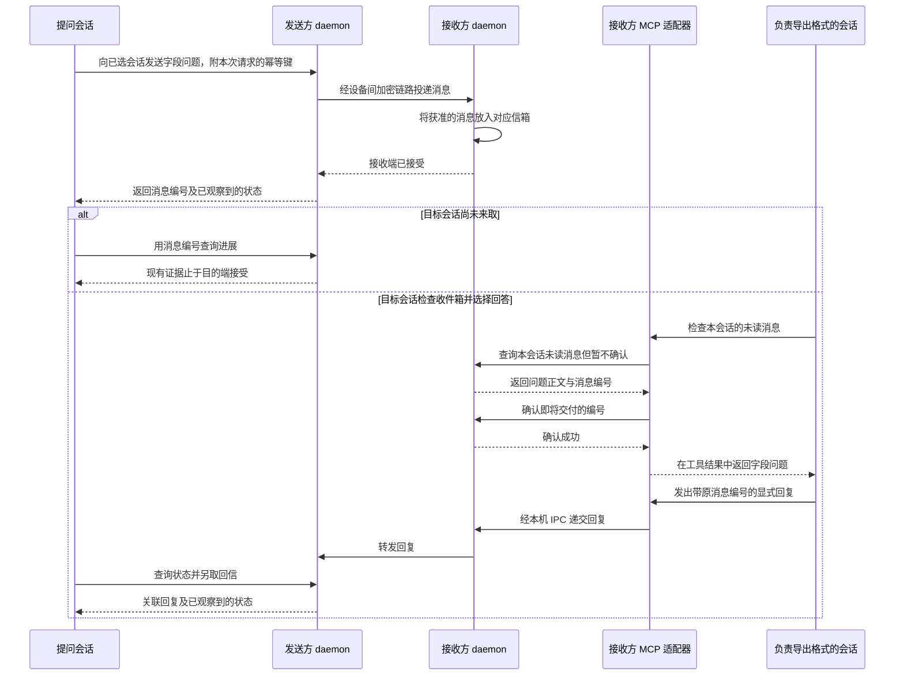

Reason Network 让同一团队在不同机器、不同编码工具中打开的 Agent 会话彼此发现和发消息。每台电脑上的 daemon 维护会话目录和信箱；本机 Agent 能看到团队里谁在处理哪个仓库、哪个分支，再把问题送进合适的对话。收件人在原有上下文中回复，发送方可以按消息编号查询进展。这适合需要对接另一位同事的既有工作、却无需建立共享任务系统的情况。[项目介绍](https://github.com/reason-machines/reason-network/blob/5442c8b551a6897b596c7695e51b0329551aaa6c/README.md) · [会话地址与架构](https://github.com/reason-machines/reason-network/blob/5442c8b551a6897b596c7695e51b0329551aaa6c/DESIGN.md#concepts)

例如桌面应用准备显示导出结果，客户端开发者想确认 `row_count` 是否包含表头。负责导出格式的队友同时有两场对话，一场改模式定义，另一场修文档。发送者按仓库、分支和会话名选中前者，只问字段含义，回答中可附自有测试样例。接到答复后，客户端仍须把约定写进测试和接口文档。问题找到了正确的对话和接口已经验收是两件事。[目录与地址解析](https://github.com/reason-machines/reason-network/blob/5442c8b551a6897b596c7695e51b0329551aaa6c/src/daemon/directory.rs) · [显式回复的关联](https://github.com/reason-machines/reason-network/blob/5442c8b551a6897b596c7695e51b0329551aaa6c/src/store.rs)

## 目录为什么分布在成员设备上

作者在设计说明中把核心问题定为：有好几个看似合适的 Agent 时，怎样在发送之前知道哪一场对话已经握有需要的上下文。为此每台机器运行一个 daemon，同时面向本地会话和获准加入团队的同伴。机器发布会话的工具类型、仓库、分支和简短近况，连接上的各成员交换在线资料；本地查询把自己的登记与同伴最近公布的资料合并。设备各自持有复制的团队成员表，用来判断哪些身份能成为同伴；经常变化的会话列表由这些设备另行发布。目标机器掉线时，目录可以保留上次所见，发送端用本地发件箱等待重连。这样做把正文留在端点，也要求将“最近见过”与“此刻能够接信”分开。上游将这种在线设备彼此连接的方案定位在小团队规模。[设计动机](https://github.com/reason-machines/reason-network/blob/5442c8b551a6897b596c7695e51b0329551aaa6c/DESIGN.md#why-another-one) · [复制成员表与设备准入](https://github.com/reason-machines/reason-network/blob/5442c8b551a6897b596c7695e51b0329551aaa6c/DESIGN.md#L193-L210) · [在线资料、发件箱与对端确认](https://github.com/reason-machines/reason-network/blob/5442c8b551a6897b596c7695e51b0329551aaa6c/DESIGN.md#L244-L275) · [本地与远端会话如何合为目录](https://github.com/reason-machines/reason-network/blob/5442c8b551a6897b596c7695e51b0329551aaa6c/src/daemon/directory.rs#L311-L439)

团队、人员、设备和会话是四个不同的对象。设备持有传输身份，一台设备可以同时承载多个会话；同一个人有重名会话时，地址还可以指定机器。队友能看到人员、设备、仓库、分支、忙闲状态等协作信息。设备优先直连，必要时经传输中继；这个中继转发密文，仍可能观察哪些机器发生了通信。该保证针对设备间的传输链路。目标会话收到正文后，其工具和模型服务如何处理消息，由所选客户端决定。[地址与网络层](https://github.com/reason-machines/reason-network/blob/5442c8b551a6897b596c7695e51b0329551aaa6c/DESIGN.md#network-layer-m1) · [团队所见信息](https://github.com/reason-machines/reason-network/blob/5442c8b551a6897b596c7695e51b0329551aaa6c/README.md#how-it-works)

每个客户端能提供的交付证据也不同。有的支持将文本加入既有会话的输入队列，有的只能在下个回合的钩子中带入，还有的只支持主动检查收件箱。以仓库列出的 DeepSeek Harness 集成为例，Agent 通过 MCP 拉取。团队不必为这种客户端假造唤醒能力；可按接收时效要求选择适配器，必要时让人处理超时。[各会话的交付能力](https://github.com/reason-machines/reason-network/blob/5442c8b551a6897b596c7695e51b0329551aaa6c/DESIGN.md#getting-messages-into-agents) · [MCP 的收件接口](https://github.com/reason-machines/reason-network/blob/5442c8b551a6897b596c7695e51b0329551aaa6c/src/mcp.rs)

## 先确定“哪个会话”，再确定“怎样交给它”

本地 MCP 服务可能由一个客户端的多个标签页共用，进程名、机器名和工作目录都不足以唯一标识对话。适配器尽量提取该工具稳定的会话身份；支持稳定编号的会话在保留期内恢复后，可以取回为它保留的名字和未读信。同一项目中另一场对话仍有自己的信箱。只给出临时进程身份的客户端则有较弱的恢复语义：再次注册有时可以承接同名信箱，此时收件地址代表那个名字，无法据此断言两次都是同一段原生对话。[会话地址、保留与例外](https://github.com/reason-machines/reason-network/blob/5442c8b551a6897b596c7695e51b0329551aaa6c/DESIGN.md#addresses) · [本地 MCP 和原生桥的职责](https://github.com/reason-machines/reason-network/blob/5442c8b551a6897b596c7695e51b0329551aaa6c/DESIGN.md#L150-L160)

在设备间可以附上受大小与类型限制的文本样例，目的端会把它们保存为本机副本，通知里给出路径。收到文件的程序何时打开、是否采纳仍是另一个动作。如果队友的问题需要人来决定，接收方 Agent 可向自己的用户发起独立请求；普通来信、仅提醒用户的通知，以及用户通过本地确认界面作出的决定，各有不同来源。产品也支持托管助手的远程 MCP 入口；前述“两端是两台成员电脑”的传输边界针对本文绘出的本地对本地路径。[附件、提醒与用户确认](https://github.com/reason-machines/reason-network/blob/5442c8b551a6897b596c7695e51b0329551aaa6c/README.md#L68-L82) · [附件与未读记录的写入顺序](https://github.com/reason-machines/reason-network/blob/5442c8b551a6897b596c7695e51b0329551aaa6c/src/store.rs#L332-L367) · [本机确认服务](https://github.com/reason-machines/reason-network/blob/5442c8b551a6897b596c7695e51b0329551aaa6c/src/daemon/ask.rs#L1-L45) · [托管助手入口](https://github.com/reason-machines/reason-network/blob/5442c8b551a6897b596c7695e51b0329551aaa6c/README.md#L33-L47)

## 一个字段问题的回执怎样形成

下图假设两台已获团队授权的机器在线，收件策略允许该测试消息，目标会话使用拉取方式。一次回执只描述报告方实际观察到的阶段。[邮件处理](https://github.com/reason-machines/reason-network/blob/5442c8b551a6897b596c7695e51b0329551aaa6c/src/daemon/mail.rs) · [本机收件与确认](https://github.com/reason-machines/reason-network/blob/5442c8b551a6897b596c7695e51b0329551aaa6c/src/mcp.rs)

`accepted` 说明目的端接受，`handed_to_agent` 只有在能观察到本地会话交接时才成立；远端发送方可能仍只知道前一阶段。适配器把内容交给原生输入队列也无法证明模型已经阅读。显式回复要带原消息编号并匹配双方地址，才能关联为 `replied`；答复是否正确仍需结合样例验证。断线排队、策略拒绝或过期均有自己的结果。回执在发送端保留七天，查询只返回状态等字段，不返回正文，因此产品若要长期留存接口决议，需另存双方认可的文档。[送达语义](https://github.com/reason-machines/reason-network/blob/5442c8b551a6897b596c7695e51b0329551aaa6c/DESIGN.md#getting-messages-into-agents) · [回执、保留与回复匹配](https://github.com/reason-machines/reason-network/blob/5442c8b551a6897b596c7695e51b0329551aaa6c/src/store.rs)

如果提问方超时，先查消息编号；没有拿到编号时，可在发送端约七天的保留窗口内，从原会话带同一幂等键重试同一请求。窗口过后键也会被清理，再次使用可能生成新消息。本地存储为键保存请求指纹、标识和已有回执。保存回执的步骤本身也可能失败，上游测试特意模拟“已经推送、保存结果失败”，检验相同请求不会因此重复推送。换了收件人或改了内容却复用同一键，会被视为冲突。这个机制保护一次消息请求，收件人若另行触发业务操作，那项操作还需要自己的幂等设计。[发送幂等记录](https://github.com/reason-machines/reason-network/blob/5442c8b551a6897b596c7695e51b0329551aaa6c/src/store.rs) · [回执写入失败后的重试测试](https://github.com/reason-machines/reason-network/blob/5442c8b551a6897b596c7695e51b0329551aaa6c/src/daemon/mail.rs)

## 把会话投递借给其他产品

若团队主要需要长期追踪负责人、产出和验收，工单更适合保存那些状态；Reason Network 的长处是找到已有上下文并递交一则问题。只有两个人偶尔同步时，带样例的普通聊天消息通常足够。引入设备信箱的成本包括每台机的常驻进程、团队目录中可见的工作信息，以及每种 Agent 不同的交付时机。[会话适配与工作边界](https://github.com/reason-machines/reason-network/blob/5442c8b551a6897b596c7695e51b0329551aaa6c/DESIGN.md#getting-messages-into-agents) · [Multica 的工单和运行记录](../../github/multica-ai-multica/)

迁移到内部的数据字典助手时，可以先用两个自有测试会话和一个已知答案的字段做验收。让接收端 daemon 在线、暂不让目标会话取信，检查状态停在目的端接受；用同一键重发原问题，确认信箱只有一条。再让接收会话拉取并发出引用原消息的答复，核对回复确实关联到了原问题；最后检查测试样例的值是否符合答复。这样能分别发现寻址错误、重复投递和答非所问，避免用单一的“成功”掩盖三种不同结果。
