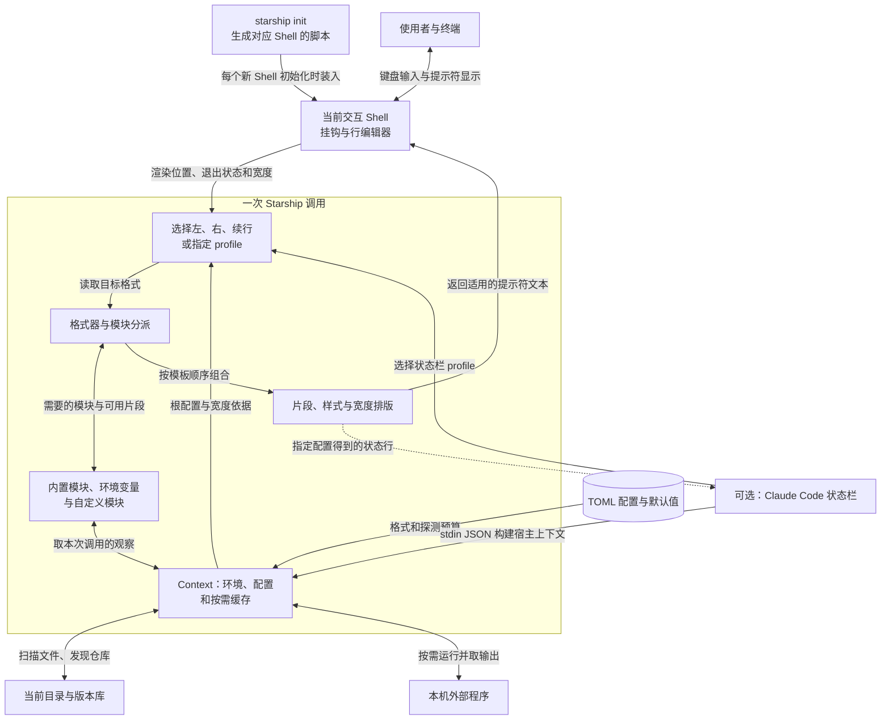
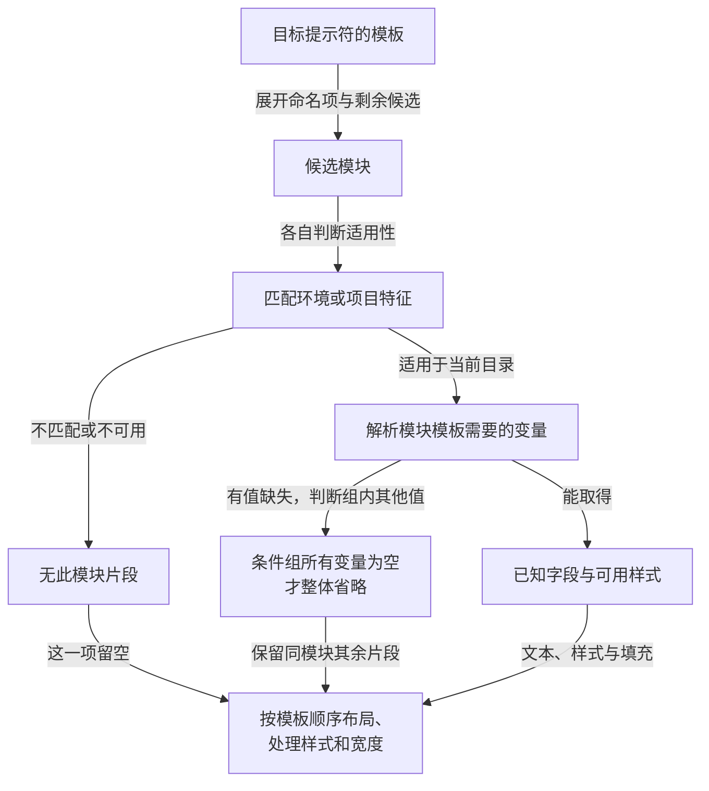
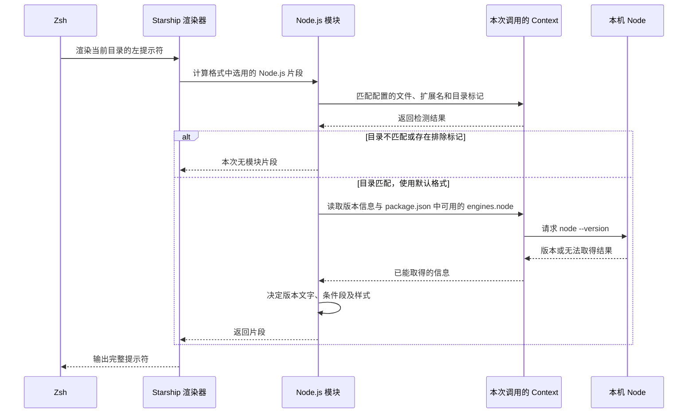

Starship 是一个用 Rust 编写的跨 Shell 提示符。开发者可以给 Bash、Zsh、Fish、PowerShell 等支持的 Shell 使用同一套提示符配置，让当前目录、版本控制状态、语言版本或上一条命令的结果出现在下一次输入之前。Shell 知道刚刚发生了什么，Starship 把这些信息和当前目录里能查到的事实组合成一行文字，终端负责显示。[项目定位](https://github.com/starship/starship/blob/622c83e8061318c1e24937a69f7a697ea00e0ef8/README.md) · [各 Shell 的初始化入口](https://github.com/starship/starship/blob/622c83e8061318c1e24937a69f7a697ea00e0ef8/src/init/mod.rs)

以同事轮流维护两个工具为例，一个是 Node.js 项目，一个目录里只有会议纪要。他希望在前者看到当前 Node 版本，版本不满足项目要求时有明显提示；进入会议纪要目录后，这一段应当消失。团队若主要想统一这类提示，可以共享 Starship 配置。若还要管理 Zsh 插件、别名和补全的装载顺序，则属于另一层工作。[Node.js 模块与用例](https://github.com/starship/starship/blob/622c83e8061318c1e24937a69f7a697ea00e0ef8/src/modules/nodejs.rs) · [Oh My Zsh 的配置装载方式](../../github/ohmyzsh-ohmyzsh/)

## 一次安装接入，每次绘制重新取数

提示符的三类信息来自不同地方：上一条命令怎样结束由 Shell 当场记录，当前项目是什么要观察目录和仓库，信息放在左侧还是右侧、怎样上色由用户配置决定。Starship 把各 Shell 的差异收进初始化脚本，用同一个 Rust 可执行程序处理后两类工作。日常调用的输入是 Shell 提供的状态、终端宽度和工作环境，输出是该位置应显示的、带样式的字符串。终端字体是否有对应字形、行编辑器何时重绘，仍是显示端的责任。[项目目标与集成方式](https://github.com/starship/starship/blob/622c83e8061318c1e24937a69f7a697ea00e0ef8/README.md) · [Shell 入口和脚本选择](https://github.com/starship/starship/blob/622c83e8061318c1e24937a69f7a697ea00e0ef8/src/init/mod.rs) · [渲染入口](https://github.com/starship/starship/blob/622c83e8061318c1e24937a69f7a697ea00e0ef8/src/print.rs#L72-L162)

以 Zsh 为例，适配层在执行命令前记录时间，在 `precmd` 中先保存退出码与管道状态。Zsh 求值左提示符时调用 `starship prompt`，传入终端宽度、耗时和作业计数等信息。Starship 为这次调用创建 `Context`，按 TOML 中的格式选择模块；例如 `$all` 展开的一组候选可以并行计算，最终按格式组织输出。目录索引和仓库发现结果在同一 Context 内按需共享，下次单独调用又会建立自己的 Context。跨 Shell 复用的是后半段计算，各 Shell 提供哪些数据、怎样重绘仍由自己的适配器决定。[Zsh 挂钩与提示符](https://github.com/starship/starship/blob/622c83e8061318c1e24937a69f7a697ea00e0ef8/src/init/starship.zsh) · [渲染与分发](https://github.com/starship/starship/blob/622c83e8061318c1e24937a69f7a697ea00e0ef8/src/print.rs) · [上下文缓存](https://github.com/starship/starship/blob/622c83e8061318c1e24937a69f7a697ea00e0ef8/src/context/mod.rs)

## 符合显示条件后，怎样决定展示多少信息

全局 `format` 描述模块之间的布局，各模块自己的格式则描述内部要什么值。例如 Node.js 模块能把符号、当前版本、项目要求与样式放在一起。一个条件组中的变量全部没有可显示的值时，整组与其中的固定文字一起省略；只要其中一个变量能显示，就保留该组。Node 默认模板里的版本组恰好只依赖版本。格式里若没有用到版本和依赖于版本的样式，也就不需要为这些变量执行查询。自定义模块和环境变量模块也通过命名位置进入顶层格式。这个接口让展示顺序和数据采集次序拆开，能同时满足“一行输出要稳定排列”和“互不依赖的探测可以并行”。[全局模块映射与顺序](https://github.com/starship/starship/blob/622c83e8061318c1e24937a69f7a697ea00e0ef8/src/print.rs#L93-L166) · [条件片段与变量解析](https://github.com/starship/starship/blob/622c83e8061318c1e24937a69f7a697ea00e0ef8/src/formatter/string_formatter.rs#L283-L403) · [Node.js 延迟求值](https://github.com/starship/starship/blob/622c83e8061318c1e24937a69f7a697ea00e0ef8/src/modules/nodejs.rs#L30-L91)

例如同一行既要显示当前目录又要把状态放在右侧，终端列宽和可见字符宽度会影响填充。渲染器区分普通文本、填充和换行，计算宽度时处理字素，输出时按对应 Shell 的规则处理提示符字符。用户看到的颜色代码只改变外观，不能算成实际占用的字符格。右提示符与续行提示符也有各自的规则。另一种实际入口是 Claude Code 状态栏：Starship 从标准输入接收宿主 JSON，设置该目标的 profile 后复用同一渲染器，整个入口不需要 Shell 挂钩。[宽度与渲染目标处理](https://github.com/starship/starship/blob/622c83e8061318c1e24937a69f7a697ea00e0ef8/src/print.rs#L25-L69) · [状态栏的独立入口](https://github.com/starship/starship/blob/622c83e8061318c1e24937a69f7a697ea00e0ef8/src/print.rs#L72-L93) · [片段与填充](https://github.com/starship/starship/blob/622c83e8061318c1e24937a69f7a697ea00e0ef8/src/segment.rs#L8-L50) · [Shell 专有的提示符转义](https://github.com/starship/starship/blob/622c83e8061318c1e24937a69f7a697ea00e0ef8/src/formatter/string_formatter.rs#L441-L469)

## 从会议纪要目录走进 Node.js 项目

默认检测包括 `package.json`、`.node-version`、若干 JavaScript/TypeScript 扩展名和 `node_modules` 目录，也有用于避免在 Bun、Deno 等环境误报的排除标记。项目识别与工具可用性分别判断：固定版的测试中，空目录没有 Node 片段，只有 `index.js` 但拿不到 `node --version` 时，默认格式仍显示符号，省略版本。若取得本机版本和可解析的 `engines.node` 范围，超出范围可以换成不兼容样式。缺少或无法解析范围时通常采用普通样式，绿色提示符无法代替真正的依赖安装和兼容性测试。[默认文件特征与排除项](https://github.com/starship/starship/blob/622c83e8061318c1e24937a69f7a697ea00e0ef8/src/configs/nodejs.rs) · [版本判断和测试](https://github.com/starship/starship/blob/622c83e8061318c1e24937a69f7a697ea00e0ef8/src/modules/nodejs.rs)

延迟预算直接影响结果含义。模块需要的目录扫描有时间限制，超过预算时本版本可返回已经收集到的条目；某个模块没显示，可能是标记根本不存在，也可能是扫描没赶上。外部命令另有超时。两种限制作用于不同工作，均不能直接充当整行提示符的耗时上限。默认配置中二者分别为 30 毫秒和 500 毫秒。排查慢提示符可用 `starship timings` 看模块用时，再用 `starship explain` 看当前各片段的含义。[配置和超时](https://github.com/starship/starship/blob/622c83e8061318c1e24937a69f7a697ea00e0ef8/docs/config/README.md) · [目录扫描和命令调用](https://github.com/starship/starship/blob/622c83e8061318c1e24937a69f7a697ea00e0ef8/src/context/mod.rs) · [模块耗时诊断](https://github.com/starship/starship/blob/622c83e8061318c1e24937a69f7a697ea00e0ef8/src/print.rs)

## 在交互路径里使用还是放到构建时检查

只要固定显示目录和一个输入符号，原生 Shell 模板通常已经足够。需要跨 Shell 共用多个环境提示时，Starship 的收益来自相同的格式和模块规则。代价是每次绘制都在用户等待下一次输入的路径上，候选文件多或工具启动慢的目录尤其值得单独测量。对发布正确性负责的检查可以在 CI 里给足预算、记录错误和明确失败；提示符则应能在缺数据时尽快让用户继续操作。[配置格式与模块](https://github.com/starship/starship/blob/622c83e8061318c1e24937a69f7a697ea00e0ef8/docs/config/README.md) · [提示符入口](https://github.com/starship/starship/blob/622c83e8061318c1e24937a69f7a697ea00e0ef8/src/print.rs)

同样的取舍也适用于编辑器状态栏。做一个显示项目运行时的扩展时，先准备三个临时目录：空目录、含 `package.json` 且能取得版本的目录、含 `index.js` 但取不到版本的目录。分别验证“不显示”“显示版本”“只显示项目类型”。再让样例的 `engines.node` 要求一个与已知测试运行时不匹配的范围，检查样式是否改变。最后在代表性的大目录中测整次刷新时间和各项探测时间；如果慢的是外部版本查询，放宽文件扫描预算不会帮到用户。[Node.js 模块回归用例](https://github.com/starship/starship/blob/622c83e8061318c1e24937a69f7a697ea00e0ef8/src/modules/nodejs.rs)
