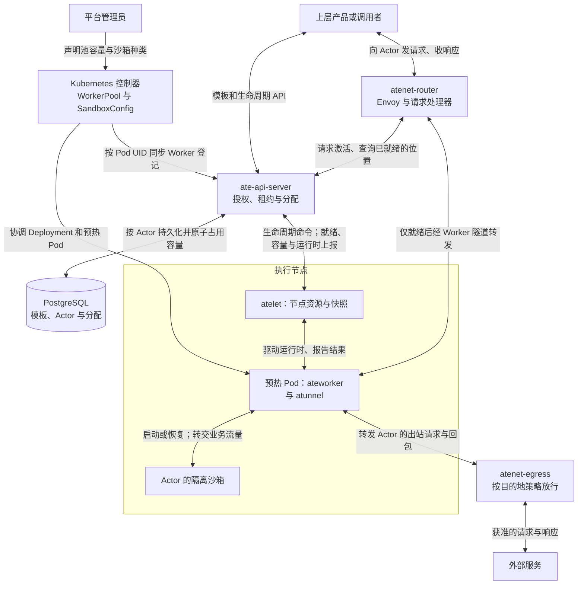
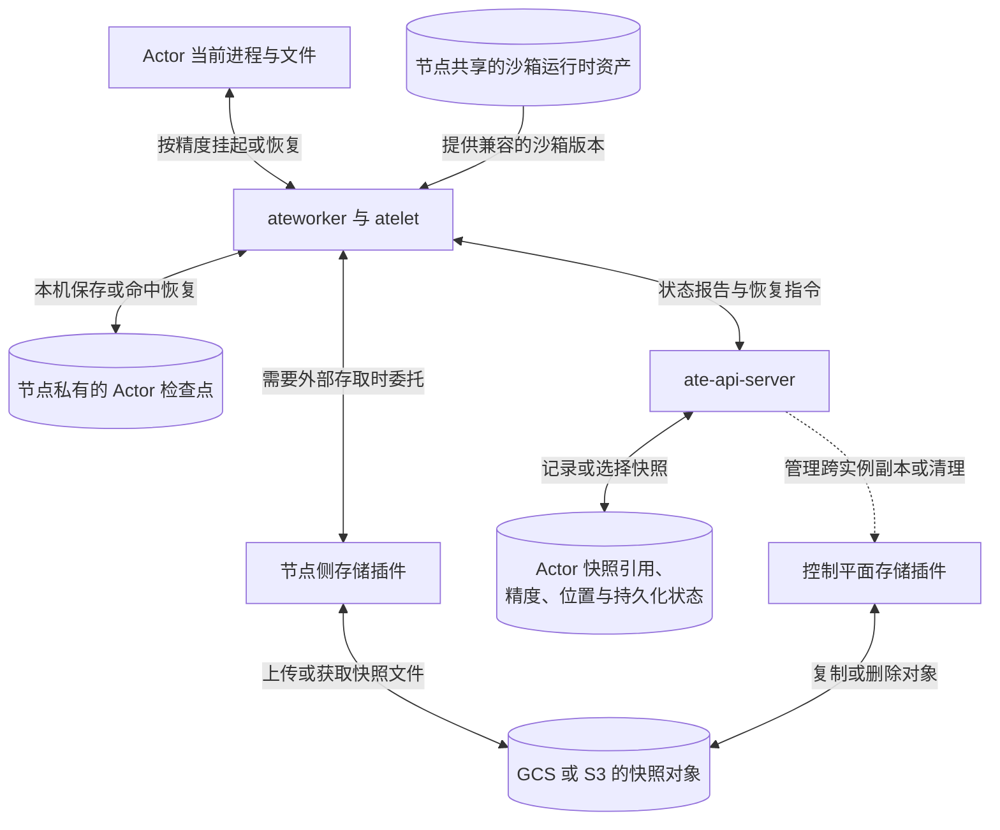
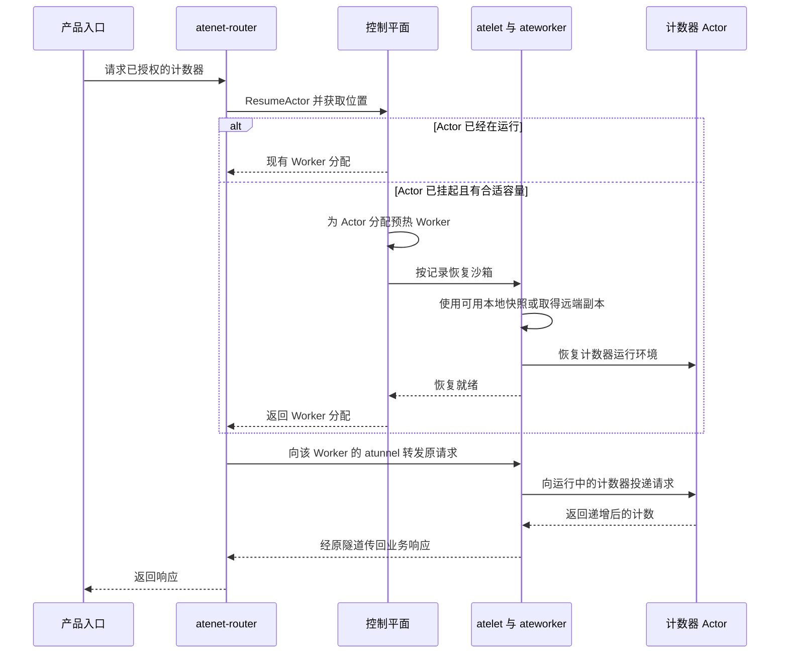

一个在线开发平台给每个用户一个独立会话。用户运行一次分析，再过半小时才回来。如果始终为每个会话保留一个运行中的 Pod，大部分容量都在等待；如果直接终止进程，用户回到的可能是全新的解释器。Agent Substrate 在 Kubernetes 上给每个工作负载一个可长期寻址的 **Actor**。需要执行时，平台把 Actor 分配给已准备好的 Worker Pod；显式挂起后，状态转为快照，Worker 可以接待其他 Actor。这里的 Actor 可以是普通 HTTP 服务，也可以是需要隔离运行的 Agent。[架构与设计前提](https://github.com/agent-substrate/substrate/blob/94e0a26ac90151886a76410568aaac2664a54d90/docs/concepts/architecture.md)

项目没有规定 Agent 的计划方式或模型接口。应用作者提交 OCI 工作负载定义，平台管理员提供已准备好的沙箱类型与容量，上层产品按稳定身份创建、访问或挂起实例。平台交付的是可路由、可隔离、可按所选精度恢复的执行环境。作者把 Kubernetes 用于较慢、声明式的基础设施协调，把频繁的 Actor 状态变更放在专门的控制平面，目的在于让“下一次执行”不必从排队创建新 Pod 开始。上层如 Google AX 还需描述工作任务、启动命令及业务结果。[作者的工作负载假设与分工](https://github.com/agent-substrate/substrate/blob/94e0a26ac90151886a76410568aaac2664a54d90/docs/concepts/architecture.md#L22-L67) · [上层产品 Google AX](../../github/google-ax/)

## 两种调度，以及一条单独的业务流量路径

以仓库的计数器为例。它把计数分别放在进程内存、根文件系统和持久目录中。请求者关心的是“我的计数器”，不用记住上一次承载它的 Pod。实现这个承诺需要三份相互独立的信息：Actor 的身份与模板、它现在分配给哪个 Worker，以及下一次恢复应读取哪个快照。控制平面用数据库管理 Actor 和分配状态。Kubernetes 控制器则根据 WorkerPool 的声明维护一批预热 Pod，因此创建 Actor 和分配算力可以发生在不同时间。[计数器示例](https://github.com/agent-substrate/substrate/blob/94e0a26ac90151886a76410568aaac2664a54d90/demos/counter/README.md) · [WorkerPool 控制器](https://github.com/agent-substrate/substrate/blob/94e0a26ac90151886a76410568aaac2664a54d90/cmd/atecontroller/internal/controllers/workerpool_controller.go) · [分配记录](https://github.com/agent-substrate/substrate/blob/94e0a26ac90151886a76410568aaac2664a54d90/cmd/ateapi/internal/store/atepg/worker_assignment.go)

这个图里有两个不同的“分配成功”。集群控制器声明、维持 Worker Pod，`SandboxConfig` 决定沙箱类型及可用运行时资产；Substrate 的调度器另在符合标签、版本和资源约束的 Worker 中分配 Actor。控制器按 Pod UID 同步 Worker 登记，节点侧上报容量、地址与支持的运行时；调度器据此筛选候选。数据库提交分配前会再核对容量，避免两个并发请求使用同一份剩余资源。分配记录还要等节点侧启动或恢复成功，才能成为可转发的运行位置。若 Actor 没有任何可恢复快照，代码会从模板启动；若已有自己的快照或共享的初始材料，则按所记录的身份恢复。[Kubernetes 与数据库对象的归属](https://github.com/agent-substrate/substrate/blob/94e0a26ac90151886a76410568aaac2664a54d90/docs/concepts/architecture.md#L199-L256) · [Pod 与 Worker 登记同步](https://github.com/agent-substrate/substrate/blob/94e0a26ac90151886a76410568aaac2664a54d90/cmd/atecontroller/internal/workersync/syncer.go#L15-L72) · [节点端上报](https://github.com/agent-substrate/substrate/blob/94e0a26ac90151886a76410568aaac2664a54d90/cmd/atelet/workersupport.go#L132-L178) · [提交分配时的并发检查](https://github.com/agent-substrate/substrate/blob/94e0a26ac90151886a76410568aaac2664a54d90/cmd/ateapi/internal/controlapi/workflow_resume.go#L450-L495) · [首次启动和已有快照的两条路径](https://github.com/agent-substrate/substrate/blob/94e0a26ac90151886a76410568aaac2664a54d90/cmd/ateapi/internal/controlapi/workflow_resume.go#L705-L818)

`atelet` 管理节点上的运行资源，`ateworker` 在选中的 Pod 内驱动具体沙箱，例如 gVisor 或 microVM。存取外部快照由对象存储插件承担，业务进程无需直接访问快照库。控制平面按 atespace 对调用方授权；对外访问的目的地策略和配置的凭据注入可在出口网关执行。产品仍然要定义自己的用户如何对应到 Actor，以及用户能请求哪些业务操作。[组件职责](https://github.com/agent-substrate/substrate/blob/94e0a26ac90151886a76410568aaac2664a54d90/docs/concepts/architecture.md#system-components) · [隔离边界](https://github.com/agent-substrate/substrate/blob/94e0a26ac90151886a76410568aaac2664a54d90/docs/security/security.md)

## 谁持有沙箱程序，谁持有 Actor 的最新状态

相同沙箱版本的程序在大量 Actor 之间可复用，某个 Actor 的进程内存与工作文件却属于那个实例。节点在本机缓存经内容标识的运行时资产，供多个 Worker/Actor 重用；节点本地的 Actor 检查点则按具体快照和位置管理。远端对象存储由插件访问。组件分工让应用继续使用正常的文件、内存和网络接口，同时把“谁能恢复哪一份状态”留给控制平面协调。[节点资产缓存](https://github.com/agent-substrate/substrate/blob/94e0a26ac90151886a76410568aaac2664a54d90/docs/concepts/sandbox-asset-cache.md#L10-L23) · [节点与控制平面的不同存储操作](https://github.com/agent-substrate/substrate/blob/94e0a26ac90151886a76410568aaac2664a54d90/docs/concepts/architecture.md#L315-L344)

WorkerPool 容量和对象存储大小因此受两组不同的数字约束：同时活跃的 Actor 需要实际算力，长期挂起的 Actor 主要占快照及必要的持久卷。恢复如果依赖原内存，还要找到能够运行相应沙箱版本的 Worker。对于配置外部 CSI 卷的预览部署，卷的创建和挂载有自己随生命周期执行的步骤；不能把一条快照引用当成外部服务或任意存储的全局回滚点。[运行时匹配与缓存](https://github.com/agent-substrate/substrate/blob/94e0a26ac90151886a76410568aaac2664a54d90/docs/concepts/sandbox-asset-cache.md#L44-L57) · [可选外部卷的范围](https://github.com/agent-substrate/substrate/blob/94e0a26ac90151886a76410568aaac2664a54d90/docs/guides/csi-volumes.md#L9-L30)

## 从第二次请求看到的计数说起

假设计数器上次响应时内存值为 1，平台随后请求挂起，并按能保留内存的精度成功制作快照。下一次用户仍访问同一 Actor。入口的 atenet-router 包括 Envoy 数据面与外部请求处理器。后者向控制平面查询可用的 Worker，Envoy 根据结果经 atunnel 转发原请求和响应。图中用一个参与者合并节点侧的 `atelet` 与 `ateworker`，展示控制消息和业务流量如何走不同路径。[激活流程](https://github.com/agent-substrate/substrate/blob/94e0a26ac90151886a76410568aaac2664a54d90/cmd/ateapi/internal/controlapi/workflow_resume.go) · [Actor 生命周期](https://github.com/agent-substrate/substrate/blob/94e0a26ac90151886a76410568aaac2664a54d90/docs/concepts/architecture.md#actor-lifecycle)

如果恢复了原进程内存，本次应得到 2。若目标仅是保留文件，重新启动应用可能是预期结果。计数器这个实验给了三种精度可观察的区别。

| 挂起时选择的精度 | 恢复后预期可以接着计数的位置 | 工作负载的要求 |
| --- | --- | --- |
| Memory | 进程内存、根文件系统、持久目录 | 需要接续尚未保存的进程上下文，并有兼容的恢复环境 |
| RootFS | 根文件系统、持久目录 | 应用能够重新启动，从文件里找回状态 |
| Volumes | 持久目录 | 应用把重要数据显式写入相应卷 |

这里描述的是示例在相应精度成功生效时的表现。模板可以表达首选精度，部署时还要核对目标 Worker 的沙箱类型、运行时版本和实际可恢复的快照。工作流为兼容性变化保留了处理分支。应用应在自己依赖的精度上做验收。[计数器数据的读写](https://github.com/agent-substrate/substrate/blob/94e0a26ac90151886a76410568aaac2664a54d90/demos/counter/counter.go) · [精度与演示结果](https://github.com/agent-substrate/substrate/blob/94e0a26ac90151886a76410568aaac2664a54d90/demos/counter/README.md) · [恢复时的兼容性检查](https://github.com/agent-substrate/substrate/blob/94e0a26ac90151886a76410568aaac2664a54d90/cmd/ateapi/internal/controlapi/workflow_resume.go)

## “已挂起”与“换一台机器还能恢复”

挂起由显式的 `SuspendActor` 调用触发。默认异步模式允许本机已有检查点后返回，此时远端副本可以仍为 PENDING，Actor 的恢复地点须保留在持有该检查点的节点，直到上传完成具备远端恢复条件。上传状态变为 COMPLETED 后，平台仍可保留本地检查点；延迟期满或原节点没有合适容量时才进一步解除本地性约束。它能缩短挂起请求的等待时间，也给回到同一节点的会话留下快速恢复的机会。若该节点在上传前丢失，最新状态可能一并丢失。同步模式把远端上传完成放在这次调用的成功条件中，产品应把这段时间计入“保存并退出”的等待预算。[挂起与上传流程](https://github.com/agent-substrate/substrate/blob/94e0a26ac90151886a76410568aaac2664a54d90/cmd/ateapi/internal/controlapi/workflow_suspend.go) · [异步挂起测试](https://github.com/agent-substrate/substrate/blob/94e0a26ac90151886a76410568aaac2664a54d90/cmd/ateapi/internal/controlapi/workflow_suspend_async_test.go)

共享容量的成本还取决于**同时活跃的会话数**。匹配的预热 Worker 暂时耗尽时，入口可暂留请求并重试恢复。等待预算耗尽会停止开始新的尝试，已开始的恢复不会单因该预算耗尽被取消；若容量仍不可用，调用方可收到 503。快照较大时，跨节点传输也可能成为首次响应的主要开销。评估一个在线笔记本产品，应该分别测量已在运行、同节点有快照、跨节点取快照三种情况下的首次响应时间，同时记录容量耗尽的请求和每个闲置会话占用的快照空间。[Worker 分配与容量耗尽](https://github.com/agent-substrate/substrate/blob/94e0a26ac90151886a76410568aaac2664a54d90/cmd/ateapi/internal/controlapi/workflow_resume.go) · [路由器暂留请求的时限](https://github.com/agent-substrate/substrate/blob/94e0a26ac90151886a76410568aaac2664a54d90/docs/concepts/request-parking.md#L32-L61) · [容量竞争测试](https://github.com/agent-substrate/substrate/blob/94e0a26ac90151886a76410568aaac2664a54d90/cmd/ateapi/internal/controlapi/functionaltest/worker_contention_test.go)

## 给在线开发产品划出保存边界

如果会话始终繁忙，或每次请求都能从数据库快速重建状态，常驻 Pod 或无状态服务更容易运营。如果只要给多个试验保留可分支、可比对的文件树，可以参考 LayerFS。如果要求同一个可寻址的会话长期休眠，回来时连进程内存都能继续，而且已有 Kubernetes 运维能力，Agent Substrate 的预热池、稳定身份与快照精度就是直接相关的设计。[LayerFS 项目参考](../../github/layerfs-workspaces/) · [Substrate 架构](https://github.com/agent-substrate/substrate/blob/94e0a26ac90151886a76410568aaac2664a54d90/docs/concepts/architecture.md)

迁移到自己的产品时，可以先写下用户按“保存”后必须找回什么。用一份笔记、一个未落盘的变量和一次已经提交到外部数据库的修改做实验，分别执行同节点恢复、远端快照恢复和应用重新启动。前两份结果能验证选择的快照范围；第三份提醒产品团队，恢复沙箱时外部数据库仍沿着自己的历史前进。对可能重做的外部写入，应用需要单独记录业务操作身份和结果。
