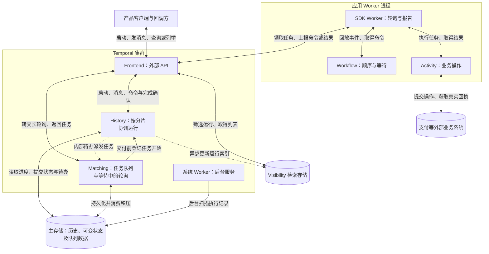
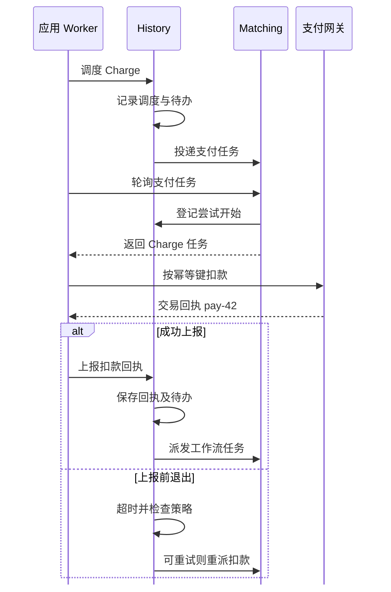
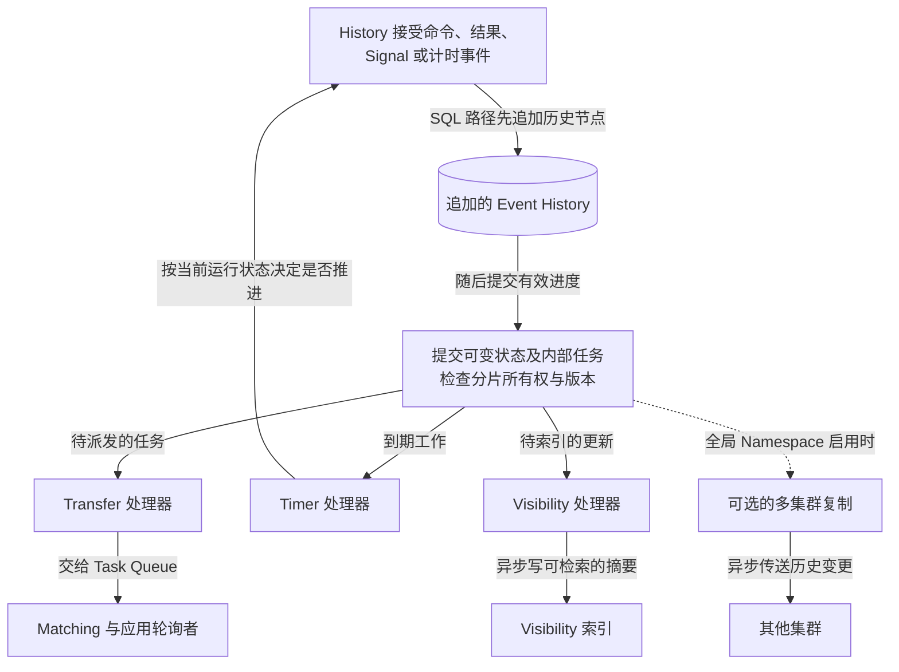
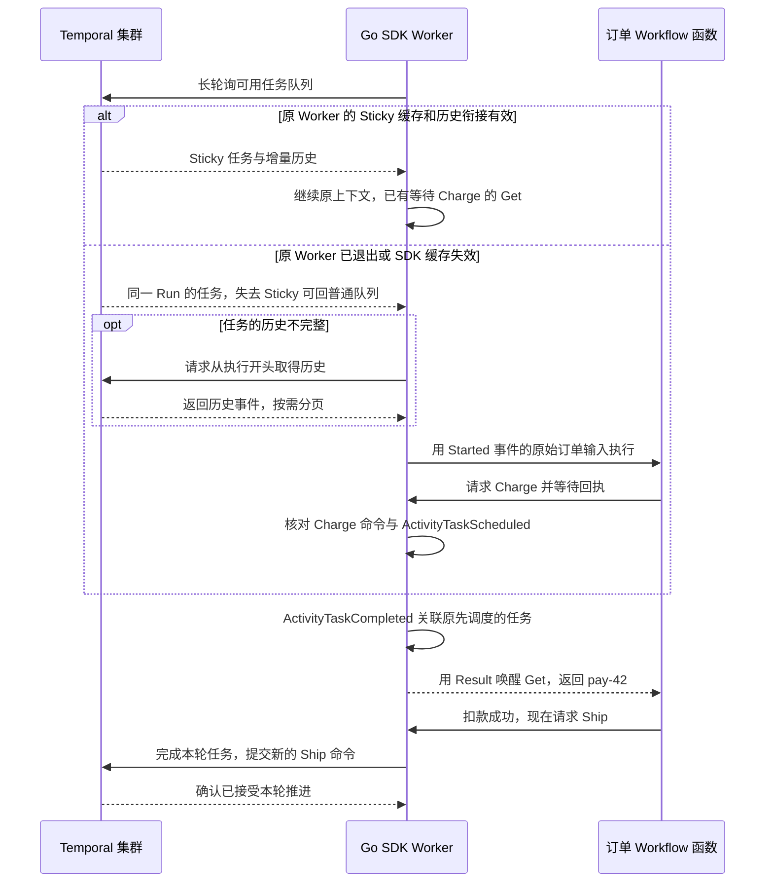

`temporalio/temporal` 是 Temporal 的 Go 服务端仓库。它接收工作流启动请求、业务消息和执行结果，交付下一步任务、可查询的运行进度以及最终结果。它让开发者用熟悉的编程语言描述一个可以持续数天的业务流程。业务团队用软件开发工具包（SDK）编写流程，并在自己的 Worker 进程里运行代码。服务端记住流程进展，在结果、消息或约定的时间到来时安排下一步。即便原进程已经退出，流程仍能接着走下去，这种能力叫作**持久执行**（Durable Execution）。[仓库 README](https://github.com/temporalio/temporal/blob/03ecd1d228d2b8d9d433da55785afc9aeeead918/README.md) · [服务端与 SDK 的职责](https://github.com/temporalio/temporal/blob/03ecd1d228d2b8d9d433da55785afc9aeeead918/docs/architecture/README.md#L17-L59)

设想一笔订单。扣款成功后才能创建运单，承运商可能三天后才通知签收。扣款、发货和签收分属三个系统，一次数据库提交无法覆盖它们。如果应用在中途发布了新版本，明天是谁来等回调？如果支付方已经扣了钱，进程却在记下回执前退出，再发一次请求会怎样？Temporal 能让新进程接着处理那笔订单。要安全地重发扣款请求，还需要支付方保证同一笔扣款操作无论收到几次都只扣一次。

## 什么时候值得把业务写成工作流

| 业务情形 | 引入 Temporal 的理由或代价 |
| --- | --- |
| 订单履约、跨服务开通账户 | 每一步都有外部结果，超时后还可能重试、取消或补偿。把先后关系写进流程代码，就能针对一笔业务解释目前卡在哪一步。 |
| 人工审批、等待物流回调、数日后提醒 | 发起请求的人可以先离开。流程身份和等待条件由服务端保存，业务进程可以在此期间重启。 |
| 一次数据库事务就能完成的短操作 | 数据库已经能同时提交结果并处理失败。再引入 Worker、任务派发和历史写入，会增加延迟和运维工作。 |
| 每秒大量采样点的聚合或大文件转换 | 计算和原始数据更适合留在流处理或存储系统里。Temporal 可以协调一次作业的启动、等待和收尾，把作业 ID 或文件引用留在流程里。 |

**系统重启后，有没有一笔未完成的业务，需要依据此前的结果决定下一步？** 如果已经在为这件事维护状态表、定期扫描未完成订单的任务、重试时间和回调关联，Temporal 替你承担的正是这些协调工作。采用它也意味着，今天部署的流程代码可能要读懂上个月启动的订单历史。[Temporal 的设计前提](https://github.com/temporalio/temporal/blob/03ecd1d228d2b8d9d433da55785afc9aeeead918/docs/architecture/README.md#L17-L33) · [Go SDK 对工作流代码演进的说明](https://github.com/temporalio/sdk-go/blob/58115b581391037b93451f50ac3628611ea0493b/workflow/workflow.go#L530-L570)

## 写一笔订单，从输入到第一条任务

订单服务收到请求后，通过 SDK 启动 `FulfillOrder`，输入订单号。可以用 `order-42` 作为 **Workflow ID**，让客服、物流回调和后台任务都能找到这笔业务。它属于一个 **Namespace**，即工作流名称和执行身份的隔离范围。**Run ID** 标识这条流程的一次具体运行。Worker 进程可以换很多次，同一个 Run 仍然可以继续。[工作流身份](https://docs.temporal.io/workflow-execution/workflowid-runid)

业务代码分成两部分。**Workflow** 决定“成功扣款后才发货”等顺序、分支和等待条件。**Activity** 执行会接触外部世界的操作，例如调用支付网关。应用 Worker 是装载这些函数、向服务端领取任务的进程。下面是订单 Workflow 的扣款与发货片段，省略了 Activity 超时配置和随后的签收处理。

```go
var receipt string
if err := workflow.ExecuteActivity(ctx, Charge, orderID).Get(ctx, &receipt); err != nil {
    return err
}
if err := workflow.ExecuteActivity(ctx, Ship, orderID, receipt).Get(ctx, nil); err != nil {
    return err
}
// 运单已创建，接下来等待签收或到期。
```

第一次运行到 `Charge` 时，SDK 生成“调度支付 Activity”的命令。此时没有回执，`Get` 挂起这段流程逻辑。Worker 把本次 **Workflow Task** 产生的命令交给服务端，便可以处理别的任务。之后某个 Worker 领取 **Activity Task**，才会真正调用支付网关。写代码时看到的是前后相邻的两行，执行时中间可以相隔很久，还可以经过不同机器。[任务类型与返回值](https://github.com/temporalio/temporal/blob/03ecd1d228d2b8d9d433da55785afc9aeeead918/docs/architecture/README.md#L44-L75) · [服务端处理调度命令](https://github.com/temporalio/temporal/blob/03ecd1d228d2b8d9d433da55785afc9aeeead918/service/history/api/respondworkflowtaskcompleted/workflow_task_completed_handler.go#L550-L561)

## Temporal 的全局架构与职责边界

订单应用部署 SDK 客户端和应用 Worker。客户端发起一次履约，应用 Worker 主动领取任务，在自己的环境中运行 Workflow 和 Activity。Temporal 集群管理执行进度和任务队列，支付网关保存真实的扣款记录。双向连线标出请求和返回的数据，虚线表示异步投递、投影或可选部署路径。主存储与 Visibility 按读写职责画开，部署时可以共用数据库。[服务端与应用的分工](https://github.com/temporalio/temporal/blob/03ecd1d228d2b8d9d433da55785afc9aeeead918/docs/architecture/README.md#L37-L75)



- **Frontend** 提供统一 API。启动订单、领取任务、上报结果和检索订单，都从这个入口进入。按条件列出运行时，它可以直接向 Visibility 查询。[Frontend 查询执行列表](https://github.com/temporalio/temporal/blob/03ecd1d228d2b8d9d433da55785afc9aeeead918/service/frontend/workflow_handler.go#L2838-L2874)
- **History** 决定单笔订单当前接受哪个结果、接下来做什么，把执行历史、状态和后续待办持久化。扣款结果里携带的任务信息，让它能把回执和先前调度的那次 Activity 关联起来。[Activity 完成处理](https://github.com/temporalio/temporal/blob/03ecd1d228d2b8d9d433da55785afc9aeeead918/service/history/api/respondactivitytaskcompleted/api.go#L112-L128)
- **Matching** 把待办交给轮询相应任务队列的应用 Worker。有合适的 Worker 正在等时可以直接交付，暂时交不出去时可以保存积压，等执行容量恢复后再交付。[同步匹配与持久化积压](https://github.com/temporalio/temporal/blob/03ecd1d228d2b8d9d433da55785afc9aeeead918/service/matching/task_queue_partition_manager.go#L499-L543)
- **系统 Worker** 负责集群自己的后台工作，例如扫描持久化的执行记录，以及处理父工作流关闭后对子工作流的策略。支付网关的访问凭据和 `Charge` 的业务实现则可以全部留在应用 Worker 一侧。[系统 Worker 的后台任务](https://github.com/temporalio/temporal/blob/03ecd1d228d2b8d9d433da55785afc9aeeead918/service/worker/service.go#L323-L370) · [执行记录扫描](https://github.com/temporalio/temporal/blob/03ecd1d228d2b8d9d433da55785afc9aeeead918/service/worker/scanner/executions/task.go#L191-L200)

这项拆分也决定了怎样处理积压。支付队列很长时，可以检查应用 Worker 数量、Activity 并发和网关限额。如果慢的是 History 写入执行状态，增加支付 Worker 很难缩短这段等待。

### 一次扣款如何交给 Worker，再回到工作流

沿用 `order-42`，假设一个应用 Worker 注册了 Workflow 和支付 Activity，采用普通队列派发。时序从它提交“调度扣款”的命令开始。为看清谁持有状态，图中省略 Frontend 的逐跳转发，所有从应用 Worker 发给 History 或 Matching 的请求都经过 Frontend。History 的本地步骤表示它向主存储提交进展。



轮询也可以早于任务到达，Matching 会让任务沿着等待中的轮询请求返回。沿图自上而下有两次独立的成功。支付网关返回 `pay-42` 时，交易已经成立。等 History 保存完成事件，下一次 Workflow Task 才能依据该回执推进发货。如果 Worker 在两次成功之间退出，只有支付网关知道扣款已发生。这也是产品设计时要为同一笔业务动作分配稳定幂等键的原因。[派发与领取 Activity](https://github.com/temporalio/temporal/blob/03ecd1d228d2b8d9d433da55785afc9aeeead918/docs/architecture/workflow-lifecycle.md#L169-L188) · [领取任务与登记开始](https://github.com/temporalio/temporal/blob/03ecd1d228d2b8d9d433da55785afc9aeeead918/docs/architecture/workflow-lifecycle.md#L247-L268) · [上报结果并继续派工](https://github.com/temporalio/temporal/blob/03ecd1d228d2b8d9d433da55785afc9aeeead918/docs/architecture/workflow-lifecycle.md#L327-L346)

## 进度如何落盘，下一步为什么不会漏派

假设支付回执 `pay-42` 已到达 History。客服明天要能核对这次扣款，服务端此刻要能找到待推进的订单，即便进程退出也要有人接手安排发货。这三件事各有一份数据支撑。

| 数据 | 订单中的例子 | 读取它的目的 |
| --- | --- | --- |
| Event History（事件历史） | 扣款已调度，随后收到了含回执的完成事件 | 依事件顺序重建这次运行，核对代码曾经做过的决定。 |
| Mutable State（可变状态） | 待处理的 Activity、计时器、当前 Workflow Task 和历史进度 | History 收到回调时快速校验和更新运行状态，无需每次重读完整历史。 |
| History 内部任务 | 把新的 Workflow Task 交给 Matching，到期时检查超时，或更新检索索引 | 让服务端在提交状态后继续完成跨服务或延时的工作。 |

这里有一个容易漏掉的故障窗口。假如先记“支付完成”，再用一次网络请求通知 Matching，进程可能恰好在两者之间退出。Temporal 把**可变状态的变更和内部待办写进同一事务**。即使派发暂时失败，History 的 Transfer 队列里也还有这笔待办，处理器可以重新投递。以 SQL 实现为例，服务端先追加历史节点，再执行带有分片所有权检查的事务。可变状态记录已确认到哪个事件。由此既能确认有效的运行进度，也能补上尚未完成的派工。[SQL 写入顺序](https://github.com/temporalio/temporal/blob/03ecd1d228d2b8d9d433da55785afc9aeeead918/common/persistence/sql/execution.go#L334-L357) · [History 的一致性约定](https://github.com/temporalio/temporal/blob/03ecd1d228d2b8d9d433da55785afc9aeeead918/docs/architecture/history-service.md#L278-L322)

搭建自己的任务系统时，也会遇到这两种职责。History 的 Transfer 队列记录服务端还欠哪些派发。Matching 的 Task Queue 把可执行工作分给正在轮询的应用 Worker。两者之间允许有派发延迟，服务端用持久待办跨过这段间隙。类似地，History 的 Timer 队列负责按时推进工作，Visibility 队列负责把运行摘要同步到检索存储。[History 的内部队列](https://github.com/temporalio/temporal/blob/03ecd1d228d2b8d9d433da55785afc9aeeead918/docs/architecture/history-service.md#L210-L246)



图中以 SQL 写入次序为例。已追加的历史节点要与该次已确认的可变状态对应，才能证明运行已推进。后台任务可以稍后消费，故而一次状态提交成功、业务 Worker 真正领取任务、客服界面的检索结果追上进展，往往是三个不同时刻。[可变状态与待办的提交](https://github.com/temporalio/temporal/blob/03ecd1d228d2b8d9d433da55785afc9aeeead918/docs/architecture/history-service.md#L254-L299) · [Matching 的队列分区](https://github.com/temporalio/temporal/blob/03ecd1d228d2b8d9d433da55785afc9aeeead918/docs/architecture/matching-service.md#L9-L19) · [复制任务生成](https://github.com/temporalio/temporal/blob/03ecd1d228d2b8d9d433da55785afc9aeeead918/service/history/workflow/task_generator.go#L764-L795)

## Worker 重启后，回执怎样回到局部变量

现在让应用 Worker 在“支付完成已被记录、发货尚未调度”这个时刻退出。旧进程的内存消失，Run ID 保持不变。Temporal 平时可以用 **Sticky Task Queue** 把后续 Workflow Task 优先交回原 Worker，复用内存中的上下文和增量历史。原 Worker 不可用时，任务可以改投普通队列。已领取却没有回报的 Workflow Task，则可在超时后重新安排。恢复需要有能执行兼容代码的 Worker 来轮询。[Sticky 派发回退](https://github.com/temporalio/temporal/blob/03ecd1d228d2b8d9d433da55785afc9aeeead918/service/history/transfer_queue_active_task_executor.go#L339-L370) · [Workflow Task 超时](https://github.com/temporalio/temporal/blob/03ecd1d228d2b8d9d433da55785afc9aeeead918/service/history/timer_queue_active_task_executor.go#L441-L478)



这就是 **Replay**（重放）。Go SDK 在缓存缺失时建立新的执行上下文，必要时回到历史开头。处理 `WorkflowExecutionStarted` 时，它用原始输入调用已注册的 Workflow 函数。代码再次走到 `Charge`，SDK 将产生的命令与已记录的调度事件匹配。随后把完成事件中的 `Result` 交还给等待者，`receipt` 再次得到 `pay-42`。恢复这段历史不会再次请求支付网关。到尚无调度记录的 `Ship` 时，才有新命令需要交给服务端。[SDK 的缓存缺失处理](https://github.com/temporalio/sdk-go/blob/58115b581391037b93451f50ac3628611ea0493b/internal/internal_task_handlers.go#L848-L864) · [服务端的 Sticky 历史条件](https://github.com/temporalio/temporal/blob/03ecd1d228d2b8d9d433da55785afc9aeeead918/service/history/api/recordworkflowtaskstarted/api.go#L285-L290) · [启动事件与结果回填](https://github.com/temporalio/sdk-go/blob/58115b581391037b93451f50ac3628611ea0493b/internal/internal_event_handlers.go#L1578-L1608)

这也解释了**确定性**的实际含义。已有历史记录了“先扣款”，若新版本把“先发货”移到相同位置，重放得到的 Activity 类型就可能与历史不符。读系统时钟或访问外部服务也可能让同一输入走进不同分支。计时应使用 SDK 的工作流时钟，外部结果通过 Activity 带回。已有长流程还在运行时，改变命令顺序可以用版本标记保留旧路径。Go SDK 的 `GetVersion` 注释专门用替换一个 Activity 的例子说明了这种升级方式。[命令与事件如何匹配](https://github.com/temporalio/sdk-go/blob/58115b581391037b93451f50ac3628611ea0493b/internal/internal_task_handlers.go#L1615-L1665) · [版本兼容示例](https://github.com/temporalio/sdk-go/blob/58115b581391037b93451f50ac3628611ea0493b/workflow/workflow.go#L530-L570)

**把故障提前一步，结论就变了。** 假如支付网关已经扣款，Activity Worker 却在上报前退出，Temporal 只知道自己还缺结果。尝试超时后，如果重试策略和剩余时间允许，服务端会安排新的 Activity 尝试，再次运行支付代码。业务需要为同一笔扣款传入跨尝试稳定的幂等键，例如“订单号＋扣款操作号”，由支付方原子去重并返回原回执。若后来需要退款，也要由 Workflow 显式安排补偿操作。跨系统的实际资金变动不会随工作流失败而自动撤销。[Activity 超时与重试分支](https://github.com/temporalio/temporal/blob/03ecd1d228d2b8d9d433da55785afc9aeeead918/service/history/timer_queue_active_task_executor.go#L307-L319) · [Activity 的幂等约定](https://docs.temporal.io/activity-definition#idempotency)

## 运单创建以后，流程如何等三天

承运商尚未送达时，订单可以等待签收 Signal，同时设置一个持久定时器，到期转人工跟进。Workflow 可以在 SDK 中等待两者之一。等待期间无需为订单留住一个线程。服务端保存等待所需的信息。当到期处理写入 `TimerFired`，或签收消息写入历史，Worker 再获得推进流程的机会。队列拥塞时，实际处理可能晚于约定时间。外部支付调用的超时用来决定某次尝试能否重试。这里的三天则是业务自己定义的期限。[用户定时器的到期处理](https://github.com/temporalio/temporal/blob/03ecd1d228d2b8d9d433da55785afc9aeeead918/service/history/timer_queue_active_task_executor.go#L166-L201) · [Go SDK 持久定时器](https://docs.temporal.io/develop/go/workflows/timers)

同一笔运行也可以接受外部请求。选哪个接口，取决于调用方需要的承诺。

| 调用方想做什么 | 使用方式 | 调用方得到什么 |
| --- | --- | --- |
| 物流商通知“已签收” | **Signal** 将消息送入运行 | 成功表示服务端已接收，业务处理结果不会随调用返回。 |
| 客服想看这一单走到哪一步 | **Query** 读取 Workflow 暴露的当前状态 | 得到只读结果，查询本身不推进订单。 |
| 买家想改收货地址并立即知道是否获准 | **Update** 可以先校验，再由 Workflow 处理 | 发货后可以拒绝。接受后，调用方可等待业务结果。 |

排查一单和搜索一批订单走的也是不同路径。客服知道 Workflow ID 时，可以直接从服务端读取历史，也可以用 Query 让可用的应用 Worker 执行已注册的查询处理器。找出“今天仍在等待签收的订单”则可以把阶段写成可检索的 **Search Attribute**，通过 **Visibility** 对多个执行筛选。索引由后台任务更新，结果可能短暂滞后。决定这笔订单还能否改址，应在该运行里校验它当前的状态。[消息语义](https://github.com/temporalio/temporal/blob/03ecd1d228d2b8d9d433da55785afc9aeeead918/docs/architecture/workflow-update.md#L8-L22) · [Visibility 与检索](https://docs.temporal.io/visibility)

## 订单变多、运行变长，系统怎样扩展

**订单按身份分摊到多个分片。** History 用 Namespace ID 和 Workflow ID 计算 History Shard，同一订单的后续 Run 也能定位到同一逻辑分片。一个 History 实例负责若干分片。所有权转移后，递增的 `RangeID` 帮助存储层拒绝旧持有者的写入。同一运行的状态变化因而有明确的归属，不同运行可以并行推进。扩容 History 可以分担许多订单。若所有消息都挤进同一笔超热的运行，它的有序历史仍是一项约束。[分片键计算](https://github.com/temporalio/temporal/blob/03ecd1d228d2b8d9d433da55785afc9aeeead918/common/util.go#L418-L428) · [所有权与写入保护](https://github.com/temporalio/temporal/blob/03ecd1d228d2b8d9d433da55785afc9aeeead918/docs/architecture/history-service.md#L77-L102)

**运行很久和历史很长是两回事。** 一笔订单安静等待三天，和一笔订单在三天内收到十万条进度通知，产生的历史规模差别很大。历史越长，新 Worker 恢复时通常要读和重放的内容越多。对持续订阅、周期巡检等长期流程，可以在合适的业务边界使用 **Continue-As-New**，以 Continued-As-New 状态关闭本次 Run，再用相同的 Workflow ID 和新的 Run ID 开始一段新历史。业务必须把下一段需要的摘要作为输入传过去。大文件宜留在业务存储，只传引用和必要元数据。将每次采样都写进同一条历史则需要重新审视粒度。[Continue-As-New 的状态交接](https://docs.temporal.io/develop/go/workflows/continue-as-new)

**跨集群恢复有另一层代价。** 为全局 Namespace 配置多集群复制时，活动集群推进运行，历史通过复制任务异步传往其他集群。本地已确认的最新进展可能尚未抵达目标端。此时切换，新活动集群可能再次派发旧集群处理过的 Activity。前面为扣款设计的幂等键，在数据中心切换时同样有用。这里换来的是异地接管能力，运维上需要观测复制滞后，并在切换决策中考虑可能回退的进度。[服务端生成复制任务](https://github.com/temporalio/temporal/blob/03ecd1d228d2b8d9d433da55785afc9aeeead918/service/history/workflow/task_generator.go#L764-L795) · [多集群切换与冲突处理](https://docs.temporal.io/self-hosted-guide/multi-cluster-replication#conflict-resolution)

## 怎样安排周期任务、子流程和跨团队调用

如果每月都要发起一次结算，用 **Schedule** 表达“何时启动一次新执行”，每期结算内部的到期动作仍可以由该期 Workflow 的 Timer 表达。需要让结算中的一个子流程拥有自己的历史和生命周期时，可以启动 **Child Workflow**，并决定父流程提前关闭时对子流程采取什么策略。跨团队、跨 Namespace 对接一个可能长时间运行的操作时，**Nexus** 提供有名称的服务、端点和完成回调，让调用方依赖一个操作接口。[子工作流生命周期](https://docs.temporal.io/child-workflows) · [Nexus 在服务端的入口](https://github.com/temporalio/temporal/blob/03ecd1d228d2b8d9d433da55785afc9aeeead918/docs/architecture/nexus.md)

### 延伸阅读 · 计划到期后谁负责启动结算

在服务端提交 `03ecd1d` 中，开发者用 **CHASM** 构建新版 Scheduler，使它能复用服务端的分片、路由、原子状态更新和故障恢复能力。这个版本的实现当时尚未正式发布。以每月结算为例，Generator 按计划算出本期要启动的动作，手动补跑时由 Backfiller 补入相应的动作，实际调用和重试由 Invoker 负责。即使能从日历重新算出哪期结算已经到期，恢复时仍要核对那期的启动结果，才能决定下一步。[CHASM 的设计动机](https://github.com/temporalio/temporal/blob/03ecd1d228d2b8d9d433da55785afc9aeeead918/docs/architecture/chasm.md#L7-L44) · [此版本 Scheduler 的状态与分工](https://github.com/temporalio/temporal/blob/03ecd1d228d2b8d9d433da55785afc9aeeead918/docs/architecture/schedules.md#L1-L14)

## 把这些设计用在带审批的产品发布功能上

假设你在做一个发布工具。用户选定制品和目标环境，负责人批准后才调用部署平台。部署可能持续半小时，期间允许服务升级。拿 Temporal 做参考时，先画出三个有业务意义的状态——待批准、等待部署结果、已上线——再决定用什么技术推进它们。下面是把订单案例迁移到这个产品的一种设计。

| 实现时要决定什么 | 可以借鉴的做法 | 怎样验证它有效 |
| --- | --- | --- |
| 批准成功意味着什么 | 如果界面要显示“已批准”，由拥有发布单状态的组件校验并确认状态变更。使用 Temporal 时可用 Update 返回处理结果。 | 让两位审批人先后提交互斥决定，检查后一次调用能否看见并遵守前一次决定。 |
| 批准与派工之间怎样防止漏发 | 自建时可在同一数据库事务中写入“已批准”和一条待部署任务，由后台消费者投递。采用 Temporal 时，让 Workflow 根据已接受的审批安排部署 Activity。 | 在提交批准后、发出部署请求前终止进程。恢复后，这张发布单应能继续派工。 |
| 部署请求丢了回执，什么时候可以重发 | 发起部署前保存请求标识。如果平台保证按该标识原子去重，可以在约定的去重期限内用原标识重发。 | 让平台接单后丢失响应，再用原标识提交。检查平台只创建了一次部署，发布单最终关联到这次部署。 |
| 平台仅支持按请求标识查询时怎么办 | 查到记录就关联原部署。查询为空时，原请求可能仍在处理，或记录尚未可见。保留“结果待确认”，稍后再查。平台连查询也不支持时，转人工核对。 | 让平台接单后丢失响应，第一次查询为空，第二次返回原部署。检查发布单先进入待确认，再关联原部署，全程只发出一次创建请求。 |

如果产品只需保存审批决定，一次数据库事务就够了。如果还要触发一次简单的后台部署，可以先用同库待办表保证派工。等需求增加到多阶段部署、数日等待、外部回调和取消，再评估采用 Temporal 是否比自行维护恢复逻辑划算。选用 Temporal 后，团队仍要部署和维护 Worker、保证旧流程与新代码兼容，并和下游约定如何识别重复操作。
