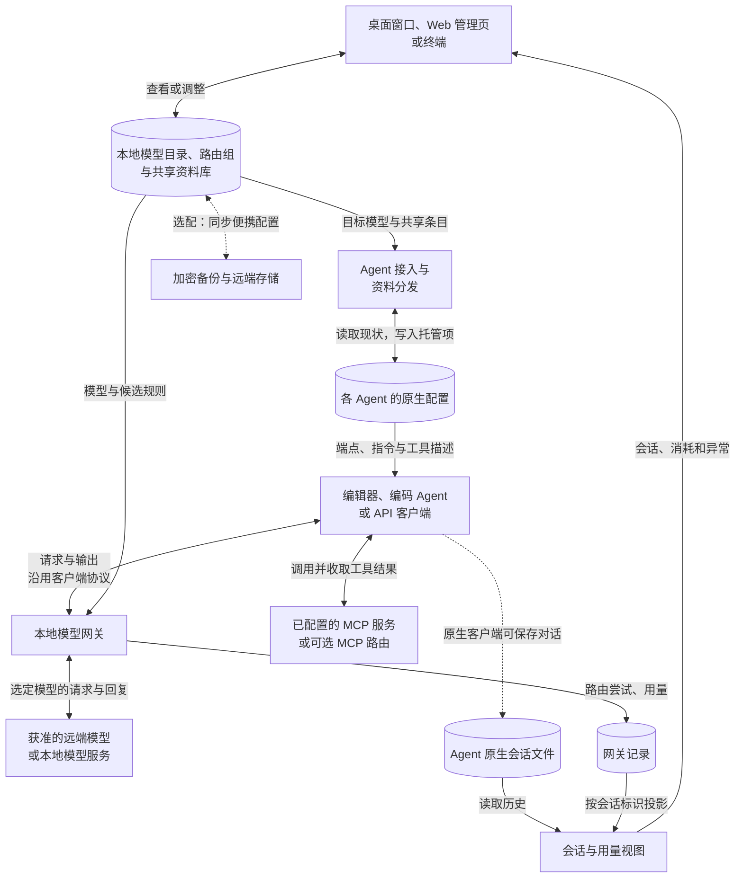
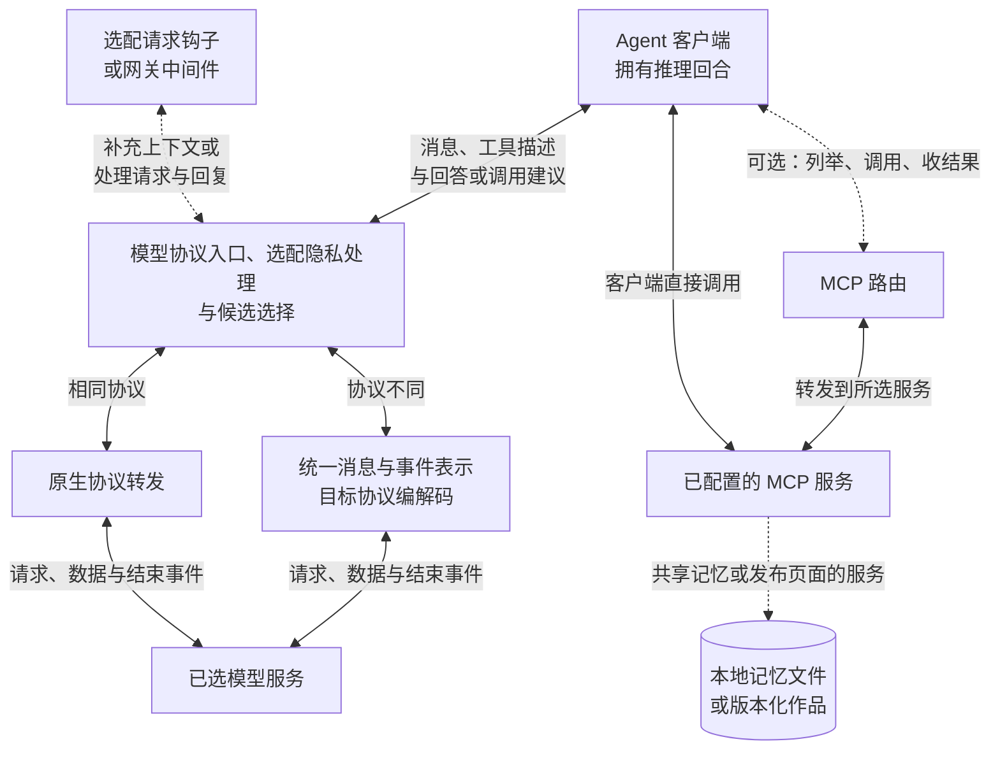
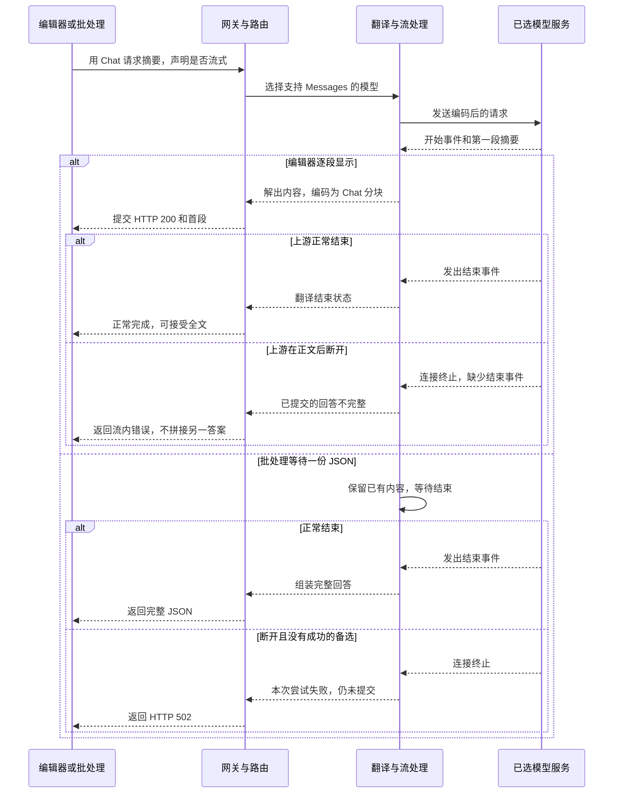

Magpie 面向同时使用多个编码 Agent、编辑器或模型 API 的人。换一种模型服务，往往要改好几个客户端；更改一条项目指令或增加一种工具，又要找到另一批格式不同的配置文件。Magpie 把这些选择放在本机统一维护。它通过同一个本地网关接受 Chat Completions、Responses、Anthropic Messages 和 Gemini 四种协议的请求，把共享资料写入选定 Agent 的原生配置，还能合看各客户端的会话与用量。真正接收提示词、运行推理的仍是路由选中的服务，既可以是本地模型，也可以是用户获准使用的远端模型。[模型网关的协议边界](https://github.com/yetone/magpie/blob/207b37754e95adcd446e12c6e4c139651aa92126/internal/gateway/ir.go#L1-L18) · [上游列出的子系统](https://github.com/yetone/magpie/blob/207b37754e95adcd446e12c6e4c139651aa92126/docs/subsystems/README.md#L3-L24)

设一个文档团队用桌面编辑器逐字显示建议，夜间批处理则要拿到完整摘要才入库，两者都可使用同一组获授权的模型。这里有两种输出。管理操作产出端点设置、技能文件或工具描述，客户端下次读取即可使用；一次模型调用产出 JSON、流事件或失败。模型给出工具调用建议后，也仍由客户端决定是否执行、把结果送入哪一轮推理。配置管理、模型请求、工具运行因此有不同的入口和完成条件。[Agent 接入](https://github.com/yetone/magpie/blob/207b37754e95adcd446e12c6e4c139651aa92126/docs/subsystems/agent-wiring.md#L1-L9) · [单次推理与后续回合的归属](https://github.com/yetone/magpie/blob/207b37754e95adcd446e12c6e4c139651aa92126/docs/subsystems/gateway-request-hooks.md#L1-L19)

## 一次配置怎样服务多个客户端

桌面托盘、窗口与无桌面机器上的 Web 模式复用同一份界面资源及 Go JSON API。接入层了解每个 Agent 如何表示端点和模型，并记下自己写过什么，日后才能识别用户改动、在断开连接时恢复原配置。资料库同样按条目分发，保留其他来源的内容。若批处理工具本来就能自己填写模型端点，它可以直接发送请求。另一个选择是跨设备同步指定的设置和资料，远端接收的是加密配置包，工作树的文件有各自的归属。[窗口与浏览器复用](https://github.com/yetone/magpie/blob/207b37754e95adcd446e12c6e4c139651aa92126/docs/subsystems/gui-shell.md#L1-L8) · [接入层与配置漂移](https://github.com/yetone/magpie/blob/207b37754e95adcd446e12c6e4c139651aa92126/docs/subsystems/agent-wiring.md#L1-L9) · [资料库的写入范围](https://github.com/yetone/magpie/blob/207b37754e95adcd446e12c6e4c139651aa92126/docs/subsystems/library.md#L1-L14) · [备份与同步对象](https://github.com/yetone/magpie/blob/207b37754e95adcd446e12c6e4c139651aa92126/docs/subsystems/sync-backup.md#L1-L25)

界面能显示“同一个会话”也有条件。Sessions API 一边读取 Agent 已经保存在本机的原生历史，一边依据调用方和会话标识，把网关用量记录计算成只读视图。后者没有独立的会话数据库；通常，一次 API 请求没有会话标识，就只有请求用量可查，Magpie 不会凭提示词猜它属于哪个对话。因此路由面板能解释某次推理的花费，原生会话却仍可能包含只有 Agent 自己知道的步骤。[两种会话来源与投影的身份](https://github.com/yetone/magpie/blob/207b37754e95adcd446e12c6e4c139651aa92126/docs/subsystems/gateway-sessions.md#L1-L24)

## 推理、调用工具和保存工作成果走哪条路

客户端可指定模型，也可只选路由组。网关据此决定候选次序，例如依序尝试两个获准模型；客户端使用的协议与候选服务匹配时可以直接转发，协议不匹配才需要转换。中间表示把文字、图像、工具调用、工具结果分别建模，工具调用还有 ID，后续结果可以关联回原调用。这样增加一种协议时可以复用已有编解码器，代价是每种协议的工具、媒体和结束语义都要逐项验证。请求钩子可以在路由前补充上下文，网关中间件可处理每次请求和流事件，归谁执行取决于扩展的职责。[路由与失败边界](https://github.com/yetone/magpie/blob/207b37754e95adcd446e12c6e4c139651aa92126/docs/subsystems/gateway-routing.md#L1-L9) · [消息块类型](https://github.com/yetone/magpie/blob/207b37754e95adcd446e12c6e4c139651aa92126/internal/gateway/ir.go#L17-L63) · [进程内中间件](https://github.com/yetone/magpie/blob/207b37754e95adcd446e12c6e4c139651aa92126/docs/subsystems/gateway-middleware.md#L1-L3) · [异步请求钩子](https://github.com/yetone/magpie/blob/207b37754e95adcd446e12c6e4c139651aa92126/docs/subsystems/gateway-request-hooks.md#L1-L19)

网关处在明文交给模型之前，因此也能在本机实施可选的隐私处理。例如先用占位符替换识别到的敏感字段，只把处理后的文本交给模型，再在返回给客户端时还原占位符。启用脱敏却无法运行时，项目选择拒绝这次请求。代价也很直观：模型看不到那个值，就很难解释它本身出了什么问题。[脱敏处理、失败策略与代价](https://github.com/yetone/magpie/blob/207b37754e95adcd446e12c6e4c139651aa92126/README.zh-CN.md#L132-L150)

资料库默认可直接把选中的 MCP 服务配置交给各客户端；开启 MCP 路由后，客户端只需连接一个入口，由路由把请求送到对应服务，工具结果仍回到发起的 Agent。技能路由解决的是另一个问题：把许多技能收成一份索引，Agent 按需读取真正的技能文件。跨 Agent 记忆的权威来源是每条记忆对应的本地 Markdown，索引丢失可重建；Agent 发布的可视化作品则在本机按版本保存，由桌面界面列出、由网关在隔离页面中提供查看。模型回答、技能索引和可再次打开的作品是三种不同的交付物。[MCP 路由](https://github.com/yetone/magpie/blob/207b37754e95adcd446e12c6e4c139651aa92126/docs/subsystems/mcp-router.md#L1-L5) · [技能路由](https://github.com/yetone/magpie/blob/207b37754e95adcd446e12c6e4c139651aa92126/docs/subsystems/skill-router.md#L1-L5) · [记忆与索引](https://github.com/yetone/magpie/blob/207b37754e95adcd446e12c6e4c139651aa92126/docs/subsystems/memory.md#L3-L25) · [作品与版本](https://github.com/yetone/magpie/blob/207b37754e95adcd446e12c6e4c139651aa92126/docs/subsystems/artifacts.md#L3-L27)

## 编辑器收到半段摘要后，网关还能换模型吗

下面选用 Chat 客户端与 Messages 上游，分别观察客户端要求实时显示和要求完整 JSON 的结果。源码测试让同一模拟服务先给出文字，接着断开连接或正常发出结束事件。两种情形中网关都收到第一段文字。上游中途断开时，流式客户端能看到片段和随后的错误，等待完整 JSON 的客户端只收到错误；上游正常结束时两者都能拿到全文。[断流与完成的对照测试](https://github.com/yetone/magpie/blob/207b37754e95adcd446e12c6e4c139651aa92126/internal/gateway/translate_severed_test.go#L59-L112)

可重试的边界是这次响应有没有向客户端提交。另一个 Chat 到 Chat 的测试中，上游只给出角色标记就断开，网关还没有把响应交给客户端，再次请求同一个模拟端点便得到完整答案。反过来，已经送出的半句话无法撤回；此时仍可把当前尝试记为失败，在客户端下一次请求时选另一候选，不能在同一条回答里偷偷换来源。对准备把文案写入知识库的程序，HTTP 200 表示响应已开始，正常结束事件或完整 JSON 才能作为本轮入库条件。[首段前的重试](https://github.com/yetone/magpie/blob/207b37754e95adcd446e12c6e4c139651aa92126/internal/gateway/stream_cut_test.go#L74-L111) · [断流后下一次请求的候选](https://github.com/yetone/magpie/blob/207b37754e95adcd446e12c6e4c139651aa92126/internal/gateway/late_stream_error_test.go#L62-L82)

## 迁移到自己的文档产品时，先验收失败路径

一个客户端只调用一个固定服务，且协议匹配时，直接集成通常更容易定位问题。多客户端、多种服务或需要统一观察失败时，网关才有机会减少重复代码。团队仍要决定哪些服务允许处理哪些文档、哪些模型可互相替代、流中断后是否允许用户保留草稿。协议兼容只能保证客户端有机会读懂响应，无法保证第二个模型提供相同的质量、成本或决策。假如已经执行过一次响应中的外部操作，客户端还要按业务操作编号处理再次请求的重复影响。[模型与协议边界](https://github.com/yetone/magpie/blob/207b37754e95adcd446e12c6e4c139651aa92126/internal/gateway/ir.go#L1-L18) · [已提交响应后的失败记录](https://github.com/yetone/magpie/blob/207b37754e95adcd446e12c6e4c139651aa92126/internal/gateway/late_stream_error_test.go#L13-L85)

可用两个自有模拟服务和一段无敏感内容的产品说明验收。让第一个服务在回答前断开，第二个返回固定文案，检查客户端只收到一份可辨认来源的答案。再让第一个服务先给出“草稿 A”再断开，核对编辑器显示不完整状态、同一条回复中没有混入“草稿 B”，批处理也没有把 A 当成完整摘要入库。最后让服务正常发送结束事件，确认同一套判断能接受真正完整的结果。这样才检验到路由、协议结束语义和产品入库条件三者是否配合。
