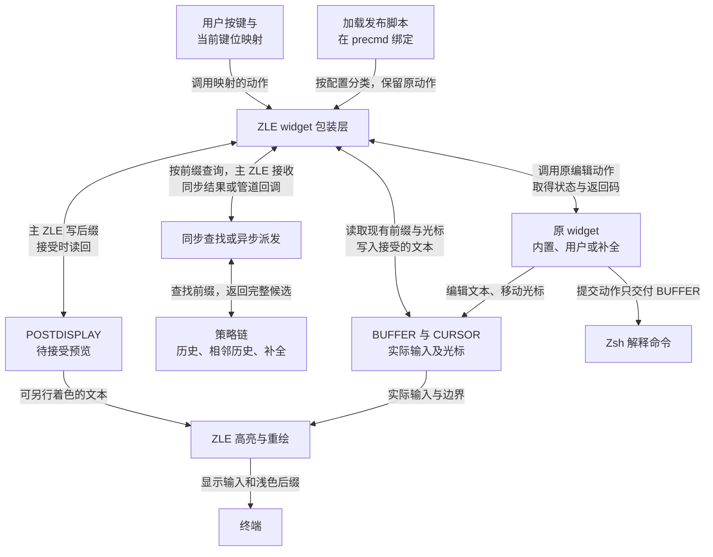
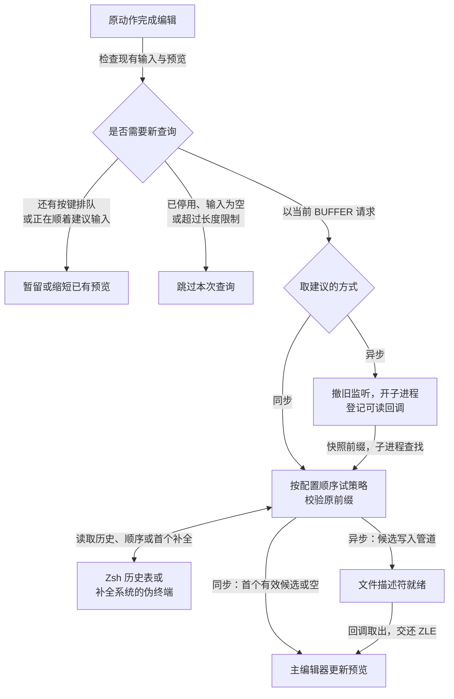
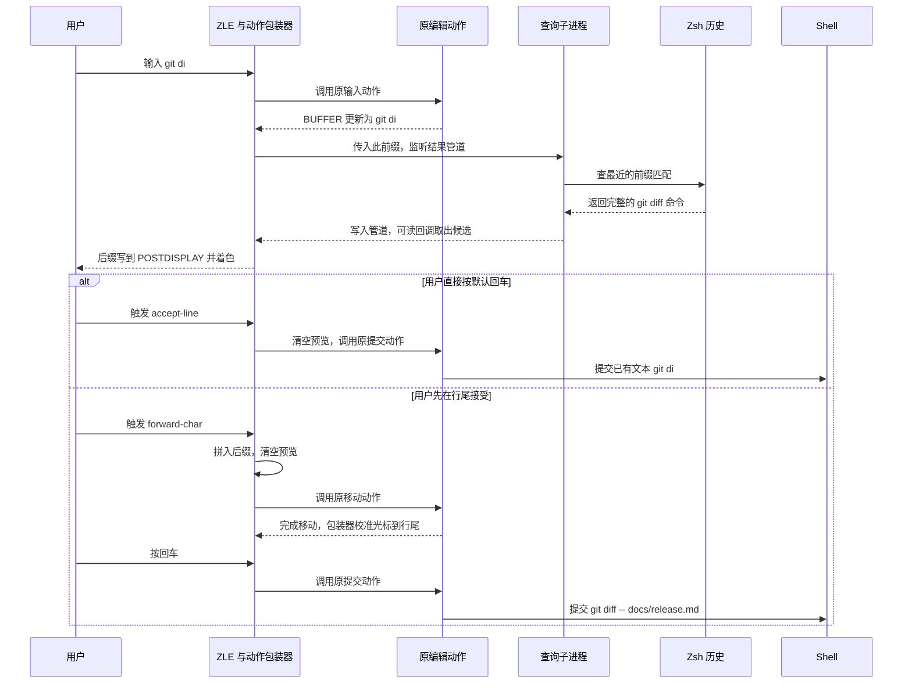

zsh-autosuggestions 是为 Zsh 行编辑器（ZLE）提供行内建议的插件。用户输入前缀，插件从 Shell 历史记录或已配置的补全策略中找出候选，把剩余部分以淡色显示在已输入文本之后。用户可以继续自己打字、只接受一个词，或把整条建议放进行缓冲区。这个过程使用当前 Shell 的编辑能力与本地可用的建议源，默认的历史策略无需模型服务。[插件使用说明](https://github.com/zsh-users/zsh-autosuggestions/blob/85919cd1ffa7d2d5412f6d3fe437ebdbeeec4fc5/README.md#usage) · [默认策略与编辑动作](https://github.com/zsh-users/zsh-autosuggestions/blob/85919cd1ffa7d2d5412f6d3fe437ebdbeeec4fc5/src/config.zsh)

例如经常比较两版发布说明，历史里留有 `git diff -- docs/release.md`。再次键入 `git di`，屏幕可以显示整行，但缓冲区里仍只有这六个字符。用户在行尾按绑定到 `forward-char` 的右方向键，才会补入剩余文本；随后按回车提交完整命令。若还没接受就直接按默认的回车，插件先清掉建议，再把已输入文本交给原来的提交动作。[接受与清除的实现](https://github.com/zsh-users/zsh-autosuggestions/blob/85919cd1ffa7d2d5412f6d3fe437ebdbeeec4fc5/src/widgets.zsh) · [默认按动作分类](https://github.com/zsh-users/zsh-autosuggestions/blob/85919cd1ffa7d2d5412f6d3fe437ebdbeeec4fc5/src/config.zsh)

## 每次按键，谁能改变命令

仓库把配置、绑定、编辑动作、策略和异步处理合成一份可装载的 Zsh 脚本。装载时登记 `precmd` 钩子；到下一次提示符出现前，绑定器读取当时的 ZLE 动作表。它保存原动作的引用，再按“清除、全量接受、接受并执行、部分接受、一般修改”分类包装。忽略名单里的动作保留原样。按键由用户的现有键位映射选择 widget，所以同一个接受动作可以配不同的键。原来的移动、删除或其他插件自定义的行为也有机会继续执行。项目默认在每次新提示符前重绑，源码注释给出的理由是能跟上其他包装器以及分类配置的变动，代价是提示符出现前多做一次检查。[发布脚本组成](https://github.com/zsh-users/zsh-autosuggestions/blob/85919cd1ffa7d2d5412f6d3fe437ebdbeeec4fc5/Makefile#L1-L26) · [绑定与分类](https://github.com/zsh-users/zsh-autosuggestions/blob/85919cd1ffa7d2d5412f6d3fe437ebdbeeec4fc5/src/bind.zsh#L21-L91) · [重绑的动机](https://github.com/zsh-users/zsh-autosuggestions/blob/85919cd1ffa7d2d5412f6d3fe437ebdbeeec4fc5/src/start.zsh#L6-L18) · [共存测试](https://github.com/zsh-users/zsh-autosuggestions/blob/85919cd1ffa7d2d5412f6d3fe437ebdbeeec4fc5/spec/integrations/wrapped_widget_spec.rb#L13-L37)

同一屏幕位置可能有三种含义。`BUFFER` 里的字符可以被提交；`POSTDISPLAY` 是只供预览的后缀；`region_highlight` 标出这段后缀的显示范围。包装器在动作前移除上次的高亮项，在动作后重新设定区间、要求 ZLE 重绘，并返还动作的状态码。接受整条建议先检查当前模式的行尾位置，行中移动仍照旧；按词接受则临时拼出完整文本，交原来的移动动作走一次，再以光标实际经过的位置切回缓冲和预览。这让 vi 与 Emacs 键位各自保留原来的移动语义。另有专门的“接受并执行”动作，但默认没有按键所属的 widget 被归到这组。[高亮区间](https://github.com/zsh-users/zsh-autosuggestions/blob/85919cd1ffa7d2d5412f6d3fe437ebdbeeec4fc5/src/highlight.zsh#L6-L25) · [接受、执行与部分接受](https://github.com/zsh-users/zsh-autosuggestions/blob/85919cd1ffa7d2d5412f6d3fe437ebdbeeec4fc5/src/widgets.zsh#L109-L194) · [重绘与返回值](https://github.com/zsh-users/zsh-autosuggestions/blob/85919cd1ffa7d2d5412f6d3fe437ebdbeeec4fc5/src/widgets.zsh#L210-L229) · [默认动作分组](https://github.com/zsh-users/zsh-autosuggestions/blob/85919cd1ffa7d2d5412f6d3fe437ebdbeeec4fc5/src/config.zsh#L23-L76)

## 一次按键不一定需要查历史

默认的 `history` 在 Zsh 的历史表中寻找最近的前缀匹配。可选的 `match_prev_cmd` 多看一步：假设历史是“查看目录、比较发布说明、比较另一文件、再查看目录”，两个比较命令都匹配时，它会优先选上次紧跟在“查看目录”之后的那条。实现最多检查前 200 个匹配项，缺少相同前序就回到最近匹配；若历史去重重排了记录，相邻关系的参考价值随之降低。另一种 `completion` 使用临时伪终端调用 Zsh 原生补全，取插入第一项后的完整文本，之后销毁伪终端；运行环境缺少补全系统或伪终端模块就放弃这个来源。插件沿用户指定的顺序选第一个非空且以前缀开头的结果，所以排在前面的策略既能降低延迟，也能遮住后一个更贴切的候选。[历史策略](https://github.com/zsh-users/zsh-autosuggestions/blob/85919cd1ffa7d2d5412f6d3fe437ebdbeeec4fc5/src/strategies/history.zsh#L16-L31) · [相邻命令策略](https://github.com/zsh-users/zsh-autosuggestions/blob/85919cd1ffa7d2d5412f6d3fe437ebdbeeec4fc5/src/strategies/match_prev_cmd.zsh#L40-L65) · [捕获首项补全](https://github.com/zsh-users/zsh-autosuggestions/blob/85919cd1ffa7d2d5412f6d3fe437ebdbeeec4fc5/src/strategies/completion.zsh#L8-L42) · [伪终端释放](https://github.com/zsh-users/zsh-autosuggestions/blob/85919cd1ffa7d2d5412f6d3fe437ebdbeeec4fc5/src/strategies/completion.zsh#L103-L136) · [策略调用与校验](https://github.com/zsh-users/zsh-autosuggestions/blob/85919cd1ffa7d2d5412f6d3fe437ebdbeeec4fc5/src/fetch.zsh#L9-L26)

Zsh 5.0.8 起默认启用异步；在较旧版本，项目为保留及时响应中断键的能力，默认同步查询。普通编辑先让原动作更新行，若还有输入排队便不启动新查询；如果刚键入的恰好是建议的开头，可以直接缩短后缀。确需异步查询时，新请求关闭旧管道并撤销对应回调，能取得子进程身份时还会尝试终止旧任务。策略校验候选用的是派发时的前缀，显示回调没有再核对请求版本。若把同样的 UI 移植到网络搜索，建议让返回值携带编辑版本，在交回界面时比对；这属于针对远程乱序的设计推论。[何时免去新查询](https://github.com/zsh-users/zsh-autosuggestions/blob/85919cd1ffa7d2d5412f6d3fe437ebdbeeec4fc5/src/widgets.zsh#L45-L92) · [异步派发与回调](https://github.com/zsh-users/zsh-autosuggestions/blob/85919cd1ffa7d2d5412f6d3fe437ebdbeeec4fc5/src/async.zsh#L11-L75) · [版本选择的理由](https://github.com/zsh-users/zsh-autosuggestions/blob/85919cd1ffa7d2d5412f6d3fe437ebdbeeec4fc5/src/start.zsh#L21-L33)

## 已显示的后缀什么时候会成为命令

按下回车时，Shell 得到的始终是提交动作选定的输入。在默认配置中，`accept-line` 属于“清掉建议再调用原动作”，而行尾的 `forward-char` 才是全量接受。第二种操作改变了 `BUFFER`，所以随后回车会提交完整命令。两者在接受前的屏幕像素完全相同；只测“候选是否显示出来”，便会漏掉最重要的行为差别。[默认分类](https://github.com/zsh-users/zsh-autosuggestions/blob/85919cd1ffa7d2d5412f6d3fe437ebdbeeec4fc5/src/config.zsh#L23-L60) · [清除实现](https://github.com/zsh-users/zsh-autosuggestions/blob/85919cd1ffa7d2d5412f6d3fe437ebdbeeec4fc5/src/widgets.zsh#L30-L36) · [接受动作的前提与写入](https://github.com/zsh-users/zsh-autosuggestions/blob/85919cd1ffa7d2d5412f6d3fe437ebdbeeec4fc5/src/widgets.zsh#L109-L145)

## 哪些交互值得借用

它适合经常重复输入命令、愿意自己确认候选的交互式 Zsh 用户。只偶尔检索长命令时，原生历史搜索已足够。Oh My Zsh 可以管理这类插件的装载，Starship 则在新命令开始前绘制提示符；三者可以承担不同工作。采用行内建议的实际成本在于每次输入后的候选计算，以及与其他包装 ZLE 动作的插件协调。关闭自动重绑可以减少提示符前的工作，但随后新增或改写的 widget 要等用户手动重绑才走新的分类。[重绑策略](https://github.com/zsh-users/zsh-autosuggestions/blob/85919cd1ffa7d2d5412f6d3fe437ebdbeeec4fc5/src/start.zsh) · [Oh My Zsh 的插件装载](/github/ohmyzsh-ohmyzsh/) · [Starship 的提示符渲染](/github/starship-starship/)

给 SQL 编辑器设计行内建议时，先把“实际查询”和“淡色补全”建成两份状态，用只读的测试文本验证。输入 `SELECT` 并让系统预览 ` COUNT(*) FROM demo`，直接提交时检查捕获到的文本仍只有 `SELECT`。返回编辑器，用按词接受动作检查只增加光标经过的文本，再全量接受并核对整条查询。最后对旧前缀人为延迟响应，在新前缀已显示候选之后才交付旧结果，验证旧结果被舍弃。这里检验的是提交边界、局部接受和异步一致性，单靠对比屏幕截图无法判断前两项是否真的生效。
