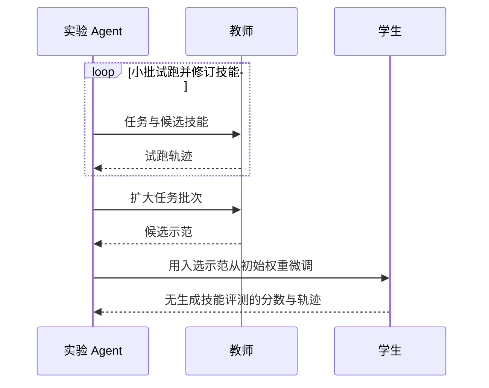
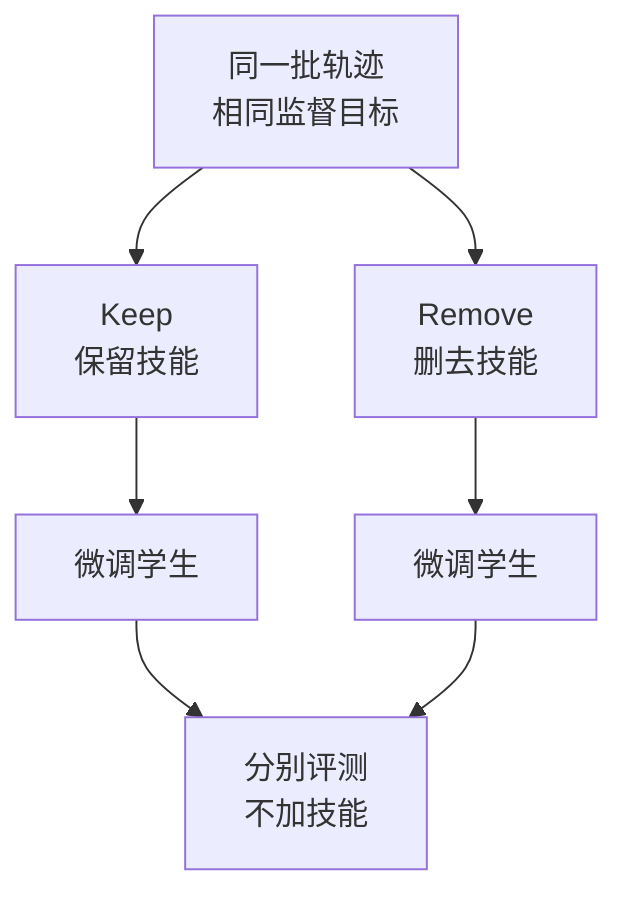

根据几条线索找一集电视剧。第一遍，模型反复猜测导演得过哪个奖，直到找到能支持答案的记录。第二遍，同一个模型先查剧集演职员表，从导演这一条可核实的线索出发，再回头核对奖项。两遍都找对了剧集，评测都记为成功。如果要用其中一遍教一个小模型，你更希望它学到哪种搜索习惯？这是 Chen 等人在 AutoMaster 论文中对照的一组真实轨迹。 [arXiv v2 图 5b](https://arxiv.org/html/2611.26510v2#S5.F5)

AutoMaster 要回答的是，任务已经做对了，教师还能怎样示范得更好？作者把自然语言技能加进教师的系统提示，让它重做部分任务，再筛选轨迹来微调学生。在三个基准和两种学生规模上，作者报告的平均成绩比普通监督微调高出 1.42–8.99 个百分点。另一组对照固定了教师示范。微调时保留生成示范所用的技能指令，学生在省去这些技能的评测里平均也拿到了更高分。 [arXiv v2 表 1](https://arxiv.org/html/2611.26510v2#S4.T1) · [图 6](https://arxiv.org/html/2611.26510v2#S5.F6)

## 答对之后，轨迹里还有什么可学

一次从接到任务到结束的运行叫 rollout。它留下的执行轨迹（trajectory）包括历史消息、模型的推理文本和回复、工具调用及返回。搜索案例里，最终答案只告诉我们找到了哪一集。轨迹还告诉我们，模型先假定了哪个奖项、遇到什么证据才改换线索，以及它怎样核实导演和剧集的关系。监督微调（supervised fine-tuning，SFT）会用教师在多个回合的输出作为学习目标，所以这些中间决策也会进入学生的训练。 [arXiv v2 §5.1](https://arxiv.org/html/2611.26510v2#S5.SS1) · [附录 A.3](https://arxiv.org/html/2611.26510v2#A1.SS3)

<figure style="margin-inline: 0">
  
  <figcaption>先看中列上下两条路径的最后一行，答案相同。再向上看两次搜索各用什么线索确认候选。点图可放大。<a href="https://arxiv.org/html/2611.26510v2#S5.F5">Chen 等，图 5（v2）</a> · <a href="https://creativecommons.org/licenses/by/4.0/">CC BY 4.0</a></figcaption>
</figure>

看图 5b 的中列，可以把这道题拆成三个可核对的判断。

1. **先分清题目线索与模型的猜测。** 题目给了播出年份、导演的大学背景和奖项命名线索。无技能教师先猜奖名，几次搜索都绕着未经证实的候选打转。
2. **找一条能独立确认候选的关系。** 有技能的教师从演职员记录入手，把第 3 季第 13 集连到导演 Meera Menon，再查她的大学背景与 Nora Ephron Prize。
3. **把两条路径交给同一个判分器。** 两次都找到《This Land Is Your Land》。只按剧集名判分，两条轨迹打平；若要教学生在搜索停滞时怎样换线索，第二条提供了一个可以模仿的下一步。图中是作者摘出的教师行为。学生能不能在另一道题上学会，要另做对照。[图 5b](https://arxiv.org/html/2611.26510v2#S5.F5) · [附录 B.2 的搜索技能](https://arxiv.org/pdf/2611.26510v2#page=20)

论文里的技能（skill）是一段可以在一类任务上复用的文字，说明遇到什么情况、该采取什么行动。用搜索案例来说，当几次查询都围绕同一个未经证实的奖项、返回的证据又没推进时，下一次查询可以先去掉这个假设，转查能独立识别候选的线索，比如剧集与导演的对应关系。把这段指令附到教师的系统提示后，教师重新与搜索环境交互，生成一条新的轨迹。教师权重固定，变化发生在它看到的指令和随后采取的行动。 [arXiv v2 §3.1](https://arxiv.org/html/2611.26510v2#S3.SS1) · [附录 B](https://arxiv.org/html/2611.26510v2#A2)

筛选和指导各解决一个问题。假如已有轨迹里经常出现查演职员表再核实奖项的过程，可以直接选出那些示范。如果原来的教师很少这样做，筛选能找到的样本就有限，技能指导可以让同一个教师尝试这条路径。把这种生成示范、再用示范微调学生的方法叫 **Skill-FT**（Skill-Guided Fine-Tuning，技能引导的微调）。**AutoMaster** 则负责寻找、试验和迭代这些干预。 [arXiv v2 §1](https://arxiv.org/html/2611.26510v2#S1) · [§3](https://arxiv.org/html/2611.26510v2#S3)

原文式（1）把轨迹 `τ` 写成由固定教师 `πT` 在任务 `x` 上运行时抽得的一个样本，条件是基础系统提示 `p` 拼上选中的技能 `s`。同一段技能可以用于多道题，一道题也可以组合多段技能。以剧集搜索为例，遇到卡住时怎样换线索和找到候选后怎样核对证据，可以分别写进适用的技能。调整这几段文字，会改变教师后续搜索动作的分布；实际是否换了线索、是否因此漏掉有效证据，还要看试跑。 [arXiv v2 §3.1–3.2](https://arxiv.org/html/2611.26510v2#S3.SS1)

## 两层循环怎样分工

论文安排了三个角色。**实验 Agent** 是在 Codex 中运行的 GPT-6 Astra，推理强度为 `xhigh`，它分析轨迹、写技能并选择示范。**教师** DeepSeek-V4-Pro-Preview 以 `high` 推理强度接收任务及适用的技能，实际调用工具完成任务。**学生** Qwen3.5-4B 或 Qwen3.5-9B 接受全参数微调，随后独立参加评测。三个角色的输出分别是实验方案、供模仿的示范和用来检验学习效果的执行结果。 [arXiv v2 §4.1](https://arxiv.org/html/2611.26510v2#S4.SS1) · [图 2](https://arxiv.org/html/2611.26510v2#S3.F2)

图中按三个角色归纳一次外环实验，箭头表示传递的材料，训练和评测服务的调度细节见原文。顺着两条返回实验 Agent 的反馈看：教师的试跑轨迹用来改当前技能，学生的评测结果用来设计下一轮实验。[原文图 2](https://arxiv.org/html/2611.26510v2#S3.F2) · [第 3.4 节](https://arxiv.org/html/2611.26510v2#S3.SS4)

**内环先看教师有没有做出预期行为。** 实验 Agent 从无技能的教师轨迹和初始学生轨迹中找反复出现的问题，为适用的任务设计技能。以搜索案例为例，小批试跑可以检查教师在卡住时，是否换了一条有辨识力的线索，并追查过早换路是否丢失了有用信息。Agent 可以据此修改技能或收窄适用范围，再试一次。试跑有效时才扩大规模，结合任务结果和执行过程挑示范。原来就展示了有效行为的无技能轨迹也可以入选。挑选时如果发现某类好示范仍少，还能改技能或任务覆盖，再发起一批运行。 [arXiv v2 §3.2](https://arxiv.org/html/2611.26510v2#S3.SS2) · [图 2](https://arxiv.org/html/2611.26510v2#S3.F2)

**外环再看学生能不能学会。** 检查点（checkpoint）是一份保存下来的模型权重。式（2）写作 `θᵣ = SFT(θ₀, Dᵣ)`，第 `r` 轮用本轮数据 `Dᵣ` 从固定的初始学生权重 `θ₀` 训练候选 `θᵣ`。随后验证候选学生能否在基准的评测环境里独立完成任务，评测省去生成的技能。每轮都从 `θ₀` 起步，比较的是不同示范集从同一个学生起点带来的结果。 [arXiv v2 §3.3](https://arxiv.org/html/2611.26510v2#S3.SS3)

分数告诉 Agent 学生做对了多少，轨迹帮助它追查学生在哪一步卡住。假如学生又反复猜奖项，可以先查教师试跑有没有改用更可靠的线索，再查这样的示范有没有入选。如果教师试跑也绕不出来，下一轮可以改技能；如果教师做到了但示范很少入选，则可以先查任务分配和筛选。即便示范已入选，学生是否学到仍要由下一轮验证。带到下一轮的是这些实验记录。 [arXiv v2 §3.3–3.4](https://arxiv.org/html/2611.26510v2#S3.SS3)

教师轨迹、技能、训练集、检查点和评测结果都留下关联记录。假如学生回头又猜起奖项，实验 Agent 可以查到它究竟见过哪些示范，区别是教师没有展示目标行为，还是示范已经入选而学生没学会。后台如何提交作业、恢复评测和读取权重，见[原文第 3.4 节与图 3](https://arxiv.org/html/2611.26510v2#S3.F3)。

## 给搜索案例换一个检验条件

搜索题里，最终答案掩盖了执行过程的差异。图 5 的另外两列分别检验两个相邻的问题：满足验收阈值能否支撑更强的技术结论？自测失败时，应该改程序还是先核对测试输入？

### 数值计算里的达标与收敛阶

第一道题要求修复一个泊松方程求解器，使它在 `64 × 64` 网格上的最大误差小于 `5 × 10⁻⁴`。这条验收条件问的是特定网格上算得有多准。无技能教师做出了误差为 `3.31 × 10⁻⁴` 的实现，已经达标，但在总结里进一步声称求解器有四阶精度。收敛阶回答的是另一道问题，网格继续加密时，误差会缩小得有多快？ [arXiv v2 图 5a](https://arxiv.org/pdf/2611.26510v2#page=9)

可以用一个简单的比例来读懂这个检查。设网格间距为 `h`。当误差主要由网格离散化决定时，`p` 阶收敛的误差大约随 `hᵖ` 变化。把间距减半，二阶对应误差约降到原来的四分之一，四阶对应约降到十六分之一。论文独立检查了无技能教师的实现，报告 `32 × 32` 和 `64 × 64` 网格上的误差分别为 `1.36 × 10⁻³` 和 `3.31 × 10⁻⁴`。按这两个报告值复算，误差比约为 `4.11`，把网格间距近似看作减半，`p ≈ log₂(4.11)` 约为 `2.04`，更接近二阶。只看某一档网格的误差就推断收敛阶，就像只看一个数据点来估计曲线的斜率。 [arXiv v2 图 5a](https://arxiv.org/pdf/2611.26510v2#page=9)

附录 B.1 的 `execute-numeric-decision` 要求教师选一个独立的参考值，并把任务实际要求的误差口径和阈值写进可运行的检查。失败时沿用原来的样例和验收条件来定位问题。图 5a 里，有技能的教师先查出修复前误差 `7.04 × 10⁻⁴` 超过上限，随后换成用九个网格点近似的离散格式，把误差降到 `2.55 × 10⁻⁷`。它又用直接求解法在逐步加密的网格上核对，得到约四阶的收敛结果。用一个检查判定是否达标，用另一个检查验证更强的技术主张，这两个动作都进入了示范。 [arXiv v2 图 5a](https://arxiv.org/pdf/2611.26510v2#page=9) · [附录 B.1](https://arxiv.org/pdf/2611.26510v2#page=19)

### 排序自测失败时查清输入

第三道题要求用 UTF-16BE 编码顺序给 JSON 的键升序排序。原题比较单个字符 `U+FB33` 和表情 `U+1F602`。两条轨迹在最初自测时都把前一个键写成了 `U+05D3 U+05BC`，却沿用了原题的预期顺序。关键在各键编码后的第一个 16 位值。原键以 `FB33` 开头，表情以 `D83D` 开头，自测换进去的键以 `05D3` 开头。由于 `05D3 < D83D < FB33`，换了输入，正确的先后次序也会变。 [arXiv v2 图 5c](https://arxiv.org/pdf/2611.26510v2#page=9)

无技能教师把整个排序方向改成降序来迎合这次自测，最终通过 38 项测试中的 32 项。有技能的教师检查了编码，修正自测输入并按题意做升序排序，通过了全部 38 项。附录 B.3 的 `contract-checkpoint` 把这种排查写成了可复用的步骤。先从规范确定一个可运行的检查，另外选一个能让两种实现给出不同结果的输入。碰到失败时，沿实际输入追到能解释差异的环节，修复后再跑原检查和区分用例。把两种键都放进测试，就有办法检验排序是否真的遵循了规则。 [arXiv v2 图 5c](https://arxiv.org/pdf/2611.26510v2#page=9) · [附录 B.3](https://arxiv.org/pdf/2611.26510v2#page=20)

从这些编码还能看出测试输入的选择为什么重要。如果排序实现直接比较 Unicode 码点，`U+1F602` 大于 `U+FB33`。按题目要求比较 UTF-16 编码时，表情的第一个编码单元 `D83D` 小于 `FB33`，先后次序会反过来。若自测只用常见的 ASCII 键，这两种实现都会给出同样的顺序。这个用例通过具体的编码差异检验程序采用了哪条规则。 [arXiv v2 图 5c](https://arxiv.org/pdf/2611.26510v2#page=9)

### 附录里的语法技能

附录 B.4 的 `expression-grammar` 还会把领域规则直接交给教师。比如连续的幂从哪一边结合，可以用 `2^3^2` 区分。先算右边的 `3^2` 得到 `2^(3^2) = 512`，先算左边得到 `(2^3)^2 = 64`。遇到需要兼容已有求值器的任务，这项技能还要求以参考实现的分组方式为准。教师先从任务规范推出预期值，再让求值器跑这个区分用例。这样的示范同时包含教师看到的规则，以及它据此作出的解析和验证动作。下一节的实验用这个区别来问，学生训练时要不要看到教师当时读过的规则？ [arXiv v2 图 7b](https://arxiv.org/pdf/2611.26510v2#page=10) · [附录 B.4](https://arxiv.org/pdf/2611.26510v2#page=21)

## 为什么学生训练时也要看技能

论文图 7 展示了两条用于微调的轨迹，可以在教师的输出里找到它参考技能的地方。一个任务要求通过 Python 解释器调用脚本。技能区分了直接运行脚本和把脚本交给解释器两种情况。教师检查了任务要求的命令，确认属于后者，保留了原命令和脚本权限，最后把程序输出和参考结果逐字节核对。这里值得学习的是先查实际调用方式，再判断要不要改权限。 [arXiv v2 图 7a](https://arxiv.org/html/2611.26510v2#S5.F7)

另一个任务要求修复表达式求值器。教师查技能里给出的语法，看到幂运算先于一元负号，因而把 `-2^2` 解析为 `-(2^2)`，结果是 −4。它还用 `(-2)^2 = 4` 检查括号是否能改变分组，用 `2^3^2 = 512` 检查连续两个幂运算是否从右向左结合。微调时删去语法，教师写下的推理和测试动作都还在，但学生少了原本可供查阅的规则全文。作者用这两个例子说明，保留上下文可能让动作的适用条件更清楚。 [arXiv v2 图 7b](https://arxiv.org/html/2611.26510v2#S5.F7) · [§5.2](https://arxiv.org/html/2611.26510v2#S5.SS2)

SFT 要学生根据到目前为止的历史预测教师输出的下一个词元（token）。一次预测给教师实际选中的词元分配的概率越低，交叉熵损失就越大。论文只在助手输出上计算损失，包括教师的推理文本、回复和工具调用，再按受监督词元总数归一化。系统提示、用户消息和工具返回都只作输入上下文。Keep 与 Remove 使用同一批已经生成的轨迹和同一套微调配方，预测目标也相同。保留技能改变了学生据以预测的条件。 [arXiv v2 附录 A.3](https://arxiv.org/html/2611.26510v2#A1.SS3)

Remove 的训练输入在形式上更接近评测输入。按同样省去技能的评测协议测量，六组成绩的均值都由 Keep 领先。下表是原文图 6 标出的两组均值之差，单位为百分点。 [arXiv v2 §5.2](https://arxiv.org/html/2611.26510v2#S5.SS2) · [图 6](https://arxiv.org/html/2611.26510v2#S5.F6)

| 评测基准           |    4B |    9B |
| ------------------ | ----: | ----: |
| Terminal-Bench 2.1 | +3.00 | +3.75 |
| BrowseComp         | +3.60 | +2.34 |
| Doc2Repo           | +4.01 | +2.15 |

这个实验量到了保留整段训练上下文的效果。技能的语义、提示长度和教师推理中引用规则时的上下文完整性都随之改变。要检验学生是否学会了按条件用规则，可以在新题里分别给出直接运行和经解释器调用这两种场景，观察学生是否在适用的场景才改权限。这样的行为检查可以把图 7 提出的机制解释变成可检验的假设。 [arXiv v2 §5.2](https://arxiv.org/html/2611.26510v2#S5.SS2) · [图 7](https://arxiv.org/html/2611.26510v2#S5.F7)

## 对照实验排除了哪些解释

### 训练题从哪来，评测怎样打分

三个领域各自在公开训练语料中随机抽取 1,000 项任务，同领域的各方法共享这批题。评测另有对应的基准。终端任务从 CalibForge 取训练题，在 Terminal-Bench 2.1 的 89 项任务上评测。搜索从 FORT-Searcher 取训练题，在 Traverse 发布的 BrowseComp Lite-185 子集上评测。软件工程从 DeNovoSWE 取训练题，在 Doc2Repo 的 50 个仓库上评测。前两项以答对或完成的任务占比计分。Doc2Repo 对每个仓库计算测试通过率，再对仓库取平均，一个未通过全部测试的仓库仍可能贡献部分分数。教师运行和学生评测使用基于 AweAgent 的执行框架，软件工程的执行环境关闭了搜索工具。Doc2Repo 的 40.79% 可以读成各仓库的平均测试通过率，完整实现的仓库数需要另行计算。 [arXiv v2 §4.1](https://arxiv.org/html/2611.26510v2#S4.SS1) · [附录 A.1](https://arxiv.org/html/2611.26510v2#A1.SS1)

Base 是额外微调前的学生。普通监督微调（Vanilla SFT）从同一个教师在任务池上无技能指导且成功的轨迹里随机抽 512 条。AutoMaster 也交付 512 条示范，每次从对应的 Qwen3.5 初始检查点做全参数 SFT，训练集遍历三遍，学习率设为 10⁻⁵，全局批大小为 32。共享配方还规定了最大序列长度 131,072 词元、余弦学习率衰减与 bfloat16 精度。教师、任务池、轨迹条数和微调配方对齐后，主要变化就落在教师示范如何生成、哪些轨迹入选，以及入选示范携带的训练上下文。 [arXiv v2 §4.1](https://arxiv.org/html/2611.26510v2#S4.SS1) · [附录 A.3](https://arxiv.org/html/2611.26510v2#A1.SS3)

同一领域的学生用同一套评测环境、工具和预算，评测时均省去生成的技能。因此要比较两套示范，读下表时应固定基准与学生规模，横向看同一行。[训练配方](https://arxiv.org/html/2611.26510v2#A1.SS3) · [评测设置](https://arxiv.org/html/2611.26510v2#A1.SS4)

### 六组主结果

下表的成绩列以百分数表示，写作平均值 ± 标准差。每个标准差来自同一检查点的三次评测，衡量这个模型多跑几遍时的分数波动。最后两列用百分点表示 AutoMaster 相对 Vanilla SFT 的平均增益及其逐项 95% 置信区间，增益按舍入前的分数计算。 [arXiv v2 图 1b](https://arxiv.org/html/2611.26510v2#S0.F1) · [表 1](https://arxiv.org/html/2611.26510v2#S4.T1) · [表 A6](https://arxiv.org/html/2611.26510v2#A1.T6)

| 基准与学生 | Base | Vanilla SFT | AutoMaster | 增益 | 95% 置信区间 |
| --- | --: | --: | --: | --: | --: |
| Terminal-Bench 2.1 · 4B | 15.73 ± 2.25 | 22.47 ± 1.12 | 28.09 ± 2.25 | +5.62 | [1.12, 10.49] |
| Terminal-Bench 2.1 · 9B | 25.47 ± 2.59 | 26.59 ± 1.30 | 35.58 ± 1.30 | +8.99 | [2.25, 16.10] |
| BrowseComp Lite · 4B | 33.69 ± 0.82 | 43.24 ± 0.54 | 46.13 ± 2.98 | +2.88 | [−1.08, 6.85] |
| BrowseComp Lite · 9B | 35.50 ± 2.72 | 46.85 ± 2.98 | 51.53 ± 1.25 | +4.68 | [0.72, 8.83] |
| Doc2Repo · 4B | 21.39 ± 2.61 | 32.30 ± 4.00 | 33.72 ± 3.58 | +1.42 | [−1.94, 5.33] |
| Doc2Repo · 9B | 33.42 ± 1.60 | 36.05 ± 3.89 | 40.79 ± 3.21 | +4.74 | [0.65, 8.93] |

普通微调在六组里都高于 Base，说明模仿已成功的示范本身就有收益。Terminal-Bench 2.1 的 9B 尤其说明了示范生成还有多少空间。Vanilla SFT 把正确率从 25.47% 提到 26.59%，AutoMaster 用同样数量的示范把它提到 35.58%。三个领域里，9B 学生的均值增益都比同领域的 4B 大。这个差别来自两种 Qwen3.5 学生和同一组教师配置，尚需更多模型和规模才能判断它是否普遍出现。 [arXiv v2 §4.2](https://arxiv.org/html/2611.26510v2#S4.SS2)

### 指导、筛选和训练题目分别改变了什么

只留筛选时，实验 Agent 从无指导的教师轨迹中挑示范。只留指导时，它仍可为预先随机抽定的任务子集设计和迭代技能，但省去由 Agent 挑选轨迹的步骤。两种消融仍使用同一教师、任务池、训练规模和配方。第三种对照 Task-Matched SFT 直接复用教师最初的无指导轨迹，逐项对应 AutoMaster 最终训练集的任务 ID 和每题样本数。下表列出这三种对照与完整方案的平均成绩，单位为百分数。 [arXiv v2 §4.3](https://arxiv.org/html/2611.26510v2#S4.SS3) · [表 A4](https://arxiv.org/html/2611.26510v2#A1.T4)

| 基准与学生              | 只留筛选 | 只留指导 | 匹配任务 | AutoMaster |
| ----------------------- | -------: | -------: | -------: | ---------: |
| Terminal-Bench 2.1 · 4B |    17.60 |    20.22 |    17.98 |      28.09 |
| Terminal-Bench 2.1 · 9B |    28.46 |    34.08 |    27.72 |      35.58 |
| BrowseComp Lite · 4B    |    45.77 |    43.78 |    44.32 |      46.13 |
| BrowseComp Lite · 9B    |    49.19 |    50.27 |    50.45 |      51.53 |
| Doc2Repo · 4B           |    32.03 |    31.43 |    32.37 |      33.72 |
| Doc2Repo · 9B           |    36.97 |    38.29 |    36.93 |      40.79 |

两种消融在六组里都低于完整方案。4B 的终端任务上，它们还都低于普通微调的 22.47%，其中只留指导得分更高。到了同一个学生的搜索任务，只留筛选的反而更高。论文给出的一个可能解释是，教师原本已有较多有效做法时，挑选有用轨迹就能提供示范。当所需做法很少出现时，先用技能让教师试出新做法，再筛选这些轨迹才有机会补足。表中的得分支持联合使用这两个环节，也提示只保留其中一个时，收益随任务和学生而变。 [arXiv v2 §4.3](https://arxiv.org/html/2611.26510v2#S4.SS3)

任务匹配后，AutoMaster 仍领先 1.08–10.11 个百分点。匹配对照保留初始轨迹里的失败样本，以维持题目和样本数一致。每组包含 512 对示范。在终端任务上，4B 和 9B 的训练语料中分别有 406 和 412 对均成功，另有 106 和 100 对从无指导教师失败变为入选示范成功。在搜索任务上，两边均成功的分别有 467 和 448 对，从失败变为成功的分别有 45 和 64 对。这四组配对中的同题双成功占 79.3–91.2%。对这些配对，成功标签给出了同一个结果。要判断两边示范是否有差别，还得看里面采取过哪些动作。 [arXiv v2 附录 A.5](https://arxiv.org/html/2611.26510v2#A1.SS5) · [表 A5](https://arxiv.org/html/2611.26510v2#A1.T5)

软件工程允许按通过的测试比例给分。比较 512 对同题示范的分数，4B 对应的语料有 43 对提高、433 对持平、36 对下降，9B 分别有 24、483、5 对。配对统计只覆盖最终入选的语料。整组效果还可能同时受同题行为改变、成功样本比例和轨迹筛选影响。若要单独看两条轨迹都成功时，执行过程的差异能教给学生多少，可以只用双成功配对做规模相同的微调比较。 [arXiv v2 表 A5](https://arxiv.org/html/2611.26510v2#A1.T5)

## 怎样理解这些增益

平均增益之外，论文还估计了结果对评测题目构成的敏感程度。先把同一题在三次评测中的分数取平均。然后做配对 bootstrap（有放回重采样），每轮重新抽取与原评测集等量的一批题，保留两种方法在每道抽中题上的分数，再重算平均增益。论文重复 10,000 轮，对每组比较取差值分布的第 2.5 和第 97.5 百分位。Doc2Repo 按整个仓库抽样，一个仓库的测试用例随仓库一起进入计算。配对让同一道难题对两种方法同时产生影响。 [arXiv v2 附录 A.6](https://arxiv.org/html/2611.26510v2#A1.SS6)

三组 9B 和 4B 的终端任务的区间完全在零以上。4B 的 BrowseComp 和 Doc2Repo 虽然取得正的平均提升，区间仍跨过零。表中的区间对应已选检查点和记录下来的评测结果。对现有评测题重新抽样的波动、同一检查点重复评测的波动和用不同随机种子重新微调的波动是三件不同的事，论文的区间与标准差分别给出了前两者的信息。六组区间是分别计算的，读整张表时也要保留这一点。 [arXiv v2 表 A6](https://arxiv.org/html/2611.26510v2#A1.T6) · [附录 A.4](https://arxiv.org/html/2611.26510v2#A1.SS4)

### 五轮探索找到了什么

<figure style="margin-inline: 0">
  
  <figcaption>沿中间的搜索任务面板看：紫色 9B 曲线到第四轮才达到峰值，蓝色 4B 曲线在第三轮见顶后回落。误差棒表示同一检查点三次评测的一个标准差。点图可放大。<a href="https://arxiv.org/html/2611.26510v2#S5.F8">Chen 等，图 8（v2）</a> · <a href="https://creativecommons.org/licenses/by/4.0/">CC BY 4.0</a></figcaption>
</figure>

每轮从原始学生检查点重新微调，调整的是技能、适用任务或选择的轨迹。六组最高均值都出现在第 2 至第 4 轮，比各自首轮高 2.16–4.87 个百分点。BrowseComp 的 9B 前三轮都在 49% 左右，第四轮到 51.53%。9B 在三域的五轮均值都超过各自的 Vanilla SFT，4B 只有终端任务在五轮中始终超过基线。这是一系列候选方案的比较，后面一轮可以尝试不同假设，得分也可能回落。 [arXiv v2 §5.3](https://arxiv.org/html/2611.26510v2#S5.SS3) · [图 8](https://arxiv.org/html/2611.26510v2#S5.F8)

官方基准的分数与轨迹既用于给候选打分，也会被交给实验 Agent 指导下一轮，最终再根据累积反馈选择检查点。论文未报告选定方案之后才启用的独立最终留出集，因此逐项区间也没有覆盖反复使用基准来设计和选择方案带来的不确定性。它们可以帮助衡量所选模型在这些基准上的差异。要进一步估计未参与搜索的任务上的收益，可以先用开发集反复试验，再把选定方案交给一直保留的评测集。另一个待测的问题是总成本。统一的 512 条只约束每次 SFT 用到多少轨迹，额外的教师试跑、批量重跑、学生训练和评测都要计入完整实验的预算。即便轨迹条数相同，轨迹长短也会影响处理的 token 量。比较算力投入时，可以给普通微调同样的教师请求、微调轮次和评测预算，让它从更多次无指导尝试中挑选示范，再看技能指导带来的增益能保留多少。 [arXiv v2 附录 A.4](https://arxiv.org/html/2611.26510v2#A1.SS4) · [附录 A.6](https://arxiv.org/html/2611.26510v2#A1.SS6)

如果把开篇的两种搜索方式作为下一轮的候选，应该在开发题上先定义可观察行为，例如遇到连续弱匹配时能否换用独立线索。在没有参与挑选技能的新题上，再一起统计答对率和换线索后的查证过程。这个设计能帮助区分「挑到了高分检查点」与「学生学会了可迁移的策略」，属于本文建议的后续验证。

## 从论文结论回到一条可检查的轨迹

作者的结论有两层。同一个教师能通过技能指导和轨迹筛选，为学生提供更有效的示范。固定示范后，保留生成示范时的技能上下文也能提高这些基准上的平均成绩。前一层有主实验、组件消融和任务匹配对照，后一层有 Keep 与 Remove 对照。轨迹案例让读者能检查示范里究竟发生了什么，学生能否在新任务上按条件重现这些行为，仍要靠独立评测来测量。 [arXiv v2 §6](https://arxiv.org/html/2611.26510v2#S6)

作者首发公开了技能示例和推理配置，可以用来查看技能如何表述触发条件及验证步骤。按论文跑完两层循环，还需要自行补齐实验控制器、教师轨迹生成服务和 SFT 编排。本文的分数均来自论文，本文中的复算用于解释原文数据。 [作者仓库的方法说明](https://github.com/RUCAIBox/AutoMaster/blob/main/docs/method.md#training-and-deployment)

回到开头那道搜索题。答案分数检查模型找到了哪一集，轨迹能够回答它怎样在搜索停滞时找到下一条可靠线索。如果团队希望把这种做法教给小模型，一个可以沿用的实验思路是先写明触发条件和可观察的动作，再检查教师是否展示它、学生是否能在新题上独立采用它。这样既能看任务结果，也能知道下一轮该改技能、改筛选，还是改评测。 [arXiv v2 §3.2–3.3](https://arxiv.org/html/2611.26510v2#S3.SS2)
