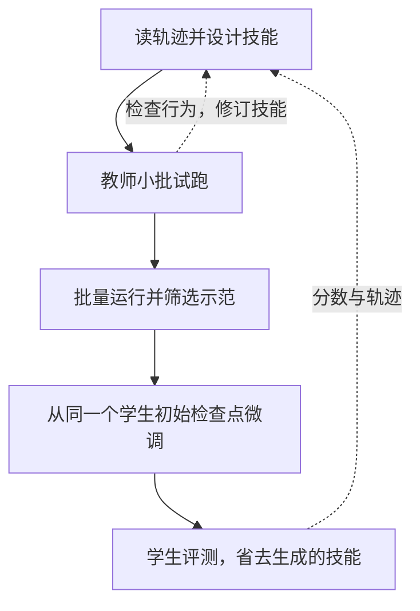
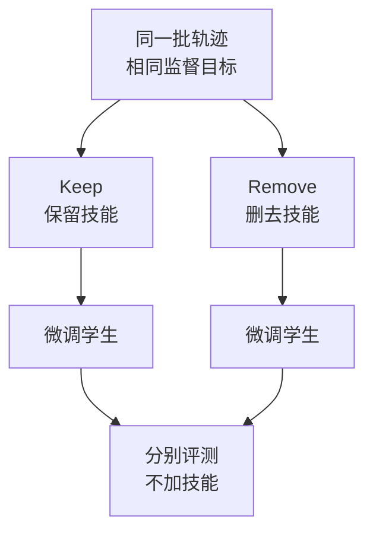

根据几条线索找一集电视剧。第一遍，模型反复猜测导演得过哪个奖，直到找到能支持答案的记录。第二遍，同一个模型先查剧集演职员表，从导演这一条可核实的线索出发，再回头核对奖项。两遍都找对了剧集，评测都记为成功。如果要用其中一遍教一个小模型，你更希望它学到哪种搜索习惯？这是 Chen 等人在 AutoMaster 论文中对照的一组真实轨迹。 [arXiv v2 图 5b](https://arxiv.org/html/2611.26510v2#S5.F5)

AutoMaster 要回答的是，任务已经做对了，教师还能怎样示范得更好？作者把自然语言技能加进教师的系统提示，让它重做部分任务，再筛选轨迹来微调学生。在三个基准和两种学生规模上，作者报告的平均成绩比普通监督微调高出 1.42–8.99 个百分点。另一组对照固定了教师示范。微调时保留生成示范所用的技能指令，学生在省去这些技能的评测里平均也拿到了更高分。 [arXiv v2 表 1](https://arxiv.org/html/2611.26510v2#S4.T1) · [图 6](https://arxiv.org/html/2611.26510v2#S5.F6)

## 答对之后，轨迹里还有什么可学

一次从接到任务到结束的运行叫 rollout。它留下的执行轨迹（trajectory）包括历史消息、模型的推理文本和回复、工具调用及返回。搜索案例里，最终答案只告诉我们找到了哪一集。轨迹还告诉我们，模型先假定了哪个奖项、遇到什么证据才改换线索，以及它怎样核实导演和剧集的关系。监督微调（supervised fine-tuning，SFT）会用教师在多个回合的输出作为学习目标，所以这些中间决策也会进入学生的训练。 [arXiv v2 §5.1](https://arxiv.org/html/2611.26510v2#S5.SS1) · [附录 A.3](https://arxiv.org/html/2611.26510v2#A1.SS3)

论文里的技能（skill）是一段可以在一类任务上复用的文字，说明遇到什么情况、该采取什么行动。用搜索案例来说，当几次查询都围绕同一个未经证实的奖项、返回的证据又没推进时，下一次查询可以先去掉这个假设，转查能独立识别候选的线索，比如剧集与导演的对应关系。把这段指令附到教师的系统提示后，教师重新与搜索环境交互，生成一条新的轨迹。教师权重固定，变化发生在它看到的指令和随后采取的行动。 [arXiv v2 §3.1](https://arxiv.org/html/2611.26510v2#S3.SS1) · [附录 B](https://arxiv.org/html/2611.26510v2#A2)

筛选和指导各解决一个问题。假如已有轨迹里经常出现查演职员表再核实奖项的过程，可以直接选出那些示范。如果原来的教师很少这样做，筛选能找到的样本就有限，技能指导可以让同一个教师尝试这条路径。把这种生成示范、再用示范微调学生的方法叫 **Skill-FT**。**AutoMaster** 则负责寻找、试验和迭代这些干预。 [arXiv v2 §1](https://arxiv.org/html/2611.26510v2#S1) · [§3](https://arxiv.org/html/2611.26510v2#S3)

## 两层循环怎样分工

论文安排了三个角色。**实验 Agent** 是在 Codex 中运行的 GPT-6 Astra，它分析轨迹、写技能并选择示范。**教师** DeepSeek-V4-Pro-Preview 接收任务及适用的技能，实际调用工具完成任务。**学生** Qwen3.5-4B 或 Qwen3.5-9B 接受全参数微调，随后独立参加评测。 [arXiv v2 §4.1](https://arxiv.org/html/2611.26510v2#S4.SS1) · [图 2](https://arxiv.org/html/2611.26510v2#S3.F2)

**内环先看教师有没有做出预期行为。** 实验 Agent 从无技能的教师轨迹和初始学生轨迹中找反复出现的问题，为适用的任务设计技能。以搜索案例为例，小批试跑可以检查教师在卡住时是否真的换了有辨识力的线索，还是只换了几个关键词。试跑提供修改技能和适用范围的依据。接着扩大运行规模，结合任务结果和执行过程挑示范。原来就展示了有效行为的无技能轨迹也可以入选。 [arXiv v2 §3.2](https://arxiv.org/html/2611.26510v2#S3.SS2)

**外环再看学生能不能学会。** 每轮拿当轮选出的数据，从对应学生的同一个初始检查点重新微调，然后用该基准的评测环境测试，省去生成的技能。如果学生仍反复猜奖项，实验 Agent 可以沿记录往回查，看看教师有没有展示换线索的动作，以及展示了这种行为的轨迹有没有入选。前者关系到技能设计，后者关系到数据筛选。带到下一轮的是实验记录，下一轮的学生仍从原始权重起步。 [arXiv v2 §3.3](https://arxiv.org/html/2611.26510v2#S3.SS3) · [§3.4](https://arxiv.org/html/2611.26510v2#S3.SS4)

## 为什么学生训练时也要看技能

设想教师在轨迹里写道，按给定语法，幂运算先于一元负号。因此 `-2^2` 解析为 `-(2^2)`，而 `(-2)^2` 先把带负号的数分为一组。这来自论文图 7 的解析器案例。微调时删去那段语法，教师已经写下的推理和测试动作都还在，不过学生少了当时可供查阅的规则全文，得更多地从已有记录中推断规则和适用范围。作者用这类例子解释为什么保留上下文可能有帮助。 [arXiv v2 图 7](https://arxiv.org/html/2611.26510v2#S5.F7)

SFT 要学生根据到目前为止的历史预测教师输出的下一个词元（token）。系统提示、用户消息、工具返回都可成为预测条件，交叉熵损失只在助手输出上计算，包含教师的推理文本、回复和工具调用。Keep 与 Remove 使用同一批已经生成的轨迹和同一套微调配方，预测目标也相同。两组的训练差别是系统提示中有没有那段技能文字。 [arXiv v2 附录 A.3](https://arxiv.org/html/2611.26510v2#A1.SS3)

Remove 的训练输入在形式上更接近评测输入。六组成绩的均值都由 Keep 领先，差距为 2.15–4.01 个百分点。这个实验量到了保留这段训练上下文的整体效果，规则语义、提示长度和推理中引用规则时的上下文完整性都随之改变。如果要检验学生是否学会了按条件应用某条具体规则，可以用一组分别满足和不满足触发条件的新任务，检查它在哪些情况下采取了对应动作。 [arXiv v2 §5.2](https://arxiv.org/html/2611.26510v2#S5.SS2) · [图 6](https://arxiv.org/html/2611.26510v2#S5.F6)

## 对照实验排除了哪些解释

每个领域共用一个含 1,000 项训练任务的固定任务池。普通微调（Vanilla SFT）从无技能的教师成功轨迹中随机抽取 512 条。AutoMaster 也用 512 条，教师、学生起点和全参数微调配方相同，每次微调都遍历训练集三遍。下表比较未额外微调的 Base、普通微调和 AutoMaster。每个成绩是对应检查点的三次评测均值。Terminal-Bench 2.1 和 BrowseComp Lite-185 报告任务正确率，Doc2Repo 报告各仓库测试通过率的均值。增益相对普通微调，按原文未舍入的分数计算，单位为百分点。 [arXiv v2 §4.1](https://arxiv.org/html/2611.26510v2#S4.SS1) · [表 1](https://arxiv.org/html/2611.26510v2#S4.T1) · [表 A6](https://arxiv.org/html/2611.26510v2#A1.T6)

| 基准与学生              |   Base | 普通微调 | AutoMaster |  增益 |
| ----------------------- | -----: | -------: | ---------: | ----: |
| Terminal-Bench 2.1 · 4B | 15.73% |   22.47% |     28.09% | +5.62 |
| Terminal-Bench 2.1 · 9B | 25.47% |   26.59% |     35.58% | +8.99 |
| BrowseComp · 4B         | 33.69% |   43.24% |     46.13% | +2.88 |
| BrowseComp · 9B         | 35.50% |   46.85% |     51.53% | +4.68 |
| Doc2Repo · 4B           | 21.39% |   32.30% |     33.72% | +1.42 |
| Doc2Repo · 9B           | 33.42% |   36.05% |     40.79% | +4.74 |

**只留指导或只留筛选会怎样？** 作者分别拿掉两者之一。只留指导时，实验 Agent 在随机固定的任务子集上设计和迭代技能；只留筛选时，它从无技能教师轨迹中挑样本。两者的均值在六组比较中都低于完整系统，但各自的表现随任务而变。以 4B 学生为例，Terminal 上只留指导得 20.22%，只留筛选得 17.60%，普通微调得 22.47%，完整系统得 28.09%。在 BrowseComp 上，只留筛选的 45.77% 高于只留指导的 43.78%。哪些轨迹原本就有可学的行为，会影响两种手段各能发挥多少作用。 [arXiv v2 §4.3](https://arxiv.org/html/2611.26510v2#S4.SS3) · [表 A4](https://arxiv.org/html/2611.26510v2#A1.T4)

**收益有多少来自挑题？** Task-Matched SFT 用同一个教师最初的无技能轨迹，逐项匹配完整系统最终训练集的任务 ID 和每题样本数。题目构成相同后，完整系统的均值仍领先 1.08–10.11 个百分点。这里为保持任务匹配，基线保留了无技能教师的失败轨迹。Terminal 和 Search 的四组入选语料里，79.3–91.2% 的配对两边都成功，其余是无技能轨迹失败、入选示范成功。这个对照的成绩差异同时可能来自两类变化，一类是原本失败的任务有了成功示范，另一类是同样答对的轨迹展示了不同的做法。要更直接地研究后者，可以只用两边都成功的配对再做一次微调对比。 [arXiv v2 附录 A.5](https://arxiv.org/html/2611.26510v2#A1.SS5) · [表 A5](https://arxiv.org/html/2611.26510v2#A1.T5)

## 怎样理解这些增益

论文把每道评测任务在三次运行中的分数先取平均，再做配对 bootstrap（有放回重采样）。每轮抽出一批题，保留两种方法在每道抽中题上的分数，再用这批题重算平均增益。以 Terminal-Bench 2.1 的 9B 为例，89 道题上的增益是 8.99 个百分点，论文给出的 95% 置信区间为 2.25–16.10 个百分点。三组 9B 的区间都在零以上，4B 的 BrowseComp 和 Doc2Repo 区间包含零。六组都观察到正的均值差，后两组的结果仍与零增益相容。区间描述的是已选检查点在这些任务上的估计不确定性，重新训练一次带来的波动需要另行测量。 [arXiv v2 附录 A.6](https://arxiv.org/html/2611.26510v2#A1.SS6)

五轮探索中，各组最高均值出现在第 2 至第 4 轮，比各自首轮高 2.16–4.87 个百分点。论文也说明，基准上的分数和轨迹会反馈到下一轮，最后用累积的评测结果选择检查点。本文据此把表中的增益理解为在这些基准上搜索到的候选成绩。在整个探索期间保留一批评测题，选定方案后才启用，可以检验增益能否延续到未参与方案选择的任务。成本也值得另算，512 条轨迹对齐的是最终训练集规模，教师的试跑、批量重跑和多轮学生训练都属于额外实验开销。 [arXiv v2 §5.3](https://arxiv.org/html/2611.26510v2#S5.SS3) · [附录 A.4](https://arxiv.org/html/2611.26510v2#A1.SS4)

作者首发公开了技能示例和推理配置。按论文跑完两层循环，还需要自行补齐实验控制器、教师轨迹生成服务和 SFT 编排。 [作者仓库的方法说明](https://github.com/RUCAIBox/AutoMaster/blob/main/docs/method.md#training-and-deployment)

回到开头那道搜索题。答案分数检查模型找到了哪一集，轨迹能够回答它怎样在搜索停滞时找到下一条可靠线索。如果团队希望把这种做法教给小模型，一个可以沿用的实验思路是先写明触发条件和可观察的动作，再检查教师是否展示它、学生是否能在新题上独立采用它。这样既能看任务结果，也能知道下一轮该改技能、改筛选，还是改评测。 [arXiv v2 §3.2–3.3](https://arxiv.org/html/2611.26510v2#S3.SS2)
