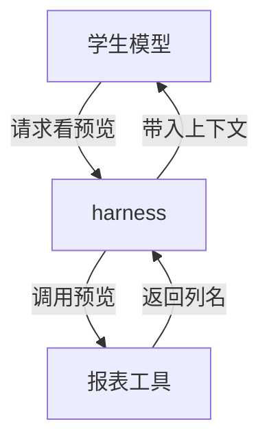
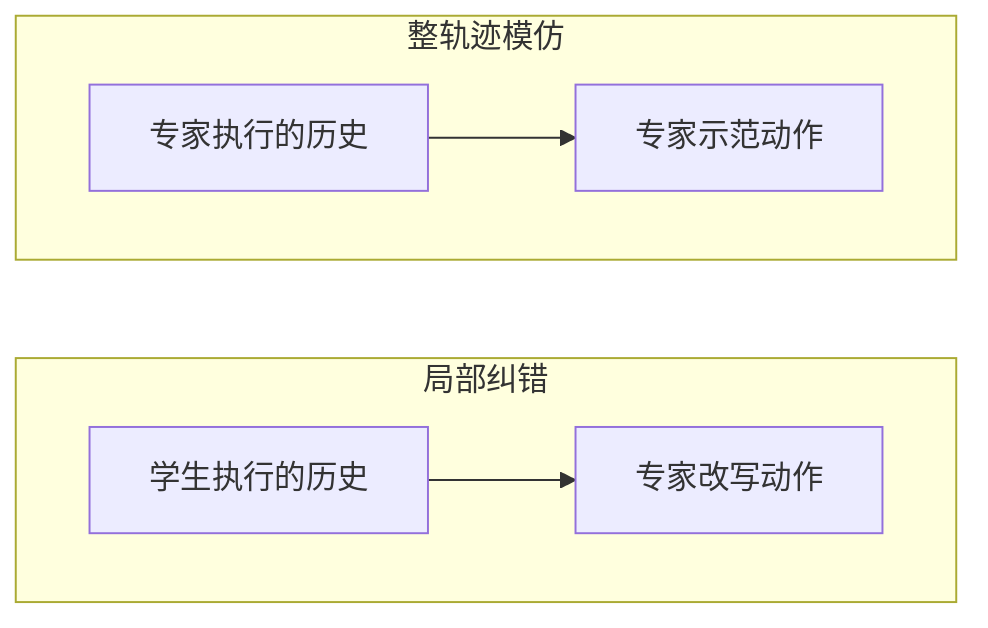
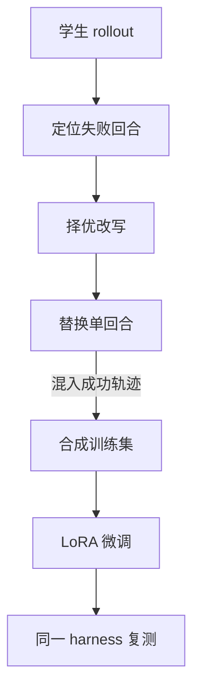

月底关账时，财务团队让一个 Agent（能按任务调用工具的智能体）读取出勤记录，汇总各部门工时，保存报表，再发出任务结束信号。Yu 等人的薪资审计实验里，模仿专家后的 Qwen3-Coder 写出了正确的结果，却反复打开同一个视图 29 次，走到第 78 步仍未发出结束信号。这次执行得了 0 分。[arXiv v1 附录 D，案例 1](https://arxiv.org/html/2609.09134v1#A4.SS0.SSS0.Px1)

想把这类重复工作交给成本较低的模型，团队可以先调整 Agent harness，也就是围绕模型运行的提示、工具和执行规则。论文关心的是 harness 已经适配学生模型（student model）之后，该怎样继续教它。作者提出让学生先按自己的方式执行，再由更强的专家模型（expert model）在学生实际遇到的上下文中，改写出错的那一回合（turn），也就是模型当时的回应及工具调用。论文把这种方法称作 on-policy expert correction。[arXiv v1 §1](https://arxiv.org/html/2609.09134v1#S1)

## 一份报表怎样算作完成

把论文的薪资审计缩小到一个部门。输入是运营部的三条工时记录，甲有 6 小时和 10 小时两条，乙有 4 小时一条。要求是按人等权，先给甲算出平均值 8，给乙算出平均值 4，再平均这两个数。报表应当保存一行，`部门` 为「运营部」，`人均工时` 为 6 小时。直接平均三条记录会得到约 6.67 小时，因为甲的记录多了一条，在这个算法中就占了乙两倍的权重。这里的人数、工时和列名都是简化设定，两级聚合的顺序来自论文案例。[arXiv v1 附录 A 表 4](https://arxiv.org/html/2609.09134v1#A1.T4) · [附录 D 案例 1](https://arxiv.org/html/2609.09134v1#A4.SS0.SSS0.Px1)

在这个例子里，harness 把任务组织成模型可以执行的操作。系统提示（system prompt）写明按人等权和保存前核对列名，工具负责读记录、看预览、写报表和结束任务。hook（execution hook）可以在操作发生时触发检查，上下文管理（context management）决定哪些历史和工具结果会进入下一回合。给定这些信息后，模型决定下一步做什么。它依据当前上下文选择动作的方式，就是策略（policy）。[arXiv v1 §1](https://arxiv.org/html/2609.09134v1#S1)

图里只画了核对列名的一个回合。看到「部门」和「人均工时」之后，学生通常就可以保存并结束。它也可能再次请求预览，结果只是把相同信息带回上下文。在这个算例里，一次成功运行要过两关，一是报表的列名和数值符合要求，二是模型发出了结束信号。论文开头那次失败落在第二关，保存本身已经成功。[arXiv v1 附录 D，案例 1](https://arxiv.org/html/2609.09134v1#A4.SS0.SSS0.Px1)

### 固定模型，调整它工作的环境

作者从现成的基准 harness（baseline harness）出发，让负责优化的 Gemini 读学生的失败记录，尝试改提示、工具或 hook。薪资任务中，胜出的改动明确写出了逐员工聚合和加班处理规则。拿我们的算例来说，如果学生交出了 6.67 小时，就可以让提示明确两级平均的先后顺序，再用同一个模型运行。小批试验得分提高的改动才进入候选池，最终按验证集表现选出优化后的 harness（evolved harness）。论文把这种搜索称为 harness evolution，期间学生参数保持固定。[arXiv v1 §3.1](https://arxiv.org/html/2609.09134v1#S3.SS1) · [附录 A 与表 4](https://arxiv.org/html/2609.09134v1#A1)

这样筛出来的提示和工具，已经和这个学生的做事方式一起通过了验证。比如，写明保存前核对一次，实际能带来收益，是因为模型会认出核对完成的时机并继续往下走。作者所说的模型与 harness 的配合（model–harness fit），具体就体现在这些衔接处。模型接受微调后，同一套提示和工具会接到新的动作序列，原来有效的衔接得重新检验。[arXiv v1 §1](https://arxiv.org/html/2609.09134v1#S1) · [附录 D，案例 1](https://arxiv.org/html/2609.09134v1#A4.SS0.SSS0.Px1)

## 完整示范也会教给学生一套计划

一次 rollout 从模型收到任务开始，到本轮停止执行为止。它留下的消息、工具调用及工具返回构成执行轨迹（trajectory）。在整轨迹专家模仿（full-trajectory expert imitation）实验里，作者让 Gemini 在为 Qwen 优化的 harness 中跑任务，取满分轨迹，转成 Qwen 的对话和工具调用格式，再混入 Qwen 自己成功的轨迹。[arXiv v1 §3.3](https://arxiv.org/html/2609.09134v1#S3.SS3) · [附录 B](https://arxiv.org/html/2609.09134v1#A2)

这些记录用来做监督微调（supervised fine-tuning，SFT）。以保存报表的那一回合为例，训练的输入是任务说明和截至保存前的轨迹前缀（trajectory prefix），包括之前的动作和工具返回。目标是样本里下一条模型回应，以及它发出的保存调用。把同样的学习信号放到完整示范的各个模型回合，模型就会学到何时做汇总、怎样核验、何时提交。论文用低秩适配（low-rank adaptation，LoRA）做这种微调，训练时冻结原有权重，更新少量新增参数。[arXiv v1 附录 B](https://arxiv.org/html/2609.09134v1#A2)

设想专家在一次计算调用中完成了两级平均，并同时打印了结果与最终列名。它接下来可以直接保存，因为之前的输出已经满足核验所需的条件。学生可能分几次算出甲、乙的平均，再单独调用预览。两条路径都能得到 6 小时，走到保存前时看到的工具返回却不一样。整段示范里「接下来直接保存」的时机，是由专家已经做过的那几步决定的。学生若也学会了提前保存，就要看自己走过的步骤是否已经完成同样的核验。这是用算例说明历史为何重要，专家采取的具体步骤是这里的假设。

论文里实际观察到的是学生的收尾方式变了。在附录 D 的同一薪资任务样例上，未经微调的 Qwen 三次都在 14 至 20 步内完成。模仿后的那次执行仍算出了正确的部门数据，却一直复查，最后没有结束。作者把这类变化归为规划策略漂移（planning-strategy drift），即学生学到的步骤安排方式和它原来的执行能力、harness 给出的流程接不上。这个案例展示了漂移如何表现为失败，接下来要看这种现象在测试中是否普遍。[arXiv v1 §3.3.3](https://arxiv.org/html/2609.09134v1#S3.SS3.SSS3) · [附录 D，案例 1](https://arxiv.org/html/2609.09134v1#A4.SS0.SSS0.Px1)

## 在学生走到的那一步纠错

沿用这份两人报表，设想学生走自己的路径。它已算出 6 小时，也看过含有正确列名的预览，但调用保存工具时把第二列填成了「总工时」。它照常结束了任务，评测的检查点（checkpoint）报告列名不符。这个错误可以定位到保存回合，因此适合用来演示作者怎样改写一个训练样本。

两种方法都用到了专家动作，图里要看的是箭头从谁的历史出发。整轨迹模仿用专家自己走过的历史，完整示范里的多个回合都能做训练目标。局部纠错里，专家回答的是「照这个学生已经走过的步骤，此刻该怎么保存」。这里的 on-policy 指训练输入中的状态由待训练的学生策略生成。出错回合的目标动作由专家提供。[arXiv v1 图 1](https://arxiv.org/html/2609.09134v1#S1.F1) · [§3.4](https://arxiv.org/html/2609.09134v1#S3.SS4)

### 从一个检查点做出一条训练样本

1. **找出哪一步把结果带偏。** MLE agent（machine learning engineering agent）负责组织数据生成和微调，在这里调度失败定位。例子里，算出 6、核对预览和调用结束工具都已完成。评测报错指向保存下来的列名，沿记录向前追就应当找到写错参数的保存回合。失败检查点提供的是出了什么问题，训练样本还需要指定该在哪一步改。[arXiv v1 §3.4](https://arxiv.org/html/2609.09134v1#S3.SS4)
2. **请专家改这一回合。** 专家看到任务说明、截至该回合的学生记录和失败检查点，生成一句纠正策略及据此修改的工具调用。在算例中，策略是保留已经算好的运营部和 6 小时，把保存字段改成「人均工时」。这样得到的训练目标可以直接接在学生已经做完的预览之后。作者为每个定位点生成三个备选，由质量评判器（quality judge）选一个。[arXiv v1 附录 B，纠错提示](https://arxiv.org/html/2609.09134v1#A2.SS0.SSS0.Px4)
3. **把改写放回原轨迹。** 前面的汇总和预览保留下来，之后的结束动作在这个算例中也有意义。模型训练时见到这段历史，学的是怎样把已经掌握的信息放进正确的保存调用。附录 B 报告了约 500 条训练样本，以局部改写为主，也混入了学生自己完整走通的轨迹，优先选择有时能做对、有时会失手的任务。[arXiv v1 附录 B，纠错数据](https://arxiv.org/html/2609.09134v1#A2.SS0.SSS0.Px3)

从图中「合成训练集」往后，轮到更新模型权重。专家在采集到学生的 rollout 后才改写轨迹，评测时由微调后的学生独立使用同一套 harness。构造样本时可以保留大部分原轨迹，实际部署后学生能否维持原来的收尾方式，还要靠任务成功率和执行记录检验。[arXiv v1 §3.4](https://arxiv.org/html/2609.09134v1#S3.SS4) · [附录 B](https://arxiv.org/html/2609.09134v1#A2)

## 实验怎样判断值得微调

主实验以 Qwen3-Coder-30B-A3B-Instruct 为学生，Gemini 3.1 Pro Preview 为专家。作者在七项有客观检查标准的企业任务上评测，覆盖薪资审计、预算审批、库存告警、物联网异常检测、浏览器自动化、网站管理和代码重构。一次执行完成并通过检查记 1 分，失败记 0 分，任务成功率（task success rate）就是通过的比例。算例里，填错列名和一直核对未结束都会丢掉整次执行的分数，分数本身还需要结合执行记录才能解释。训练和验证数据用于优化，测试集留作评估。[arXiv v1 §3.1](https://arxiv.org/html/2609.09134v1#S3.SS1) · [附录 C](https://arxiv.org/html/2609.09134v1#A3)

下表从原文表 1 取出薪资审计（Attn）和七项任务均值（Avg）两列，数字是三次运行的均值。读原表时可以用行号找到单项结果和各自的波动。[arXiv v1 表 1](https://arxiv.org/html/2609.09134v1#S3.T1)

| 配置（原表行号）                | 薪资审计 | 七项均值 |
| ------------------------------- | -------: | -------: |
| 1 · Qwen 基准 harness        |    13.9% |    29.2% |
| 2 · Qwen 优化后 harness      |    81.7% |    78.0% |
| 3 · Gemini 基准 harness      |    97.4% |    84.4% |
| 4 · Gemini 优化后 harness    |    97.0% |    93.6% |
| 5 · Qwen 模仿 优化后 harness |    51.9% |    63.1% |
| 6 · Qwen 模仿 基准 harness   |    27.8% |    35.5% |
| 7 · Qwen 纠错 优化后 harness |    81.3% |    79.7% |

### 先看每个对照固定了什么

**换 harness 和换模型，各能带来什么？** 第 1 至 2 行的 Qwen 权重相同，七项均值提高了 48.8 个百分点。第 2 和第 4 行使用同一个 harness，Gemini 高出 15.6 个百分点。前者量出为当前学生优化 harness 的效果，后者说明更强的模型在这个接口下还能做到什么。作者因此选 Gemini 的成功执行来示范。学生能学到多少，要看接下来的微调对照。[arXiv v1 §3.2](https://arxiv.org/html/2609.09134v1#S3.SS2)

**同一种模仿配方遇到不同 harness 会怎么样？** 分别比较第 1 与第 6 行、第 2 与第 5 行。每一对固定各自的 harness，以未经微调的 Qwen 为参照。在基准 harness 中，均值增加 6.3 个百分点。在优化后的 harness 中，七项均下降，均值下降 14.9 个百分点。这两对一起看，才能发现 harness 适配会改变模仿的效果。作者也在网站管理基准 WebArena 上换用 Gemma 4。在优化后的 harness 中，它的成绩由 55.6% 降到模仿后的 41.1%。这项补充实验测试的是第二个模型家族在单项任务上的整轨迹模仿。[arXiv v1 §3.3.1](https://arxiv.org/html/2609.09134v1#S3.SS3.SSS1) · [§3.3.2](https://arxiv.org/html/2609.09134v1#S3.SS3.SSS2)

**把局部纠错放进候选方案，应该跟谁比？** 第 7 行相对第 5 行的整轨迹模仿提高了 16.6 个百分点，这是两套微调配方的差距。相对第 2 行直接使用优化后的 harness，增加了 1.7 个百分点，这是完成 harness 优化后追加一轮微调的收益。五项的平均分上升，薪资审计和预算审批分别下降 0.4 和 0.6 个百分点，作者把这两项小幅回落解释为运行波动。使用同一个 harness 时，纠错后的学生与专家仍差 13.9 个百分点。[arXiv v1 §3.4](https://arxiv.org/html/2609.09134v1#S3.SS4) · [表 1](https://arxiv.org/html/2609.09134v1#S3.T1)

原表的均值标准误（standard error of the mean，SEM）用来估计各自均值的抽样波动。第 2 和第 7 行的七项均值标准误分别是 0.97 和 0.67 个百分点。从三次运行的均值看，局部纠错大体保住了 harness 优化带来的收益。要判断 1.7 个百分点的提升能否在新任务上重复，还需要新的测试。[arXiv v1 表 1](https://arxiv.org/html/2609.09134v1#S3.T1)

### 再用失败记录解释分数为什么跌

表 2 的采用率（adoption rate）问的是「有多少次执行至少用过一次这项 harness 改动」。Qwen 整轨迹模仿后，领域计算规则的采用率从 30.8% 升到 76.1%，其余五类改动的采用率都有回落。以我们的算例来说，日志里出现一次按员工汇总，就可以给这一项记一次采用。要判断平均值是否算对、模型是否在核对后收尾，得看后续步骤和最终评测。[arXiv v1 §3.3.3](https://arxiv.org/html/2609.09134v1#S3.SS3.SSS3) · [表 2](https://arxiv.org/html/2609.09134v1#S3.T2)

表 3 问的是「这组执行失败之后，通常因为什么失败」。作者采用 LLM-as-judge，让大语言模型依据失败检查点和工具错误判断类别。按错口径平均可能属于隐性知识缺失（lack of implicit knowledge），反复核验而无法推进则属于规划缺陷（planning defects）。共用优化后的 harness 时，未经微调、整轨迹模仿、局部纠错三组的规划类占比分别为 1.1%、14.6% 和 1.8%，隐性知识类占比分别为 46.2%、44.5% 和 43.2%。这些比例的分母是各组得零分的执行次数。[arXiv v1 表 3](https://arxiv.org/html/2609.09134v1#S3.T3) · [附录 C](https://arxiv.org/html/2609.09134v1#A3)

这个分母改变了读法。假设两组各做 100 次薪资审计，一组失败 20 次，其中一半是知识错误，另一组失败 40 次，其中四成是知识错误。失败中的知识类占比降了，实际知识错误却从 10 次增至 16 次。在论文里，规则采用率上升、规划缺陷在失败中更常见、附录 D 的案例仍然算对了报表。这几条观察合在一起，解释了作者为什么把注意力放在规划方式的变化上。[arXiv v1 §3.3.3](https://arxiv.org/html/2609.09134v1#S3.SS3.SSS3) · [附录 D](https://arxiv.org/html/2609.09134v1#A4)

在基准 harness 中，规划类占比同样上升，从 0.9% 变为 11.5%，同时任务成功率仍然提高。作者推测，基准 harness 还没围绕学生原有的做事方式调过，模仿带来的知识收益盖过了规划代价。表 3 描述的是失败构成，要分别量出这两种变化对成功率的贡献，还需要直接控制训练数据的实验。[arXiv v1 §3.3.3](https://arxiv.org/html/2609.09134v1#S3.SS3.SSS3) · [表 3](https://arxiv.org/html/2609.09134v1#S3.T3)

## 什么条件下值得尝试

**作者的结论。** 在这组企业任务中，先为学生优化 harness，再用学生实际遇到的状态做局部纠错，可以把两步的收益叠加起来。原文图 1 还提出模型与 harness 可以继续共同优化（co-evolution），用更新后的学生模型去搜索下一版 harness。v1 的对照验证覆盖一轮 harness 优化和模型更新。多轮迭代能否持续获益，需要逐轮验证。[arXiv v1 图 1](https://arxiv.org/html/2609.09134v1#S1.F1) · [§4](https://arxiv.org/html/2609.09134v1#S4)

**本文的工程推演。** 薪资审计适合演示这种方法，因为任务反复执行，输出固定，记录能追溯到出错的那一步。到了报表已算好、只待保存的状态，专家有足够的上下文给出可执行的局部修改。如果学生连工时记录都读错了，后面的错通常会贯穿计算和提交，改一回合未必够。即使只是把「总工时」改成「人均工时」，后面的工具如果还按旧列名读取，也需要检查改写后留下的动作是否能够顺利执行。能重放执行（replay）的环境可以用来发现这种前后不一致。

**还可以怎样验证机制。** 表 1 比较的是整套训练配方，轨迹来源、成功与失败样本的构成、监督的回合数都一起变了。要单独检查改写范围，可以做消融实验（ablation），用同一批学生失败前缀，让专家在一组只改保存回合，在另一组从那个回合接着演示到结束。要检查历史来源，可以固定只给一回合监督，另用同一批任务中专家自己走到保存时的历史做对照。两项实验都用同一个 harness，在留出的报表上分别测字段保存正确率、结束率和整项任务成功率。这是本文从论文对照推出来的验证思路。[arXiv v1 表 1](https://arxiv.org/html/2609.09134v1#S3.T1) · [附录 B](https://arxiv.org/html/2609.09134v1#A2)

**本文实际核对的结果。** 本文用脚本复算了两种平均口径和失败占比算例，核对了示例中表格正确与任务通过的条件，以及表 1 的摘录和百分点差。模型训练及任务成功率均取自作者报告的 arXiv v1 实验。[arXiv v1 表 1](https://arxiv.org/html/2609.09134v1#S3.T1)
