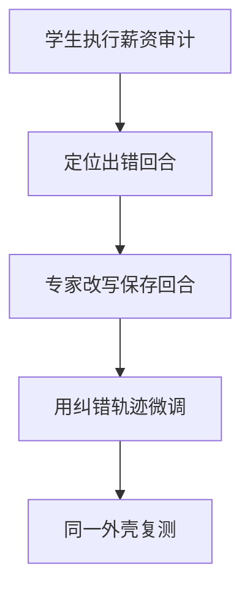

月底关账时，财务团队让一个智能体（agent）读取出勤记录，汇总各部门工时，保存报表，再发出任务结束信号。Yu 等人的薪资审计实验里，模仿专家后的 Qwen3-Coder 写出了正确的结果，却反复打开同一个视图 29 次，走到第 78 步仍未发出结束信号。这次执行得了 0 分。[arXiv v1 附录 D，案例 1](https://arxiv.org/html/2609.09134v1#A4.SS0.SSS0.Px1)

如果团队想用成本较低的模型承担这类固定业务，往往会先改进围绕模型运行的提示与工具，也就是运行外壳（agent harness）。论文关心的是外壳已经适配学生模型（student model）之后，该怎样继续教它。作者提出让学生先按自己的方式执行，再由更强的专家模型（expert model）在学生遇到的上下文里改写出错的那一回合（turn），也就是模型当时的回应和工具调用。这一步叫同策略专家纠错（on-policy expert correction）。[arXiv v1 §1](https://arxiv.org/html/2609.09134v1#S1)

## 先让外壳适配学生模型

外壳通过系统提示（system prompt）、工具、执行钩子（execution hook）和上下文管理（context management），决定模型能看到哪些信息、能采取哪些动作。比如，提示写明报表的计算口径，工具提供读取、保存和结束任务的操作，钩子可以拦下不合规的操作。具备这些接口后，仍由模型决定下一步调用什么、何时结束。运行时依据当前上下文选择下一步的方式，就是模型的策略（policy）。

把论文的薪资审计案例缩小到一个部门。假设运营部的甲有两条工时记录，分别是 6 和 10 小时，乙有一条 4 小时。报表要按人等权。先分别算出甲的平均值 8 和乙的平均值 4，再把这两个数平均，得到部门人均工时 6 小时。直接平均三条记录会得到约 6.67 小时，相当于让甲的权重变成乙的两倍。最后检查输出的列名，保存报表，再发出结束信号。人数、工时和列名是本文的简化设定，先按员工聚合再按部门汇总的顺序来自论文案例。[arXiv v1 附录 A 表 4](https://arxiv.org/html/2609.09134v1#A1.T4) · [附录 D 案例 1](https://arxiv.org/html/2609.09134v1#A4.SS0.SSS0.Px1)

论文从现成的基准外壳（baseline harness）出发，把搜索这类改动的过程称为外壳演化（harness evolution）。学生模型的参数保持固定，负责优化的 Gemini 根据学生的失败记录提出改动，比如把员工级聚合规则写进提示。候选改动在小批样本上试跑，有得分提升才会保留，最终用验证集得分选出优化后的外壳（evolved harness）。这套外壳经过了这位学生的实际执行检验。能否稳定完成任务，取决于外壳提供的流程和学生选择动作的方式能否配合。[arXiv v1 §3.1](https://arxiv.org/html/2609.09134v1#S3.SS1) · [附录 A](https://arxiv.org/html/2609.09134v1#A1)

## 完整示范也会教给学生一套计划

模型从收到任务到停止执行，算一次试跑（rollout）。它留下的消息、工具调用及工具返回构成执行轨迹（trajectory）。在整轨迹专家模仿（full-trajectory expert imitation）实验里，作者让 Gemini 在优化后的外壳里跑任务，把得满分的完整轨迹转成 Qwen 的对话和工具调用格式，再混入 Qwen 自己成功的轨迹。接下来做监督微调（supervised fine-tuning，SFT），让学生根据已有的上下文学习样本里下一条模型消息或工具动作。论文采用低秩适配（low-rank adaptation，LoRA），冻结原有权重，训练少量新增参数。[arXiv v1 §3.3](https://arxiv.org/html/2609.09134v1#S3.SS3) · [附录 B](https://arxiv.org/html/2609.09134v1#A2)

在简化例子里，一条完整示范既能教学生怎样算出 6 小时，也会示范如何拆分任务、检查结果和决定收尾时机。训练时，专家动作之前的上下文大多由专家自己的选择形成。实际运行时，模型要继续处理自己走出来的中间状态。在开头的失败案例里，未经微调的 Qwen 在同一个任务样例上三次都成功，用了 14 至 20 步。作者将模仿后反复核验的行为解释为规划策略漂移（planning-strategy drift），也就是微调改变了学生安排步骤的方式，削弱了它和既有外壳的配合（model–harness fit）。[arXiv v1 §3.3.3](https://arxiv.org/html/2609.09134v1#S3.SS3.SSS3) · [附录 D 案例 1](https://arxiv.org/html/2609.09134v1#A4.SS0.SSS0.Px1)

## 在学生走到的那一步纠错

沿用这份两人报表，设想另一种失误。学生已核对预览里的「部门」和「人均工时」两列，却在调用保存工具时把第二列写成了「总工时」。它照常结束了任务，评测的检查点（checkpoint）指出报表列名有误。下面用这个假设的单回合错误演示论文怎样构造训练数据。

图中前两步决定专家能看到什么。学生先在优化后的外壳里跑任务，留下自己的执行轨迹。接下来，机器学习工程智能体（machine learning engineering agent，MLE agent）负责协调失败定位、专家改写和训练。[arXiv v1 图 1](https://arxiv.org/html/2609.09134v1#S1.F1) · [§3.4](https://arxiv.org/html/2609.09134v1#S3.SS4)

1. **定位失败回合。** 从学生在优化外壳下真实产生的失败轨迹中，找出要改写的一回合。这里算出的 6 小时已经正确，出错的是保存时传给工具的列名。定位后，汇总和预览依然是学生自己执行的步骤。
2. **给专家当时的上下文。** 输入任务说明、截至出错回合的学生轨迹和失败的检查点。专家输出一句纠正策略和一条工具调用。这里的策略是保留已算出的 6 小时，把保存参数里的「总工时」改成「人均工时」。修正后的调用应当保存运营部这一行，部门人均工时为 6 小时。论文为每个出错回合采样三个候选，由质量评判器（quality judge）选出一个。
3. **替换回合并微调。** 将新回合放回学生轨迹，保留其余回合。在例子里，前面的汇总、预览和后面的结束动作都可以沿用。训练集还混入少量学生自己成功的轨迹，优先取同一任务有时能做对、有时会失手的样本。用这批数据做 LoRA 微调，再把更新的学生放回同一套外壳评测。[arXiv v1 附录 B](https://arxiv.org/html/2609.09134v1#A2)

「同策略」说的是训练样本中的上下文从哪里来。学生按当前策略走到了保存报表这一步，专家负责补上这个状态下该做的动作。训练在采样和改写完成后进行，学生下一次执行时依旧要自己决定何时保存、何时结束。

## 成功率看的是整项任务

作者在七项有客观检查标准的企业任务上评测，包括薪资审计、预算审批、库存告警、物联网异常检测、浏览器自动化、网站管理和代码重构。一次执行完成并通过任务检查记 1 分，失败记 0 分。任务成功率（task success rate）衡量的是通过的比例，算对一个中间数字仍有可能得零分。训练和验证数据用于优化，测试集留作评估。下表从原文表 1 取出薪资审计（Attn）和七项任务均值（Avg）两列，数字是三次运行的均值。[arXiv v1 §3.1](https://arxiv.org/html/2609.09134v1#S3.SS1) · [表 1](https://arxiv.org/html/2609.09134v1#S3.T1) · [附录 C](https://arxiv.org/html/2609.09134v1#A3)

| 配置（原表行号）            | 薪资审计 | 七项均值 |
| --------------------------- | -------: | -------: |
| 1 · Qwen 基准外壳        |    13.9% |    29.2% |
| 2 · Qwen 优化后外壳      |    81.7% |    78.0% |
| 3 · Gemini 基准外壳      |    97.4% |    84.4% |
| 4 · Gemini 优化后外壳    |    97.0% |    93.6% |
| 5 · Qwen 模仿 优化后外壳 |    51.9% |    63.1% |
| 6 · Qwen 模仿 基准外壳   |    27.8% |    35.5% |
| 7 · Qwen 纠错 优化后外壳 |    81.3% |    79.7% |

- **固定 Qwen，换外壳。** 第 1 至 2 行的均值增加 48.8 个百分点，表明主要收益来自外壳优化。第 2 和第 4 行共用为 Qwen 优化的外壳，Gemini 的七项均值还高出 15.6 个百分点，说明这个环境里仍有模型能力可以发挥。[arXiv v1 §3.2](https://arxiv.org/html/2609.09134v1#S3.SS2)
- **分别固定两套外壳，比较整轨迹模仿。** 在基准外壳下，第 1 至 6 行的均值增加 6.3 个百分点。在优化后的外壳下，第 2 至 5 行的七项成绩都下降，均值少了 14.9 个百分点。作者还在网站管理基准 WebArena 上更换学生模型，Gemma 4 在自己的优化外壳下由 55.6% 降到模仿后的 41.1%。这是第二个模型家族在一项任务上的检验。[arXiv v1 §3.3.1](https://arxiv.org/html/2609.09134v1#S3.SS3.SSS1) · [§3.3.2](https://arxiv.org/html/2609.09134v1#S3.SS3.SSS2)
- **固定优化后的外壳，比较局部纠错。** 第 2 至 7 行的均值增加 1.7 个百分点，五项上升，薪资审计和预算审批分别回落 0.4 和 0.6 个百分点。表 1 用均值标准误（standard error of the mean，SEM）估计均值的抽样波动，这两组的七项均值对应 0.97 和 0.67 个百分点的标准误。作者将两个小回落视为运行波动。这组结果支持局部纠错能保留外壳优化带来的主要收益，且有小幅平均提升。纠错后与同外壳下的专家仍差 13.9 个百分点。[arXiv v1 §3.4](https://arxiv.org/html/2609.09134v1#S3.SS4) · [表 1](https://arxiv.org/html/2609.09134v1#S3.T1)

### 失败记录能说明什么

表 2 的外壳改动采用率（adoption rate）指至少使用一次某项改动的执行占比。Qwen 整轨迹模仿前后，领域计算规则的采用率从 30.8% 升到 76.1%。回到报表案例，模型能用到计算规则，任务仍可能卡在后续步骤。[arXiv v1 §3.3.3](https://arxiv.org/html/2609.09134v1#S3.SS3.SSS3) · [表 2](https://arxiv.org/html/2609.09134v1#S3.T2)

表 3 按各组得 0 分的执行统计失败类型。共用优化后外壳时，未经微调、整轨迹模仿、局部纠错三组里，规划缺陷（planning defects）分别占失败的 1.1%、14.6% 和 1.8%。分母是各组的失败次数。隐性知识缺失（lack of implicit knowledge）的占比从 46.2% 到 44.5% 的变化也只描述构成，知识类错误是否在全部任务中变少还取决于总失败率。这些分类由大语言模型评判器（LLM-as-judge）根据失败的检查点和工具错误判定。规划类失败的占比变化给作者的解释提供了线索，附录 D 则展示了这类失败怎样发生。[arXiv v1 表 3](https://arxiv.org/html/2609.09134v1#S3.T3) · [附录 C](https://arxiv.org/html/2609.09134v1#A3) · [附录 D](https://arxiv.org/html/2609.09134v1#A4)

## 什么条件下值得尝试

**作者的结论。** 在这组企业任务中，先适配外壳，再用学生实际遇到的状态做局部纠错，可以把轻量微调叠加到外壳优化上。原文图 1 还提出了共演化（co-evolution）的下一步，把更新的学生模型带入新一轮外壳搜索。v1 的对照验证覆盖了一轮外壳优化和模型更新。多轮是否会持续改善，需要逐轮比较。[arXiv v1 图 1](https://arxiv.org/html/2609.09134v1#S1.F1) · [§4](https://arxiv.org/html/2609.09134v1#S4)

**本文的工程推演。** 薪资审计这类反复执行、有固定输出、有可定位检查点的流程，比较容易构造这种训练样本。它依赖学生走到有意义的中间状态，也依赖专家能在同一工具接口下给出可执行的修正。假如改了保存列名，后续工具仍然按旧列名读取，保留下来的回合就可能和新状态接不上。出错跨越多个回合时，单回合改写是否足够也要检查。表 1 比较的是整套训练配方，两组数据在轨迹来源、成功或失败样本和改写范围上都有差异。要量化单独哪个因素带来多少收益，还需额外的消融实验（ablation）。

**本文实际核对的结果。** 本文用脚本复算了按员工和按记录两种平均值，逐项核对了表 1 的摘录和文中列出的百分点差。模型训练及任务成功率均取自作者报告的 arXiv v1 实验。[arXiv v1 表 1](https://arxiv.org/html/2609.09134v1#S3.T1)
