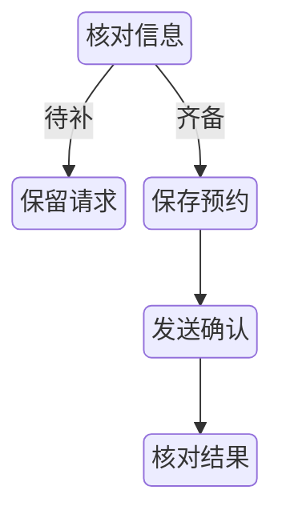

同一笔预约，客户邮件和预约系统显示了两个时间。Grok Bot 应该信哪一个？Lauren Tan 在《Automate Anything with Grok Bot》里用这个例子问读者。平时负责预约的人可能看一眼就知道该怎么办，因为他们熟悉客户的说法，也知道系统里的记录代表什么。这些判断很容易从交接里漏掉。

Tan 把自动化看成一种可以学习的思考方式。她从目标和过程讲起，再讨论怎样把做决定的依据、判断结果的反馈和启动任务的时机交给 Bot。预约能不能交出去，要看这几部分能否接起来。

## 先把目标说成一个结果

原文从烤苹果派讲起。做成一只苹果派是目标，准备材料、组装、烘烤和冷却是过程。Tan 把同样的区分带到工作里。填表和发邮件常常只是大家已经习惯的步骤，弄清它们服务的目标，Bot 才有机会简化流程。

「回复每一封预约邮件」能指导 Bot 去做一个动作。「帮客户约到可用的时段，让客户收到确认」把可用时段和客户确认都写进了完成标准。如果第一封回信是在询问客户偏好的时间，任务就进入等待回复。收到答复以后，Bot 还得核对时段是否可用。

Tan 建议用原目标来检查流程能不能简化。比如，Bot 可以在第一封回信里列出几个可选时段，省去先问客户哪天方便的一轮往来。客户回复时，店里还得能核对空档并留出时间。回复次数衡量流程省了多少往来，预约记录和确认结果才能说明工作是否办妥。

## 让 Bot 复述你平时怎么做

目标还含糊时，Tan 建议先让 Bot 提问。明确想得到什么以后，可以用口述把工作经验带进对话。除了先开哪个工具、再查什么资料，还要说自己会留意哪些细节，以及怎样确认事情办对了。等 Bot 用自己的话复述出目标和过程，人再纠正遗漏，确认后才接入执行所需的工具。

复述时最值得听的是那些自己觉得理所当然的词。「找个空档」到了 Bot 那里，会变成查哪一份日历、找哪个人、给这项服务留多久。Tan 举了服务时长、人员分工和预约间隔的例子。假如 Bot 复述成「找到最早的空白时段」，就可以追问它准备怎样确认那段时间足够长。把条件补进说明后，再给它一个没见过的例子，例如一项需要 60 分钟的服务，看看它能否跳过一个只有 45 分钟的空档。

## 用例外教它怎么判断

Tan 用两个时间冲突的例子问读者该相信哪个来源。预约系统可能记着双方已确认的时间，邮件可能记录着客户刚提出的改期请求。两条记录可以同时成立。Bot 得先判断客户是在询问时段，还是已经选定了店里提供的时段。

比如，邮件里写着「周四也可以」。如果店方刚列出的选项里有周四，这句话可能是在选择时段，Bot 可以重新核对空档。如果店方还没提出周四，Bot 可以把它记为客户偏好，保留现有预约。理解一句话要读对话上下文，判断时段是否可订要查排班和预约记录。客户选定的时段明确、系统也确认仍有空档时，才能更新预约。

原文也把预约完成和等待补充写得很具体。预约需要正确保存，客户还要收到确认。缺信息时，Bot 得记住这笔尚未办完的预约，后续才能接着办。落实到工具操作上，保存预约后可以留下预约编号，确认消息的结果可以单独记录。若保存成功、发送确认超时，下一轮就能找回原预约，先查确认是否已发出。一次异常要从哪里恢复，取决于前一步留下了什么证据。

## 让反馈能找到具体的一次工作

Tan 说的「让 Bot 自我改进」，具体是让它拿到反馈、回查记录，再提出改进建议。她用修车店举例。顾客在 Yelp 抱怨等了很久，店里如果记下到店、接待、交钥匙和开工等时间，Bot 就能回看等待发生在哪一段。

假设顾客 9:00 到店，9:05 见到接待人员，9:15 交钥匙，9:40 才开工。交钥匙到开工这段，顾客等了 25 分钟。如果预约时约定的是 9:30 开工，实际晚开工了 10 分钟。前一个数字描述顾客的等待体验，后一个数字反映店里遵守预约的情况。至于延迟是不是因为工位被占、配件没到，还需要查相应的记录。

Tan 提到用稳定的 ID 把不同来源的记录连起来。顾客 ID 可以串起同一个人的多次来访，工单号能把开工时间和实际用到的工位连到同一次维修。能把评价对应到具体工单时，Bot 才有理由用这条时间线解释它。只有顾客身份时，可以先列出几次可能的来访，等时间或服务项目对得上再定位工单。

如果几次同类维修都开工晚，且排班记录显示对应工位当时被占，店里就有依据试行「确认预约前先核对工位」。试行前后可以比较同类工单晚开工多久，也记录从顾客首次询问到最早可预约的时段相隔多久。增加工位检查可能让服务更准时，也可能让可预约的时段变少。两项数据都关系到顾客一共得等多久。

## 最后决定什么时候自动开始

原文把 Grok Bot 的自动触发称为 Routines。触发可以来自一封邮件、一条 Slack 或 Teams 消息，也可以按时间运行。手动交办时，人通常已经判断这件事值得处理。交给触发器后，这个判断也得写清楚。

例如，预约邮件到了，可以启动一次核对。遇到邮件重新投递或客户补充信息，Bot 应该先把消息和原请求对上，再决定是否推进。需要等待客户回复的预约，也可以由定时任务集中核对。前面讲过的判断和记录，决定了触发器叫醒 Bot 以后，它能把事情推进到哪一步。

可以先让邮件触发核对和拟回复，实际写入由人确认。试跑时，重放一封已经处理过的邮件，看看 Bot 会不会再次提出新建预约。再模拟一次预约已保存、确认消息发送超时的情况，看看它能否从原记录接着查。正常和异常的结果都能核验后，再挑信息齐备的请求试行自动写入。

原文用「自动化任何事」概括产品愿景。以预约为例，每一步能交给 Bot 到什么程度，要看接入的系统让它读到什么、能核对什么。如果预约工具只允许提交请求，一次写入超时后，就得靠其他记录查出这笔预约是否已生效。拿不到这条证据时，可以先让 Bot 整理客户要求，把最终写入交给能查到预约状态的人。

## 读完以后，试着交接一件熟悉的工作

Tan 在文末推荐用 Dr Eggbot 帮忙设计 Bot。练习这套思路时，可以挑一件自己做过多次的事。先记下自己会查哪些资料、做出什么决定，再让 Bot 用当时可取得的信息走一遍。

- 一次顺利完成的任务。让它指出工作完成后，哪个系统里应该出现什么结果。
- 一次信息冲突或缺失的任务。让它说明会查哪条记录、会问谁，以及这期间怎样保留待办。
- 一次做完一半遇到故障的任务。让它根据已保存的记录，判断下一轮从哪一步接着做。

把 Bot 的处理与自己的记录对照。比如，它把改期请求当成了新预约，就把「先找到原预约」这条判断补进说明，再换一条改期邮件试一次。下一份结果可以用来检查，它能不能在一条新消息上用对刚交代的规则。
