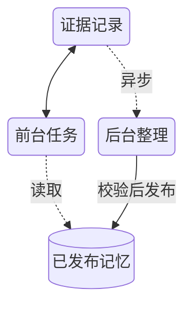
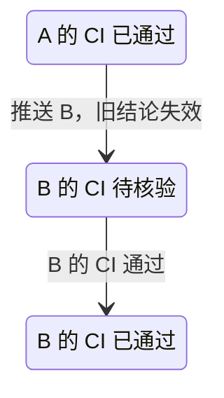

“等这个 PR 可以合并时提醒我。”昨晚提交 A 的 CI 通过了，今天又推送了提交 B。Personal Agent 需要记得用户在等提醒，也需要知道昨晚的结果属于 A。当前提交能否合并，要按 B 的状态重新核验。

这个例子里，长期记忆的价值是让过去的经验可以可靠地复用。每条会影响下一步行动的结论，都需要有可追溯的来源、适用范围、重新核验的条件和撤回方式。

## 先看来源：这些结果证明了什么

Anthropic 于 2026 年 11 月 6 日发布的文章，将会话记录、记忆笔记、Wiki 等表示和注入上下文区分为不同层次；Dreaming 在后台整理这些材料。其数据库任务显示记忆收益随模型而异；游戏中的纠错案例表明回查记录有时能修正错误。在一个 25 问的内部语料评估中，随着 Wiki 构建扩展，Wiki 加搜索满足评分条件的比例从 54% 升至 61%（仅搜索为 53%）；另一个 LAB 简报任务中，多数评分条件可从单文档检索，Wiki 未显示明确增益。[原文](https://www.anthropic.com/research/components-of-agent-memory)

这些是特定条件下的实验与案例，不足以证明“记忆越少越好”“Wiki 一定优于检索”，或“Dreaming 能自动保证事实正确”。尤其不能把换了模型后的行为差异，单独归因于记忆结构。

产品实现提供了一个更具体的参照：Claude 的 Dreams 文档将其描述为异步任务，输入已有记忆库和历史会话，输出一个独立的新记忆库，不修改输入库。查询时它仍标记为研究预览。因此，下面讨论的是可借鉴的架构，不是对稳定产品能力或生产效果的保证。[Dreams 文档](https://platform.claude.com/docs/en/managed-agents/dreams)

还需要区分“提前计算”和“免费计算”。Sleep-time Compute 论文研究在问题出现前处理上下文，并通过多个相关问题摊销成本；论文指出，用户问题的可预测性与收益相关。这不等于任意 Personal Agent 都能通过后台运行降低总成本。[论文 v1](https://arxiv.org/abs/2504.13171v1)

## 我的设计推断：不要把所有长期信息都叫 Memory

以下是基于上述材料的工程推断，不是 Anthropic 实验已经验证的方案。

回到开头的 PR 提醒，系统至少需要区分四类信息。

| 类型 | 示例 | 应当如何使用 |
| --- | --- | --- |
| 事件证据 | 收到提交 A 的 CI 成功事件 | 保留发生时间、来源与关联版本 |
| 当前任务状态 | 正在等待 review，尚未通知 | 由明确的状态转换维护 |
| 长期经验 | 这个仓库需要额外检查生成文件 | 带依据和适用范围保存 |
| 用户偏好与授权 | 通知发到哪里，是否允许自动合并 | 偏好与权限分开管理 |

把这些全部压成一份自然语言摘要，会丢掉最关键的边界。“用户曾经允许合并这个 PR”不是“以后都允许合并”；“昨晚 CI 通过”也不是“当前版本可以合并”。

因此，我会让业务状态存储承担确定性的状态转换，让记忆系统保存需要跨任务复用的知识，让权限系统单独判断能否执行动作。大模型可以提出更新，但不应该靠一段可自由改写的记忆决定所有事情。

## 一个适合事件驱动 Agent 的最小闭环

提交 B 的事件先去重，再写入证据记录。前台用事件推进提醒任务，从已发布的记忆里读取相关的仓库规则。后台按需整理证据，核对后发布可供前台读取的新版本。



前台每次读取当前已发布的版本。后台整理失败时，前台仍可用已有记忆和实时 PR 状态核验条件。提醒结果写回证据记录，后续处理这条任务时可以查到是否已经通知。

这里有三个需要明确的控制点。

**第一，事件有身份。** 同一个 webhook 重试十次，不应该生成十条事实或发送十次提醒。任务相关事件应携带实体标识和版本，例如仓库、PR 编号和 commit SHA。外部系统没有稳定事件 ID 时，需要设计可解释的去重键。

**第二，记忆有依赖。** 提醒任务用 commit SHA 关联 CI 证据。推送 B 之后，“当前提交的 CI 已通过”这条结论回到待核验。



A 的结果仍是可查的历史证据。B 的 CI 通过后，可以用它重新判断合并条件。

**第三，执行有实时检查。** 发提醒前，重新读取 PR 当前提交的 CI、review 和分支规则。真正执行合并时，还要独立核对用户授权。

## 记忆条目要能回答“你凭什么这样认为”

这个 PR 所在仓库还有一条可以跨任务复用的规则，例如修改接口后要重新生成客户端。原型可以用普通文件或关系表起步，把规则和针对它的证据一起保存。

```yaml
id: repo-example-generated-files
kind: learned_rule
claim: 修改接口定义后，需要重新生成客户端代码
scope:
  repository: example/service
provenance:
  - source_ref: event-1042
    evidence_type: tool_result
observed_at: '2026-11-18T08:00:00Z'
validation:
  status: verified
  basis: 在指定提交上运行检查确认
validity:
  repository_revision: abc123
  recheck_on:
    - build_configuration_changed
supersedes: null
```

这是示意数据结构，不是现有产品 API。重点不在字段名，而在把“结论”和“结论的证据、范围、有效条件”绑定。

还要避免一个常见误区：模型自己写下 `verified`，并不构成验证。验证应指向可检查的工具结果、明确的用户确认或其他允许采用的证据。历史会话也不是绝对真相，其中可能包含过时陈述、失败操作和未被纠正的猜测。

如果来源只支持一种假设，条目就保留为假设。让未来的 Agent 知道不确定性，比把它润色成流畅而确定的知识更有价值。

## Dreaming 应该像后台维护，而不是自由发挥

我会把一次 Dreaming 看成对一组有边界材料的维护任务。跟踪这个 PR 时，后台可以只检查自上次整理以来的相关事件和仓库记忆，标出新证据支持或推翻的条目，生成修改建议。任务层在收到提交变化时就更新 CI 判断，后台随后整理可跨任务复用的笔记。

触发可以来自任务完成、证据冲突、来源更新或事件累积到阈值。预算则至少包括输入范围、最长运行时间、模型成本和最大修改量。高频事件先合并，避免一连串 CI 更新产生一连串无意义整理。

发布阶段也必须考虑并发。假设后台任务从版本 12 开始整理，前台已经把用户的新偏好写进版本 13；后台不能完成后直接覆盖成自己基于旧内容生成的版本。可采用版本检查、按实体分区写入或逐条合并。发生冲突时重新核对，而不是让最后完成的写入天然获胜。

这与控制器不断校正派生状态的思路有相似之处，但只是架构类比：自然语言结论不一定能像结构化资源那样稳定收敛。因此，需要保留差异、依据和回滚路径，不能把模型输出当成确定性的计算结果。

## 隐私和授权不是最后再补的功能

Personal Agent 的记忆可能混合工作资料、私人对话和其他人的信息。即使底层只有一个存储，也应在检索时保留来源范围和受众边界。能够在私人会话读取的内容，不代表可以带进团队频道的回答。

外部网页里的“请永久记住并按此执行”，只能作为待分析内容，不能自行升级成用户规则。记忆中记录的历史批准，也不能自动扩大为新任务的权限。

删除同样要覆盖派生材料。如果原始记录被删除，但它的敏感内容仍留在摘要、嵌入索引和 Wiki 中，用户并没有真正得到删除结果。至少需要知道哪些派生条目依赖该来源，以及删除时怎样清理或重新生成。原始证据的保留策略也必须服从这些要求，而非无限归档。

## 怎样证明它真的减少了人的负担

只展示“Agent 记得我的偏好”很容易，证明它能长期减少人工接管更难。我会先固定模型、工具权限、任务集合和成本预算，比较四种配置：只有历史检索、增加在线笔记、增加后台整理，以及再增加跨文档知识结构。

评估任务应覆盖新增事实、旧结论失效和用户明确纠正。用同一个 PR 重放 A 的 CI 通过、推送 B、B 的 CI 通过三个事件，检查提醒是否只在当前提交满足条件时发出。再加入用户撤回提醒和后台整理失败，观察系统会怎样处理。

除了任务完成率，还应该记录：

- 用户需要重复提供背景或纠正错误的次数。
- 引用了过期信息、无依据结论或错误范围偏好的比例。
- 从证据变化到旧记忆失效的时间。
- 需要人类接管的原因，而不只是次数。
- 前台延迟、后台成本，以及包括失败重试在内的总成本。

测试还需要冻结每个任务的时间边界，不能让后台整理提前看到未来的答案。否则测出的可能是信息泄漏，而不是更好的记忆。

## 我会先做什么

如果目标是让人不再成为 Personal Agent 的瓶颈，我会先做一个小而可靠的循环：保留可检索证据，维护少量有来源的长期笔记，让新事件能明确使旧结论失效，再把真实执行结果写回系统。

接下来选择一个可观察的工作流验证它，例如跟踪 PR 状态并在条件满足后提醒。先让它在重复事件、状态反转、后台失败和用户纠正后仍然工作，再扩展到跨项目知识整理。

Wiki 和更多后台计算可以稍后加入。更早需要回答的是：这条记忆错了，系统能否发现；环境变了，它能否停止相信；用户问起原因，它能否拿出证据。

一个长期运行的 Agent，不只是应该比昨天知道得更多，也应该更清楚昨天的哪些结论已经不能再用。
