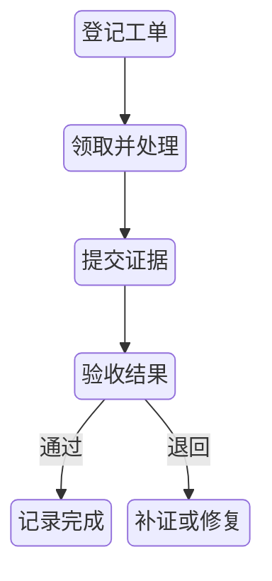

一个小产品要处理客服工单、维护代码，每周五还得交一份报告。m4lka 用这个例子贯穿全文。把这些事都交给一个 Bot，头几次可能很顺利。等到客服规则和代码排错堆进同一段聊天，人又要回来判断请求该交给谁、结果能不能用、上次做到哪一步。加了几个 Bot 后，这些问题会出现在好几个窗口里。

m4lka 同时提出了一个用量问题。他导出自己的记录，按他的分类，约 75% 的 token 花在重读旧对话上。小产品的工单能把两个问题连起来。谁来接手、任务现在是什么状态、交回的结果怎样才算完成，如果这些答案都埋在聊天里，每次启动和交接都要重新找一遍。

## 一次空跑怎样积成一笔开销

每 15 分钟检查一次，一天是 96 次。即使 Bot 最后只说「没有新工单」，这一轮也可能把和客服无关的排错、周报讨论一起读进去。频率越高，启动越多。对话越长，每次读入的上下文也越多。

可以先统计**重复输入 token 总量 = 模型调用次数 × 每次调用平均重复读取的 token**。如果一次唤醒会触发多轮模型调用，就逐轮记下来。新输入、输出、工具调用和重试也会产生各自的用量。折算到账单时，还要看平台怎样给缓存读取和普通输入计费。

原文还引了几位用户的用量记录，其中一位把约 87.7% 的 token 归为重读。另一些人统计的是缓存读取或后台任务。作者在发帖介绍长文时提到「约 1% 用于实际工作」，这个数字也依赖他如何分类。查资料、核对记录和阅读测试结果都可能是完成任务所需的工作。这些分享提供了排查线索，比较节省量要回到同一口径下的运行记录。 [作者原帖](https://x.com/m4lkxx/status/2115775972536434946)

## 六个 Bot 怎样管理 200 多个 Agent

Lingxi Li 在 xAI 的工程记录里描述了自己的团队。五个工程 Bot 各自负责一个领域，运营 Bot Jenny 负责协调、入职和复盘。工程 Bot 会拉起云端编码 Agent、跟踪执行、回查测试或截图。Li 报告，自己原先手动管理约 15 个云端 Agent，这套团队后来能同时管理 200 多个。这个数字是他报告的并行管理规模，评估投入产出还得看完成、返工和用量。

m4lka 借这个案例说明长期职责和一次次派出的执行可以有各自的生命周期。一个工程 Bot 可以交办多次执行，后续重试仍回到同一个责任人。小产品用的六席方案是作者将这个思路落到客服、工程和周报上的设计。实际需要几个角色，要从工作和数据的边界推出来。

## 从一个 Bot 开始，先定义任务和验收

### Level 0 先找出什么在混用

同一个 Bot 同时接客服、代码和周报时，一次退款规则的纠正很容易混进代码对话。先列出它正在做的事，看哪些任务可以共用资料和判断标准。如果只是增加一套导出周报的步骤，可以把步骤整理成按需加载的技能。客服和工程各自积累了一套持续使用的规则、资料和权限时，就有理由让两个角色各自负责。

### Level 1 把描述写成能交接的工作约定

m4lka 把角色描述当成每次工作前都会读到的约定。写清这个 Bot 拥有哪项结果、输入从哪里来、交付物放在哪儿，以及怎样才算完成。长期规则要写成后来接手的人也能使用的表述。以工程角色为例，可以写成「从工单编号和重现条件开始处理，把修复 PR 和对应提交上的验证结果挂回工单」。如果后来更换执行 Bot，这份约定依旧能用来交办。

### Level 2 用证据判断工作是否完成

原文建议优先找机器可以检查的信号。代码任务可以固定测试数据、跑目标流程并保存测试结果或截图。客服草稿可以核对工单编号、报价是否来自当前价目表、关键陈述有没有出处。对于登录跳转工单，构建成功只是其中一项证据，还要实际走一遍登录后的跳转，看它是否落在约定页面。

m4lka 把可委托的动作分成调查、起草、验证后执行和仅用于可丢弃项目的全自动四档。按作者的描述，团队在试验项目中让 Bot 自行合并，碰到有真实用户的数据库后，一次有问题的查询让注册暂时中断。生产环境里的动作要按影响范围重新确定许可。需要验证的行为和允许执行的动作，都应在任务开始前写清楚。

## 让多个角色从同一张看板交接

### Level 3 给人一个入口，给工作一个负责人

m4lka 的六个席位分别承担以下工作。

- **入口 CHIEF** 接收人的请求，明确目标、指派负责人，并汇报已完成、受阻或待确认的事项。
- **运营 OPS** 维护看板和手册，发现卡住的任务，把问题交还给对应的人。
- **验收 CHECKER** 根据原始任务和交付证据判断能否进入完成。退回时指出哪项要求未满足，由责任人补证或修复。
- **两个专门角色** 分别负责客服和工程。各自读取相关业务资料，写回本领域的产物和验证结果。
- **杂项 MISC** 接住没有明确归属的小事。同类需求反复出现时，入口可以据此决定沉淀成技能，还是交给专门角色。

原文也给了用 Dr Eggbot 预配团队的办法。它先问哪两类工作最耗时间，据此生成角色方案供人确认。拿到角色说明之后，可以用真实输入试跑，检验工具权限和验收条件能否支撑这个角色独立工作。

验收角色有自己的上下文，能从原始工单重新看证据，比较容易发现执行者默认了什么。它也要能定位到需要验收的那一版结果。PR 更新后，可以把旧截图和测试结果留作历史证据，再在当前提交上重跑受影响的检查。

### Level 4 在看板上保存任务状态和证据

原文给看板用五种状态。待办表示尚未开始，处理中有当前负责人，受阻需要记录原因，待审要附上交付证据，完成由验收结果推进。交接时说明当前目标、已有产物、做过的决定和仍待解决的问题，再给接手者一个可回查的入口。

拿原文看板上的登录跳转工单 `#482` 推演。客服在看板里留下工单编号、用户看到的页面和复现条件，工程把修复 PR、测试结果和截图挂在同一张卡上。验收读取原始要求和当前提交对应的证据。如果客服后来补充了另一种登录方式，工单应该更新，接手的人可以在同一条记录上继续补测。

聊天可以提醒大家去看卡片。接手时直接读状态和证据，再按需打开由工单指向的讨论。这样，协调者知道哪件事尚未办妥，执行者也能少读一段与自己无关的历史。单次任务怎样约定完成条件，上一篇用预约作了推演。 [读 Lauren Tan 的 Grok Bot 自动化指南](/posts/agent-automation-workflow/)

## 持续运行需要触发、权限和记忆

### Level 5 先跑通，再给工作加时钟

m4lka 建议先人工跑出可核对的结果，随后把做法保存为技能，最后才接上定时或事件触发。每条定时任务要交代输入、输出、失败后怎样继续，以及原有结果仍然有效时怎样结束。作者举了巡查失败检查、夜间准备修复、运营与各 Bot 复核手册、早上汇总逾期任务等例子。这些工作的响应时间不同，可以各自决定多久检查一次。

从手动切到后台运行前，先确定哪些动作要等人确认。原文的首周计划把这个安排放在第一天。原文也提到，当时的后台批准请求可能在约十分钟后过期。夜间任务可以先把已有证据和待决定的动作写进看板。第二天批准时，再按最新状态检查是否适合执行。

### Level 6 按撤回代价设审批

原文用撤回代价判断哪里需要人介入。检索、分类、拟答复可以先做到完整。发送外部消息、发布、付款、删除数据、修改权限和变更生产环境，适合在执行前核对批准。原文的设置让要求确认的规则优先。客服可以先让 Bot 在内部准备答复，接着积累人工审核结果，再让已授权的窄范围请求进入自动处理。

角色说明需要与实际权限配合。原文提醒，多个 Bot 共用云端电脑时，可能访问同一份文件和登录会话。需要限定访问范围时，应把限制落在实际凭据、工具权限或运行环境上。工单可以记录待批动作和审批记录的链接。执行前，系统要核对批准者的权限，以及批准涵盖的对象、动作和版本。

### Level 7 让经验能在正确的时机被用到

m4lka 给不同信息指定了存放位置。

- **角色说明**保存长期职责和必须遵守的约束。
- **技能**保存可以重复使用的做法。
- **长期记忆**保存稳定的决定和定义，并留下来源。
- **业务系统**提供会变化的事实，例如客户套餐、价格、当前负责人。
- **看板**保存这一轮做到哪一步、还有哪项证据没拿到。

原文举了旧客户套餐导致误判的例子。历史记录可以说明当时为什么批准，下一次能否批准要读当前套餐和规则。重复出错时，作者建议依次查看工具和权限是否合适、能否增加可运行的检查、是否需要改技能或规则，最后才把稳定经验写进记忆。这个顺序让修复先落在问题实际发生的地方。 [Agent Memory 的关键是让经验可以被纠正](/posts/agent-memory-correctable-experience/)

运营的周五复盘也有了具体内容。看每条定时任务启动了几次、验收了几件、哪些失败反复出现、用了多少资源。下周要调整哪一条，可以从这些记录里找。

## 九种用量漏点，逐条看怎么发生

1. **定时任务和日常聊天共用上下文。** 入口 Bot 白天聊了支持、会议和代码，定时任务每跑一轮都可能带上整段背景。只需要读队列的任务，可以使用不随日常聊天累积的上下文。
2. **一段对话无限累积。** 原文当时通过复制 Bot 保留设置、技能和定时任务，同时开启新的对话。重开前，把未完成事项、决定和证据链接放回任务记录。原文引用了一位用户单轮用量从 158.8K 到 35.7K 的观测，这个幅度受当时的会话长度与平台实现影响。
3. **检查频率过高。** 按 30 天算，每 5 分钟检查一次要启动 8,640 次，每小时则是 720 次。原文引用的约 397 美元和 33 美元，来自用户按当时 API 价格做的估算。真正需要更快发现变化的任务，可以把检查频率和完整执行的次数分别调整。
4. **一醒来就跑完整流程。** 原文引用过 96 次检查只有两次进入完整执行的个人记录。检查放在模型启动前，未变化时就能跳过整个调用。工单总数相同也可能有人补评论，需要选择可信的事件版本。原文示例发现变化就先记新值，处理失败后可能因此漏重试。用队列时，可以在变更可靠入队后再推进检查位置。
5. **一条群消息叫醒所有 Bot。** 原文按 20 条消息、6 个 Bot 各处理一轮，估了 120 次唤醒。可以让入口找到责任人，再把工单指给需要参与的角色。入口本身若调用模型，也要计入路由开销。反复交接毫无进展时，把受阻原因写回看板。
6. **监听范围太宽，任务指代太模糊。** 监听所有新消息会把普通闲聊也送进工作流。把触发限制到真正有关的事件，请求里给出工单编号。连接器能直接返回所需字段时，可以就地读取，少做一轮页面浏览和猜测。
7. **把结果固定的步骤交给模型反复判断。** 比如统计重复工单或按已知规则归类，可以交给程序，模型处理需要额外判断的个案。比较这项改动时，要核对分类准确率，以及需要人工复核的工单有没有送到负责人手里。
8. **本可按需加载的技能变成了独立 Bot。** 有独立的职责、数据、权限或运行时间时，独立角色有其价值。同一类任务里的方法可以放在技能里。原文还提醒，归档一个角色后应确认它的旧定时任务是否仍在运行。
9. **手动运行、定时运行和测试互相重叠。** 测试运行也可能调用模型并执行真实步骤。同一条工单变更遇到重复投递时，应能找到正在处理或已经完成的记录。可以在隔离的测试队列里重放同一批事件，核对重复投递是否接回原任务，以及每项预期动作是否只执行一次。

## 用一次审计和一周试跑验证

原文用一个假想团队估算每日启动次数。四条每 15 分钟运行一次的轮询，合计降到每天八次。夜间巡查、站会和晨报仍各运行一次。

| 启动来源     | 改动前 | 改动后 |
| ------------ | -----: | -----: |
| 四条轮询     |    384 |      8 |
| 群聊消息     |    120 |     20 |
| 客服监听器   |     60 |      5 |
| 每日例行任务 |      3 |      3 |
| 合计         |    567 |     36 |

四条轮询减少的 376 次约占总降幅的 71%。工单能不能在相同的响应目标内处理完，要对照队列等待时间和验收通过的数量。

原文的短审计可以先从自己的用量记录开始。导出后用汇总数据核对重复输入和任务产出。检查哪条定时任务值得原样保留，哪条可以降频、改事件触发、加前置检查或停用。核对平台的预算和续费设置能约束什么，再一次只改一项，用同一口径比较改动前后的用量和结果。

首周计划从一个 Bot 和一件事开始。前两天把职责和审批写清，手动完成一次调查或草稿。接下来补验收，再把已经验证过的流程保存为技能。接上第一条低频定时任务以后，用看板和新增角色解决实际出现的交接问题。最后回查用量，把少有交付的任务找出来。原文的阶段表还可以反过来用。人每天还在手工分派，先查有没有清楚的入口。接手者总要问进度，就检查任务状态是否能从看板读到。同样的纠正反复出现，就回查工具、验收和规则。

用 `#482` 做练习，可以重放一次正常更新、一次重复投递和一次执行中途失败。观察任务能否找到原负责人和当前证据，失败时能否从正确位置续跑。记录从进入队列到验收的时间、模型调用和重复输入，再与原流程比较。每件通过验收的工作用量降了，响应时间也仍符合约定，这套调整才有依据保留。
