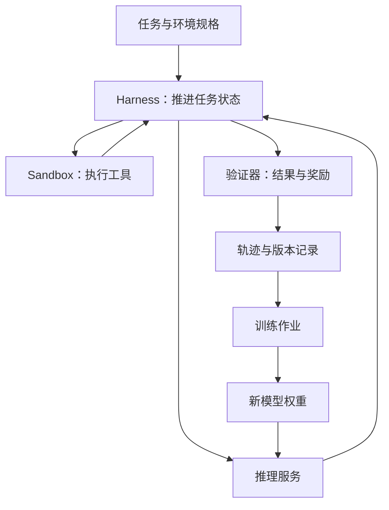

把模型部署到 Kubernetes 上，和做出一个可靠的 Agent 平台，是两件事。

前者主要解决模型服务的部署、资源分配与请求路由；后者还要回答“任务做到哪一步、环境能否恢复、结果是否可信、失败之后应该重试什么”。如果平台进一步服务强化学习，就还要知道：这条轨迹来自哪个模型、哪个环境版本，以及奖励究竟评价了什么。

Google 在 2026 年 11 月 10 日发布的文章，把 OpenRL、llm-d、KubeRay 和 Agent Substrate 放进同一张基础设施蓝图：分别面向后训练、分布式推理、Ray 工作负载管理与 Agent 执行。这篇文章值得读的地方，是它让这些边界同时出现在视野里，而不是要求每个平台照搬全部组件。[Google 原文](https://cloud.google.com/blog/topics/developers-practitioners/the-open-ai-native-stack-on-kubernetes-from-open-models-to-distributed-inference-and-agents)

下面先还原一次任务，再讨论已有 Sandbox、Harness 和 RL 基础设施应该如何演进。组件能力来自官方资料；架构取舍和实验方案是本文的工程判断，不是实测结论。

## 先从一次 Coding Agent 任务出发

假设任务是“修复一个仓库中的测试失败”。模型本身不会直接完成任务。Harness 负责组织循环：准备上下文，调用模型，把工具请求交给执行环境，再把观察结果送回模型。最后由验证器检查修改是否满足要求。

如果要用这批任务训练模型，循环外还需要轨迹采集、奖励计算、训练和权重更新。

这里最容易混淆的三个对象，其实应该分开管理：

- **任务状态**：目标、步骤、预算、等待原因和完成条件。
- **执行状态**：文件、进程、依赖、网络连接与工具输出。
- **模型状态**：权重版本，以及推理过程中可复用的缓存。

它们的生命周期不同。任务可能等待用户一天，执行环境可能已经休眠，推理副本则可能经历过多次扩缩容。不能因为它们属于同一个 Agent，就强行让它们跟随同一个 Pod 存亡。

## 推理层：llm-d 优化的是模型请求，不是整个任务

llm-d 在推理引擎之上提供集群级能力。其架构中，Endpoint Picker 根据实时指标、KV Cache 亲和性和策略选择模型服务端；vLLM、SGLang 等引擎负责真正执行模型前向计算。两者不是替代关系。[llm-d 架构](https://llm-d.ai/docs/architecture)

这与传统无状态 HTTP 服务有一个重要差别：两个副本虽然装着相同模型，却不一定具有相同的请求处理成本。

假设下一轮对话沿用了很长的历史前缀。副本 A 保存了可复用的缓存，副本 B 没有。仅按请求数量均衡，可能把请求送到 B，重新计算本来可以复用的部分。但如果 A 已经严重排队，坚持选择 A 也不一定更快。

因此，需要同时考虑缓存和负载。llm-d 的精确前缀缓存路由方案，会利用模型服务端发布的缓存事件建立驻留索引，并结合 token 负载选择端点；这不是仅凭“同一个会话”进行粘性路由。[精确前缀缓存路由](https://llm-d.ai/docs/well-lit-paths/foundations/precise-prefix-cache-routing)

对 Agent 平台，我会由此提出两个设计要求：

第一，尽量保持可复用上下文的构造稳定，不要无意中在长前缀开头插入每次变化的时间戳。第二，明确缓存隔离和版本边界，不能为了命中率混淆不同用户、不同模型配置或不同权限下的请求。

但 KV Cache 不是 Agent 长期记忆。缓存消失后，请求仍应能根据任务记录重新构造；否则平台就把正确性寄托在一项性能优化上了。

### 为什么不立即拆开 Prefill 和 Decode？

llm-d 支持把 Prefill 和 Decode 放到不同工作节点，并在它们之间传输 KV 数据。[llm-d 架构](https://llm-d.ai/docs/architecture)

工程上，我会先问：当前瓶颈是否真的来自这两个阶段相互干扰？如果大部分任务时间花在拉取仓库、安装依赖或运行测试，先引入更复杂的推理拓扑，可能只是在优化总时延中的小部分。

拆分意味着增加网络传输、容量配比和故障处理问题。应先有单一部署方式的基线，再用真实提示长度、输出长度和并发分布判断是否值得。

## 执行层：隔离、休眠和任务恢复是三种能力

gVisor 提供用户态的应用内核，用 Linux-like 接口隔离应用与宿主系统，并通过 `runsc` 接入容器工具链。准确地说，它不是简单的 syscall 过滤器，也不是把一个普通容器改名为虚拟机。[gVisor 官方说明](https://gvisor.dev/docs/)

Agent Substrate 则把更高一层的执行生命周期放到前台：其官方介绍包含独立沙箱、休眠与恢复，以及内存和文件系统状态的快照持久化。它还将身份、凭据注入和出站网络策略纳入运行时设计。[Agent Substrate](https://ate.dev/)

这些能力有价值，但我不会把“沙箱恢复成功”等同于“任务可以安全续跑”。

考虑一个简单例子：Agent 调用了外部接口创建工单，远端已经成功，本地却在记录结果前崩溃。恢复快照后再次执行该步骤，可能产生重复工单。文件系统和进程恢复得再完整，也无法自动撤销已经发生的外部副作用。

因此，任务平台仍需要独立设计：

1. **步骤标识与去重**：为一次逻辑操作分配稳定 ID，而不是每次重试都生成新操作。
2. **提交与回查**：外部操作结果不确定时，优先查询，不要盲目重放。
3. **取消传播**：取消任务后，模型生成、工具进程和排队重试都应停止。
4. **租约与清理**：协调器失联时，环境不能无限运行或永久占用资源。
5. **权限边界**：沙箱能访问什么网络、拿到什么凭据，应由策略控制，而不是让模型自行决定。

这里的核心分工是：运行时保存执行现场，工作流保存任务语义。两者应当协作，但不能互相冒充。

## 训练层：有 GPU 调度，不等于有训练闭环

KubeRay 用 Kubernetes Operator 管理 Ray 集群，提供 RayCluster、RayJob、RayService 等资源，并支持按工作负载需要扩缩容。它解决的是 Ray 工作负载在 Kubernetes 上的部署和生命周期问题。[Ray on Kubernetes](https://docs.ray.io/en/latest/cluster/kubernetes/index.html)

Google 的文章则将 OpenRL 放在后训练服务这一层。这里应保留一个边界：本文依据 Google 对它的定位进行讨论，没有对 OpenRL 的安装、API 兼容性和训练效果做独立验证。[Google 原文](https://cloud.google.com/blog/topics/developers-practitioners/the-open-ai-native-stack-on-kubernetes-from-open-models-to-distributed-inference-and-agents)

对于已经采用 AReaL、SGLang 和 Sandbox 的系统，我不会先建议更换训练框架。更值得检查的是，下面这些信息能不能沿着完整轨迹保留下来：

| 对象 | 至少需要回答的问题                             |
| ---- | ---------------------------------------------- |
| 任务 | 输入是什么，使用哪个任务集版本？               |
| 环境 | 镜像、仓库提交和依赖是否可追溯？               |
| 模型 | 每次采样对应哪个权重与采样配置？               |
| 工具 | 执行了什么，何时超时，退出码是什么？           |
| 验证 | 奖励来自哪个验证器版本，基础设施失败如何归类？ |
| 轨迹 | 哪些步骤可用于训练，哪些必须排除？             |

“测试没通过”可能是补丁错误，也可能是依赖下载失败。若二者都变成同一个负奖励，平台吞吐越高，错误标签就生成得越快。

我的判断是：在训练闭环里，可追溯的有效轨迹，比单独追求高 GPU 利用率更接近业务目标。

## 我会怎样演进现有平台

### 第一步：把任务契约固定下来

先定义统一的 TaskSpec 与执行结果，而不是急着统一所有基础设施。TaskSpec 应表达环境版本、输入、资源预算、网络策略和验证方式；结果应区分成功、任务失败、基础设施失败、超时和取消。

这一步让同一个任务可以交给不同 Sandbox 后端，也让离线评测与训练采样共享任务语义。后端可以更换，失败分类不能随实现漂移。

### 第二步：建立端到端时间线

给任务、模型请求、工具步骤和训练样本建立可关联的标识。先看清时间花在哪里，再决定优化哪一层。

例如：排队 20 秒、环境启动 5 秒、模型生成 10 秒、测试执行 90 秒的任务，不应仅凭 TTFT 较高就认定推理是首要瓶颈。这些数字只是示例，真正的决策需要平台自己的分布数据。

### 第三步：一次只验证一项基础设施收益

可以先比较普通负载路由与缓存感知路由，而不是同时升级模型、换推理引擎、修改 Harness 并拆分 Prefill/Decode。

实验中固定任务集、模型权重、采样参数、最大步骤数和资源预算，同时观察三类指标：

- 用户结果：任务成功率、端到端延迟与尾延迟。
- 系统过程：缓存命中率、模型请求排队、首 token 延迟、环境启动与工具执行时间。
- 单位成本：每条有效轨迹成本、每个成功任务成本，以及基础设施失败比例。

缓存命中率上升却没有改善成功任务成本，也是一项有价值的实验结果。它意味着优化可能发生在非主导瓶颈，或者新增开销抵消了收益。

### 第四步：再考虑更复杂的资源协同

当轨迹、瓶颈和失败分类足够清晰，再评估训练与采样是否应该共享资源池、是否需要更细的队列策略，以及是否引入新的训练服务。

这时的架构选择应来自测量，而不是来自组件列表。

## 最后的判断

这套技术栈给我的启发，不是“把 Agent 全部交给 Kubernetes”，而是：推理缓存、执行现场、任务进度和训练轨迹，都需要明确的所有者与生命周期。

如果要做一个成熟的 Sandbox + Harness + RL 平台，我会把自己的核心放在任务契约、可靠执行、结果验证和数据谱系上；把模型服务、容器运行时与集群调度做成可以演进的基础设施接口。

更快地创建环境很重要。更重要的是，在任务失败、节点重启和模型更新之后，平台仍然知道发生了什么、哪些结果可信，以及下一步应该做什么。

## 阅读范围与待验证项

本文核对了 Google 原文及 llm-d、Ray、gVisor、Agent Substrate 的官方页面，查阅日期为 2026 年 11 月 18 日。动态文档可能继续变化。本文没有部署整套方案，没有复现官方性能数据，也不据此认定各组件组合后已满足特定生产负载的兼容性与可靠性要求。实际选型仍需验证硬件与引擎支持矩阵、故障恢复语义、网络开销和安全策略。
